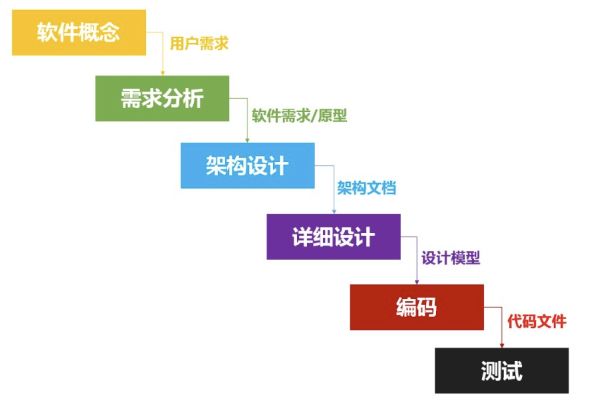
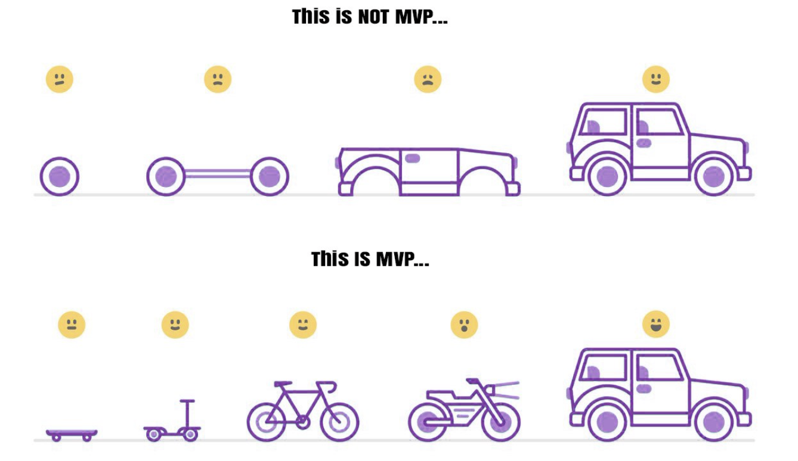

Many software developers overlook foundational concepts in software development. These ideas are important: they form the basis of building software.

## What Is Software Engineering?

In 1968, NATO introduced the term **software crisis**. The concept of **software engineering** emerged that year as a response to the crisis, and software engineering became a field of study.

The field has continued to evolve. Core topics such as software-development models have become more varied and practical.

**What was the software crisis?**

In short, it described how difficult it was to develop high-quality software efficiently.

Dijkstra also discussed the software crisis in his 1972 Turing Award lecture:

> The major cause of the software crisis is that the machines have become several orders of magnitude more powerful! To put it bluntly: as long as there were no machines, programming was no problem at all; when we had a few weak computers, programming became a mild problem, and now we have gigantic computers, programming has become an equally gigantic problem.

**So, what is software engineering?**

Engineering applies theory to practical problems. Software engineering applies engineering principles to software development.

For a more authoritative definition, IEEE Std 610.12-1990, _IEEE Standard Glossary of Software Engineering Terminology_, defines software engineering as:

1. The application of a systematic, disciplined, and quantifiable approach to the development, operation, and maintenance of software; that is, the application of engineering to software.
2. The study of the approaches described in (1).

In short, software engineering aims to **create better, more maintainable software while using fewer resources**.

## Software-Development Process

[Wikipedia's definition of a software-development process](https://zh.wikipedia.org/wiki/%E8%BD%AF%E4%BB%B6%E5%BC%80%E5%8F%91%E8%BF%87%E7%A8%8B) is:

> A software-development process, or software process, is the software development life cycle. Its phases cover requirements definition and analysis, design, implementation, testing, delivery, and maintenance. It is a set of steps to follow when developing and building a system—a roadmap for software development.

The process commonly includes:

- **Requirements analysis**: Analyze user needs and build a logical model.
- **Software design**: Design the software architecture based on the requirements.
- **Coding**: Write the source code that runs the program.
- **Testing**: Define test cases and write test reports.
- **Delivery**: Deliver the completed software to the customer.
- **Maintenance**: Fix bugs and improve the software, for example by adding features.

A software-development process describes possible activities at a high level. A software-development model defines the process in more detail and provides a theoretical basis for carrying it out.

## Software-Development Models

There are many software-development models and methods, including the Waterfall Model, Rapid Prototyping Model, V-Model, W-Model, and agile methods. The best-known approaches are the **Waterfall Model** and **agile development**.

The **Waterfall Model** defines a complete development cycle and presents the software lifecycle from beginning to end.

**Agile development** is not a single model, but a set of values and principles. Common methods include Scrum, Extreme Programming (XP), and Kanban. Agile emphasizes individuals and interactions, working software, customer collaboration, and responding to change. Teams use iterations and frequent delivery to gather feedback.

**Continuous integration**, **refactoring**, **small releases**, **pair programming**, and **test-driven development** are common XP practices. **Daily stand-ups** are common in Scrum. These practices are not mandatory in every agile method. Agile does not mean “no documentation”; it prioritizes working software while retaining documentation that is necessary and useful.

## Basic Software-Development Strategies

### Reuse

When building software, you do not need to start from scratch. Reusing existing tools—frameworks, third-party libraries, design patterns, and principles—can help you build a solution faster.

Open-source projects are a good example. Without open source, building software that meets your needs would take much more time and effort.

### Divide and Conquer

Software development involves many problems. Break complex problems into smaller ones and solve them one by one.

Domain-Driven Design (DDD), a widely used software-design approach, illustrates this idea. A **domain** is the problem to be solved. DDD breaks a large domain into smaller subdomains.

Divide and conquer is also a common algorithmic approach. To learn more, see Peking University's [Design and Analysis of Algorithms](https://www.coursera.org/learn/algorithms).

### Evolve Incrementally

Software development is an iterative process. Build and deliver increments over time until the product meets customer needs.

One important concept is the **Minimum Viable Product (MVP)**: a version of a product that uses minimal effort to gain the greatest amount of validated customer learning. Its goal is to test key assumptions quickly; it does not necessarily meet all customer needs.

An MVP also supports early market analysis. This can help guide decisions while the product and its market are still uncertain.

### Make Trade-Offs

Software development is an ongoing process of improvement. Every system has room to improve and none is perfect. Continue improving its quality, but avoid optimizing endlessly. Make trade-offs and use available resources where they will have the greatest effect.

## References

- [IEEE Std 610.12-1990: IEEE Standard Glossary of Software Engineering Terminology](https://standards.ieee.org/ieee/610.12/855/)
- [Manifesto for Agile Software Development](https://agilemanifesto.org/)
- [Minimum Viable Product: A Guide — Eric Ries](https://www.startuplessonslearned.com/2009/08/minimum-viable-product-guide.html)
- Software Engineering Fundamentals, Liu Qiang, School of Software, Tsinghua University: <https://www.xuetangx.com/course/THU08091000367>
- [Software-Development Process — Wikipedia](https://zh.wikipedia.org/wiki/%E8%BD%AF%E4%BB%B6%E5%BC%80%E5%8F%91%E8%BF%87%E7%A8%8B)

<!-- @include: @article-footer.snippet.md -->
