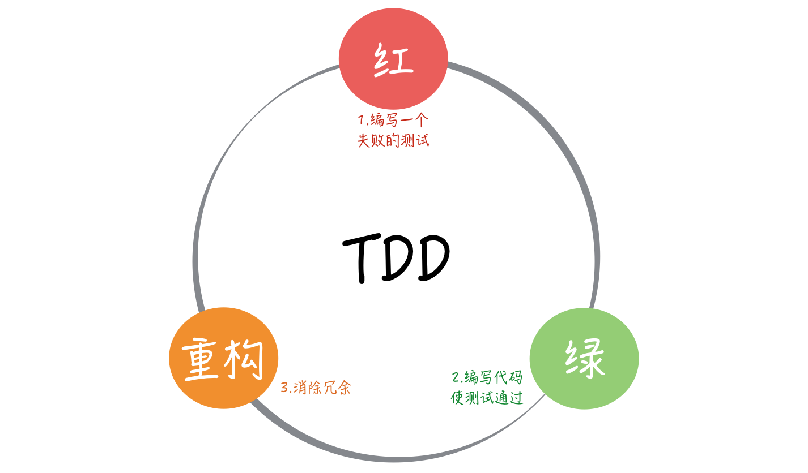

> This article is a revised and expanded version of [Why Write Unit Tests? - Keyboard Man - 2016](https://www.jianshu.com/p/fa41fb80d2b8).

## What Is Unit Testing?

Wikipedia defines unit testing as:

> In computer programming, unit testing is a method of software testing by which individual units of source code are tested to determine whether they are fit for use.
>
> A unit is the smallest testable part of an application. In procedural programming, it may be a program, function, or procedure. In object-oriented programming, it is usually a method, including a method in a base, abstract, or derived class.

Each unit has its own logic. To isolate that logic from external dependencies, unit tests often use fakes, stubs, and mocks.

For an explanation of these terms, see [Fakes, Mocks, and Stubs in Testing - Wang Xia Yueyue Xiong - 2018](https://zhuanlan.zhihu.com/p/26942686).

## Why Write Unit Tests?

### Make Refactoring Safer

In my article on [refactoring](./refactoring.md), I wrote:

> Unit tests give you confidence when refactoring and reduce its cost. Treat tests with the same care as production code.

Every developer refactors code, and refactoring can introduce bugs. A seemingly small change to a method can cause a serious problem elsewhere in the system.

Unit tests can catch some logic errors early and reduce the risk of regressions. Add tests as you write each class. However, passing tests for individual classes does not guarantee that they work correctly together. Integration and end-to-end tests are still needed to catch problems with API contracts, configuration, databases, networks, and transactions.

### Improve Code Quality

Because unit tests isolate a unit's logic from external dependencies, they encourage developers to split systems into components and clarify dependency relationships. This can reduce coupling and make code easier to maintain and extend.

### Reduce Bugs

A machine works only when each of its parts meets its design requirements.

A testable system divides business logic and features into smaller units with independent logic. Unit tests check whether each unit behaves as expected, reducing the chance of local logic errors and regressions. Other levels of testing are still needed to verify that the whole application works correctly.

### Find Bugs Faster

When a bug appears, run the unit tests and inspect the failures to narrow down the code involved. After fixing the code, rerun the relevant tests. Repeat until they pass.

### Support Continuous Integration

Continuous integration depends on fast, reliable automated tests. After a CI service builds new code, it runs unit and integration tests to catch problems. Unit tests are usually among the fastest tests to provide feedback.

## Who Makes You Write Unit Tests?

### Your Manager

Some experienced managers require teams to write unit tests. That is a reasonable expectation for experienced developers. For new graduates who are still learning to write production code, it can feel overwhelming: they may wonder why they have to test code they are still struggling to write.

Teaching new developers to write unit tests is challenging. They may not yet have an established coding style or understand the value of testing, so a strict requirement can leave them unsure how to approach the work.

### Respected Open-Source Projects Do It

Many well-known open-source projects have extensive unit tests, including [Retrofit](https://link.jianshu.com?t=https://github.com/square/retrofit/tree/master/retrofit/src/test/java/retrofit2), [OkHttp](https://link.jianshu.com?t=https://github.com/square/okhttp/tree/master/okhttp-tests/src/test/java/okhttp3), and [Butter Knife](https://link.jianshu.com?t=https://github.com/JakeWharton/butterknife/tree/master/butterknife-compiler/src/test/java/butterknife). If respected developers write unit tests, we should too—or so the reasoning goes.

Many readers start with that enthusiasm. But when they try to test their own projects, they run into difficulties, often because the projects are not designed to be testable. They end up testing only a few minor utility classes, and their initial enthusiasm fades.

### To Save Face

If you have years of experience but still keep getting bug reports from the test team, that can be embarrassing. Spending more time on unit tests can help catch basic bugs and show that you take quality seriously.

### Because You Do Not Trust Your Code

I do not always trust my own code. I worry that an unexpected bug will appear or that someone will accidentally break existing behavior. Before a release, that can make it hard to relax. Writing tests and running them from time to time helps confirm that the existing logic still works—and can help you sleep better.

## Test-Driven Development (TDD)

### What Is TDD?

TDD, or Test-Driven Development, is a core Agile practice and a design method.

The idea is to write test cases before implementing a feature, then write the production code needed to make them pass.

The TDD cycle is **Red – Green – Refactor**.

TDD can be difficult to adopt because it requires a different way of thinking from traditional development and calls for strong development skills.

Some developers consider TDD impractical. They may not understand what it means for tests to “drive” development, but more often they have trouble breaking work into small tasks. Decomposing work is essential to TDD: each task must be small enough to test on its own.

### Pros and Cons of TDD

TDD has both benefits and drawbacks. Tests are derived from requirements, or from smaller requirements created by breaking down a larger one. The implementation must satisfy those tests. If a test fails, change the implementation until it passes.

**Benefits:**

1. Helps clarify requirements and organize your thinking.
2. Encourages better API design. Designing everything in your head can lead to poor interfaces.
3. Reduces the likelihood of bugs.
4. Can improve development efficiency when used correctly and skillfully.

**Drawbacks:**

1. Few developers use TDD well. It looks simple, but has a steep learning curve.
2. It often requires more development time and effort.
3. Writing tests before designing the code can constrain the overall design.
4. It can frustrate developers who do not want to write unit tests, even though testing has many benefits.

Further reading: [How to Practice TDD Effectively? - Chen Tian - 2017](https://zhuanlan.zhihu.com/p/24997923).

## Choosing a Test Framework and Mocking Tool

JUnit and Spock are test frameworks. Mockito, PowerMock, JMockit, and TestableMock are mainly used to create mocks and other test doubles.

JUnit is a common default, but it does not provide mocking. It is usually paired with a tool such as Mockito. Spock provides both a testing framework and mocking capabilities.

Which should you choose: JUnit with Mockito, or Spock? Here is a brief comparison:

- Spock 2.4 can mock static Java and Groovy methods with `SpyStatic()` and a compatible MockMaker. Mockito has supported static mocking since version 3.4.0. See the [Spock 2.4 release notes](https://spockframework.org/spock/docs/2.4/release_notes.html) and the [Mockito documentation](https://javadoc.io/doc/org.mockito/mockito-core/latest/org.mockito/org/mockito/Mockito.html).
- Spock is based on Groovy. Its tests are often concise and easy to read, and it uses the familiar given-when-then structure. Mockito does not prescribe a test structure, so teams need to agree on conventions or follow established testing practices. For the same test case, Spock code is often shorter.
- Mockito has a larger user base and is stable and reliable. It is also the mocking tool integrated by default in Spring Boot Test.

Both JUnit with Mockito and Spock are good choices. JUnit with Mockito is generally more widely applicable.

## Summary

Unit tests have many benefits, but you may not see them immediately. They are like critical illness insurance: you keep paying for it and may go years without needing it. Ideally, you never need to make a claim. Unit tests offer similar peace of mind by helping catch bugs early. It would be misleading to say that tests are a waste of time just because they do not find a bug every time.

Here are a few suggestions:

> - Write unit tests for important code.
> - If code is hard to test, think about how to improve it instead of giving up on testing.
> - Write tests alongside business code, rather than waiting until an entire feature is complete.
> - Look for ways to improve and simplify test code.
> - Refactor or update tests as production code evolves. Untidy tests become increasingly difficult to change.

For experienced developers, writing unit tests is ultimately about **taking responsibility for your code**. Tests also help others understand it and make changes with confidence.

**Practice by writing code and talk with engineers who have experience with unit testing.** You will see more of its benefits over time.

<!-- @include: @article-footer.snippet.md -->
