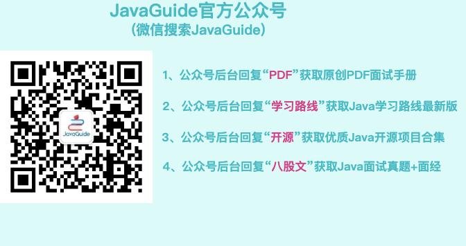
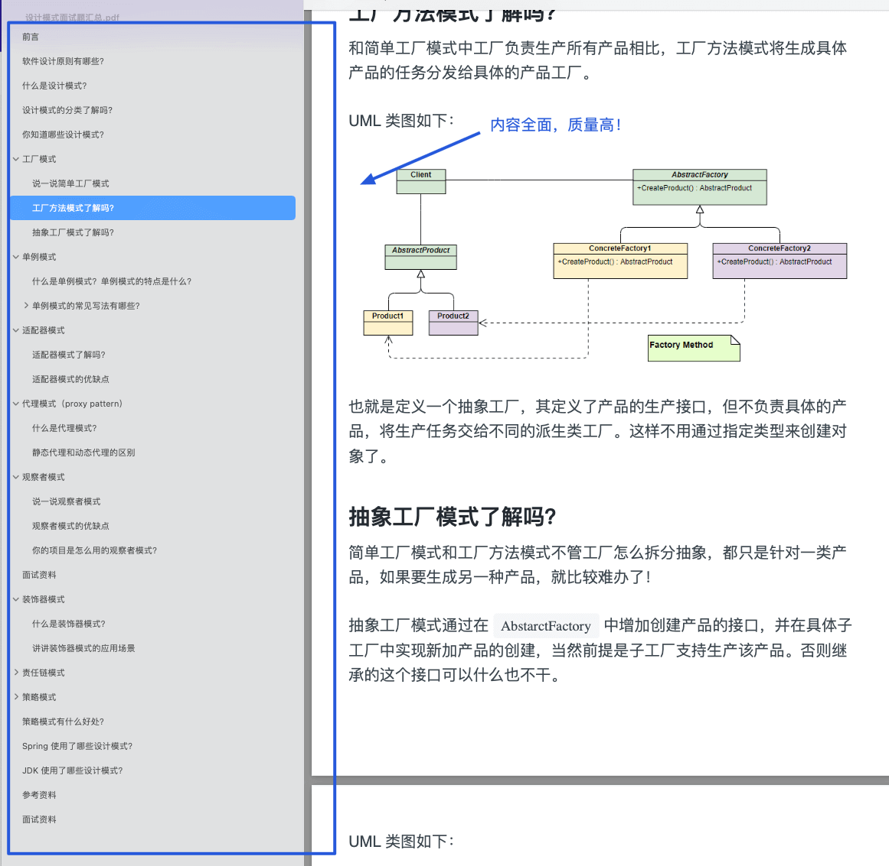

Questions about **design patterns** are included in a PDF handbook. To get it, reply **PDF** to the **JavaGuide** account on WeChat.

**Contents of the _Design Patterns_ PDF handbook:**

<!-- @include: @article-footer.snippet.md -->
