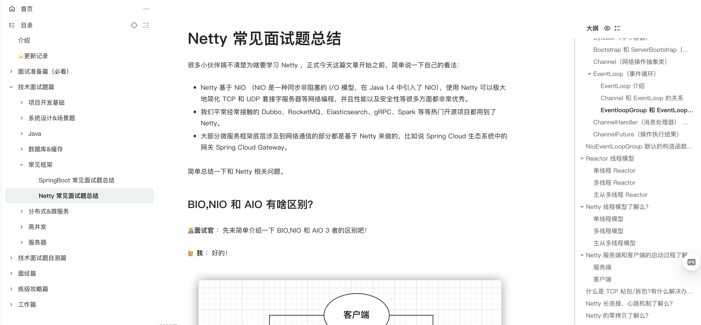

**Netty** interview questions are exclusive to my [Knowledge Planet](https://javaguide.cn/about-the-author/zhishixingqiu-two-years.html) community (follow the link for details and instructions on joining) and are included in [_Java Interview Handbook_](https://javaguide.cn/zhuanlan/java-mian-shi-zhi-bei.html).

<!-- @include: @planet.snippet.md -->
