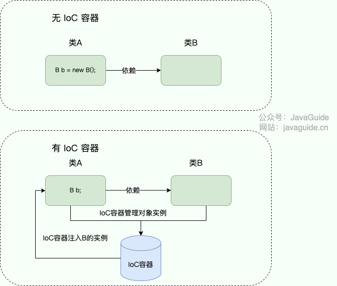
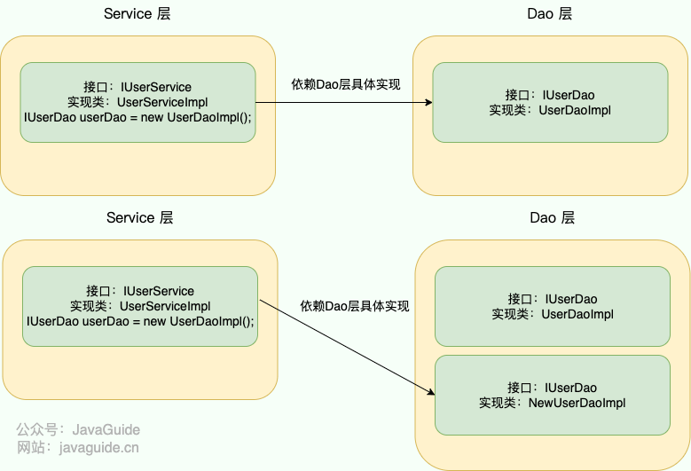
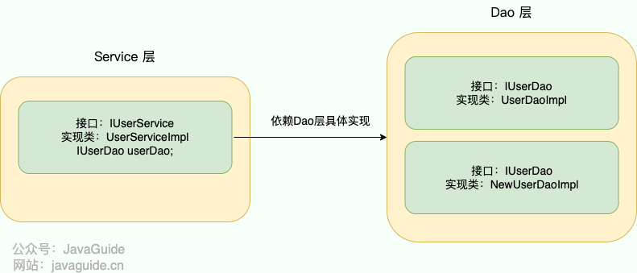
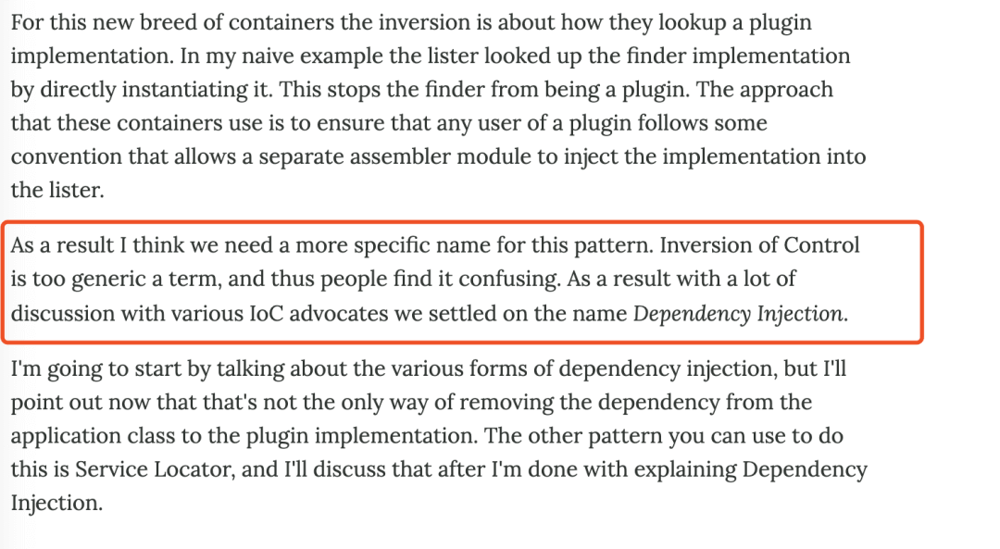
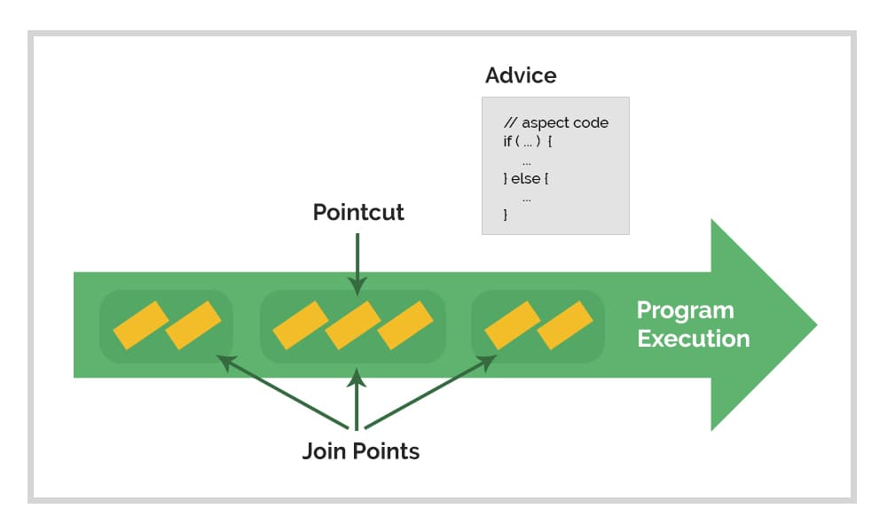
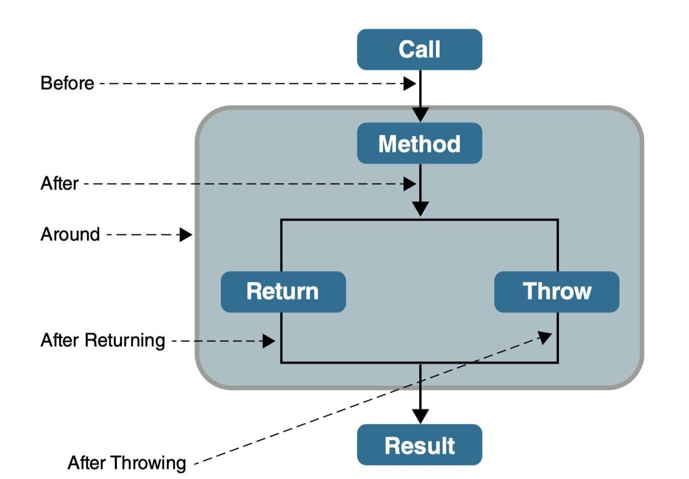
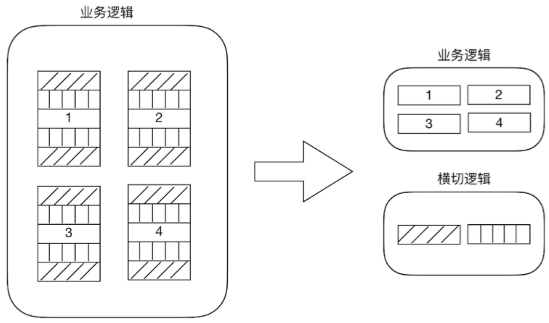
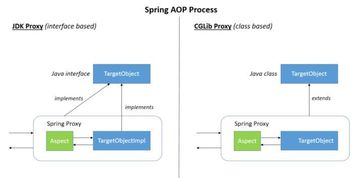

This article explains IoC and AOP through the following questions:

- What is IoC?
- What problem does IoC solve?
- What is the difference between IoC and DI?
- What is AOP?
- What problem does AOP solve?
- What are common uses of AOP?
- Why is it called aspect-oriented programming?
- How can AOP be implemented?

First, IoC and AOP were not introduced by Spring. Both ideas existed before Spring, though they were more theoretical. Spring provides practical implementations of them.

## IoC (Inversion of Control)

### What Is IoC?

IoC (Inversion of Control) is a design principle, not a specific implementation technology. In Java development, it describes how objects are created and managed.

For example, suppose class A depends on class B:

- **Traditional development:** Class A creates an instance of B itself using the `new` keyword.
- **Using IoC:** Objects are not created with `new` by the dependent class. An IoC container, such as the Spring container, creates and manages them. When we need an object, we retrieve it from the container.

Comparing the two approaches, we give up the ability to create and manage objects ourselves. In return, we no longer need to handle object creation and management directly.

**Why is it called inversion of control?**

- **Control** means the responsibility for creating and managing objects.
- **Inversion** means handing that responsibility to an external environment, such as an IoC container.



### What Problems Does IoC Solve?

The idea behind IoC is that two components do not depend on each other's concrete implementation. A third-party container manages their resources. This has several benefits:

1. It reduces coupling between objects and their dependencies.
2. It makes resource management easier. For example, the Spring container makes it straightforward to use a singleton.

For example, suppose a user-related operation uses a `Service` and `DAO` layer.

Without IoC, the service layer creates the concrete DAO implementation, `UserDaoImpl`, with `new` inside `UserServiceImpl`. It cannot instantiate the `IUserDao` interface directly.

This works, but imagine receiving a new requirement to create another implementation of `IUserDao`. Since the service layer depends on a specific implementation, we would need to change the object created with `new` in `UserServiceImpl`. That may be manageable if only one class uses it, but becomes difficult if many classes depend on that implementation.



With IoC, the container controls object creation and management. When we need an object, we ask the container for it.



### Are IoC and DI Different?

IoC (Inversion of Control) is a design principle or pattern. It means **handing control of object creation from the program to a third party, such as an IoC container.** In the Spring framework, the IoC container is essentially a map of key–value pairs that stores objects. IoC is also used in other languages and is not specific to Spring.

The most common and generally accepted way to implement IoC is **Dependency Injection (DI)**.

Martin Fowler suggested renaming IoC to DI in an article. Here is an excerpt; see the [original article](https://martinfowler.com/articles/injection.html):



Fowler's point was that IoC is too broad and does not describe the pattern clearly, which can confuse people. DI is a more precise name for this pattern.

## AOP (Aspect-Oriented Programming)

This section focuses on explaining the idea behind AOP without too much specialized terminology.

### What Is AOP?

AOP (Aspect-Oriented Programming) is a continuation of OOP (Object-Oriented Programming). The two approaches complement each other rather than conflict.

AOP separates cross-cutting concerns—such as logging, transaction management, access control, rate limiting, and API idempotency—from core business logic. It uses techniques such as dynamic proxies and bytecode manipulation to promote reuse and reduce coupling, improving maintainability and extensibility. OOP encapsulates business logic in objects using properties and behaviors. Classes, objects, inheritance, and polymorphism support modular and hierarchical code, reuse, readability, and maintainability.

### Why Is AOP Called Aspect-Oriented Programming?

AOP is named for its central idea: separating cross-cutting concerns from core business logic and encapsulating them as **aspects**.



Here are some key AOP terms. Do not worry if they are unclear; you can continue reading.

- **Cross-cutting concerns:** Behavior shared across multiple classes or objects, such as logging, transaction management, access control, rate limiting, and API idempotency.
- **Aspect:** A class that encapsulates a cross-cutting concern. An aspect can define multiple pieces of advice that implement specific behavior.
- **Join point:** A specific point during a method call or execution, such as a method invocation or an exception being thrown.
- **Advice:** An operation performed by an aspect at a join point. The five types are Before, After, AfterReturning, AfterThrowing, and Around. The first four run before or after the target method; Around advice can control the target method's execution.
- **Pointcut:** An expression that matches the join points to which an aspect should apply. It can be defined using annotations, regular expressions, or logical operators. For example, `execution(* com.xyz.service..*(..))` matches classes or interfaces in `com.xyz.service` and its subpackages.
- **Weaving:** The process of connecting an aspect to a target object by applying advice to matching join points. Weaving may happen at compile time (for example, with AspectJ) or at runtime (for example, with AspectJ or Spring AOP).

### What Are the Common Types of AOP Advice?



- **Before:** Runs before the target method is called.
- **After:** Runs after the target method is called.
- **AfterReturning:** Runs after the target method completes and returns a value.
- **AfterThrowing:** Runs if the target method throws an exception. AfterReturning and AfterThrowing are mutually exclusive. A successful call returns a value; a call that throws an exception does not.
- **Around:** Programmatically controls the target method call. It offers the most control because it can access the target object and the method to be executed. Around advice can perform operations before or after the call, or even choose not to invoke the target method.

### What Problems Does AOP Solve?

OOP does not handle shared behavior across multiple classes or objects particularly well. Examples include logging, transaction management, access control, rate limiting, and API idempotency. These are **cross-cutting concerns**. Reimplementing them in every class leads to duplication, complexity, and maintenance problems.

AOP separates cross-cutting concerns such as logging, transaction management, access control, rate limiting, and API idempotency from **core business logic (core concerns)**. This separates the concerns in the codebase.



Consider logging. If we need consistent logging for several methods, without AOP we would have to write the same logging logic in each method:

```java
public CommonResponse<Object> method1() {
      // Business logic
      xxService.method1();
      // Omit the specific business logic
      // Logging
      ServletRequestAttributes attributes = (ServletRequestAttributes) RequestContextHolder.getRequestAttributes();
      HttpServletRequest request = attributes.getRequest();
      // Omit the logging details, such as retrieving information and writing it to a database
      return CommonResponse.success();
}

public CommonResponse<Object> method2() {
      // Business logic
      xxService.method2();
      // Omit the specific business logic
      // Logging
      ServletRequestAttributes attributes = (ServletRequestAttributes) RequestContextHolder.getRequestAttributes();
      HttpServletRequest request = attributes.getRequest();
      // Omit the logging details, such as retrieving information and writing it to a database
      return CommonResponse.success();
}

// ...
```

With AOP, we can encapsulate logging in an aspect, then use a pointcut and advice to specify which methods should be logged.

```java

// Logging annotation
@Target({ElementType.PARAMETER,ElementType.METHOD})
@Retention(RetentionPolicy.RUNTIME)
@Documented
public @interface Log {

    /**
     * Description
     */
    String description() default "";

    /**
     * Method type: INSERT, DELETE, UPDATE, OTHER
     */
    MethodType methodType() default MethodType.OTHER;
}

// Logging aspect
@Component
@Aspect
public class LogAspect {
  // Pointcut: all methods annotated with Log
  @Pointcut("@annotation(cn.javaguide.annotation.Log)")
  public void webLog() {
  }

   /**
   * Around advice
   */
  @Around("webLog()")
  public Object doAround(ProceedingJoinPoint joinPoint) throws Throwable {
    // Omit the specific processing logic
  }

  // Omit the remaining code
}
```

Now a single annotation is enough to enable logging:

```java
@Log(description = "method1",methodType = MethodType.INSERT)
public CommonResponse<Object> method1() {
      // Business logic
      xxService.method1();
      // Omit the specific business logic
      return CommonResponse.success();
}
```

### What Are Common Uses of AOP?

- **Logging:** Define a custom logging annotation and use AOP to add logging with one line of code.
- **Performance measurement:** Use AOP before and after a target method to measure its execution time for analysis and optimization.
- **Transaction management:** The `@Transactional` annotation lets Spring manage transactions, such as rolling back failed operations, without repeating transaction logic. `@Transactional` is implemented using AOP.
- **Access control:** Use AOP before a method call to check whether the user has the required permission. If so, run the method; otherwise, reject the call. For example, Spring Security's `@PreAuthorize` annotation supports custom permission checks in one line.
- **Rate limiting:** Use a rate-limiting algorithm before invoking the target method to control request volume.
- **Caching:** Read and update a cache before or after invoking the target method.
- …

### How Can AOP Be Implemented?

Common AOP implementation techniques include dynamic proxies and bytecode manipulation.

Spring AOP uses dynamic proxies. If the target object implements an interface, Spring AOP uses **JDK Proxy** to create the proxy. If the target class does not implement an interface, JDK Proxy cannot proxy it, so Spring AOP uses CGLIB to create a subclass of the target class, as shown below:



**Do Spring Boot and Spring use the same dynamic proxy strategy?** Not exactly. This is often misunderstood.

Before Spring Boot 2.0, `spring.aop.proxy-target-class` defaulted to `false`. Spring generally used **JDK dynamic proxies** when the target had an interface. If no usable interface was available, Spring AOP still fell back to **CGLIB dynamic proxies**; it did not throw an exception simply because the target class lacked an interface. The following is the Spring Boot 1.5.x AOP auto-configuration:

```java
@Configuration
@ConditionalOnClass({ EnableAspectJAutoProxy.class, Aspect.class, Advice.class })
@ConditionalOnProperty(prefix = "spring.aop", name = "auto", havingValue = "true", matchIfMissing = true)
public class AopAutoConfiguration {

	@Configuration
	@EnableAspectJAutoProxy(proxyTargetClass = false)
 // This configuration is active when spring.aop.proxy-target-class=false or is not set.
 // In other words, Spring uses JDK dynamic proxies unless the developer selects a strategy explicitly.
	@ConditionalOnProperty(prefix = "spring.aop", name = "proxy-target-class", havingValue = "false", matchIfMissing = true)
	public static class JdkDynamicAutoProxyConfiguration {

	}

	@Configuration
	@EnableAspectJAutoProxy(proxyTargetClass = true)
 // This configuration is active when spring.aop.proxy-target-class=true.
 // The developer has explicitly selected CGLIB dynamic proxies in the configuration.
	@ConditionalOnProperty(prefix = "spring.aop", name = "proxy-target-class", havingValue = "true", matchIfMissing = false)
	public static class CglibAutoProxyConfiguration {

	}

}
```

Starting with Spring Boot 2.0, **CGLIB dynamic proxies** are used by default if no setting is provided. To force JDK dynamic proxies, add `spring.aop.proxy-target-class=false` to the configuration. Here is the Spring Boot 2.0 AOP auto-configuration:

```java
@Configuration
@ConditionalOnClass({ EnableAspectJAutoProxy.class, Aspect.class, Advice.class,
		AnnotatedElement.class })
@ConditionalOnProperty(prefix = "spring.aop", name = "auto", havingValue = "true", matchIfMissing = true)
public class AopAutoConfiguration {

	@Configuration
	@EnableAspectJAutoProxy(proxyTargetClass = false)
 // This configuration is active only when spring.aop.proxy-target-class=false.
 // The developer has explicitly selected JDK dynamic proxies in the configuration.
	@ConditionalOnProperty(prefix = "spring.aop", name = "proxy-target-class", havingValue = "false", matchIfMissing = false)
	public static class JdkDynamicAutoProxyConfiguration {

	}

	@Configuration
	@EnableAspectJAutoProxy(proxyTargetClass = true)
 // This configuration is active when spring.aop.proxy-target-class=true or is not set.
 // In other words, Spring uses CGLIB proxies unless the developer selects a strategy explicitly.
	@ConditionalOnProperty(prefix = "spring.aop", name = "proxy-target-class", havingValue = "true", matchIfMissing = true)
	public static class CglibAutoProxyConfiguration {

	}

}
```

You can also use **AspectJ**. Spring AOP integrates with AspectJ, one of the most complete AOP frameworks in the Java ecosystem.

**Spring AOP applies advice at runtime, while AspectJ supports compile-time, post-compile, and load-time weaving.** Spring AOP is based on proxying; AspectJ is based on bytecode manipulation.

Spring AOP integrates with AspectJ, one of the most complete AOP frameworks in the Java ecosystem. AspectJ is more powerful, while Spring AOP is simpler.

When there are only a few aspects, the performance difference between them is small. If there are many aspects, AspectJ may be a better choice because it can be much faster than Spring AOP.

## References

- [AOP in Spring Boot: JDK Dynamic Proxy or CGLIB Dynamic Proxy?](https://www.springcloud.io/post/2022-01/springboot-aop/)
- [Spring Proxying Mechanisms](https://docs.spring.io/spring-framework/reference/core/aop/proxying.html)
