> Authors: [Miki-byte-1024](https://github.com/Miki-byte-1024) and [Snailclimb](https://github.com/Snailclimb)

Interviewers often ask about Spring Boot: “Can you explain how Spring Boot auto-configuration works?”

I would answer by covering these questions:

1. What is Spring Boot auto-configuration?
2. How does Spring Boot implement auto-configuration and load configurations only when needed?
3. How do you create a starter?

To keep the article concise, it does not cover every detail. You can also use a debugger to inspect Spring Boot's auto-configuration source code directly.

## Introduction

Anyone who has used Spring may remember feeling overwhelmed by XML configuration. Even after Spring introduced annotation-based configuration, enabling some Spring features or adding a third-party dependency still required explicit XML or Java configuration.

For example, before Spring Boot, a RESTful Web service required configuration like this:

```java
@Configuration
public class RESTConfiguration {
    @Bean
    public View jsonTemplate() {
        MappingJackson2JsonView view = new MappingJackson2JsonView();
        view.setPrettyPrint(true);
        return view;
    }

    @Bean
    public ViewResolver viewResolver() {
        return new BeanNameViewResolver();
    }
}
```

`spring-servlet.xml`:

```xml
<beans xmlns="http://www.springframework.org/schema/beans"
    xmlns:xsi="http://www.w3.org/2001/XMLSchema-instance"
    xmlns:context="http://www.springframework.org/schema/context"
    xmlns:mvc="http://www.springframework.org/schema/mvc"
    xsi:schemaLocation="http://www.springframework.org/schema/beans http://www.springframework.org/schema/beans/spring-beans.xsd
    http://www.springframework.org/schema/context/ http://www.springframework.org/schema/context/spring-context.xsd
    http://www.springframework.org/schema/mvc/ http://www.springframework.org/schema/mvc/spring-mvc.xsd">

    <context:component-scan base-package="com.howtodoinjava.demo" />
    <mvc:annotation-driven />

    <!-- JSON support -->
    <bean name="viewResolver" class="org.springframework.web.servlet.view.BeanNameViewResolver" />
    <bean name="jsonTemplate" class="org.springframework.web.servlet.view.json.MappingJackson2JsonView" />
</beans>
```

In a Spring Boot project, you can add the relevant dependencies and start the application without writing this configuration:

```java
@SpringBootApplication
public class DemoApplication {
    public static void main(String[] args) {
        SpringApplication.run(DemoApplication.class, args);
    }
}
```

You can also configure the project through Spring Boot's global configuration file, `application.properties` or `application.yml`, for example to change the port or configure JPA properties.

**Why is Spring Boot so convenient to use?** Auto-configuration is a major reason. **It is one of Spring Boot's core features. What exactly is auto-configuration?**

## What Is Spring Boot Auto-Configuration?

Auto-configuration is often associated with Spring Boot, but the Spring Framework had similar capabilities earlier. Spring Boot builds on them and further improves the process through SPI mechanisms.

> In Spring Boot 2.6 and earlier, auto-configuration classes were mainly registered through `META-INF/spring.factories` in external JARs. Spring Boot 2.7 introduced `META-INF/spring/org.springframework.boot.autoconfigure.AutoConfiguration.imports` and supported both registration mechanisms. Spring Boot 3.0 removed support for registering auto-configuration classes under the `EnableAutoConfiguration` key in `spring.factories`, but other uses of `spring.factories` are unaffected.

Without Spring Boot, adding a third-party dependency often requires manual configuration. With Spring Boot, you can add a starter. For example, to use Redis, add the corresponding starter to the project:

```xml
<dependency>
    <groupId>org.springframework.boot</groupId>
    <artifactId>spring-boot-starter-data-redis</artifactId>
</dependency>
```

After adding the starter, a small amount of configuration and a few annotations are usually enough to use the third-party component.

In simple terms, auto-configuration means **using annotations or a small amount of configuration to enable a feature with Spring Boot's help**.

## How Does Spring Boot Implement Auto-Configuration?

First, consider Spring Boot's core `@SpringBootApplication` annotation:

```java
@Target(ElementType.TYPE)
@Retention(RetentionPolicy.RUNTIME)
@Documented
@Inherited
@SpringBootConfiguration // 1
@ComponentScan          // 2
@EnableAutoConfiguration // 3
public @interface SpringBootApplication {
}

@Target(ElementType.TYPE)
@Retention(RetentionPolicy.RUNTIME)
@Documented
@Configuration // This is also a configuration class.
public @interface SpringBootConfiguration {
}
```

You can think of `@SpringBootApplication` as a combination of `@Configuration`, `@EnableAutoConfiguration`, and `@ComponentScan`. According to the Spring Boot documentation, they have these roles:

- `@EnableAutoConfiguration`: Enables Spring Boot's auto-configuration mechanism.
- `@Configuration`: Allows additional beans to be registered in the context or other configuration classes to be imported.
- `@ComponentScan`: Scans for beans annotated with `@Component`, `@Service`, or `@Controller`. By default, it scans the package containing the application class and its subpackages. You can customize the scan to exclude beans. As shown below, the container excludes `TypeExcludeFilter` and `AutoConfigurationExcludeFilter`.

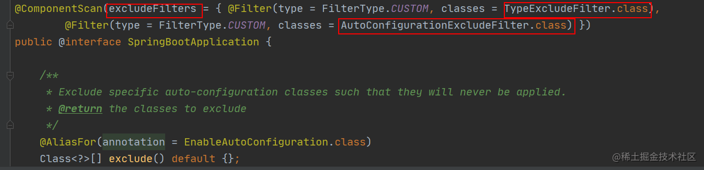

`@EnableAutoConfiguration` is central to auto-configuration, so let's start there.

### `@EnableAutoConfiguration`: The Core Auto-Configuration Annotation

`@EnableAutoConfiguration` is a simple annotation. The core functionality is implemented by `AutoConfigurationImportSelector`.

```java
@Target(ElementType.TYPE)
@Retention(RetentionPolicy.RUNTIME)
@Documented
@Inherited
@AutoConfigurationPackage // Registers components from the main package in the container.
@Import(AutoConfigurationImportSelector.class) // Loads auto-configuration classes.
public @interface EnableAutoConfiguration {
    String ENABLED_OVERRIDE_PROPERTY = "spring.boot.enableautoconfiguration";

    Class<?>[] exclude() default {};

    String[] excludeName() default {};
}
```

What does `AutoConfigurationImportSelector` do?

### `AutoConfigurationImportSelector`: Loading Auto-Configuration Classes

The following excerpt from Spring Boot 2.1.x illustrates `AutoConfigurationImportSelector`. Some implementation details are omitted, so this is not a complete class that can be compiled independently. In Spring Boot 2.7 and later, candidate auto-configuration classes are primarily read from `AutoConfiguration.imports`, so the source code differs from the older versions shown below.

The class hierarchy of `AutoConfigurationImportSelector` is:

```java
public class AutoConfigurationImportSelector implements
        DeferredImportSelector,
        BeanClassLoaderAware,
        ResourceLoaderAware,
        BeanFactoryAware,
        EnvironmentAware,
        Ordered {
}

public interface DeferredImportSelector extends ImportSelector {
}

public interface ImportSelector {
    String[] selectImports(AnnotationMetadata metadata);
}
```

`AutoConfigurationImportSelector` implements `ImportSelector` and its `selectImports()` method. This method **gets the fully qualified class names of configurations that meet the conditions and should be loaded into the IoC container**.

```java
private static final String[] NO_IMPORTS = new String[0];

public String[] selectImports(AnnotationMetadata annotationMetadata) {
    // 1. Check whether auto-configuration is enabled.
    if (!this.isEnabled(annotationMetadata)) {
        return NO_IMPORTS;
    }

    // 2. Find the candidate configurations.
    AutoConfigurationMetadata autoConfigurationMetadata =
            AutoConfigurationMetadataLoader.loadMetadata(this.beanClassLoader);
    AutoConfigurationImportSelector.AutoConfigurationEntry autoConfigurationEntry =
            this.getAutoConfigurationEntry(autoConfigurationMetadata, annotationMetadata);
    return StringUtils.toStringArray(autoConfigurationEntry.getConfigurations());
}
```

The key method here is `getAutoConfigurationEntry()`, which loads the auto-configuration classes.

Its call flow is shown below:

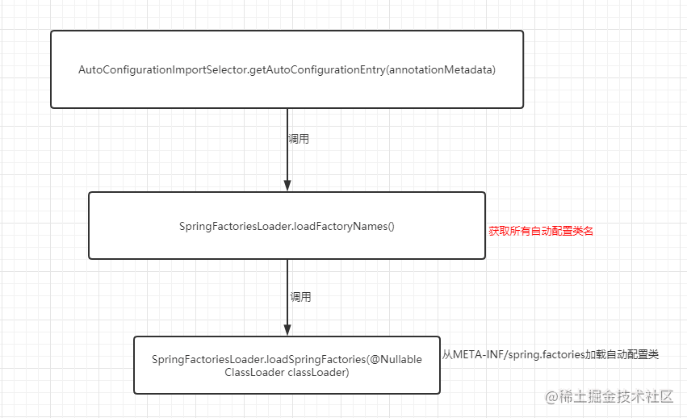

Now let's examine the `getAutoConfigurationEntry()` source:

```java
private static final AutoConfigurationEntry EMPTY_ENTRY = new AutoConfigurationEntry();

AutoConfigurationEntry getAutoConfigurationEntry(
        AutoConfigurationMetadata autoConfigurationMetadata,
        AnnotationMetadata annotationMetadata) {
    // 1. Check whether auto-configuration is enabled.
    if (!this.isEnabled(annotationMetadata)) {
        return EMPTY_ENTRY;
    }

    // 2. Read the annotation attributes.
    AnnotationAttributes attributes = this.getAttributes(annotationMetadata);

    // 3. Find the candidate configuration classes.
    List<String> configurations =
            this.getCandidateConfigurations(annotationMetadata, attributes);

    // 4. Remove duplicates, exclusions, and configurations that do not match.
    configurations = this.removeDuplicates(configurations);
    Set<String> exclusions = this.getExclusions(annotationMetadata, attributes);
    this.checkExcludedClasses(configurations, exclusions);
    configurations.removeAll(exclusions);
    configurations = this.filter(configurations, autoConfigurationMetadata);
    this.fireAutoConfigurationImportEvents(configurations, exclusions);
    return new AutoConfigurationImportSelector.AutoConfigurationEntry(configurations, exclusions);
}
```

**Step 1:**

Check whether auto-configuration is enabled. By default, `spring.boot.enableautoconfiguration=true`. It can be set in `application.properties` or `application.yml`.

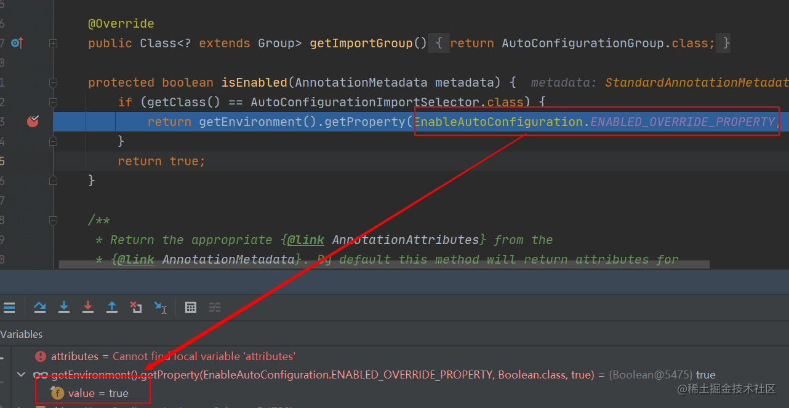

**Step 2:**

Read the `exclude` and `excludeName` attributes from `@EnableAutoConfiguration`.

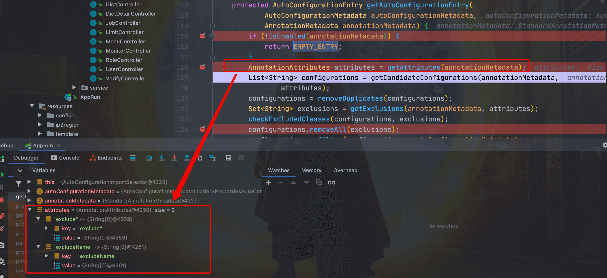

**Step 3:**

In the Spring Boot 2.1.x source shown here, the candidate auto-configuration classes are loaded from `META-INF/spring.factories`:

```text
spring-boot/spring-boot-project/spring-boot-autoconfigure/src/main/resources/META-INF/spring.factories
```

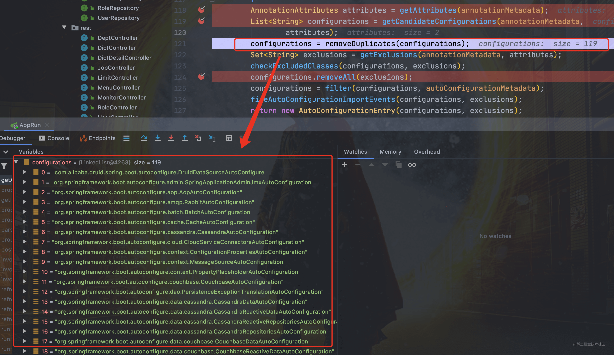

The entries in this file are read. Each `XXXAutoConfiguration` class configures a component when its conditions are met.

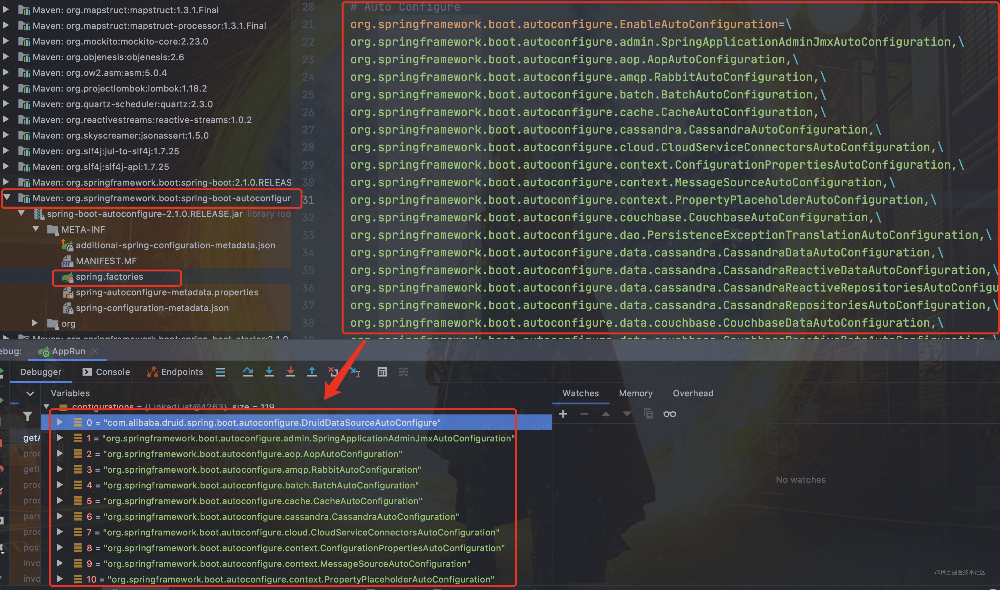

`SpringFactoriesLoader` reads and combines same-named `META-INF/spring.factories` resources from other JARs on the classpath, not just from this dependency. Note that a starter is usually a JAR that aggregates dependencies. Auto-configuration code and its registration file may be in a separate auto-configuration module or combined with the starter; not every starter must contain `spring.factories`.

For example, the Spring Boot starter for the Druid connection pool contains a `META-INF/spring.factories` file.

For Spring Boot 2.6 and earlier, use this registration mechanism. For Spring Boot 3.x, register auto-configuration through `AutoConfiguration.imports`.

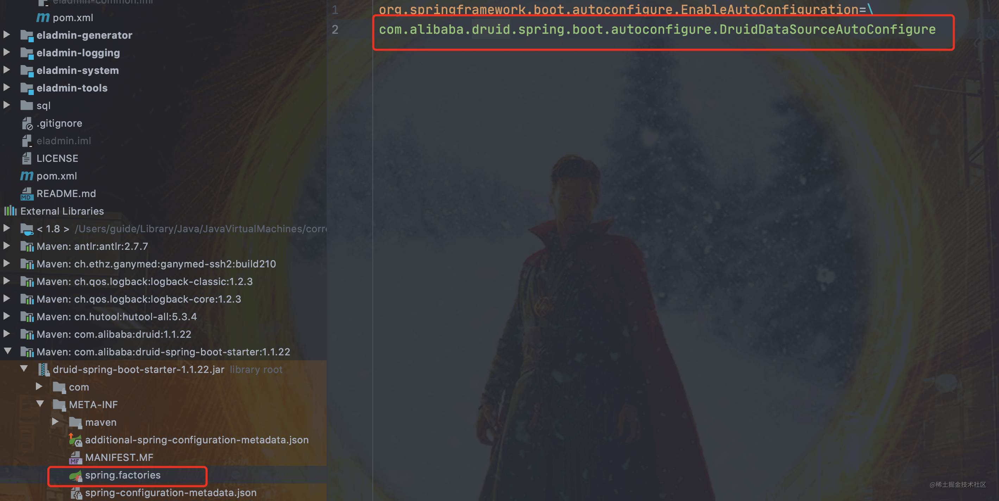

**Step 4:**

An interviewer may ask: “There are so many entries in `spring.factories`. Are they all loaded every time the application starts?”

Clearly, that would not be practical. If you debug the process, you will see the `configurations` list become smaller.

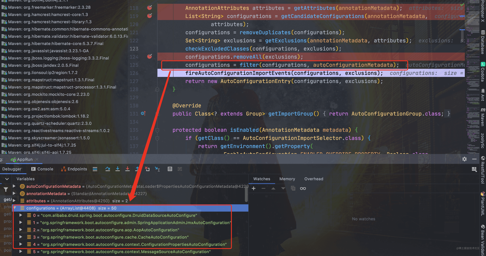

The list is filtered. A class is enabled only if all of its `@ConditionalOn...` conditions are satisfied.

```java
@Configuration
// Check whether RabbitTemplate and Channel are available.
// Load this configuration only if both classes are present.
@ConditionalOnClass({ RabbitTemplate.class, Channel.class })
@EnableConfigurationProperties(RabbitProperties.class)
@Import(RabbitAnnotationDrivenConfiguration.class)
public class RabbitAutoConfiguration {
}
```

Spring Boot provides several conditional annotations:

- `@ConditionalOnBean`: Matches when the specified bean is present in the container.
- `@ConditionalOnMissingBean`: Matches when the specified bean is absent from the container.
- `@ConditionalOnSingleCandidate`: Matches when there is one bean of the specified type, or when one of multiple beans is marked as the primary candidate.
- `@ConditionalOnClass`: Matches when the specified class is on the classpath.
- `@ConditionalOnMissingClass`: Matches when the specified class is not on the classpath.
- `@ConditionalOnProperty`: Matches based on whether a property has a specified value.
- `@ConditionalOnResource`: Matches when a specified resource is available.
- `@ConditionalOnExpression`: Matches based on a SpEL expression.
- `@ConditionalOnJava`: Matches based on the Java version.
- `@ConditionalOnJndi`: Matches when a specified JNDI location is available.
- `@ConditionalOnNotWebApplication`: Matches when the current application is not a Web application.
- `@ConditionalOnWebApplication`: Matches when the current application is a Web application.

## How to Create a Starter

Let's put the ideas into practice by creating a custom thread-pool starter.

First, create a `threadpool-spring-boot-starter` project.

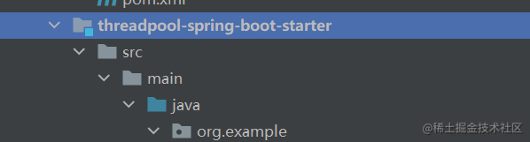

Second, add the Spring Boot dependencies.

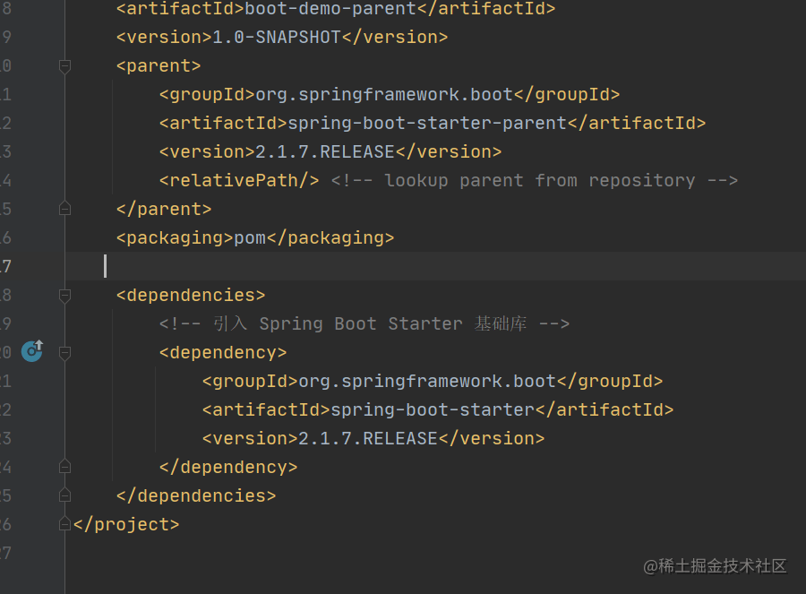

Third, create `ThreadPoolAutoConfiguration`.

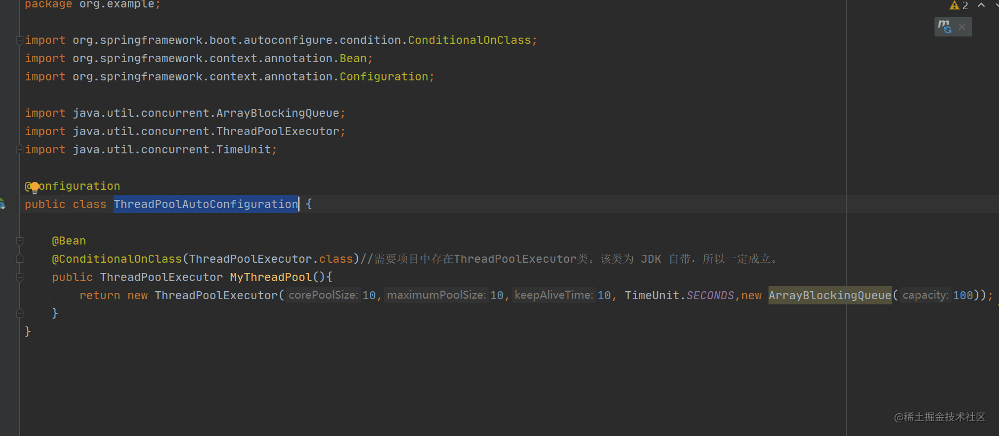

Fourth, register the auto-configuration class. For Spring Boot 2.6 and earlier, create `META-INF/spring.factories` under the `resources` directory of the `threadpool-spring-boot-starter` project. For Spring Boot 2.7 and later, use `META-INF/spring/org.springframework.boot.autoconfigure.AutoConfiguration.imports`. For Spring Boot 3.x, auto-configuration classes are usually annotated with `@AutoConfiguration`.

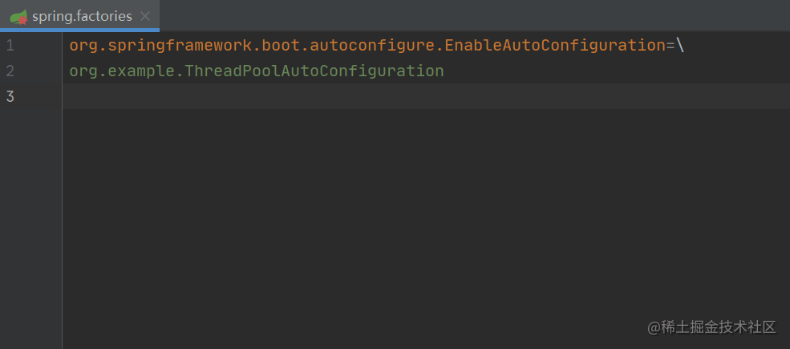

Finally, create another project and add the `threadpool-spring-boot-starter` dependency.

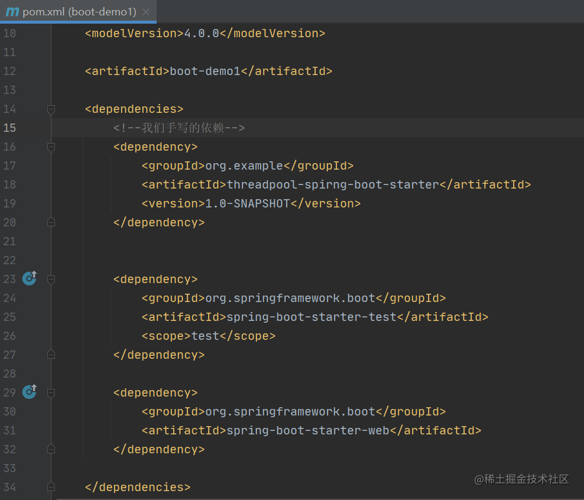

The test passes!

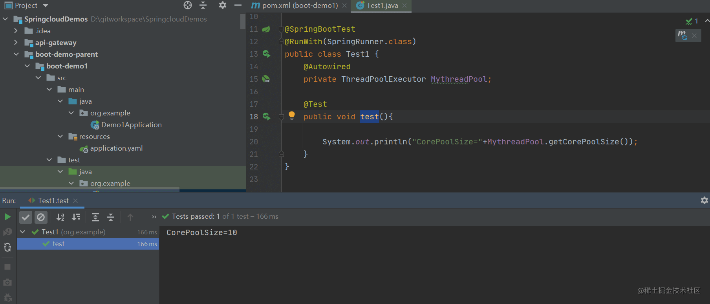

## Summary

Spring Boot enables auto-configuration through `@EnableAutoConfiguration` and loads candidate auto-configuration classes registered on the classpath. Spring Boot 2.6 and earlier mainly used `spring.factories`; Spring Boot 2.7 and later use `AutoConfiguration.imports`. Auto-configuration classes take effect as needed through the `@Conditional` annotations. A starter mainly aggregates commonly used dependencies; it does not require a specific package name for auto-configuration to work.

<!-- @include: @article-footer.snippet.md -->
