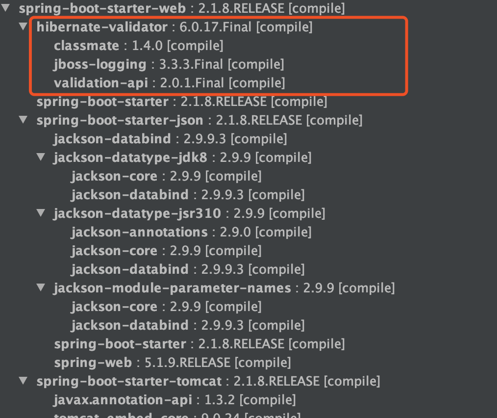

This guide covers many of the Spring and Spring Boot annotations commonly used in day-to-day development, with examples for each. These fundamentals will help you build applications with Spring Boot.

**Why was this guide written?**

I recently saw a widely shared article about common Spring Boot annotations that contained misleading information, especially for developers with limited hands-on experience. I put this guide together to help readers understand and use Spring annotations more accurately.

**If you find an error or omission, please let me know. Thank you!**

## Spring Boot Core Annotation

`@SpringBootApplication` is the core annotation for a Spring Boot application and is usually placed on the main application class.

Example:

```java
@SpringBootApplication
public class SpringSecurityJwtGuideApplication {
      public static void main(java.lang.String[] args) {
        SpringApplication.run(SpringSecurityJwtGuideApplication.class, args);
    }
}
```

`@SpringBootApplication` can be thought of as a combination of these annotations:

- **`@EnableAutoConfiguration`:** Enables Spring Boot's auto-configuration mechanism.
- **`@ComponentScan`:** Scans for classes annotated with `@Component`, `@Service`, `@Repository`, `@Controller`, and related annotations.
- **`@Configuration`:** Allows additional Spring beans to be registered or other configuration classes to be imported.

The source code is shown below:

```java
package org.springframework.boot.autoconfigure;
@Target(ElementType.TYPE)
@Retention(RetentionPolicy.RUNTIME)
@Documented
@Inherited
@SpringBootConfiguration
@EnableAutoConfiguration
@ComponentScan(excludeFilters = {
    @Filter(type = FilterType.CUSTOM, classes = TypeExcludeFilter.class),
    @Filter(type = FilterType.CUSTOM, classes = AutoConfigurationExcludeFilter.class) })
public @interface SpringBootApplication {
   ......
}

package org.springframework.boot;
@Target(ElementType.TYPE)
@Retention(RetentionPolicy.RUNTIME)
@Documented
@Configuration
public @interface SpringBootConfiguration {

}
```

## Spring Beans

### Dependency Injection (DI)

`@Autowired` injects dependencies (other Spring beans). It can be placed on a constructor, field, setter, or configuration method. The Spring container finds a bean of the matching type and injects it.

```java
@Service
public class UserServiceImpl implements UserService {
    // ...
}

@RestController
public class UserController {
    // Field injection.
    @Autowired
    private UserService userService;
    // ...
}
```

If multiple beans have the same type, `@Autowired` may be ambiguous because it resolves dependencies by type by default. Combine it with `@Qualifier` to select a bean by name.

```java
@Repository("userRepositoryA")
public class UserRepositoryA implements UserRepository { /* ... */ }

@Repository("userRepositoryB")
public class UserRepositoryB implements UserRepository { /* ... */ }

@Service
public class UserService {
    @Autowired
    @Qualifier("userRepositoryA") // Inject the bean named "userRepositoryA".
    private UserRepository userRepository;
    // ...
}
```

`@Primary` also resolves ambiguity when multiple beans have the same type. Add it to a bean definition (for example, a `@Bean` method or a component class) to mark that bean as the **preferred** candidate. When `@Autowired` is used without a `@Qualifier`, Spring selects the `@Primary` bean first.

```java
@Primary // Mark UserRepositoryA as the preferred bean.
@Repository("userRepositoryA")
public class UserRepositoryA implements UserRepository { /* ... */ }

@Repository("userRepositoryB")
public class UserRepositoryB implements UserRepository { /* ... */ }

@Service
public class UserService {
    @Autowired // Injects UserRepositoryA because it is marked @Primary.
    private UserRepository userRepository;
    // ...
}
```

`@Resource(name="beanName")` is a JSR-250 annotation that also supports dependency injection. By default, it resolves a bean **by name**, while `@Autowired` resolves **by type**. If `name` is omitted, `@Resource` first looks for a bean matching the field or method name, then falls back to type-based resolution.

`@Resource` can be used on fields and setter methods, but not on constructors.

```java
@Service
public class UserService {
    @Resource(name = "userRepositoryA")
    private UserRepository userRepository;
    // ...
}
```

### Bean Scopes

`@Scope("scopeName")` defines a Spring bean's scope: its lifecycle and visibility. Common scopes include:

- **singleton:** One bean instance per IoC container. Spring beans use this scope by default.
- **prototype:** A new bean instance is created each time it is requested. Two consecutive `getBean()` calls return different instances.
- **request** (web applications only): A new bean is created for each HTTP request and is valid only for that request.
- **session** (web applications only): A new bean is created for each HTTP session and remains valid for that session.
- **application/global session** (web applications only): A bean is created for a web application and remains valid for the application's lifetime.
- **websocket** (web applications only): A new bean is created for each WebSocket session.

```java
@Component
// Create a new PrototypeBean instance each time it is requested.
@Scope("prototype")
public class PrototypeBean {
    // ...
}
```

### Registering Beans

The Spring container needs to know which classes to manage as beans. In addition to declaring beans explicitly with `@Bean` methods (usually in a `@Configuration` class), a common approach is to mark classes with stereotype annotations and let component scanning discover and register them. These beans can then be injected into other components with annotations such as `@Autowired`.

Common bean-registration annotations include:

- `@Component`: A general-purpose annotation for registering a class as a Spring component. Use it when the class does not belong to a more specific application layer.
- `@Repository`: Marks a persistence-layer component, commonly used for database operations.
- `@Service`: Marks a service-layer component, typically containing business logic that uses the data-access layer.
- `@Controller`: Marks a Spring MVC controller that handles user requests and calls the service layer to return data or render a view.
- `@RestController`: A composed annotation equivalent to `@Controller` + `@ResponseBody`, designed for RESTful web controllers. Return values from all handler methods are serialized (usually as JSON) into the HTTP response body instead of being interpreted as view names.

`@Controller` vs. `@RestController`:

- `@Controller`: Mainly used in traditional Spring MVC applications. Methods usually return logical view names that a view resolver renders. Add `@ResponseBody` to a method when it should return data such as JSON.
- `@RestController`: Designed for RESTful APIs that return data. All method return values are treated as response bodies, as if each method had `@ResponseBody`, and are commonly serialized as JSON or XML. It is a common choice for applications with separate frontends and backends.

For a comparison, see [@RestController vs. @Controller](https://mp.weixin.qq.com/s?__biz=Mzg2OTA0Njk0OA==&mid=2247485544&idx=1&sn=3cc95b88979e28fe3bfe539eb421c6d8&chksm=cea247a3f9d5ceb5e324ff4b8697adc3e828ecf71a3468445e70221cce768d1e722085359907&token=1725092312&lang=zh_CN#rd).

## Configuration

### Declaring a Configuration Class

`@Configuration` marks a class as a Spring configuration class. Although `@Component` can also register the class, `@Configuration` communicates its purpose—defining beans—more clearly. It also lets Spring apply special handling, such as using a CGLIB proxy to preserve singleton behavior for `@Bean` methods.

```java
@Configuration
public class AppConfig {

    // Declare a bean in the configuration class with @Bean.
    @Bean
    public TransferService transferService() {
        return new TransferServiceImpl();
    }

    // A configuration class can contain one or more @Bean methods.
}
```

### Reading Configuration

Applications often need configuration such as database connection details, or credentials and endpoints for third-party services (for example, Alibaba Cloud OSS, SMS providers, or WeChat authentication). This information is usually **stored centrally in a configuration file**, such as `application.yml` or `application.properties`, for easier management.

Spring provides several ways to read this configuration. Suppose `application.yml` contains:

```yaml
wuhan2020: A novel coronavirus outbreak began in Wuhan in early 2020. The situation was serious, but I believe it will pass. Stay strong, Wuhan! Stay strong, China!

my-profile:
  name: Guide
  email: koushuangbwcx@163.com

library:
  location: Wuhan, Hubei, China
  books:
    - name: The Method of Genius
      description: On the day Lin Chaoxi's father is diagnosed with Alzheimer's, she learns that Pei Zhi, the student she has long admired, is leaving to study abroad at the same school her father once gave up for her.
    - name: The Order of Time
      description: Why do we remember the past rather than the future? What does it mean for time to flow? Do we exist within time, or does time exist within us? Carlo Rovelli invites readers to consider the nature of time.
    - name: The Power of Small Habits
      description: How can you build a new habit, develop a more mature mindset, build strong relationships, and get through difficult times?
```

Here are several common ways to read configuration:

1. `@Value("${property.key}")` injects a single property from a configuration file such as `application.properties` or `application.yml`. It also supports the Spring Expression Language (SpEL) for more complex injection logic.

```java
@Value("${wuhan2020}")
String wuhan2020;
```

2. `@ConfigurationProperties` reads configuration and binds it to a bean. It is often more suitable for groups of related properties.

```java
@Component
@ConfigurationProperties(prefix = "library")
class LibraryProperties {
    @NotEmpty
    private String location;
    private List<Book> books;

    @Setter
    @Getter
    @ToString
    static class Book {
        String name;
        String description;
    }
  // Getters and setters omitted.
  ......
}
```

Inject this bean into another class just like any other Spring bean.

```java
@Service
public class LibraryService {

    private final LibraryProperties libraryProperties;

    @Autowired
    public LibraryService(LibraryProperties libraryProperties) {
        this.libraryProperties = libraryProperties;
    }

    public void printLibraryInfo() {
        System.out.println(libraryProperties);
    }
}
```

### Loading a Specific Configuration File

`@PropertySource` loads a custom configuration file. Use it when some configuration needs to be stored separately.

```java
@Component
@PropertySource("classpath:website.properties")

class WebSite {
    @Value("${url}")
    private String url;

  // Getters and setters omitted.
  ......
}
```

**Note:** When using `@PropertySource`, make sure the file path is correct and the file is on the classpath.

For details, see [How to Read Configuration Files Cleanly in Spring Boot](https://mp.weixin.qq.com/s?__biz=Mzg2OTA0Njk0OA==&mid=2247486181&idx=2&sn=10db0ae64ef501f96a5b0dbc4bd78786&chksm=cea2452ef9d5cc384678e456427328600971180a77e40c13936b19369672ca3e342c26e92b50&token=816772476&lang=zh_CN#rd).

## Spring MVC

### HTTP Requests

**Five common HTTP methods:**

- **GET:** Retrieves a resource from the server. For example, `GET /users` retrieves all users.
- **POST:** Creates a resource on the server. For example, `POST /users` creates a user.
- **PUT:** Replaces a resource on the server with the complete updated resource. For example, `PUT /users/12` updates user 12.
- **DELETE:** Deletes a resource from the server. For example, `DELETE /users/12` deletes user 12.
- **PATCH:** Partially updates a resource by sending only the changed properties.

#### GET Requests

`@GetMapping("users")` is equivalent to `@RequestMapping(value="/users", method=RequestMethod.GET)`.

```java
@GetMapping("/users")
public ResponseEntity<List<User>> getAllUsers() {
  return ResponseEntity.ok(userRepository.findAll());
}
```

#### POST Requests

`@PostMapping("users")` is equivalent to `@RequestMapping(value="/users", method=RequestMethod.POST)`.

`@PostMapping` is often used with `@RequestBody` to receive JSON and map it to a Java object.

```java
@PostMapping("/users")
public ResponseEntity<User> createUser(@Valid @RequestBody UserCreateRequest userCreateRequest) {
  User user = userService.create(userCreateRequest);
  return ResponseEntity.status(HttpStatus.CREATED).body(user);
}
```

#### PUT Requests

`@PutMapping("/users/{userId}")` is equivalent to `@RequestMapping(value="/users/{userId}", method=RequestMethod.PUT)`.

```java
@PutMapping("/users/{userId}")
public ResponseEntity<User> updateUser(@PathVariable(value = "userId") Long userId,
  @Valid @RequestBody UserUpdateRequest userUpdateRequest) {
  ......
}
```

#### DELETE Requests

`@DeleteMapping("/users/{userId}")` is equivalent to `@RequestMapping(value="/users/{userId}", method=RequestMethod.DELETE)`.

```java
@DeleteMapping("/users/{userId}")
public ResponseEntity deleteUser(@PathVariable(value = "userId") Long userId){
  ......
}
```

#### PATCH Requests

In practice, use PATCH when a partial update is needed instead of replacing the entire resource with PUT.

```java
  @PatchMapping("/profile")
  public ResponseEntity updateStudent(@RequestBody StudentUpdateRequest studentUpdateRequest) {
        studentRepository.updateDetail(studentUpdateRequest);
        return ResponseEntity.ok().build();
    }
```

### Parameter Binding

Spring MVC provides several annotations for binding HTTP request values to method parameters. Common approaches include:

#### Extracting Parameters from the URL Path

`@PathVariable` extracts a value from the URL path. For example:

```java
@GetMapping("/klasses/{klassId}/teachers")
public List<Teacher> getTeachersByClass(@PathVariable("klassId") Long klassId) {
    return teacherService.findTeachersByClass(klassId);
}
```

For a request to `/klasses/123/teachers`, `klassId` is `123`.

#### Binding Query Parameters

`@RequestParam` binds a query parameter. For example:

```java
@GetMapping("/klasses/{klassId}/teachers")
public List<Teacher> getTeachersByClass(@PathVariable Long klassId,
                                        @RequestParam(value = "type", required = false) String type) {
    return teacherService.findTeachersByClassAndType(klassId, type);
}
```

For a request to `/klasses/123/teachers?type=web`, `klassId` is `123` and `type` is `web`.

#### Binding JSON from the Request Body

`@RequestBody` reads JSON data from an HTTP request body (commonly from POST, PUT, or PATCH requests) when the **Content-Type is `application/json`**. Spring binds the received data to a Java object using an `HttpMessageConverter`, which can be customized.

Here is a simple example of how to use it.

Suppose we have a registration endpoint:

```java
@PostMapping("/sign-up")
public ResponseEntity signUp(@RequestBody @Valid UserRegisterRequest userRegisterRequest) {
  userService.save(userRegisterRequest);
  return ResponseEntity.ok().build();
}
```

The `UserRegisterRequest` class:

```java
@Data
@AllArgsConstructor
@NoArgsConstructor
public class UserRegisterRequest {
    @NotBlank
    private String userName;
    @NotBlank
    private String password;
    @NotBlank
    private String fullName;
}
```

Send a POST request to the endpoint with this JSON body:

```json
{ "userName": "coder", "fullName": "shuangkou", "password": "123456" }
```

Spring maps the JSON data to the `UserRegisterRequest` object.


**Notes:**

- A method can have only one `@RequestBody` parameter, but it can have multiple `@PathVariable` and `@RequestParam` parameters.
- If an endpoint needs several complex values, combine them into one request object.

## Validation

Validation is essential for system stability and security. Even if the user interface validates input, **the backend must validate received data again**. Frontend checks can be bypassed—for example, by modifying requests in developer tools or calling an API directly with Postman or curl. Invalid or malicious data can therefore reach the backend, making server-side validation the final and most important defense for data integrity and correct business logic.

Bean Validation is a specification for validating JavaBean properties (JSR 303, 349, and 380). It provides annotations that can be applied directly to fields for convenient validation.

- **JSR 303 (Bean Validation 1.0):** Introduced core constraints such as `@NotNull`, `@Size`, `@Min`, and `@Max`, and defined annotation-based validation for JavaBean properties, nested objects, and custom validators.
- **JSR 349 (Bean Validation 1.1):** Expanded the specification with method parameter and return-value validation and improved validation groups.
- **JSR 380 (Bean Validation 2.0):** Adopted Java 8 features, added support for date and time types in `java.time`, and introduced constraints such as `@NotEmpty` and `@NotBlank`.

Bean Validation is a **specification (interfaces and annotations)**; a **framework that implements it** is needed to perform validation. **Hibernate Validator** is the most widely used reference implementation.

- Hibernate Validator 4.x implements Bean Validation 1.0 (JSR 303).
- Hibernate Validator 5.x implements Bean Validation 1.1 (JSR 349).
- Hibernate Validator 6.x implements Bean Validation 2.0 (JSR 380) and uses the `javax.validation` package.
- Hibernate Validator 7.x and 8.x implement Jakarta Bean Validation 3.0 and use `jakarta.validation`; Hibernate Validator 9.x implements Jakarta Validation 3.1.

Spring Boot's auto-configuration makes Bean Validation easy to use. Keep these dependency changes in mind:

- In earlier Spring Boot versions (generally before 2.3.x), `spring-boot-starter-web` included Hibernate Validator by default, so no additional validation dependency was needed.
- Starting with Spring Boot 2.3.x, validation dependencies were removed from `spring-boot-starter-web` for more granular dependency management. Add `spring-boot-starter-validation` explicitly when using Bean Validation:

```xml
<dependency>
    <groupId>org.springframework.boot</groupId>
    <artifactId>spring-boot-starter-validation</artifactId>
</dependency>
```



For non-Spring Boot projects, add the required dependencies manually. For details, see [Parameter Validation in Spring and Spring Boot](https://mp.weixin.qq.com/s?__biz=Mzg2OTA0Njk0OA==&mid=2247485783&idx=1&sn=a407f3b75efa17c643407daa7fb2acd6&chksm=cea2469cf9d5cf8afbcd0a8a1c9cc4294d6805b8e01bee6f76bb2884c5bc15478e91459def49&token=292197051&lang=zh_CN#rd).

👉 Prefer constraints from the Bean Validation/Jakarta Validation specification over Hibernate Validator-specific constraints. Spring Boot 2.x typically uses `javax.validation.constraints`; Spring Boot 3.x and later use `jakarta.validation.constraints`.

### Common Field-Validation Annotations

Bean Validation and its implementations, such as Hibernate Validator, provide many annotations for declaring validation rules. Common constraints include:

- `@NotNull`: The annotated value of any type must not be `null`.
- `@NotEmpty`: The annotated `CharSequence`, `Collection`, `Map`, or array must not be `null` or empty. For strings, whitespace-only values such as `" "` are allowed.
- `@NotBlank`: The annotated `CharSequence`, such as a `String`, must not be `null` and must contain at least one non-whitespace character.
- `@Null`: The annotated value must be `null`.
- `@AssertTrue` / `@AssertFalse`: The annotated `boolean` or `Boolean` must be `true` or `false`, respectively.
- `@Min(value)` / `@Max(value)`: A supported numeric value must be greater than or equal to, or less than or equal to, `value`. These are commonly used with integral types such as `byte`, `short`, `int`, `long`, and `BigInteger`.
- `@DecimalMin(value)` / `@DecimalMax(value)`: Similar to `@Min` / `@Max`, but support decimal values such as `BigDecimal`. The `value` is specified as a numeric string.
- `@Size(min=, max=)`: The size or length of a `CharSequence`, `Collection`, `Map`, or array must be within the inclusive `min` and `max` bounds.
- `@Digits(integer=, fraction=)`: The number of integer digits must not exceed `integer`, and the number of fractional digits must not exceed `fraction`.
- `@Pattern(regexp=, flags=)`: The annotated `CharSequence` must match the regular expression in `regexp`. `flags` can set options such as case-insensitive matching.
- `@Email`: The annotated `CharSequence` must match a relatively permissive email pattern.
- `@Past` / `@Future`: The annotated date or time value, including supported `java.util` and `java.time` types, must be before or after the current time.
- `@PastOrPresent` / `@FutureOrPresent`: Similar to `@Past` / `@Future`, but the value may equal the current time.
- ……

### Validating a Request Body

When a controller method uses `@RequestBody` to bind a request body to an object, add `@Valid` to the parameter to validate that object. Validation failures throw `MethodArgumentNotValidException`.

```java
@Data
@AllArgsConstructor
@NoArgsConstructor
public class Person {
    @NotNull(message = "classId must not be null")
    private String classId;

    @Size(max = 33)
    @NotNull(message = "name must not be null")
    private String name;

    @Pattern(regexp = "((^Man$|^Woman$|^UGM$))", message = "sex must be one of the supported values")
    @NotNull(message = "sex must not be null")
    private String sex;

    @Email(message = "email has an invalid format")
    @NotNull(message = "email must not be null")
    private String email;
}


@RestController
@RequestMapping("/api")
public class PersonController {
    @PostMapping("/person")
    public ResponseEntity<Person> getPerson(@RequestBody @Valid Person person) {
        return ResponseEntity.ok().body(person);
    }
}
```

### Validating Request Parameters and Path Variables

Validation for simple values mapped directly to method parameters, such as `@PathVariable` and `@RequestParam`, depends on the Spring Framework version:

1. **Spring Framework 6.1 and later:** Spring MVC supports handler method validation natively. Put constraints such as `@Min`, `@Max`, `@Size`, and `@Pattern` directly on method parameters. Do not add `@Validated` to the controller class, or validation will use the AOP-based method validation mechanism instead.
2. **Spring Framework 6.0 and earlier:** Add Spring's `@Validated` to the controller class to enable method validation for parameter constraints.

The following example uses the built-in validation in Spring Framework 6.1 and later:

```java
@RestController
@RequestMapping("/api")
public class PersonController {

    @GetMapping("/person/{id}")
    public ResponseEntity<Integer> getPersonByID(
            @PathVariable("id")
            @Max(value = 5, message = "ID must not exceed 5")
            Integer id
    ) {
        // Spring MVC 6.1+ throws HandlerMethodValidationException before entering the method body.
        return ResponseEntity.ok().body(id);
    }

    @GetMapping("/person")
    public ResponseEntity<String> findPersonByName(
            @RequestParam("name")
            @NotBlank(message = "Name must not be blank") // Also applies to @RequestParam.
            @Size(max = 10, message = "Name must not exceed 10 characters")
            String name
    ) {
        return ResponseEntity.ok().body("Found person: " + name);
    }
}
```

## Global Exception Handling

Global exception handling is essential for handling exceptions from the controller layer in a Spring application.

**Related annotations:**

1. `@ControllerAdvice`: Defines a class for global controller advice.
2. `@ExceptionHandler`: Declares a method that handles exceptions.

For example, invalid request-body parameters from the validation section throw `MethodArgumentNotValidException`. Handle it with an exception handler:

```java
@ControllerAdvice
@ResponseBody
public class GlobalExceptionHandler {

    /**
     * Handle invalid request parameters.
     */
    @ExceptionHandler(MethodArgumentNotValidException.class)
    public ResponseEntity<?> handleMethodArgumentNotValidException(MethodArgumentNotValidException ex, HttpServletRequest request) {
       ......
    }
}
```

For more on exception handling in Spring Boot, see these articles:

1. [Common Ways to Handle Exceptions in Spring Boot](https://mp.weixin.qq.com/s?__biz=Mzg2OTA0Njk0OA==&mid=2247485568&idx=2&sn=c5ba880fd0c5d82e39531fa42cb036ac&chksm=cea2474bf9d5ce5dcbc6a5f6580198fdce4bc92ef577579183a729cb5d1430e4994720d59b34&token=2133161636&lang=zh_CN#rd)
2. [A Clean Global Exception Handler for Spring Boot Using Enums](https://mp.weixin.qq.com/s?__biz=Mzg2OTA0Njk0OA==&mid=2247486379&idx=2&sn=48c29ae65b3ed874749f0803f0e4d90e&chksm=cea24460f9d5cd769ed53ad7e17c97a7963a89f5350e370be633db0ae8d783c3a3dbd58c70f8&token=1054498516&lang=zh_CN#rd)

## Transactions

Add `@Transactional` to a method to run it within a transaction:

```java
@Transactional(rollbackFor = Exception.class)
public void save() {
  ......
}

```

Exceptions include runtime exceptions (`RuntimeException`) and checked exceptions. Without `rollbackFor`, `@Transactional` rolls back by default for `RuntimeException` and its subclasses. Add `rollbackFor = Exception.class` to also roll back for checked exceptions.

`@Transactional` can be applied to a class or a method.

- **On a class:** Applies the same transaction configuration to all public methods in the class.
- **On a method:** Overrides the class-level transaction configuration for that method.

For more on Spring transactions, see [A Detailed Guide to Spring Transaction Management](./spring-transaction.md).

## JPA

Spring Data JPA provides annotations and features that simplify ORM (object-relational mapping).

### Mapping an Entity to a Table

`@Entity` marks a class as a JPA entity mapped to a database table. `@Table` specifies the table name.

```java
@Entity
@Table(name = "role")
public class Role {

    @Id
    @GeneratedValue(strategy = GenerationType.IDENTITY)
    private Long id;

    private String name;
    private String description;

    // Getters and setters omitted.
}
```

### Primary-Key Generation Strategies

`@Id` marks a field as the primary key. `@GeneratedValue` specifies how the key is generated.

Jakarta Persistence 3.1 provides five primary-key generation strategies:

- **`GenerationType.TABLE`:** Uses a database table to generate primary keys.
- **`GenerationType.SEQUENCE`:** Uses a database sequence, supported by databases such as Oracle.
- **`GenerationType.IDENTITY`:** Uses an auto-incrementing primary key, supported by databases such as MySQL.
- **`GenerationType.UUID`:** Generates an RFC 4122 UUID for a `UUID` or `String` key.
- **`GenerationType.AUTO`:** Lets JPA choose a suitable strategy (the default).

```java
@Id
@GeneratedValue(strategy = GenerationType.IDENTITY)
private Long id;
```

Declare a custom primary-key generation strategy with `@GenericGenerator`:

```java
@Id
@GeneratedValue(generator = "IdentityIdGenerator")
@GenericGenerator(name = "IdentityIdGenerator", strategy = "identity")
private Long id;
```

This is equivalent to:

```java
@Id
@GeneratedValue(strategy = GenerationType.IDENTITY)
private Long id;
```

The following excerpt from an older Hibernate implementation shows string-based generator strategies supported at the time. These are not part of the JPA/Jakarta Persistence standard API and do not replace the standard `GenerationType` enum above. For new projects, consult the documentation for the Hibernate version in use.

```java
public class DefaultIdentifierGeneratorFactory
    implements MutableIdentifierGeneratorFactory, Serializable, ServiceRegistryAwareService {

  @SuppressWarnings("deprecation")
  public DefaultIdentifierGeneratorFactory() {
    register( "uuid2", UUIDGenerator.class );
    register( "guid", GUIDGenerator.class );      // can be done with UUIDGenerator + strategy
    register( "uuid", UUIDHexGenerator.class );      // "deprecated" for new use
    register( "uuid.hex", UUIDHexGenerator.class );   // uuid.hex is deprecated
    register( "assigned", Assigned.class );
    register( "identity", IdentityGenerator.class );
    register( "select", SelectGenerator.class );
    register( "sequence", SequenceStyleGenerator.class );
    register( "seqhilo", SequenceHiLoGenerator.class );
    register( "increment", IncrementGenerator.class );
    register( "foreign", ForeignGenerator.class );
    register( "sequence-identity", SequenceIdentityGenerator.class );
    register( "enhanced-sequence", SequenceStyleGenerator.class );
    register( "enhanced-table", TableGenerator.class );
  }

  public void register(String strategy, Class generatorClass) {
    LOG.debugf( "Registering IdentifierGenerator strategy [%s] -> [%s]", strategy, generatorClass.getName() );
    final Class previous = generatorStrategyToClassNameMap.put( strategy, generatorClass );
    if ( previous != null ) {
      LOG.debugf( "    - overriding [%s]", previous.getName() );
    }
  }

}
```

### Field Mapping

`@Column` configures how an entity field maps to a database column.

- **`name`:** Sets the database column name.
- **`nullable`:** Specifies whether the column can be `null`.
- **`length`:** Sets the column length (for `String` fields).
- **`columnDefinition`:** Specifies the database type and default value.

```java
@Column(name = "user_name", nullable = false, length = 32)
private String userName;

@Column(columnDefinition = "tinyint(1) default 1")
private Boolean enabled;
```

### Ignoring Fields

`@Transient` marks a field that should not be persisted.

```java
@Entity
public class User {

    @Transient
    private String temporaryField; // Not mapped to a database column.
}
```

Other field modifiers that prevent persistence include:

- **`static`:** Static fields are not persisted.
- **`final`:** Final fields are not persisted.
- **`transient`:** Fields declared with Java's `transient` keyword are not serialized or persisted.

### Large Object Storage

`@Lob` marks a large object field, such as a `CLOB` or `BLOB`.

```java
@Lob
@Column(name = "content", columnDefinition = "LONGTEXT NOT NULL")
private String content;
```

### Mapping Enums

`@Enumerated` maps an enum to a database column.

- **`EnumType.ORDINAL`:** Stores the enum's ordinal (the default).
- **`EnumType.STRING`:** Stores the enum's name (recommended).

```java
public enum Gender {
    MALE,
    FEMALE
}

@Entity
public class User {

    @Enumerated(EnumType.STRING)
    private Gender gender;
}
```

The database stores either `MALE` or `FEMALE`.

### Auditing

JPA auditing automatically records information such as entity creation and update timestamps and the users who created or modified the entity.

Auditable base class:

```java
@Data
@MappedSuperclass
@EntityListeners(AuditingEntityListener.class)
public abstract class AbstractAuditBase {

    @CreatedDate
    @Column(updatable = false)
    private Instant createdAt;

    @LastModifiedDate
    private Instant updatedAt;

    @CreatedBy
    @Column(updatable = false)
    private String createdBy;

    @LastModifiedBy
    private String updatedBy;
}
```

Enable auditing with this configuration:

```java
@Configuration
@EnableJpaAuditing
public class AuditConfig {

    @Bean
    public AuditorAware<String> auditorProvider() {
        return () -> Optional.ofNullable(SecurityContextHolder.getContext())
                .map(SecurityContext::getAuthentication)
                .filter(Authentication::isAuthenticated)
                .map(Authentication::getName);
    }
}
```

The annotations used above are:

1. `@CreatedDate`: Sets the creation timestamp when the entity is inserted.
2. `@CreatedBy`: Sets the creator when the entity is inserted. `@LastModifiedDate` and `@LastModifiedBy` work similarly for updates.
3. `@EnableJpaAuditing`: Enables JPA auditing.

### Update and Delete Operations

`@Modifying` marks a statement declared with `@Query` as a modifying operation such as `INSERT`, `UPDATE`, `DELETE`, or DDL. Derived delete methods (for example, `deleteByUserName`) do not need `@Modifying`. The transaction boundary can be declared on the repository method or managed by the surrounding service operation.

```java
@Repository
public interface UserRepository extends JpaRepository<User, Long> {

    @Modifying
    @Transactional
    @Query("delete from User user where user.userName = :userName")
    int deleteByUserName(@Param("userName") String userName);
}
```

### Relationships

JPA provides annotations for four relationship types:

- **`@OneToOne`:** One-to-one relationship.
- **`@OneToMany`:** One-to-many relationship.
- **`@ManyToOne`:** Many-to-one relationship.
- **`@ManyToMany`:** Many-to-many relationship.

```java
@Entity
public class User {

    @OneToOne
    private Profile profile;

    @OneToMany(mappedBy = "user")
    private List<Order> orders;
}
```

## JSON Processing

Web applications often convert between Java objects and JSON. Spring commonly uses Jackson for this. The following annotations customize JSON serialization (Java object to JSON) and deserialization (JSON to Java object).

### Filtering JSON Fields

Sometimes a Java object's fields should be excluded from the generated JSON, or certain JSON properties should be ignored when converting JSON to a Java object.

`@JsonIgnoreProperties` is applied to a class to exclude specified fields from serialization or deserialization.

```java
// Ignore userRoles when generating JSON.
// Add ignoreUnknown = true to allow JSON properties that are not defined in the class.
@JsonIgnoreProperties({"userRoles"})
public class User {
    private String userName;
    private String fullName;
    private String password;
    private List<UserRole> userRoles = new ArrayList<>();
    // getters and setters...
}
```

`@JsonIgnore` is applied to a field or getter/setter to ignore that property during serialization or deserialization.

```java
public class User {
    private String userName;
    private String fullName;
    private String password;

    // Ignore userRoles when generating JSON.
    @JsonIgnore
    private List<UserRole> userRoles = new ArrayList<>();
    // getters and setters...
}
```

Use `@JsonIgnoreProperties` to exclude several fields at the class level or in inheritance scenarios. Use `@JsonIgnore` to mark one specific property.

### Formatting JSON Data

`@JsonFormat` specifies a property's serialization and deserialization format. It is commonly used with date and time values.

For example:

```java
// Serialize Date as an ISO 8601 string and use the GMT time zone.
@JsonFormat(shape = JsonFormat.Shape.STRING, pattern = "yyyy-MM-dd'T'HH:mm:ss.SSS'Z'", timezone = "GMT")
private Date date;
```

### Flattening JSON Objects

`@JsonUnwrapped` is applied to a field to "unwrap" a nested object's properties into the containing object during serialization. Deserialization performs the reverse operation, producing a flatter JSON structure.

Suppose an `Account` class contains two nested objects: `Location` and `PersonInfo`.

```java
@Getter
@Setter
@ToString
public class Account {
    private Location location;
    private PersonInfo personInfo;

  @Getter
  @Setter
  @ToString
  public static class Location {
     private String provinceName;
     private String countyName;
  }
  @Getter
  @Setter
  @ToString
  public static class PersonInfo {
    private String userName;
    private String fullName;
  }
}

```

Before flattening, the JSON looks like this:

```json
{
  "location": {
    "provinceName": "Hubei",
    "countyName": "Wuhan"
  },
  "personInfo": {
    "userName": "coder1234",
    "fullName": "shaungkou"
  }
}
```

Flatten the objects with `@JsonUnwrapped`:

```java
@Getter
@Setter
@ToString
public class Account {
    @JsonUnwrapped
    private Location location;
    @JsonUnwrapped
    private PersonInfo personInfo;
    ......
}
```

The resulting JSON is:

```json
{
  "provinceName": "Hubei",
  "countyName": "Wuhan",
  "userName": "coder1234",
  "fullName": "shaungkou"
}
```

## Testing

`@ActiveProfiles` is commonly used on a test class to activate a Spring profile.

```java
// Start the application context on a random port and activate the "test" profile.
@SpringBootTest(webEnvironment = SpringBootTest.WebEnvironment.RANDOM_PORT)
@ActiveProfiles("test")
@Slf4j
public abstract class TestBase {
    // Common test setup or abstract methods...
}
```

`@Test` is provided by JUnit (usually JUnit 5 Jupiter) and marks a method as a test. It is not a Spring annotation, but is fundamental to unit and integration testing.

For a `@Transactional` test method managed by Spring TestContext, the transaction is rolled back after the test by default, preventing test data from persisting. With `RANDOM_PORT`, however, real HTTP requests are handled on a separate server thread and transaction, so they are not rolled back with the test thread's transaction. Use an isolated database or clean up the data explicitly in that case.

`@WithMockUser` is provided by Spring Security Test and simulates an authenticated user during a test. It can set the username, password, and authorities to test secured endpoints or methods.

```java
public class MyServiceTest extends TestBase { // Assuming TestBase provides Spring context

    @Test
    @Transactional // Test data is rolled back.
    @WithMockUser(username = "test-user", authorities = { "ROLE_TEACHER", "read" }) // Simulate a user with the TEACHER role and read authority.
    void should_perform_action_requiring_teacher_role() throws Exception {
        // ... Test logic ...
        // Call a service method that requires the "ROLE_TEACHER" authority.
    }
}
```

<!-- @include: @article-footer.snippet.md -->
