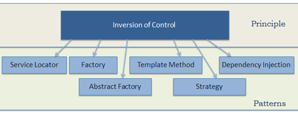
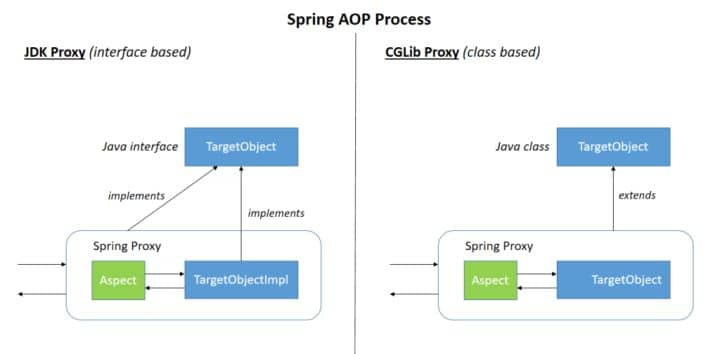
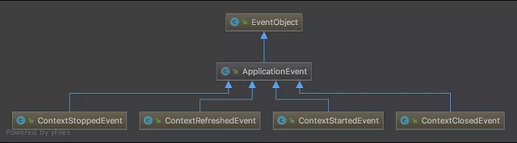
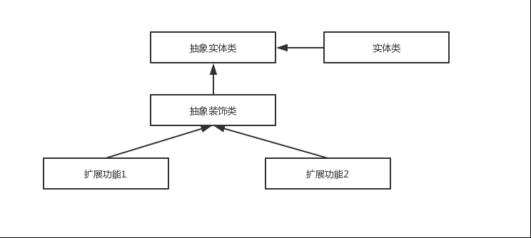

“Which design patterns are used in the JDK? Which ones are used in Spring?” These are common interview questions.

When I searched online for explanations of design patterns in Spring, most were repetitive and many were outdated. So I spent a few days putting together this summary.

Please point out any errors you find. Space is limited, so the explanations of the patterns and source code are brief. This article is intended as a review of the design patterns used in Spring.

## Inversion of Control (IoC) and Dependency Injection (DI)

**IoC (Inversion of Control)** is a central concept in Spring. It is not a technology, but a design principle for reducing coupling. IoC uses a third party—the Spring IoC container—to decouple dependent objects. The container manages the objects, so application code can use them without managing how they are created. This reduces coupling between parts of the code.

**IoC is a principle, not a pattern. The following patterns, among others, can implement the IoC principle.**



**The Spring IoC container acts like a factory. To create an object, configure it with a configuration file or annotations; you do not need to manage how it is instantiated.** The container creates objects, wires them together, configures them, and manages their lifecycle from creation until destruction.

In a real project, a service may depend on hundreds or even thousands of other classes. Without IoC, you would have to understand the constructors of all those dependencies whenever you instantiate the service. This would quickly become unmanageable. With IoC, configure the dependencies once and reference the service where needed. This improves maintainability and reduces development effort.

> For another explanation of Spring IoC, see this [Zhihu answer](https://www.zhihu.com/question/23277575/answer/169698662). It is very useful.

**What does inversion of control mean?** Suppose object A depends on object B. Without a container, A must create B itself. After an IoC container is introduced, A and B are no longer directly coupled. When A needs B, the container creates B and injects it into A. A's acquisition of its dependency changes from an active action to a passive one: control has been inverted.

**DI (Dependency Injection) is a design pattern for implementing IoC. It supplies an object's dependencies to it, rather than having the object create them itself.**

## Factory Pattern

Spring uses the factory pattern to create beans through `BeanFactory` or `ApplicationContext`.

**Comparison:**

- `BeanFactory`: Provides the basic capabilities of the Spring IoC container. When using a basic `BeanFactory` directly, the container typically does not eagerly instantiate all singleton beans; it creates each one when first requested.
- `ApplicationContext`: Extends `BeanFactory` with event publishing, internationalization, resource loading, and other capabilities. By default, it eagerly instantiates non-lazy singleton beans during startup. `prototype` beans and beans marked as lazy are not all created at startup.

Three common `ApplicationContext` implementations are:

1. `ClassPathXmlApplicationContext`: Loads the context file as a classpath resource.
2. `FileSystemXmlApplicationContext`: Loads context definitions from an XML file in the file system.
3. `XmlWebApplicationContext`: Loads context definitions from an XML file in a web application.

Example:

```java
import org.springframework.context.ApplicationContext;
import org.springframework.context.support.FileSystemXmlApplicationContext;

public class App {
  public static void main(String[] args) {
    ApplicationContext context = new FileSystemXmlApplicationContext(
        "C:/work/IOC Containers/springframework.applicationcontext/src/main/resources/bean-factory-config.xml");

    HelloApplicationContext obj = (HelloApplicationContext) context.getBean("helloApplicationContext");
    obj.getMsg();
  }
}
```

## Singleton Pattern

Some objects should have only one instance in a system, such as a thread pool, cache, dialog, registry, logger, or device driver. Creating multiple instances may cause unexpected behavior, excessive resource use, or inconsistent results.

**Benefits of the singleton pattern:**

- It avoids repeatedly creating frequently used objects. This can save significant overhead for heavyweight objects.
- Fewer object allocations can reduce memory use, GC pressure, and GC pause times.

**The default scope of a Spring bean is `singleton`.** Spring also provides these scopes:

- **prototype**: Creates a new bean instance each time it is requested. Two consecutive calls to `getBean()` return different instances.
- **request** (web applications only): Creates a new bean for each HTTP request. The bean is available only during that request.
- **session** (web applications only): Creates a new bean for each HTTP session. The bean is available only during that session.
- **application** (web applications only): Creates one bean per `ServletContext`. The bean is available for the lifecycle of the current web application. Older versions of Spring also provided a separate `globalSession` scope for Portlet applications; it is not part of the current standard scopes.
- **websocket** (web applications only): Creates a new bean for each WebSocket session.

Spring uses a singleton registry backed by `ConcurrentHashMap` to implement the singleton pattern.

The core of Spring's singleton implementation looks like this:

```java
// Use ConcurrentHashMap (thread-safe) as the singleton registry
private final Map<String, Object> singletonObjects = new ConcurrentHashMap<String, Object>(64);

public Object getSingleton(String beanName, ObjectFactory<?> singletonFactory) {
        Assert.notNull(beanName, "'beanName' must not be null");
        synchronized (this.singletonObjects) {
                // Check whether the instance is in the cache
            Object singletonObject = this.singletonObjects.get(beanName);
            if (singletonObject == null) {
                // ... many lines omitted
                try {
                    singletonObject = singletonFactory.getObject();
                }
                // ... many lines omitted
                // Register the instance if it does not exist
                addSingleton(beanName, singletonObject);
            }
            return (singletonObject != NULL_OBJECT ? singletonObject : null);
        }
    }
    // Add the object to the singleton registry
    protected void addSingleton(String beanName, Object singletonObject) {
            synchronized (this.singletonObjects) {
                this.singletonObjects.put(beanName, (singletonObject != null ? singletonObject : NULL_OBJECT));

            }
        }
}
```

**Are singleton beans thread-safe?**

This question is often overlooked because many applications do not use much multithreading. Singleton beans can have thread-safety issues when multiple threads access the same object and compete for shared mutable state.

Two common ways to address this are:

1. Avoid defining mutable instance fields in the bean where possible.
2. Store per-thread mutable state in a `ThreadLocal` field.

Most beans, such as DAOs and services, are stateless and have no instance fields. In that case, they are thread-safe.

## Proxy Pattern

### Proxy Pattern in AOP

**AOP (Aspect-Oriented Programming)** encapsulates logic shared across business modules but separate from their core business, such as transaction handling, logging, and access control. This reduces duplicated code and coupling between modules, and improves extensibility and maintainability.

Spring AOP uses dynamic proxies. If the target object implements an interface, Spring AOP creates a proxy with **JDK dynamic proxies**. For a target without an interface, it cannot use a JDK proxy, so Spring AOP uses **CGLIB** to create a subclass as the proxy, as shown below:



You can also use AspectJ. Spring AOP integrates with AspectJ, which is one of the most comprehensive AOP frameworks in the Java ecosystem.

With AOP, common functionality can be abstracted and applied where needed. This reduces code and makes it easier to add functionality, improving extensibility. Logging and transaction management are common use cases.

### How Do Spring AOP and AspectJ AOP Differ?

**Spring AOP performs runtime weaving, while AspectJ can weave at compile time.** Spring AOP is proxy-based; AspectJ operates on bytecode.

Spring AOP integrates with AspectJ, one of the most comprehensive AOP frameworks in the Java ecosystem. AspectJ is more powerful, while Spring AOP is simpler to use.

With only a few aspects, the performance difference is small. With many aspects, AspectJ may be a better choice, as it can be significantly faster than Spring AOP.

## Template Method Pattern

The template method pattern is a behavioral design pattern that defines the skeleton of an algorithm and defers some steps to subclasses. Subclasses can redefine those steps without changing the algorithm's structure.

```java
public abstract class Template {
    // Template method
    public final void TemplateMethod() {
        PrimitiveOperation1();
        PrimitiveOperation2();
        PrimitiveOperation3();
    }

    protected void PrimitiveOperation1() {
        // Implemented in this class
    }

    // Implemented by subclasses
    protected abstract void PrimitiveOperation2();
    protected abstract void PrimitiveOperation3();

}
public class TemplateImpl extends Template {

    @Override
    public void PrimitiveOperation2() {
        // Implementation
    }

    @Override
    public void PrimitiveOperation3() {
        // Implementation
    }
}

```

Spring uses the template method pattern in database access classes such as `JdbcTemplate` and `HibernateTemplate`. Although the pattern is often implemented through inheritance, Spring combines template methods with callbacks instead. This provides code reuse while preserving flexibility.

## Observer Pattern

The observer pattern defines a dependency between objects: when one object changes, its dependents are notified. Spring's event-driven model is a classic example. It can decouple code in many scenarios. For example, when a product is added, observers can update the product index without coupling that work to the product creation logic.

### Three Roles in Spring's Event-Driven Model

#### Event

`ApplicationEvent` (in the `org.springframework.context` package) represents an event. It is an abstract class that extends `java.util.EventObject` and implements `java.io.Serializable`.

Spring provides the following events by default. They all extend `ApplicationContextEvent`:

- `ContextStartedEvent`: Published after the `ApplicationContext` starts.
- `ContextStoppedEvent`: Published after the `ApplicationContext` stops.
- `ContextRefreshedEvent`: Published after the `ApplicationContext` is initialized or refreshed.
- `ContextClosedEvent`: Published after the `ApplicationContext` closes.



#### Event Listener

`ApplicationListener` represents an event listener. It is an interface with one method, `onApplicationEvent()`, for handling an `ApplicationEvent`. As shown below, the event type must extend `ApplicationEvent`. To listen for events in Spring, implement `ApplicationListener` and its `onApplicationEvent()` method.

```java
package org.springframework.context;
import java.util.EventListener;
@FunctionalInterface
public interface ApplicationListener<E extends ApplicationEvent> extends EventListener {
    void onApplicationEvent(E var1);
}
```

#### Event Publisher

`ApplicationEventPublisher` represents an event publisher. It is also an interface.

```java
@FunctionalInterface
public interface ApplicationEventPublisher {
    default void publishEvent(ApplicationEvent event) {
        this.publishEvent((Object)event);
    }

    void publishEvent(Object var1);
}

```

The `publishEvent()` method from `ApplicationEventPublisher` is implemented in `AbstractApplicationContext`. Its implementation shows that events are actually broadcast through `ApplicationEventMulticaster`. There is too much detail to cover here; it may be discussed in a separate article.

### Spring Event Flow

1. Define an event by extending `ApplicationEvent` and adding a constructor.
2. Define a listener by implementing `ApplicationListener` and overriding `onApplicationEvent()`.
3. Publish the event by calling `publishEvent()` on `ApplicationEventPublisher`.

Example:

```java
// Define an event by extending ApplicationEvent and adding a constructor
public class DemoEvent extends ApplicationEvent{
    private static final long serialVersionUID = 1L;

    private String message;

    public DemoEvent(Object source,String message){
        super(source);
        this.message = message;
    }

    public String getMessage() {
         return message;
          }


// Define a listener by implementing ApplicationListener and overriding onApplicationEvent()
@Component
public class DemoListener implements ApplicationListener<DemoEvent>{

    // Receive the event in onApplicationEvent
    @Override
    public void onApplicationEvent(DemoEvent event) {
        String msg = event.getMessage();
        System.out.println("Received message: " + msg);
    }

}
// Publish an event with ApplicationEventPublisher.publishEvent()
@Component
public class DemoPublisher {

    @Autowired
    ApplicationContext applicationContext;

    public void publish(String message){
        // Publish the event
        applicationContext.publishEvent(new DemoEvent(this, message));
    }
}

```

When `DemoPublisher.publish()` is called, for example `demoPublisher.publish("Hello")`, the console prints `Received message: Hello`.

## Adapter Pattern

The adapter pattern converts one interface into another interface expected by a client. It allows classes with incompatible interfaces to work together.

### Adapter Pattern in Spring AOP

Spring AOP is based on the proxy pattern, but its advice uses the adapter pattern. The related interface is `AdvisorAdapter`.

Common advice types include `BeforeAdvice` (before the target method is called), `AfterAdvice` (after the target method is called), and `AfterReturningAdvice` (after the target method completes successfully). Each advice type has a corresponding interceptor, such as `MethodBeforeAdviceInterceptor`, `AfterReturningAdviceInterceptor`, and `ThrowsAdviceInterceptor`.

Spring adapts predefined advice into objects that implement the `MethodInterceptor` interface. For example, `MethodBeforeAdviceAdapter` calls `getInterceptor()` to adapt `MethodBeforeAdvice` into a `MethodBeforeAdviceInterceptor`.

### Adapter Pattern in Spring MVC

In Spring MVC, `DispatcherServlet` uses request information to call `HandlerMapping`, which resolves the corresponding `Handler`. After the `Handler` (the `Controller`) is found, a `HandlerAdapter` processes it. `HandlerAdapter` is the target interface, and its implementations adapt the controller to that interface.

**Why does Spring MVC use the adapter pattern?**

Spring MVC has many types of controllers, and each type handles requests differently. Without the adapter pattern, `DispatcherServlet` would have to identify each controller type itself, as in the following code:

```java
if(mappedHandler.getHandler() instanceof MultiActionController){
   ((MultiActionController)mappedHandler.getHandler()).xxx
}else if(mappedHandler.getHandler() instanceof XXX){
    ...
}else if(...){
   ...
}
```

Adding another controller type would require another conditional branch. This makes the code difficult to maintain and violates the open-closed principle: software should be open for extension but closed for modification.

## Decorator Pattern

The decorator pattern dynamically adds behavior or properties to an object. It is more flexible than inheritance. When you want to extend existing functionality without changing the original code, wrap it in a decorator. The JDK uses this pattern in the `InputStream` family. For example, `FileInputStream` reads files, while `BufferedInputStream` adds buffering to improve read performance. Both extend `InputStream` functionality without modifying its code.



## Summary

Which design patterns does Spring use?

- **Factory pattern**: Spring creates beans through `BeanFactory` and `ApplicationContext`.
- **Proxy pattern**: Used to implement Spring AOP.
- **Singleton pattern**: Spring beans use the singleton scope by default.
- **Template method pattern**: Database access classes such as `JdbcTemplate` and `HibernateTemplate` use this pattern.
- **Observer pattern**: Spring's event-driven model is a classic example of the observer pattern.
- **Adapter pattern**: Spring AOP adapts advice, and Spring MVC uses adapters for controllers.
- ……

## References

- _Inside the Spring Framework_ (Chinese-language book)
- <https://blog.eduonix.com/java-programming-2/learn-design-patterns-used-spring-framework/>
- <https://www.tutorialsteacher.com/ioc/inversion-of-control>
- <https://design-patterns.readthedocs.io/zh_CN/latest/behavioral_patterns/observer.html>
- <https://juejin.im/post/5a8eb261f265da4e9e307230>
- <https://juejin.im/post/5ba28986f265da0abc2b6084>

<!-- @include: @article-footer.snippet.md -->
