This guide uses questions to build a deeper understanding of Spring, with few code examples.

Some of these questions cover details I had overlooked while using Spring, so I researched them in books and other references. Many online Spring FAQs repeat one another, and some contain weak or inaccurate answers. I spent a week compiling and checking this guide, and hope it is useful.

## Spring Fundamentals

### What Is the Spring Framework?

Spring is an open-source framework for Java development. It aims to improve developer productivity and application maintainability.

The term Spring Framework usually refers to a collection of modules that support application development. Spring provides IoC (Inversion of Control) and AOP (Aspect-Oriented Programming), simplifies database access and integration with third-party components such as email, task scheduling, and caching, supports unit testing, and helps build RESTful Java applications.

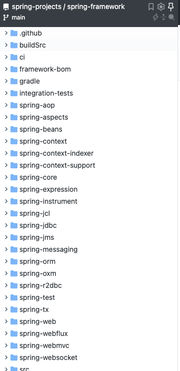

Spring's core idea is to provide reusable components that work out of the box and improve development efficiency.

The name Spring suggests a fresh start for Java developers.

🤐 One more point: **A language's popularity often depends on a killer application. Spring is one of the Java ecosystem's defining frameworks.**

Spring's core features are IoC and AOP. Understanding their underlying ideas is essential to learning Spring.

- Spring website: <https://spring.io/>
- GitHub repository: <https://github.com/spring-projects/spring-framework>

### What Modules Does Spring Include?

**Spring 4.x:**

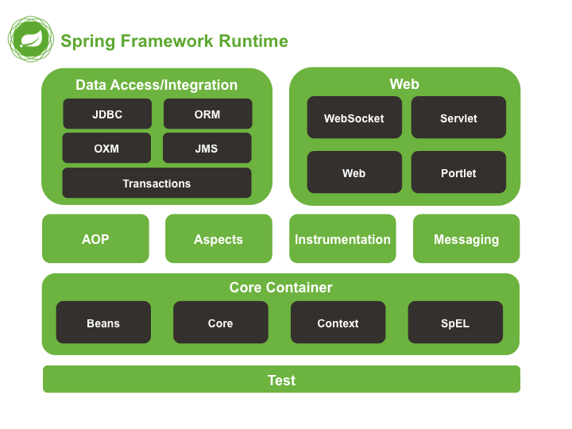

**Spring 5.x:**

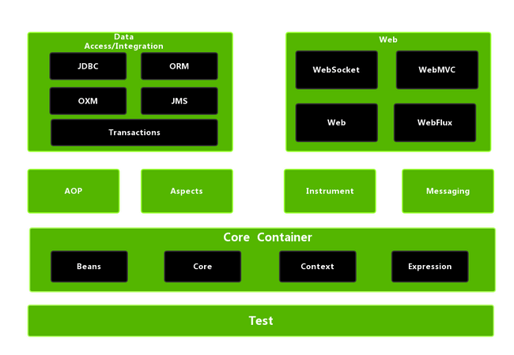

Spring 5 deprecated the Portlet component in the Web module and added WebFlux for asynchronous, reactive processing.

The following diagram shows the dependencies between Spring modules:

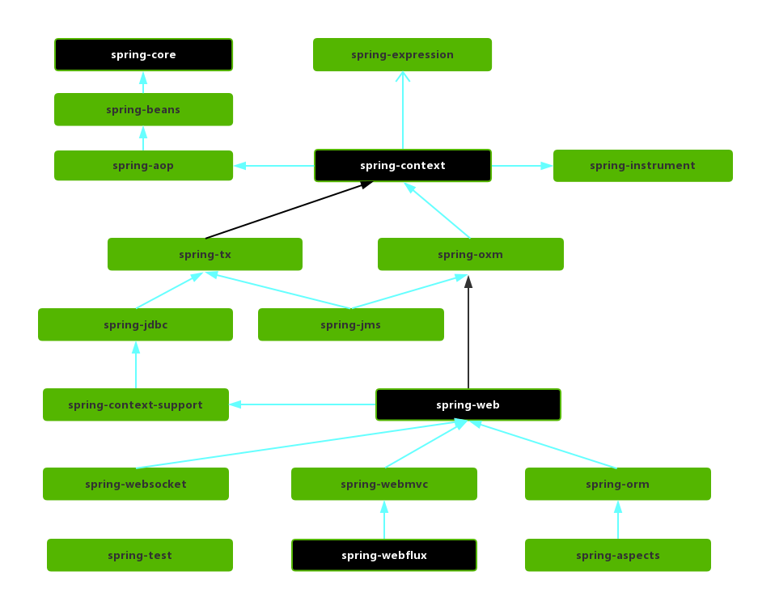

#### Core Container

This is Spring's core module. It provides IoC and dependency-injection support, which most other Spring features rely on, as the module diagram above shows.

- **spring-core**: Core utilities for the Spring Framework.
- **spring-beans**: Bean creation, configuration, and management.
- **spring-context**: Internationalization, event propagation, and resource loading.
- **spring-expression**: Spring Expression Language (SpEL) support. It depends only on `spring-core` and can be used independently.

#### AOP

- **spring-aspects**: Integration with AspectJ.
- **spring-aop**: AOP support.
- **spring-instrument**: Class instrumentation and class-loader agents, including support for instrumenting Tomcat. This module has limited use in typical applications.

#### Data Access/Integration

The modules below are mainly based on Spring Framework 5.x. Modern versions have removed some legacy integrations, so consult the module list for the Spring version you use.

- **spring-jdbc**: JDBC abstractions for database access. Applications use the JDBC API instead of depending directly on database-specific APIs.
- **spring-tx**: Transaction management.
- **spring-orm**: ORM integrations such as Hibernate and JPA in Spring Framework 5.x. Earlier versions also integrated with iBATIS.
- **spring-oxm**: Object-to-XML Mapping (OXM) abstractions. Implementations vary by Spring version; JAXB is one example, while Castor, XMLBeans, and JiBX are legacy integrations.
- **spring-jms**: Message service support. Since Spring Framework 4.1, it has also provided integration with `spring-messaging`.

#### Spring Web

- **spring-web**: Core support for web applications.
- **spring-webmvc**: Spring MVC.
- **spring-websocket**: WebSocket support for two-way communication between clients and servers.
- **spring-webflux**: WebFlux support. Introduced in Spring Framework 5.0, WebFlux is a reactive, non-blocking web framework that can run on Netty or Servlet containers supporting non-blocking I/O. End-to-end non-blocking behavior also depends on whether data access and downstream calls block.

#### Messaging

**spring-messaging** was introduced in Spring 4.0 to provide messaging abstractions and integration for the framework.

#### Spring Test

The Spring team advocates test-driven development (TDD). IoC makes unit and integration testing easier.

Spring's test module integrates with common testing tools such as JUnit, TestNG, Mockito, and PowerMock. Mockito creates mocks; PowerMock supports cases Mockito cannot handle by itself, such as mocking `final`, `static`, or private methods.

### ⭐️How Are Spring, Spring MVC, and Spring Boot Related?

Spring, Spring MVC, and Spring Boot are often confused. Their relationship is straightforward.

Spring contains several modules, as described above. The most important is `spring-core`, which provides IoC and dependency-injection support. Other modules, including Spring MVC, build on the core modules.

The following diagram shows Spring 4.x. Spring 5.0 introduced WebFlux for reactive processing and deprecated Portlet support. Check the official documentation for the modules in current Spring versions.


Spring MVC is an important Spring module for building web applications with the MVC architecture. MVC stands for Model-View-Controller. It organizes code by separating business logic, data, and presentation.

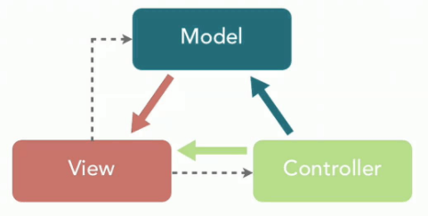

Spring applications can require substantial configuration. For example, enabling some Spring features requires explicit XML or Java configuration. Spring Boot was created to simplify this setup.

Spring aims to simplify enterprise application development. Spring Boot aims to simplify Spring development with less configuration and sensible defaults.

Spring Boot simplifies configuration; it does not replace Spring MVC. To build an MVC web application, you still use Spring MVC, while Spring Boot handles much of its setup for you.

## Spring IoC

### ⭐️What Is IoC?

IoC (Inversion of Control) is a design principle, not a specific implementation. In Java, it describes how object creation and management are delegated.

For example, suppose class A depends on class B:

- **Traditional approach:** Class A creates an instance of B with the `new` keyword.
- **Using IoC:** An IoC container, such as the Spring Framework, creates and manages the objects. Code requests the objects it needs from the container instead of creating them directly.

With IoC, code gives up direct control over object creation and management, so it no longer needs to handle those tasks itself.

**Why is it called inversion of control?**

- **Control** refers to the responsibility for creating and managing objects.
- **Inversion** means that this responsibility is transferred to an external component, such as the IoC container.

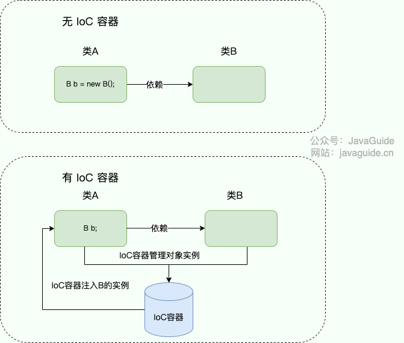

### ⭐️What Problems Does IoC Solve?

IoC uses a third-party container to manage resources, reducing direct dependencies between components. This has several benefits:

1. It reduces coupling and dependencies between objects.
2. It makes resources easier to manage. For example, the Spring container can provide a singleton bean.

For example, consider a user operation implemented with Service and DAO layers.

Without IoC, the service layer creates a concrete DAO implementation manually. `UserServiceImpl` would use `new` to create `UserDaoImpl`, an implementation of `IUserDao` (interfaces cannot be instantiated directly).

This works, but consider the following scenario:

Suppose a new requirement adds another implementation of `IUserDao`. Because the service layer directly depends on a concrete implementation, `UserServiceImpl` must be changed. Updating one class is manageable, but changing many classes that instantiate the implementation becomes costly.

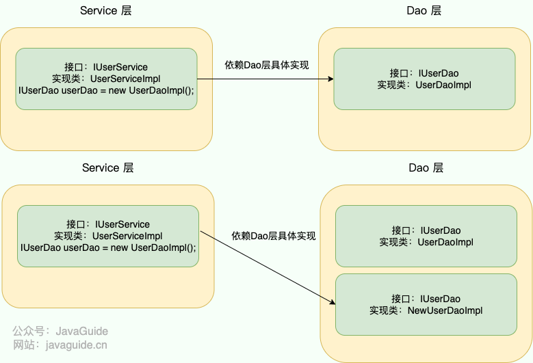

With IoC, the container takes responsibility for creating and managing objects. Components request their dependencies from the container.

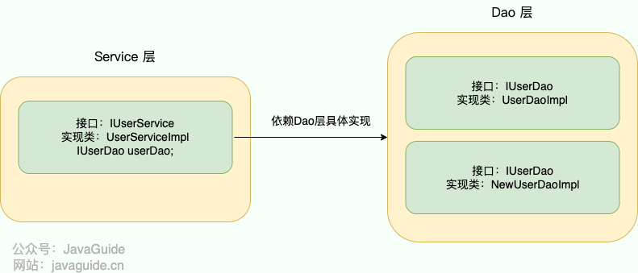

### What Is a Spring Bean?

A bean is an object managed by the IoC container.

Configuration metadata tells the IoC container which objects to manage. It can be provided in XML, annotations, or Java configuration classes.

```xml
<!-- Constructor-arg with 'value' attribute -->
<bean id="..." class="...">
   <constructor-arg value="..."/>
</bean>
```

The diagram below shows how the IoC container uses configuration metadata to manage objects.

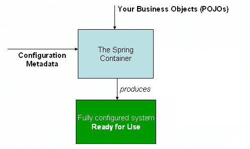

The `org.springframework.beans` and `org.springframework.context` packages form the foundation of Spring's IoC implementation. Explore them if you want to study the related source code.

### Which Annotations Declare a Class as a Bean?

- `@Component`: A general-purpose annotation for any Spring-managed component. Use it when a bean does not belong to a more specific layer.
- `@Repository`: Marks a persistence or DAO component, usually for database operations.
- `@Service`: Marks a service-layer component, usually containing business logic that uses DAOs.
- `@Controller`: Marks a Spring MVC controller that handles requests and returns data or a view.

### What Is the Difference Between `@Component` and `@Bean`?

- `@Component` annotates a class; `@Bean` annotates a method.
- `@Component` is usually detected and registered through classpath scanning. Use `@ComponentScan` to specify which packages to scan. A `@Bean` method explicitly creates and registers an object with Spring.
- `@Bean` offers more customization. It is also useful when registering a class from a third-party library that you cannot annotate with `@Component`.

Example of using `@Bean`:

```java
@Configuration
public class AppConfig {
    @Bean
    public TransferService transferService() {
        return new TransferServiceImpl();
    }

}
```

The code above is equivalent to this XML configuration:

```xml
<beans>
    <bean id="transferService" class="com.acme.TransferServiceImpl"/>
</beans>
```

The following example cannot be expressed with `@Component` alone:

```java
@Bean
public OneService getService(status) {
    case (status)  {
        when 1:
                return new serviceImpl1();
        when 2:
                return new serviceImpl2();
        when 3:
                return new serviceImpl3();
    }
}
```

### Which Annotations Inject Beans?

Spring's `@Autowired` and the Jakarta annotations `@Resource` and `@Inject` can all be used to inject beans.

| Annotation   | Package                                        | Source                                 |
| ------------ | ---------------------------------------------- | -------------------------------------- |
| `@Autowired` | `org.springframework.beans.factory.annotation` | Spring 2.5+                            |
| `@Resource`  | `jakarta.annotation` (Spring 6+)               | Jakarta Annotations / JSR-250          |
| `@Inject`    | `jakarta.inject` (Spring 6+)                   | Jakarta Dependency Injection / JSR-330 |

`@Autowired` and `@Resource` are the most commonly used.

### ⭐️What Is the Difference Between `@Autowired` and `@Resource`?

`@Autowired` is a Spring annotation. By default, it **matches by type first, then uses the name to disambiguate if multiple beans have that type**.

In detail:

1. Spring first searches for beans matching the interface or class type. If it finds exactly one, it injects that bean without checking the name.
2. If it finds multiple beans of that type, such as multiple implementations of an interface, it tries to match the **field or parameter name** to a bean name. By default, the bean name is the class name with its first letter lowercased, unless a name is explicitly set with `@Bean(name = "...")` or `@Component("...")`.

When an interface has multiple implementations:

- If the field name matches a bean name, Spring injects that bean.
- If the field name matches none of them, Spring throws `NoUniqueBeanDefinitionException`. Use `@Qualifier` to specify the bean name explicitly.

For example:

```java
// SmsService has two implementations, both managed by Spring.

// Fails: multiple beans match by type, and "smsService" matches neither default bean name.
@Autowired
private SmsService smsService;

// Works: "smsServiceImpl1" matches the default name of SmsServiceImpl1.
@Autowired
private SmsService smsServiceImpl1;

// Works: @Qualifier explicitly selects the bean named "smsServiceImpl1".
@Autowired
@Qualifier(value = "smsServiceImpl1")
private SmsService smsService;
```

In practice, use `@Qualifier` to specify the bean name instead of relying on the field name.

`@Resource` comes from the **JSR-250** specification. `javax.annotation.Resource` was included with JDK 6 through JDK 10; starting with JDK 11, the API must be added as a separate dependency. Spring 5 / Java EE 8 projects generally use `javax.annotation-api`, while Spring 6 / Jakarta EE 9 and later use `jakarta.annotation-api`.

For `@Resource` with no attributes, Spring behaves as follows:

1. **Match by name:** Spring uses the field name as the bean name. If it finds a bean with that name, it injects it.
2. **Fall back to matching by type:** If no bean with that name exists, Spring searches by the field's **type**:
   - **One bean found:** Injection succeeds.
   - **No beans found:** Spring throws `NoSuchBeanDefinitionException`.
   - **Multiple beans found:** Spring throws `NoUniqueBeanDefinitionException`.

Two commonly used `@Resource` attributes are `name` and `type`:

```java
public @interface Resource {
    String name() default "";
    Class<?> type() default Object.class;
}
```

Specifying only `name` selects by name; specifying only `type` selects by type. Specifying both is not recommended and combines the two criteria.

```java
// Fails: neither the name nor the type identifies a bean.
@Resource
private SmsService smsService;
// Injects the bean whose name matches the field.
@Resource
private SmsService smsServiceImpl1;
// Injects the bean named "smsServiceImpl1"; this form is recommended.
@Resource(name = "smsServiceImpl1")
private SmsService smsService;
```

**Summary:**

- `@Autowired` is provided by Spring; `@Resource` comes from Jakarta Annotations / JSR-250.
- `@Autowired` matches by type by default, while `@Resource` matches by name by default.
- When an interface has multiple implementations, both annotations need a name to select the intended bean. Use `@Qualifier` with `@Autowired` or the `name` attribute with `@Resource`.
- `@Autowired` can annotate constructors, methods, fields, and parameters. `@Resource` is mainly used on fields and methods, not constructors or parameters.

Because `@Resource` has clear name-first semantics and is a Java standard, it can reduce coupling to Spring; it is often a good choice when injecting by name. Constructor injection with `@Autowired` is also a strong practice when dependencies should be immutable and required.

### What Are the Bean-Injection Methods?

Common dependency injection (DI) methods include:

1. **Constructor injection:** Pass dependencies to the class constructor.
2. **Setter injection:** Set dependencies through setter methods.
3. **Field injection:** Annotate fields with `@Autowired`, `@Resource`, or a similar annotation.

Constructor injection:

```java
@Service
public class UserService {

    private final UserRepository userRepository;

    public UserService(UserRepository userRepository) {
        this.userRepository = userRepository;
    }

    //...
}
```

Setter injection:

```java
@Service
public class UserService {

    private UserRepository userRepository;

    @Autowired
    public void setUserRepository(UserRepository userRepository) {
        this.userRepository = userRepository;
    }

    //...
}
```

Field injection:

```java
@Service
public class UserService {

    @Autowired
    private UserRepository userRepository;

    //...
}
```

### ⭐️Constructor Injection or Setter Injection?

The Spring documentation discusses this question: <https://docs.spring.io/spring-framework/reference/core/beans/dependencies/factory-collaborators.html#beans-setter-injection>.

Here is a summary of its recommendations.

**Spring recommends constructor injection** for these reasons:

1. **Complete dependencies:** Required dependencies are supplied when the object is created, reducing the risk of null references.
2. **Immutability:** Dependencies can be stored in final fields, which supports thread safety.
3. **Complete initialization:** Components are fully initialized before use, reducing potential errors.
4. **Easier testing:** Unit tests can pass mock dependencies through the constructor without relying on Spring injection.

Constructor injection is suited to **required dependencies**. **Setter injection** is better for **optional dependencies** that have defaults or may change during the object's lifecycle. Although `@Autowired` can inject required dependencies through setters, constructor injection is generally preferable.

In some cases, such as when a third-party class has no setter methods, constructor injection may be the **only option**.

### ⭐️What Are the Bean Scopes?

Spring commonly provides these bean scopes:

- **singleton:** The IoC container has one bean instance. This is the default scope and corresponds to the singleton pattern.
- **prototype:** Each request to the container creates a new bean instance. Two consecutive `getBean()` calls return different instances.
- **request** (web applications only): A new bean is created for each HTTP request and is available during that request.
- **session** (web applications only): A new bean is created for each HTTP session and is available during that session.
- **application** (web applications only): One bean instance is created per `ServletContext` and shared across the web application.
- **websocket** (web applications only): A new bean is created for each WebSocket session.

**How do you configure a bean's scope?**

With XML:

```xml
<bean id="..." class="..." scope="singleton"></bean>
```

With annotations:

```java
@Bean
@Scope(value = ConfigurableBeanFactory.SCOPE_PROTOTYPE)
public Person personPrototype() {
    return new Person();
}
```

### ⭐️Are Spring Beans Thread-Safe?

Whether a Spring bean is thread-safe depends on its scope and state.

Consider the two most common scopes: `prototype` and `singleton`. Most beans use the default `singleton` scope, so it deserves particular attention.

With `prototype` scope, each request to the container creates a new bean, reducing sharing by the container. The scope itself does not guarantee thread safety: if the caller shares one prototype instance across threads, race conditions can still occur. With `singleton` scope, the container has one shared instance, so concurrent access can cause problems if the bean holds mutable state.

Example of a stateful bean:

```java
// A shopping cart with a list of items for one user.
@Component
public class ShoppingCart {
    private List<String> items = new ArrayList<>();

    public void addItem(String item) {
        items.add(item);
    }

    public List<String> getItems() {
        return items;
    }
}
```

Most beans, such as DAOs and services, are stateless and have no mutable instance fields. Stateless beans are generally safe for concurrent use.

Example of a stateless bean:

```java
// A user service that contains business logic but stores no state.
@Component
public class UserService {

    public User findUserById(Long id) {
        //...
    }
    //...
}
```

Three common ways to handle thread safety in stateful singleton beans are:

1. **Avoid mutable fields:** Design beans to be stateless where possible.
2. **Use `ThreadLocal`:** Store per-thread values in a `ThreadLocal`.
3. **Use synchronization:** Protect shared state with `synchronized`, `ReentrantLock`, or another synchronization mechanism.

The following example uses `ThreadLocal` to store the current user's login information:

```java
public class UserThreadLocal {

    private UserThreadLocal() {}

    private static final ThreadLocal<SysUser> LOCAL = ThreadLocal.withInitial(() -> null);

    public static void put(SysUser sysUser) {
        LOCAL.set(sysUser);
    }

    public static SysUser get() {
        return LOCAL.get();
    }

    public static void remove() {
        LOCAL.remove();
    }
}
```

### ⭐️What Is the Spring Bean Lifecycle?

1. **Instantiate the bean:** The container finds the bean definition and uses an instantiation strategy, such as a factory method, constructor autowiring, or direct instantiation, to create the object through Java reflection.
2. **Populate bean properties:** Set the bean's properties and dependencies, including processing annotations such as `@Autowired`, `@Value`, and `@Resource` on fields or setter methods.
3. **Initialize the bean:**
   - If the bean implements `BeanNameAware`, call `setBeanName()` with its name.
   - If it implements `BeanClassLoaderAware`, call `setBeanClassLoader()` with its class loader.
   - If it implements `BeanFactoryAware`, call `setBeanFactory()` with its `BeanFactory`.
   - Call the corresponding methods for any other `*.Aware` interfaces it implements.
   - Run `BeanPostProcessor.postProcessBeforeInitialization()` methods registered with the container.
   - If the bean implements `InitializingBean`, call `afterPropertiesSet()`.
   - If the bean definition specifies an `init-method`, call that method.
   - Run `BeanPostProcessor.postProcessAfterInitialization()` methods.
4. **Destroy the bean:** Spring registers destruction callbacks to release resources when the bean or its container is destroyed.
   - If the bean implements `DisposableBean`, call `destroy()`.
   - If the bean definition specifies a `destroy-method`, call it. You can also mark a method with `@PreDestroy`.

The `doCreateBean()` method in `AbstractAutowireCapableBeanFactory` shows the first three stages and registers destruction callbacks:

```java
protected Object doCreateBean(final String beanName, final RootBeanDefinition mbd, final @Nullable Object[] args)
    throws BeanCreationException {

    // 1. Instantiate the bean.
    BeanWrapper instanceWrapper = null;
    if (instanceWrapper == null) {
        instanceWrapper = createBeanInstance(beanName, mbd, args);
    }

    Object exposedObject = bean;
    try {
        // 2. Populate bean properties.
        populateBean(beanName, mbd, instanceWrapper);
        // 3. Initialize the bean.
        exposedObject = initializeBean(beanName, exposedObject, mbd);
    }

    // 4. Register destruction callbacks.
    try {
        registerDisposableBeanIfNecessary(beanName, bean, mbd);
    }

    return exposedObject;
}
```

`Aware` interfaces let a bean access resources from the Spring container.

Common `Aware` interfaces include:

1. `BeanNameAware`: Provides the current bean's name.
2. `BeanClassLoaderAware`: Provides the class loader used to load the bean.
3. `BeanFactoryAware`: Provides a reference to the current `BeanFactory`.

`BeanPostProcessor` is a Spring extension point for modifying beans.

```java
public interface BeanPostProcessor {

	// Runs before initialization.
	default Object postProcessBeforeInitialization(Object bean, String beanName) throws BeansException {
		return bean;
	}

	// Runs after initialization.
	default Object postProcessAfterInitialization(Object bean, String beanName) throws BeansException {
		return bean;
	}

}
```

- `postProcessBeforeInitialization`: Runs after instantiation and property population, but before `InitializingBean.afterPropertiesSet()` and a custom `init-method`.
- `postProcessAfterInitialization`: Runs after `InitializingBean.afterPropertiesSet()` and a custom `init-method`.

`InitializingBean` and `init-method` are extension points for bean initialization.

```java
public interface InitializingBean {
	// Initialization logic.
	void afterPropertiesSet() throws Exception;
}
```

Configure an initialization method with `init-method`:

```xml
<?xml version="1.0" encoding="UTF-8"?>
<beans xmlns="http://www.springframework.org/schema/beans"
       xmlns:xsi="http://www.w3.org/2001/XMLSchema-instance"
       xsi:schemaLocation="http://www.springframework.org/schema/beans http://www.springframework.org/schema/beans/spring-beans.xsd">

    <bean id="demo" class="com.chaycao.Demo" init-method="init"/>

</beans>
```

**A simple way to remember the lifecycle:**

1. The lifecycle has four broad stages: instantiation → property population → initialization → destruction.
2. Initialization includes `Aware` callbacks, `BeanPostProcessor` hooks, and the `InitializingBean` and `init-method` callbacks.
3. Destruction callbacks are registered during creation and later invoked through `DisposableBean` or `destroy-method`.

The following diagram summarizes the lifecycle. Source: [Remembering the Spring Bean lifecycle](https://chaycao.github.io/2020/02/15/%E5%A6%82%E4%BD%95%E8%AE%B0%E5%BF%86Spring-Bean%E7%9A%84%E7%94%9F%E5%91%BD%E5%91%A8%E6%9C%9F.html).

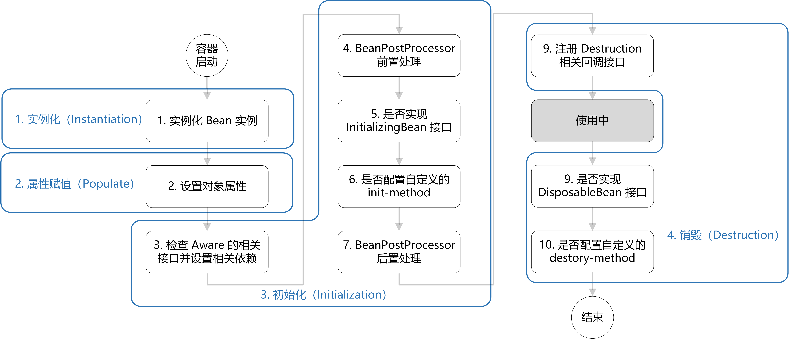

## Spring AOP

### ⭐️What Is Your Understanding of AOP?

Aspect-oriented programming (AOP) encapsulates logic shared across business modules but unrelated to their core business, such as transaction handling, logging, and access control. This reduces duplicated code and coupling, and improves extensibility and maintainability.

Spring AOP uses dynamic proxies. If the target implements an interface, Spring AOP creates a proxy with **JDK dynamic proxies**. If it does not implement an interface, Spring AOP uses **CGLIB** to create a subclass proxy, as shown below:

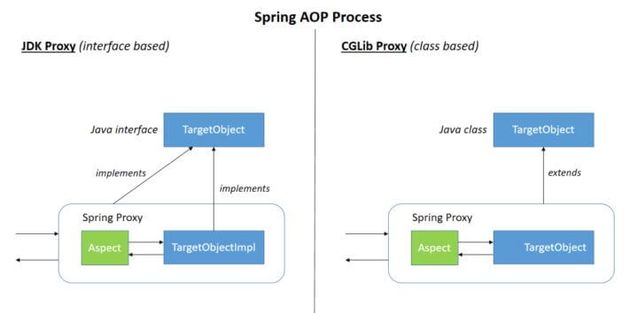

You can also use **AspectJ**. Spring integrates with AspectJ, one of the most complete AOP frameworks in the Java ecosystem.

Some common AOP terms:

| Term       |                                                     Meaning                                                     |
| :--------- | :-------------------------------------------------------------------------------------------------------------: |
| Target     |                                     The object to which advice is applied.                                      |
| Proxy      |                           The proxy object created by applying advice to the target.                            |
| Join point |                        A method execution that can be intercepted on the target object.                         |
| Pointcut   | A predicate that selects join points. Every pointcut selects join points, but not every join point is selected. |
| Advice     |                                  The logic executed at a selected join point.                                   |
| Aspect     |                                        A pointcut combined with advice.                                         |
| Weaving    |                     The process of applying advice to a target to create or modify a proxy.                     |

### ⭐️How Do Spring AOP and AspectJ Differ?

| Feature                | Spring AOP                                                                        | AspectJ                                                 |
| ---------------------- | --------------------------------------------------------------------------------- | ------------------------------------------------------- |
| **Enhancement**        | Runtime, using dynamic proxies                                                    | Compile-time or load-time, by modifying bytecode        |
| **Join-point support** | Method-level join points on Spring beans; cannot advise `final` or static methods | Methods, fields, constructors, static methods, and more |
| **Performance**        | Proxy overhead at runtime; may be slower with many aspects                        | No runtime proxy overhead; may perform better           |
| **Complexity**         | Simple and suitable for most cases                                                | More powerful, but more complex                         |
| **Use cases**          | Straightforward AOP needs in Spring applications                                  | High-performance or complex AOP needs                   |

**Which should you choose?**

- **Features:** AspectJ supports more complex use cases, while Spring AOP is simpler. AspectJ is needed to advise `final` methods, static methods, field access, constructor calls, or objects not managed by Spring.
- **Performance:** The difference is small with few aspects. AspectJ can perform better when many aspects are applied.

**In short:** Use Spring AOP for simple cases and AspectJ for complex cases or demanding performance requirements.

### ⭐️What Are the Common Types of AOP Advice?

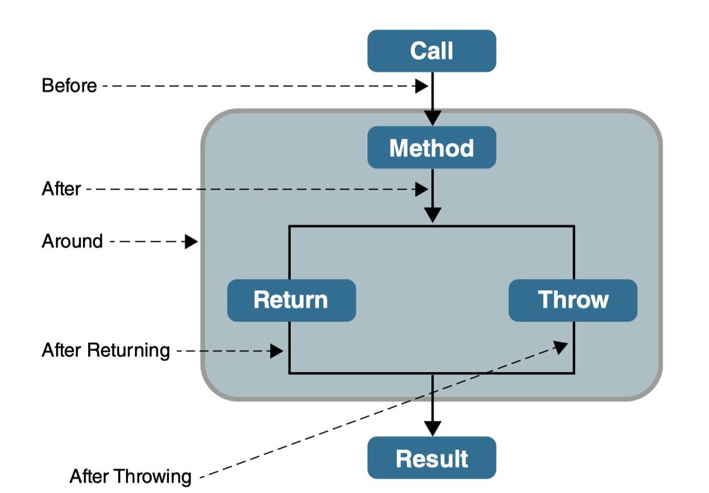

- **Before:** Runs before the target method.
- **After:** Runs after the target method, whether it completes normally or throws an exception.
- **AfterReturning:** Runs after the target method returns successfully.
- **AfterThrowing:** Runs when the target method throws an exception. `AfterReturning` and `AfterThrowing` are mutually exclusive for a given invocation.
- **Around:** Programmatically controls the target method invocation. It can run logic before and after the call, and can even skip invoking the target method.

### How Do You Control the Order of Multiple Aspects?

1. Use `@Order` to define the aspect's order. A lower value means higher precedence.

```java
// Lower values have higher precedence.
@Order(3)
@Component
@Aspect
public class LoggingAspect implements Ordered {
```

2. Implement `Ordered` and override `getOrder()`.

```java
@Component
@Aspect
public class LoggingAspect implements Ordered {

    // ....

    @Override
    public int getOrder() {
        // Lower values have higher precedence.
        return 1;
    }
}
```

## Spring MVC

### What Is Your Understanding of Spring MVC?

MVC stands for Model-View-Controller. It organizes code by separating business logic, data, and presentation.


Some argue that MVC is an architectural pattern rather than a design pattern. I consider it one of the many design patterns; the **[java-design-patterns](https://github.com/iluwatar/java-design-patterns)** project also covers MVC.

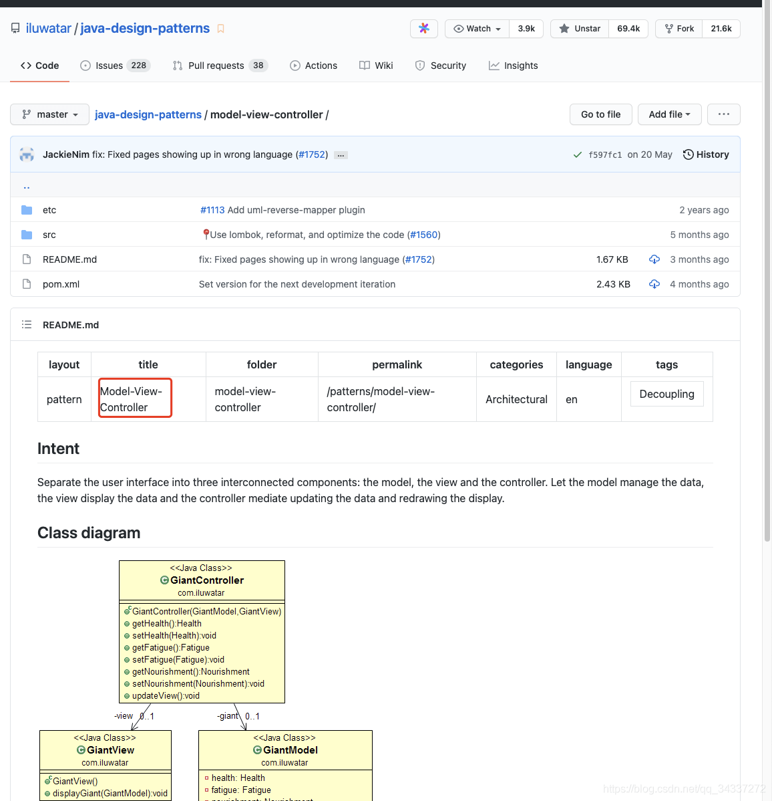

To understand Spring MVC, it helps to look at the earlier Model 1 and Model 2 approaches.

**The Model 1 era**

Developers who started with Java web development later may not have encountered Model 1. In this approach, a web application consisted mostly of JSP pages, with a small number of JavaBeans handling database connections and access.

In this model, JSP served as both the controller and the view. This mixed control and presentation logic, limited code reuse, and tightly coupled the frontend and backend, making testing and maintenance difficult and slowing development.

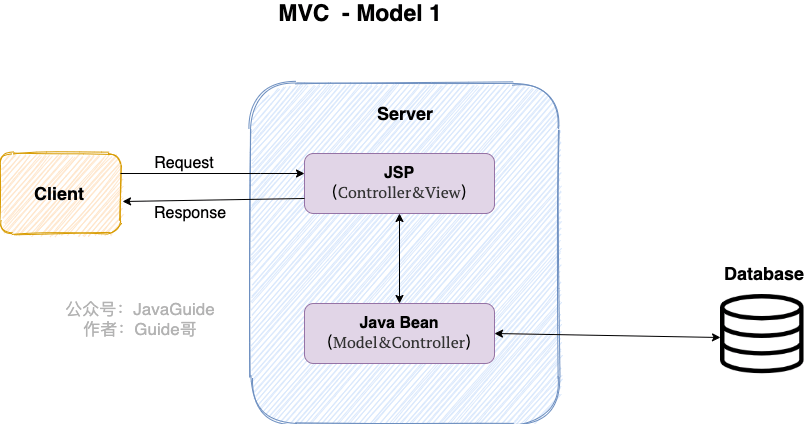

**The Model 2 era**

Developers familiar with Servlets may know the early Java web MVC model: JavaBeans (Model) + JSP (View) + Servlet (Controller).

- **Model:** Application data, such as DAO and bean objects.
- **View:** Displays data from the model.
- **Controller:** Receives user requests, sends them to the model, and returns data to a JSP for display.

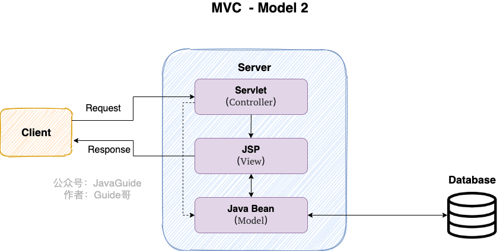

Model 2 still lacked sufficient abstraction and encapsulation. Developers had to reimplement common functionality, reducing maintainability and reuse.

Many MVC frameworks for Java web development followed, including Struts 2, which was relatively heavyweight.

**The Spring MVC era**

As the lightweight Spring Framework became popular, Spring MVC emerged as part of its ecosystem. Compared with Struts 2, Spring MVC is simpler to use and can improve development productivity.

MVC is a design pattern; Spring MVC is a framework that simplifies web-layer development and integrates with Spring. A typical backend separates responsibilities into Service (business logic), DAO (database access), Entity (domain objects), and Controller (request handling and responses) layers.

### What Are the Core Components of Spring MVC?

These components explain how Spring MVC works:

- **`DispatcherServlet`:** The central servlet that receives and dispatches requests, then sends responses to clients.
- **`HandlerMapping`:** Finds a handler for a URL and packages it with any interceptors involved in the request.
- **`HandlerAdapter`:** Invokes the handler selected by `HandlerMapping`.
- **`Handler`:** Processes the request.
- **`ViewResolver`:** Resolves a handler's logical view to a concrete view, renders it, and returns it to `DispatcherServlet` for the response.

### ⭐️How Does Spring MVC Work?

**The following diagram illustrates Spring MVC:**

> This diagram is a clear illustration found online; its original source is unknown.

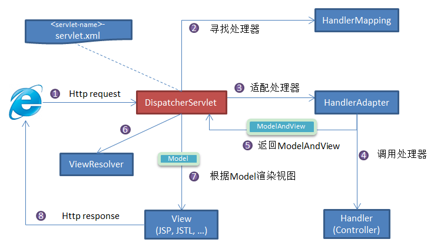

**Request flow:**

1. The client (browser) sends a request, which `DispatcherServlet` intercepts.
2. `DispatcherServlet` calls `HandlerMapping` with the request details. `HandlerMapping` matches the URL to a handler (typically a controller) and packages it with any interceptors.
3. `DispatcherServlet` calls `HandlerAdapter` to invoke the handler.
4. After processing the request, the handler returns a `ModelAndView` to `DispatcherServlet`. It contains the model data and a logical view.
5. `ViewResolver` maps the logical view to a concrete view.
6. `DispatcherServlet` passes the model to the view for rendering.
7. The rendered view is returned to the client.

This describes traditional server-side rendering with JSP, Thymeleaf, and similar technologies. In the common frontend-backend split, frontend frameworks such as Vue or React render the page, while the backend provides data. As a result:

- With a separate frontend and backend, the backend usually returns **data**, commonly JSON, rather than a view. The frontend renders and displays it.
- Controllers can return data directly instead of `ModelAndView`; Spring converts it to JSON. In this case, a `ViewResolver` is not needed.

How do you do this?

- Use `@RestController` instead of `@Controller` so methods return response data rather than view names by default.
- With `@Controller`, add `@ResponseBody` to return JSON.

### How Do You Handle Exceptions Centrally?

Use `@ControllerAdvice` with `@ExceptionHandler` for centralized exception handling.

```java
@ControllerAdvice
@ResponseBody
public class GlobalExceptionHandler {

    @ExceptionHandler(BaseException.class)
    public ResponseEntity<?> handleAppException(BaseException ex, HttpServletRequest request) {
      //......
    }

    @ExceptionHandler(value = ResourceNotFoundException.class)
    public ResponseEntity<ErrorReponse> handleResourceNotFoundException(ResourceNotFoundException ex, HttpServletRequest request) {
      //......
    }
}
```

This does not create an AOP proxy for the controller. When a controller method throws an exception, Spring MVC uses the `HandlerExceptionResolver` chain to find a matching `@ExceptionHandler` method.

`ExceptionHandlerMethodResolver.getMappedMethod()` selects the `@ExceptionHandler` method for an exception.

```java
@Nullable
  private Method getMappedMethod(Class<? extends Throwable> exceptionType) {
    List<Class<? extends Throwable>> matches = new ArrayList<>();
    // Find all mapped exception types and their handler methods.
    for (Class<? extends Throwable> mappedException : this.mappedMethods.keySet()) {
      if (mappedException.isAssignableFrom(exceptionType)) {
        matches.add(mappedException);
      }
    }
    // A non-empty list means a handler was found.
    if (!matches.isEmpty()) {
      // Sort from the least specific match to the most specific.
      matches.sort(new ExceptionDepthComparator(exceptionType));
      // Return the most specific handler.
      return this.mappedMethods.get(matches.get(0));
    }
    else {
      return null;
    }
  }
```

The source shows that **`getMappedMethod()` finds all handlers that match the exception, sorts them by inheritance distance, and selects the closest match.**

## Which Design Patterns Does Spring Use?

> For details, see [Design Patterns Used in Spring](https://javaguide.cn/system-design/framework/spring/spring-design-patterns-summary.html).

- **Factory:** `BeanFactory` and `ApplicationContext` create beans.
- **Proxy:** Spring AOP uses proxies.
- **Singleton:** Beans use singleton scope by default.
- **Template Method:** Database classes such as `JdbcTemplate` and `HibernateTemplate` use this pattern.
- **Wrapper:** A wrapper can switch data sources dynamically, for example when an application connects to multiple databases.
- **Observer:** Spring's event-driven model is a common application of the observer pattern.
- **Adapter:** Spring AOP uses adapters for advice, and Spring MVC uses adapters to invoke controllers.
- ……

## ⭐️Circular Dependencies in Spring

### What Are Circular Dependencies in Spring, and How Can You Resolve Them?

A circular dependency occurs when two or more beans hold references to one another, such as `CircularDependencyA` → `CircularDependencyB` → `CircularDependencyA`.

```java
@Component
public class CircularDependencyA {
    @Autowired
    private CircularDependencyB circB;
}

@Component
public class CircularDependencyB {
    @Autowired
    private CircularDependencyA circA;
}
```

A bean can also depend on itself, though this is uncommon and usually indicates a coding error.

```java
@Component
public class CircularDependencyA {
    @Autowired
    private CircularDependencyA circA;
}
```

Spring can resolve some circular dependencies between singleton beans that use setter or field injection through its three-level cache. This mechanism does not resolve constructor-injection cycles or cycles involving prototype beans.

Spring's three-level cache consists of three maps:

```java
// First-level cache.
/** Cache of singleton objects: bean name to bean instance. */
private final Map<String, Object> singletonObjects = new ConcurrentHashMap<>(256);

// Second-level cache.
/** Cache of early singleton objects: bean name to bean instance. */
private final Map<String, Object> earlySingletonObjects = new HashMap<>(16);

// Third-level cache.
/** Cache of singleton factories: bean name to ObjectFactory. */
private final Map<String, ObjectFactory<?>> singletonFactories = new HashMap<>(16);
```

The three caches contain:

1. **First-level cache (`singletonObjects`):** Fully initialized singleton beans. Most bean lookups are served from this cache; prototype beans are not stored here.
2. **Second-level cache (`earlySingletonObjects`):** Early references to beans whose properties have not yet been populated. It stores objects produced by the third-level cache and helps ensure that repeated lookups return the same early reference, including when AOP proxies are involved.
3. **Third-level cache (`singletonFactories`):** `ObjectFactory` instances. Calling `getObject()` ultimately invokes `getEarlyBeanReference()` to produce an early reference to the original bean or its proxy. This cache applies only to singleton beans.

The bean-creation process checks these caches in order:

1. Check **`singletonObjects`** and return the bean if present.
2. If it is absent or still being created, check **`earlySingletonObjects`**.
3. If it is still unavailable, check **`singletonFactories`** and call the factory's `getObject()`. If successful, remove the factory from the third-level cache and put the early reference in the second-level cache.

The third-level cache stores `ObjectFactory` instances:

```java
public interface ObjectFactory<T> {
    T getObject() throws BeansException;
}
```

When circular references are allowed, Spring exposes a bean after instantiation but before its properties are populated. It adds an `ObjectFactory` to the third-level cache through `addSingletonFactory()`:

```java
// AbstractAutowireCapableBeanFactory # doCreateBean #
public abstract class AbstractAutowireCapableBeanFactory ... {
	protected Object doCreateBean(...) {
        //...

		// Support circular references by adding getEarlyBeanReference() to the third-level cache.
		addSingletonFactory(beanName, () -> getEarlyBeanReference(beanName, mbd, bean));
    }
}
```

As described above, if the first- and second-level caches do not contain the bean, Spring calls `ObjectFactory.getObject()` in the third-level cache.

```java
class A {
    // Depends on B.
    private B b;
}
class B {
    // Depends on A.
    private A a;
}
```

For the example above, Spring resolves the circular dependency as follows:

- Spring creates A, finds that A depends on B, and starts creating B. B depends on A, so Spring tries to obtain A again.
- A is not fully initialized yet, so it is not present in the first- or second-level cache.
- Spring calls `getObject()` on A's factory in the third-level cache. This invokes `getEarlyBeanReference()` and creates an early reference to A.
- Spring removes the factory from the third-level cache and stores the early reference in the second-level cache. It then injects that reference into B, resolving the cycle.

**Are two cache levels enough?** Without AOP, the first and second levels can resolve circular dependencies. With AOP, the third level helps ensure that repeated requests for an early reference return the same proxy, avoiding multiple proxies for one bean.

**In summary:**

To resolve a circular dependency, Spring retrieves the bean's `ObjectFactory` from **`singletonFactories`** and calls `getObject()` to obtain an early reference to the not-yet-initialized bean. It then stores that reference in the second-level cache so the bean is not initialized again during the cycle.

This mechanism has costs: it uses additional memory for three maps and performs multiple lookups and conversions. It resolves only some circular dependencies involving singleton beans with setter or field injection; it does not resolve cycles involving prototype beans or constructor injection.

### Can `@Lazy` Resolve Circular Dependencies?

`@Lazy` enables lazy initialization and can be applied to classes, methods, constructors, parameters, and fields.

Spring Boot 2.2 added a **global lazy-initialization property**. When enabled, all beans are created only when needed.

Enable global lazy initialization in a configuration file:

```properties
# Defaults to false.
spring.main.lazy-initialization=true
```

Enable global lazy initialization in code:

```java
SpringApplication springApplication=new SpringApplication(Start.class);
springApplication.setLazyInitialization(true);
springApplication.run(args);
```

Avoid global lazy initialization unless necessary. It can slow down the first use of a bean and delay the discovery of initialization errors until the bean is first requested.

Unless marked lazy, a bean is created and initialized as the Spring IoC container starts. A lazy bean is created only when first requested. This can reduce startup time and may help resolve a circular dependency.

For example, if beans A and B depend on each other, add `@Lazy` at A's injection point for B, such as the constructor parameter in `A(@Lazy B b)`. This delays resolving B; adding `@Lazy` to A's constructor or class is not equivalent.

- Spring starts creating A and needs to inject B.
- Because A's injection point for B is annotated with `@Lazy`, Spring creates a lazy-resolution proxy for B and injects the proxy into A.
- When B is later created and initialized, A already exists, so Spring can inject A into B.

The proxy is what allows `@Lazy` to break the dependency cycle.

- **Without `@Lazy`:** While creating A, Spring immediately tries to create B. B then requires A, resulting in a circular dependency and an exception.
- **With `@Lazy`:** Spring injects a proxy for B instead of creating B immediately. A can finish initialization, and the proxy initializes B when A first calls it.

An `@Lazy` injection-point proxy can break some dependency cycles, including some constructor-injection cycles. It does not remove the underlying design problem and can cause subtle initialization issues in complex dependency graphs, so avoid circular dependencies where possible.

### Does Spring Boot Allow Circular Dependencies?

Spring Boot allowed circular references by default before version 2.6. Starting with 2.6, circular dependencies are discouraged, and applications should avoid unnecessary mutual dependencies. Circular dependencies are usually a design flaw; relying on Spring to resolve them can hide code-quality issues.

In Spring Boot 2.6 and later, if you cannot refactor the cycle immediately, you can:

- Set `spring.main.allow-circular-references=true` in the global configuration. This is the simplest option, but is not recommended.
- Add `@Lazy` at an injection point involved in the cycle. This is generally preferable. `@Lazy` enables lazy initialization and can be applied to classes, methods, constructors, parameters, and fields.
- ……

## ⭐️Spring Transactions

For details, see [Spring Transaction Management](https://javaguide.cn/system-design/framework/spring/spring-transaction.html).

### What Transaction-Management Approaches Does Spring Support?

- **Programmatic transactions:** Manage transactions explicitly with `TransactionTemplate` or `TransactionManager`. This can be useful in distributed systems, but keep transaction boundaries small to avoid timeouts and long-held locks.
- **Declarative transactions:** Configure transactions in XML or with annotations. This approach is generally suited to monolithic applications and simpler business systems; `@Transactional` is the most common option and uses AOP.

### What Are Spring's Transaction Propagation Behaviors?

**Transaction propagation defines how transactions behave when business-layer methods call one another.**

When one transactional method calls another, the propagation behavior determines whether the called method joins the existing transaction or starts a new one.

The propagation options include:

**1.`TransactionDefinition.PROPAGATION_REQUIRED`**

This is the most commonly used behavior and the default for `@Transactional`. The method joins the current transaction, or starts one if none exists.

**`2.TransactionDefinition.PROPAGATION_REQUIRES_NEW`**

Always starts a new transaction. If a transaction already exists, Spring suspends it. The inner transaction runs independently of the outer method's transaction.

**3.`TransactionDefinition.PROPAGATION_NESTED`**

If a transaction exists, the method runs in a nested transaction. Otherwise, this behaves like `TransactionDefinition.PROPAGATION_REQUIRED`.

**4.`TransactionDefinition.PROPAGATION_MANDATORY`**

Joins the current transaction, or throws an exception if none exists (`mandatory` means required).

This option is rarely used.

The remaining three valid propagation options depend on whether an outer transaction exists:

- **`TransactionDefinition.PROPAGATION_SUPPORTS`:** Joins the current transaction if one exists; otherwise, runs non-transactionally.
- **`TransactionDefinition.PROPAGATION_NOT_SUPPORTED`:** Runs non-transactionally, suspending the current transaction if one exists.
- **`TransactionDefinition.PROPAGATION_NEVER`:** Runs non-transactionally and throws an exception if a transaction exists.

### What Isolation Levels Does Spring Support?

As with propagation behavior, Spring provides an enum for convenience: `Isolation`.

```java
public enum Isolation {

    DEFAULT(TransactionDefinition.ISOLATION_DEFAULT),
    READ_UNCOMMITTED(TransactionDefinition.ISOLATION_READ_UNCOMMITTED),
    READ_COMMITTED(TransactionDefinition.ISOLATION_READ_COMMITTED),
    REPEATABLE_READ(TransactionDefinition.ISOLATION_REPEATABLE_READ),
    SERIALIZABLE(TransactionDefinition.ISOLATION_SERIALIZABLE);

    private final int value;

    Isolation(int value) {
        this.value = value;
    }

    public int value() {
        return this.value;
    }

}
```

The isolation levels are:

- **`TransactionDefinition.ISOLATION_DEFAULT`:** Uses the database's default isolation level. MySQL defaults to `REPEATABLE_READ`, while Oracle defaults to `READ_COMMITTED`.
- **`TransactionDefinition.ISOLATION_READ_UNCOMMITTED`:** The lowest and rarely used level. It allows reading uncommitted changes and can cause dirty, non-repeatable, and phantom reads.
- **`TransactionDefinition.ISOLATION_READ_COMMITTED`:** Reads only changes committed by other transactions. It prevents dirty reads, but non-repeatable and phantom reads may still occur.
- **`TransactionDefinition.ISOLATION_REPEATABLE_READ`:** Repeated reads of the same field return the same value unless the transaction itself changes it. It prevents dirty and non-repeatable reads, but phantom reads may still occur.
- **`TransactionDefinition.ISOLATION_SERIALIZABLE`:** The highest level. Transactions run serially, preventing interference and dirty, non-repeatable, and phantom reads. This can significantly reduce performance, so it is rarely used.

### How Does `@Transactional(rollbackFor = Exception.class)` Work?

Java exceptions include runtime exceptions (`RuntimeException`) and checked exceptions. Transaction management is important in enterprise applications because it helps preserve data consistency when failures occur.

When `@Transactional` is applied to a class, its public methods inherit the transaction settings. A method-level annotation can override the class-level settings.

By default, `@Transactional` rolls back on `RuntimeException` and `Error`, but not on checked exceptions. Spring treats runtime exceptions and errors as unexpected failures, while checked exceptions are generally considered recoverable by application logic.

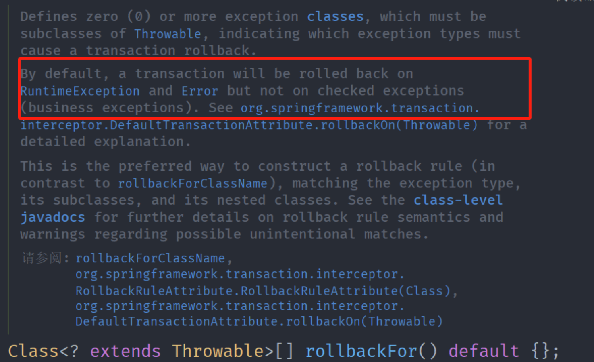

Use the `rollbackFor` and `noRollbackFor` attributes to change the default rules. For example, to roll back on all exceptions:

```java
@Transactional(rollbackFor = Exception.class)
public void someMethod() {
    // Business logic.
}
```

To prevent rollback for a specific exception type:

```java
@Transactional(noRollbackFor = CustomException.class)
public void someMethod() {
    // Business logic.
}
```

## Spring Data JPA

JPA is best learned through practice. This section summarizes a few key points.

### How Do You Exclude a Field from JPA Persistence?

Consider the following class:

```java
@Entity(name="USER")
public class User {

    @Id
    @GeneratedValue(strategy = GenerationType.AUTO)
    @Column(name = "ID")
    private Long id;

    @Column(name="USER_NAME")
    private String userName;

    @Column(name="PASSWORD")
    private String password;

    private String secrect;

}
```

To prevent the `secret` field from being persisted, use one of these approaches:

```java
static String transient1; // not persistent because of static
final String transient2 = "Satish"; // not persistent because of final
transient String transient3; // not persistent because of transient
@Transient
String transient4; // not persistent because of @Transient
```

The last two approaches are more common. I generally use `@Transient`.

### What Is JPA Auditing Used For?

Auditing records details about database changes, such as who created a record, when it was created, and who last modified it and when.

```java
@Data
@AllArgsConstructor
@NoArgsConstructor
@MappedSuperclass
@EntityListeners(value = AuditingEntityListener.class)
public abstract class AbstractAuditBase {

    @CreatedDate
    @Column(updatable = false)
    @JsonIgnore
    private Instant createdAt;

    @LastModifiedDate
    @JsonIgnore
    private Instant updatedAt;

    @CreatedBy
    @Column(updatable = false)
    @JsonIgnore
    private String createdBy;

    @LastModifiedBy
    @JsonIgnore
    private String updatedBy;
}
```

- `@CreatedDate`: Marks the creation-time field, which is set when the entity is inserted.

- `@CreatedBy`: Marks the creator field, which is set when the entity is inserted.

  `@LastModifiedDate` and `@LastModifiedBy` work similarly.

### Which Annotations Define Entity Relationships?

- `@OneToOne`: One-to-one.
- `@ManyToMany`: Many-to-many.
- `@OneToMany`: One-to-many.
- `@ManyToOne`: Many-to-one.

You can also model a many-to-many relationship using `@ManyToOne` and `@OneToMany`.

## Spring Security

Spring Security is best learned through practice. This section summarizes a few key points.

### Which Methods Control Access to Requests?

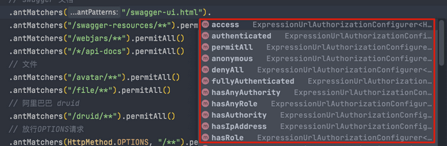

- `permitAll()`: Allows access regardless of authentication.
- `anonymous()`: Allows access only to unauthenticated users.
- `denyAll()`: Denies all access.
- `authenticated()`: Allows access only to authenticated users.
- `fullyAuthenticated()`: Allows fully authenticated users, excluding anonymous and remember-me authentication.
- `hasRole(String)`: Allows users with the specified role.
- `hasAnyRole(String)`: Allows users with any of the specified roles.
- `hasAuthority(String)`: Allows users with the specified authority.
- `hasAnyAuthority(String)`: Allows users with any of the specified authorities.
- `hasIpAddress(String)`: Allows requests from the specified IP address.

### What Is the Difference Between `hasRole` and `hasAuthority`?

For a detailed explanation, see [What Is the Difference Between `hasRole` and `hasAuthority` in Spring Security?](https://mp.weixin.qq.com/s/GTNOa2k9_n_H0w24upClRw).

### ⭐️How Should Passwords Be Stored?

Before storing sensitive data such as passwords, encode it with an adaptive one-way password-hashing function. Do not use reversible encryption.

Spring Security provides several password encoders out of the box. They implement the `PasswordEncoder` interface; custom password encoders should implement it as well.

`PasswordEncoder` has two required methods, `encode()` and `matches()`, plus a default method, `upgradeEncoding()`, that can be overridden when needed.

```java
public interface PasswordEncoder {
    // Encodes the raw password.
    String encode(CharSequence var1);
    // Compares the raw password with the stored encoded password.
    boolean matches(CharSequence var1, String var2);
    // Checks whether the encoded password should be upgraded; defaults to false.
    default boolean upgradeEncoding(String encodedPassword) {
        return false;
    }
}
```

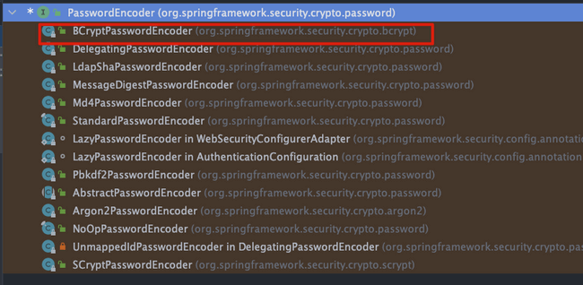

Spring recommends adaptive one-way functions with a configurable work factor. Tune verification time for your system; examples include bcrypt, PBKDF2, scrypt, and Argon2.

### How Can You Change the Password-Hashing Algorithm?

If the current password-hashing algorithm no longer meets your requirements, how can you migrate to another one?

Use `DelegatingPasswordEncoder` to support multiple password-encoding formats during migration.

`DelegatingPasswordEncoder` is a delegating implementation, not a new hashing algorithm. It routes encoding and matching to the configured password encoders. Spring Security has used it by default since version 5.0.

## References

- _Inside the Spring Framework_
- [Learning Spring from the Ground Up](https://juejin.cn/book/6857911863016390663)
- <http://www.cnblogs.com/wmyskxz/p/8820371.html>
- <https://www.journaldev.com/2696/spring-interview-questions-and-answers>
- <https://www.edureka.co/blog/interview-questions/spring-interview-questions/>
- <https://www.cnblogs.com/clwydjgs/p/9317849.html>
- <https://howtodoinjava.com/interview-questions/top-spring-interview-questions-with-answers/>
- <http://www.tomaszezula.com/2014/02/09/spring-series-part-5-component-vs-bean/>
- <https://stackoverflow.com/questions/34172888/difference-between-bean-and-autowired>

<!-- @include: @article-footer.snippet.md -->
