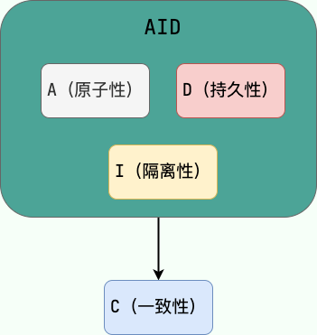

Here is the **Spring transaction** guide I promised readers. Transactions are important in both day-to-day development and interviews, but there are few reliable references available online.

## What Is a Transaction?

**A transaction is a logical group of operations that either all succeed or all fail.**

Let's look at what this means in everyday development.

An application method may contain several database operations that depend on one another. For example, `savePerson()` below performs two such operations; both must succeed or both must fail.

```java
  public void savePerson() {
    personDao.save(person);
    personDetailDao.save(personDetail);
  }
```

Keep in mind that **transactions work only if the database engine supports them**. MySQL commonly uses the transactional `InnoDB` engine by default. If the table uses `MyISAM`, the application cannot rely on database transactions for it.

Money transfers are a classic example. If Alice transfers 1,000 yuan to Bob, two operations are required:

> 1. Subtract 1,000 yuan from Alice's balance.
> 2. Add 1,000 yuan to Bob's balance.

If an error occurs between these operations—for example, a bank system crash or network failure—Alice's balance could decrease without Bob's balance increasing. A transaction ensures that both operations succeed or both fail.


```java
public class OrdersService {
  private AccountDao accountDao;

  public void setOrdersDao(AccountDao accountDao) {
    this.accountDao = accountDao;
  }

  @Transactional(propagation = Propagation.REQUIRED,
                isolation = Isolation.DEFAULT, readOnly = false, timeout = -1)
  public void accountMoney() {
    // Add 1,000 yuan to Bob's account.
    accountDao.addMoney(1000,xiaohong);
    // Simulate a sudden failure, such as a power outage at the bank.
    // Without transaction management, Bob's balance would increase while Alice's would remain unchanged.
    int i = 10 / 0;
    // Subtract 1,000 yuan from Alice's account.
    accountDao.reduceMoney(1000,xiaoming);
  }
}
```

Database transactions are built around the four ACID properties. Here is a brief overview.

## What Are the ACID Properties?

1. **Atomicity:** A transaction is indivisible: either all its operations complete, or none of them take effect.
2. **Consistency:** Data remains valid before and after a transaction. In a transfer, for example, the combined balance of the sender and recipient should remain unchanged whether the transaction succeeds or fails.
3. **Isolation:** Concurrent transactions do not interfere with one another as if each were running independently, subject to the configured isolation level.
4. **Durability:** Once committed, a transaction's changes persist, even if the database later fails.

🌈 One additional point: **Atomicity, isolation, and durability help an application maintain consistency. A, I, and D are mechanisms; C is the goal.** I clarified this distinction after watching [Zhou Zhihua's Software Architecture course](https://time.geekbang.org/opencourse/intro/100064201).



The author of [_Designing Data-Intensive Applications_](https://book.douban.com/subject/30329536/) also writes:

> Atomicity, isolation, and durability are properties of the database, whereas consis‐ tency (in the ACID sense) is a property of the application. The application may rely on the database’s atomicity and isolation properties in order to achieve consistency, but it’s not up to the database alone.
>
> In other words, atomicity, isolation, and durability are properties of the database, while consistency (in the ACID sense) is a property of the application. An application may rely on database atomicity and isolation to achieve consistency, but consistency does not depend on the database alone. Thus, the C in ACID is not solely a database property.

I highly recommend _Designing Data-Intensive Applications_; it rewards rereading. A Chinese translation is also available on GitHub: [Vonng/ddia](https://github.com/Vonng/ddia).

## Spring's Transaction Support

> ⚠️ A reminder: transaction support first depends on the database engine. MySQL tables using InnoDB support transactions; tables using MyISAM do not.

One more important question: **How does MySQL provide atomicity?**

To provide atomicity, a database must **roll back** completed operations when an error occurs. MySQL uses an **undo log** for recovery: transaction changes are recorded there before the corresponding operations are performed. If an error occurs, MySQL uses the undo log to restore the previous state. The undo log is persisted before the data, allowing MySQL to roll back incomplete transactions after a crash and restart.

### Spring Supports Two Transaction-Management Approaches

#### Programmatic Transaction Management

Manage transactions manually with `TransactionTemplate` or `TransactionManager`. This approach is uncommon in application code but can help explain how Spring transaction management works.

Here is an example using `TransactionTemplate`:

```java
@Autowired
private TransactionTemplate transactionTemplate;
public void testTransaction() {

        transactionTemplate.execute(new TransactionCallbackWithoutResult() {
            @Override
            protected void doInTransactionWithoutResult(TransactionStatus transactionStatus) {

                try {

                    // ... Business logic ...
                } catch (Exception e){
                    // Roll back.
                    transactionStatus.setRollbackOnly();
                }

            }
        });
}
```

Here is an example using `TransactionManager`:

```java
@Autowired
private PlatformTransactionManager transactionManager;

public void testTransaction() {

  TransactionStatus status = transactionManager.getTransaction(new DefaultTransactionDefinition());
          try {
               // ... Business logic ...
              transactionManager.commit(status);
          } catch (Exception e) {
              transactionManager.rollback(status);
          }
}
```

#### Declarative Transaction Management

Declarative transaction management is recommended because it requires minimal code changes. It is implemented through AOP, most commonly with `@Transactional`.

Here is an example using `@Transactional`:

```java
@Transactional(propagation = Propagation.REQUIRED)
public void aMethod() {
  // Perform business logic.
  B b = new B();
  C c = new C();
  b.bMethod();
  c.cMethod();
}
```

### Spring Transaction-Management Interfaces

The three most important Spring transaction-management interfaces are:

- **`PlatformTransactionManager`:** The transaction manager and core of Spring's transaction strategy.
- **`TransactionDefinition`:** Transaction settings such as isolation level, propagation behavior, timeout, and read-only status.
- **`TransactionStatus`:** The current transaction state.

Think of **`PlatformTransactionManager`** as the transaction coordinator, while **`TransactionDefinition`** and **`TransactionStatus`** describe the transaction and its state.

**`PlatformTransactionManager`** manages transactions according to the settings in **`TransactionDefinition`**, such as timeout, isolation level, and propagation behavior. **`TransactionStatus`** provides methods for checking the state, such as whether the transaction is new or marked for rollback.

#### `PlatformTransactionManager`: The Transaction-Manager Interface

**Spring does not manage transactions directly; it provides several transaction managers.** Their common interface is **`PlatformTransactionManager`**.

Spring provides transaction-manager implementations for different technologies, such as JDBC (`DataSourceTransactionManager`), Hibernate (`HibernateTransactionManager`), and JPA (`JpaTransactionManager`). Each implementation delegates the actual transaction work to its underlying platform.

**An implementation of `PlatformTransactionManager` is shown below:**


The `PlatformTransactionManager` interface defines three methods:

```java
package org.springframework.transaction;

import org.springframework.lang.Nullable;

public interface PlatformTransactionManager {
    // Get a transaction.
    TransactionStatus getTransaction(@Nullable TransactionDefinition var1) throws TransactionException;
    // Commit a transaction.
    void commit(TransactionStatus var1) throws TransactionException;
    // Roll back a transaction.
    void rollback(TransactionStatus var1) throws TransactionException;
}

```

**Why define or abstract the `PlatformTransactionManager` interface?**

It abstracts transaction-management behavior so different platforms can implement it while exposing a consistent interface. This makes the system easier to extend.

I recently discussed **"Why use interfaces?"** in my [Knowledge Planet community](https://javaguide.cn/about-the-author/zhishixingqiu-two-years.html).

> The classic _Design Patterns_ book by the Gang of Four recommends programming to an interface rather than an implementation. Do you know why?
>
> Interfaces are an essential part of open-source frameworks and projects. To understand why, consider what an interface provides: a contract listing behaviors. The interface itself does not implement those behaviors. A class that uses the contract must implement it and provide the defined functionality.
>
> For example, one of my previous projects needed to send text messages, so we defined an interface with two methods:
>
> 1. Send a text message.
> 2. Handle the send result.
>
> Initially, we used Alibaba Cloud's SMS service and implemented the interface for it. Later, when we switched providers, we only needed another implementation. The external behavior stayed the same, so the change required little code and improved flexibility and extensibility.
>
> When should you use an interface? Use one when a module needs to define an abstract behavior, such as sending text messages or storing images in an image-hosting service.

#### `TransactionDefinition`: Transaction Attributes

The transaction manager interface **`PlatformTransactionManager`** obtains a transaction through **`getTransaction(TransactionDefinition definition)`**. The `TransactionDefinition` argument specifies basic transaction attributes.

**What are transaction attributes?** They are basic settings that describe how transaction behavior applies to a method.

`TransactionDefinition` covers four main settings:

- Isolation level
- Propagation behavior
- Read-only status
- Transaction timeout

The `getName()` method also returns the transaction name. Rollback rules are not part of `TransactionDefinition` itself; Spring's declarative transactions use `TransactionAttribute`, which extends `TransactionDefinition` with rollback rules and related behavior.

```java
package org.springframework.transaction;

import org.springframework.lang.Nullable;

public interface TransactionDefinition {
    int PROPAGATION_REQUIRED = 0;
    int PROPAGATION_SUPPORTS = 1;
    int PROPAGATION_MANDATORY = 2;
    int PROPAGATION_REQUIRES_NEW = 3;
    int PROPAGATION_NOT_SUPPORTED = 4;
    int PROPAGATION_NEVER = 5;
    int PROPAGATION_NESTED = 6;
    int ISOLATION_DEFAULT = -1;
    int ISOLATION_READ_UNCOMMITTED = 1;
    int ISOLATION_READ_COMMITTED = 2;
    int ISOLATION_REPEATABLE_READ = 4;
    int ISOLATION_SERIALIZABLE = 8;
    int TIMEOUT_DEFAULT = -1;
    // Returns the propagation behavior; the default is REQUIRED.
    int getPropagationBehavior();
    // Returns the isolation level; the default is DEFAULT.
    int getIsolationLevel();
    // Returns the timeout; the default is -1. A transaction that exceeds the configured limit is rolled back.
    int getTimeout();
    // Returns whether the transaction is read-only; the default is false.
    boolean isReadOnly();

    @Nullable
    String getName();
}
```

#### `TransactionStatus`: Transaction State

The `TransactionStatus` interface records transaction state and defines methods for retrieving or checking that state.

`PlatformTransactionManager.getTransaction(...)` returns a `TransactionStatus` object.

**The `TransactionStatus` interface includes:**

```java
public interface TransactionStatus{
    boolean isNewTransaction(); // Whether this is a new transaction.
    boolean hasSavepoint(); // Whether the transaction has a savepoint.
    void setRollbackOnly();  // Mark the transaction as rollback-only.
    boolean isRollbackOnly(); // Whether the transaction is marked rollback-only.
    boolean isCompleted(); // Whether the transaction has completed.
}
```

### Transaction Attributes in Detail

In application code, transactions are usually enabled with `@Transactional`, but its attributes are not always well understood. Read the following sections to use transaction management effectively.

#### Transaction Propagation

**Transaction propagation defines how a transaction behaves when transactional business methods call one another.**

When one transactional method calls another, propagation determines whether the called method joins the existing transaction or runs in a new one.

For example, class A's `aMethod()` calls class B's `bMethod()`. If `bMethod()` throws an exception and must roll back, how should propagation be configured so that `aMethod()` also rolls back? This is where transaction propagation matters.

The following propagation example omits imports and implementation details. `Propagation.xxx` is a placeholder, not a complete, compilable value.

```java
@Service
class A {
    @Autowired
    B b;
    @Transactional(propagation = Propagation.xxx)
    public void aMethod() {
        // Perform business logic.
        b.bMethod();
    }
}

@Service
class B {
    @Transactional(propagation = Propagation.xxx)
    public void bMethod() {
       // Perform business logic.
    }
}
```

`TransactionDefinition` defines the following propagation constants:

```java
public interface TransactionDefinition {
    int PROPAGATION_REQUIRED = 0;
    int PROPAGATION_SUPPORTS = 1;
    int PROPAGATION_MANDATORY = 2;
    int PROPAGATION_REQUIRES_NEW = 3;
    int PROPAGATION_NOT_SUPPORTED = 4;
    int PROPAGATION_NEVER = 5;
    int PROPAGATION_NESTED = 6;
    ......
}
```

For convenience, Spring provides the `Propagation` enum:

```java
package org.springframework.transaction.annotation;

import org.springframework.transaction.TransactionDefinition;

public enum Propagation {

    REQUIRED(TransactionDefinition.PROPAGATION_REQUIRED),

    SUPPORTS(TransactionDefinition.PROPAGATION_SUPPORTS),

    MANDATORY(TransactionDefinition.PROPAGATION_MANDATORY),

    REQUIRES_NEW(TransactionDefinition.PROPAGATION_REQUIRES_NEW),

    NOT_SUPPORTED(TransactionDefinition.PROPAGATION_NOT_SUPPORTED),

    NEVER(TransactionDefinition.PROPAGATION_NEVER),

    NESTED(TransactionDefinition.PROPAGATION_NESTED);

    private final int value;

    Propagation(int value) {
        this.value = value;
    }

    public int value() {
        return this.value;
    }

}

```

**The available transaction propagation behaviors are:**

**1. `TransactionDefinition.PROPAGATION_REQUIRED`**

This is the most commonly used propagation behavior and the default for `@Transactional`. It joins the current transaction if one exists; otherwise, it creates a new transaction:

- If the outer method has no transaction, an inner method using `Propagation.REQUIRED` starts a new transaction.
- If the outer method has a transaction, inner methods using `Propagation.REQUIRED` join it. They all share one transaction, so a rollback rolls back the entire transaction.

For example, if both `aMethod()` and `bMethod()` use `PROPAGATION_REQUIRED`, they share a transaction. If either one rolls back, the entire transaction rolls back.

```java
@Service
class A {
    @Autowired
    B b;
    @Transactional(propagation = Propagation.REQUIRED)
    public void aMethod() {
        // Perform business logic.
        b.bMethod();
    }
}
@Service
class B {
    @Transactional(propagation = Propagation.REQUIRED)
    public void bMethod() {
       // Perform business logic.
    }
}
```

**2. `TransactionDefinition.PROPAGATION_REQUIRES_NEW`**

Always creates a new transaction. If one already exists, Spring suspends it while the new transaction runs. The inner method's transaction is independent of the outer method's transaction.

For example, if `aMethod()` uses `PROPAGATION_REQUIRED` and `bMethod()` uses `PROPAGATION_REQUIRES_NEW`, a rollback of `aMethod()` does not roll back `bMethod()`'s independent transaction. However, if `bMethod()` throws an uncaught exception that matches the rollback rules, the exception propagates to `aMethod()`, which may then roll back its own transaction.

```java
@Service
class A {
    @Autowired
    B b;
    @Transactional(propagation = Propagation.REQUIRED)
    public void aMethod() {
        // Perform business logic.
        b.bMethod();
    }
}

@Service
class B {
    @Transactional(propagation = Propagation.REQUIRES_NEW)
    public void bMethod() {
       // Perform business logic.
    }
}
```

**3. `TransactionDefinition.PROPAGATION_NESTED`**

If a transaction exists, run a nested transaction within it. If none exists, behave similarly to `TransactionDefinition.PROPAGATION_REQUIRED`:

- When the outer method has a transaction, start a nested transaction inside it.
- When the outer method has no transaction, start one, as with `PROPAGATION_REQUIRED`.

`PROPAGATION_NESTED` creates a parent-child relationship: the nested transaction does not commit independently and depends on the outer transaction. It commits when the outer transaction commits and rolls back when the outer transaction rolls back.

> Unlike `PROPAGATION_REQUIRES_NEW`, `PROPAGATION_NESTED` is not independent of the outer transaction. `PROPAGATION_REQUIRES_NEW` suspends the outer transaction and commits independently when it completes.

The nested transaction can also roll back independently without rolling back the outer transaction, provided its exception is handled and does not propagate to the outer transaction.

For example:

- If `aMethod()` rolls back, the nested transaction in `bMethod()` rolls back too.
- If `bMethod()` rolls back, whether `aMethod()` rolls back depends on whether `bMethod()`'s exception is handled:

  - If neither `bMethod()` nor `aMethod()` handles the exception, it propagates and causes the outer transaction to roll back.

    ```java
    @Service
    class A {
        @Autowired
        B b;
        @Transactional(propagation = Propagation.REQUIRED)
        public void aMethod (){
            // Perform business logic.
            b.bMethod();
        }
    }

    @Service
    class B {
        @Transactional(propagation = Propagation.NESTED)
        public void bMethod (){
           // Perform business logic and throw an exception.
        }
    }
    ```

  - If `bMethod()` or `aMethod()` handles the exception, `aMethod()` does not roll back.

    ```java
    @Service
    class A {
        @Autowired
        B b;
        @Transactional(propagation = Propagation.REQUIRED)
        public void aMethod (){
            // Perform business logic.
            try {
                b.bMethod();
            } catch (Exception e) {
                System.out.println("The method rolled back");
            }
        }
    }

    @Service
    class B {
        @Transactional(propagation = Propagation.NESTED)
        public void bMethod() {
           // Perform business logic and throw an exception.
        }
    }
    ```

**4. `TransactionDefinition.PROPAGATION_MANDATORY`**

Joins the current transaction if one exists; otherwise, throws an exception. (Mandatory means required.)

This behavior is uncommon, so no example is included.

**The following three behaviors handle an existing transaction differently and should not be treated as equivalent rollback rules.**

- **`TransactionDefinition.PROPAGATION_SUPPORTS`:** Joins the current transaction if one exists, so its operations participate in that transaction's commit or rollback. Without a transaction, it runs non-transactionally.
- **`TransactionDefinition.PROPAGATION_NOT_SUPPORTED`:** Always runs non-transactionally. If a transaction exists, Spring suspends it, so operations within this boundary are not controlled by the suspended transaction's rollback.
- **`TransactionDefinition.PROPAGATION_NEVER`:** Runs only without a transaction; throws an exception if one exists.

For more on transaction propagation, see [Understanding Spring Transaction Propagation Through Examples](https://mp.weixin.qq.com/s?__biz=Mzg2OTA0Njk0OA==&mid=2247486668&idx=2&sn=0381e8c836442f46bdc5367170234abb&chksm=cea24307f9d5ca11c96943b3ccfa1fc70dc97dd87d9c540388581f8fe6d805ff548dff5f6b5b&token=1776990505&lang=zh_CN#rd).

#### Transaction Isolation Levels

The `TransactionDefinition` interface defines five isolation-level constants:

```java
public interface TransactionDefinition {
    ......
    int ISOLATION_DEFAULT = -1;
    int ISOLATION_READ_UNCOMMITTED = 1;
    int ISOLATION_READ_COMMITTED = 2;
    int ISOLATION_REPEATABLE_READ = 4;
    int ISOLATION_SERIALIZABLE = 8;
    ......
}
```

As with transaction propagation, Spring provides an enum for convenience: `Isolation`.

```java
public enum Isolation {

  DEFAULT(TransactionDefinition.ISOLATION_DEFAULT),

  READ_UNCOMMITTED(TransactionDefinition.ISOLATION_READ_UNCOMMITTED),

  READ_COMMITTED(TransactionDefinition.ISOLATION_READ_COMMITTED),

  REPEATABLE_READ(TransactionDefinition.ISOLATION_REPEATABLE_READ),

  SERIALIZABLE(TransactionDefinition.ISOLATION_SERIALIZABLE);

  private final int value;

  Isolation(int value) {
    this.value = value;
  }

  public int value() {
    return this.value;
  }

}
```

The isolation levels are:

- **`TransactionDefinition.ISOLATION_DEFAULT`:** Uses the database's default isolation level. MySQL defaults to `REPEATABLE_READ`, while Oracle defaults to `READ_COMMITTED`.
- **`TransactionDefinition.ISOLATION_READ_UNCOMMITTED`:** The lowest isolation level and rarely used. It allows reading uncommitted changes and can cause dirty reads, non-repeatable reads, and phantom reads.
- **`TransactionDefinition.ISOLATION_READ_COMMITTED`:** Allows a transaction to read changes committed by other transactions. It prevents dirty reads, but non-repeatable reads and phantom reads can still occur.
- **`TransactionDefinition.ISOLATION_REPEATABLE_READ`:** Repeated reads of the same field return the same value unless the transaction itself changes it. It prevents dirty and non-repeatable reads, but phantom reads may still occur.
- **`TransactionDefinition.ISOLATION_SERIALIZABLE`:** The highest isolation level. Transactions execute serially, preventing interference and dirty, non-repeatable, and phantom reads. This can significantly reduce performance, so it is rarely used.

For more, see [MySQL Transaction Isolation Levels](https://javaguide.cn/database/mysql/transaction-isolation-level.html).

#### Transaction Timeout

A transaction timeout is the maximum time allowed for a transaction to complete. If it exceeds this limit, the transaction is rolled back. `TransactionDefinition` represents the timeout as an integer in seconds. The default is `-1`, which means the timeout is determined by the underlying transaction system or is unlimited.

#### Read-Only Transactions

```java
package org.springframework.transaction;

import org.springframework.lang.Nullable;

public interface TransactionDefinition {
    ......
    // Returns whether this is a read-only transaction; defaults to false.
    boolean isReadOnly();

}
```

For transactions that only query data, you can set the transaction as read-only. A read-only transaction does not modify data, and the database may apply optimizations. This can be useful for methods that run multiple queries.

Why enable transaction support for a query?

For example, the [MySQL InnoDB documentation](https://dev.mysql.com/doc/refman/5.7/en/innodb-autocommit-commit-rollback.html) states:

> MySQL enables `autocommit` by default for each new connection. In this mode, each SQL statement sent to the server runs in its own transaction. The transaction is committed when the statement completes, and a new transaction begins.

When you annotate a method with `@Transactional`, all SQL statements it executes run in one transaction. For a read-only transaction, Spring passes the read-only hint to the underlying transaction system. Whether and how it is optimized depends on the database, driver, and transaction manager; the hint does not guarantee that writes will fail.

Without `@Transactional`, each SQL statement runs in a separate transaction. Changes committed by other transactions between statements may therefore be visible to later queries.

The read-only setting is useful to consider in these cases:

- For a single query, transaction support is usually unnecessary because the database provides read consistency while that SQL statement runs.
- For multiple queries, such as a report or aggregate query, you may need a transaction to keep the results consistent. Otherwise, another user could change the data between statements, producing an inconsistent result.

#### Rollback Rules

Rollback rules define which exceptions cause a transaction to roll back. By default, Spring rolls back on `RuntimeException` and `Error`, but not on checked exceptions.


To roll back on a specific exception type, configure `rollbackFor`:

```java
@Transactional(rollbackFor= MyException.class)
```

### Using `@Transactional`

#### Where to Apply `@Transactional`

1. **Method:** Applying the annotation to a method is recommended. Spring 6 class-based proxies also support `protected` and package-private methods by default. Interface-based proxies require a `public` method declared in the interface. Earlier proxy modes generally support only `public` methods.
2. **Class:** Applying the annotation to a class gives its methods that meet the proxy visibility rules the same transaction semantics.
3. **Interface:** Applying it to an interface is not recommended.

#### Common `@Transactional` Attributes

The `@Transactional` annotation defines the following transaction attributes:

```java
@Target({ElementType.TYPE, ElementType.METHOD})
@Retention(RetentionPolicy.RUNTIME)
@Inherited
@Documented
public @interface Transactional {

  @AliasFor("transactionManager")
  String value() default "";

  @AliasFor("value")
  String transactionManager() default "";

  Propagation propagation() default Propagation.REQUIRED;

  Isolation isolation() default Isolation.DEFAULT;

  int timeout() default TransactionDefinition.TIMEOUT_DEFAULT;

  boolean readOnly() default false;

  Class<? extends Throwable>[] rollbackFor() default {};

  String[] rollbackForClassName() default {};

  Class<? extends Throwable>[] noRollbackFor() default {};

  String[] noRollbackForClassName() default {};

}
```

**Five commonly used `@Transactional` attributes:**

| Attribute   | Description                                                                                                  |
| :---------- | :----------------------------------------------------------------------------------------------------------- |
| propagation | Propagation behavior. Defaults to `REQUIRED`; other options are described above.                             |
| isolation   | Isolation level. Defaults to `DEFAULT`; other options are described above.                                   |
| timeout     | Timeout in seconds. Defaults to `-1` (no timeout). If the limit is exceeded, the transaction is rolled back. |
| readOnly    | Whether the transaction is read-only. Defaults to `false`.                                                   |
| rollbackFor | Exception types that trigger rollback. You can specify multiple types.                                       |

#### How `@Transactional` Works

This is a common interview question about AOP.

**`@Transactional` uses AOP, which is implemented with dynamic proxies. By default, Spring uses a JDK dynamic proxy when the target implements an interface; otherwise, it uses a CGLIB proxy.**

The `createAopProxy()` method selects the proxy implementation:

```java
public class DefaultAopProxyFactory implements AopProxyFactory, Serializable {

  @Override
  public AopProxy createAopProxy(AdvisedSupport config) throws AopConfigException {
    if (config.isOptimize() || config.isProxyTargetClass() || hasNoUserSuppliedProxyInterfaces(config)) {
      Class<?> targetClass = config.getTargetClass();
      if (targetClass == null) {
        throw new AopConfigException("TargetSource cannot determine target class: " +
            "Either an interface or a target is required for proxy creation.");
      }
      if (targetClass.isInterface() || Proxy.isProxyClass(targetClass)) {
        return new JdkDynamicAopProxy(config);
      }
      return new ObjenesisCglibAopProxy(config);
    }
    else {
      return new JdkDynamicAopProxy(config);
    }
  }
  .......
}
```

When a class or one of its public methods is annotated with `@Transactional`, Spring creates a proxy for it. Calls to annotated methods go through `TransactionInterceptor.invoke()`, which starts a transaction before the target method runs, rolls it back when an applicable exception occurs, and commits it when the method completes successfully.

> `TransactionInterceptor.invoke()` internally calls `TransactionAspectSupport.invokeWithinTransaction()`. This implementation has changed substantially in newer Spring versions and includes reactive programming support, so the source code is omitted here.

#### Self-Invocation with Spring AOP

When a method is annotated with `@Transactional`, Spring's transaction management is applied when another bean calls it through the proxy. A call from another method in the same class does not pass through the proxy, so the transaction advice does not run.

Spring AOP uses dynamic proxies to manage transactions. It creates a proxy that applies transaction logic around calls to annotated methods. Calls from another bean go through that proxy, but calls between methods on the same object bypass it, so the transaction advice is not applied.

When `method1()` calls `method2()` within `MyService`, the transaction on `method2()` is not applied.

```java
@Service
public class MyService {

    private void method1() {
     method2();
     //......
    }

    @Transactional
    public void method2() {
     //......
    }
}
```

Avoid self-invocation within the same class, or use AspectJ instead of Spring AOP proxies.

Issue [#2091](https://github.com/Snailclimb/JavaGuide/issues/2091) provides another example:

```java
@Service
public class MyService {

    private void method1() {
     // First configure @EnableAspectJAutoProxy(exposeProxy = true).
     ((MyService) AopContext.currentProxy()).method2();
     //......
    }

    @Transactional
    public void method2() {
     //......
    }
}
```

This code can access the current proxy through `AopContext.currentProxy()` only when `exposeProxy` is enabled, for example with `@EnableAspectJAutoProxy(exposeProxy = true)`. Calling `method2()` this way passes through the proxy, so its transaction advice runs. This couples business code to the AOP context; separating responsibilities to avoid self-invocation is usually preferable.

#### `@Transactional` Usage Notes

- Method visibility requirements for `@Transactional` depend on the proxy type and Spring version. Spring 6 class-based proxies support `public`, `protected`, and package-private methods by default. Interface-based proxies require a `public` method declared in the interface; earlier proxy modes generally support only `public` methods.
- Avoid calling an `@Transactional` method from another method in the same class, because the call bypasses the proxy.
- Configure `rollbackFor` and `propagation` correctly to get the intended rollback and propagation behavior.
- The class containing the annotated method must be managed by Spring.
- The underlying database must support transactions.
- ……

## References

- [Spring transaction attributes](http://www.mobabel.net/spring%E4%BA%8B%E5%8A%A1%E7%AE%A1%E7%90%86%E4%B8%ADtransactional%E7%9A%84%E5%8F%82%E6%95%B0/)
- [Spring Framework transaction management documentation](https://docs.spring.io/spring/docs/4.2.x/spring-framework-reference/html/transaction.html)
- _Spring 5 Advanced Programming_
- [A thorough guide to using `@Transactional` in Spring](https://www.ibm.com/developerworks/cn/java/j-master-spring-transactional-use/index.html)
- [Spring transaction propagation](https://github.com/love-somnus/Spring/wiki/Spring%E4%BA%8B%E5%8A%A1%E7%9A%84%E4%BC%A0%E6%92%AD%E7%89%B9%E6%80%A7)
- [A detailed guide to Spring transaction propagation](https://segmentfault.com/a/1190000013341344)
- [Programmatic and declarative transaction management in Spring](https://www.ibm.com/developerworks/cn/education/opensource/os-cn-spring-trans/index.html)

<!-- @include: @article-footer.snippet.md -->
