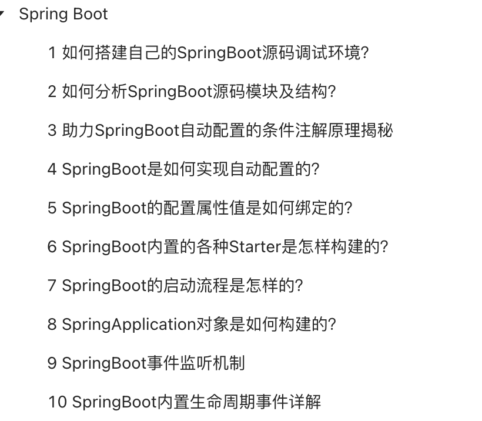

**Spring Boot Internals** is exclusive to my [Knowledge Planet](https://javaguide.cn/about-the-author/zhishixingqiu-two-years.html) community (follow the link for details and instructions on joining) and is included in the [Java Source Code Reading Series](https://javaguide.cn/zhuanlan/source-code-reading.html).

<!-- @include: @yuanma.snippet.md -->

<!-- @include: @article-footer.snippet.md -->
