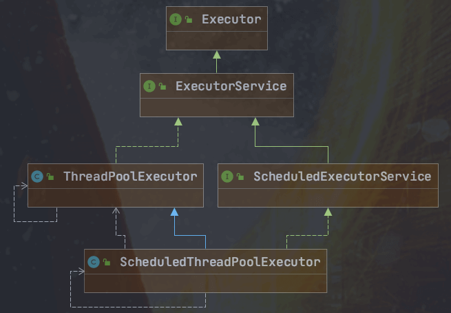
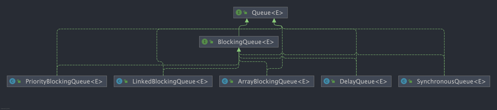
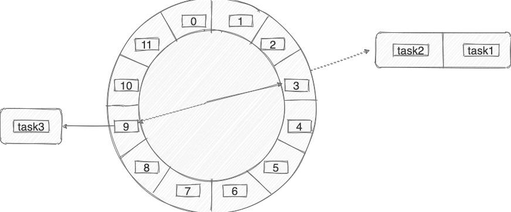
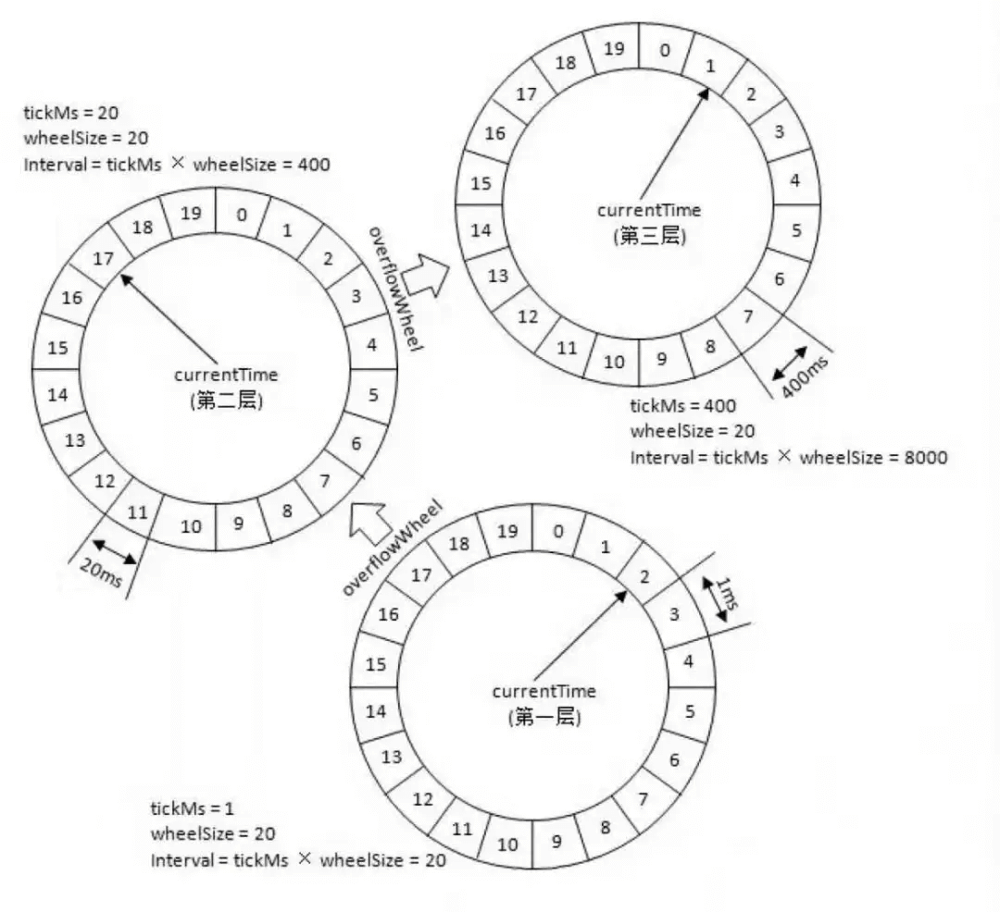
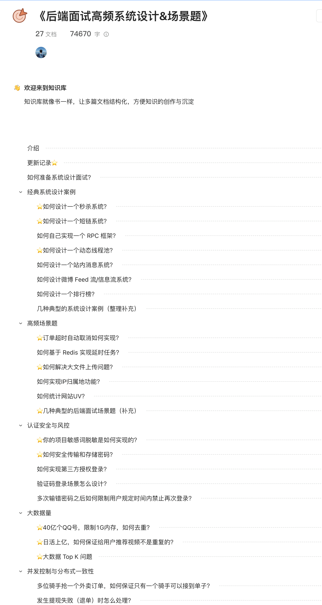
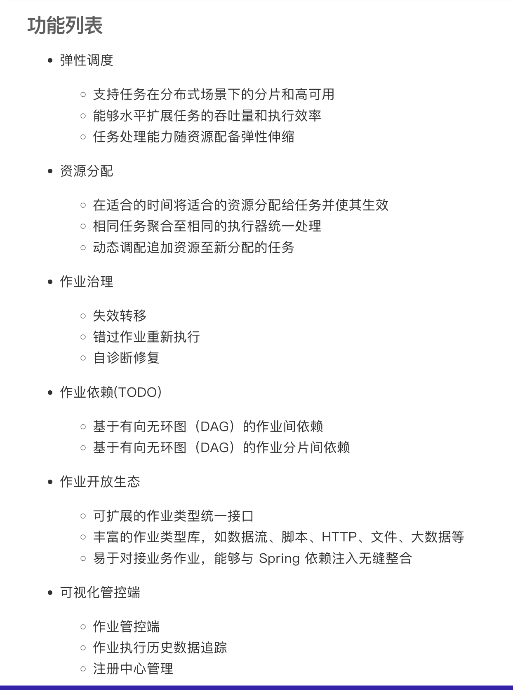
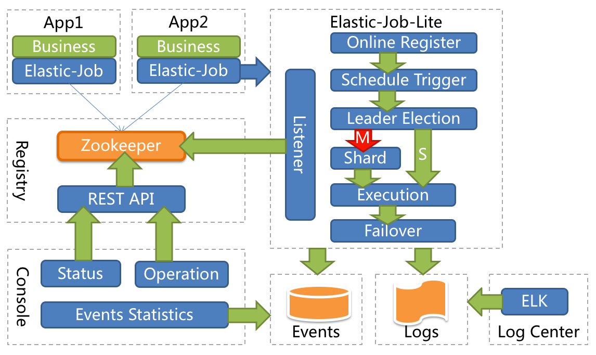
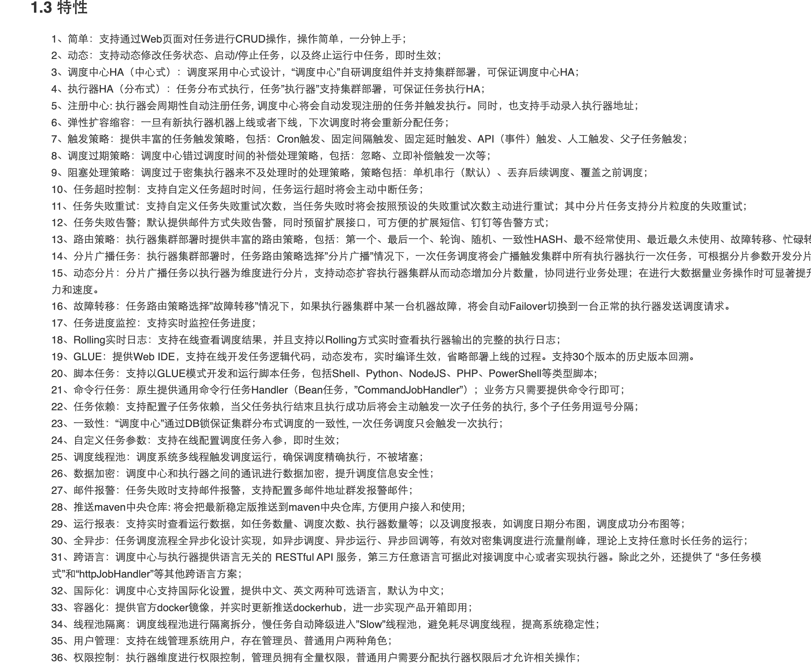
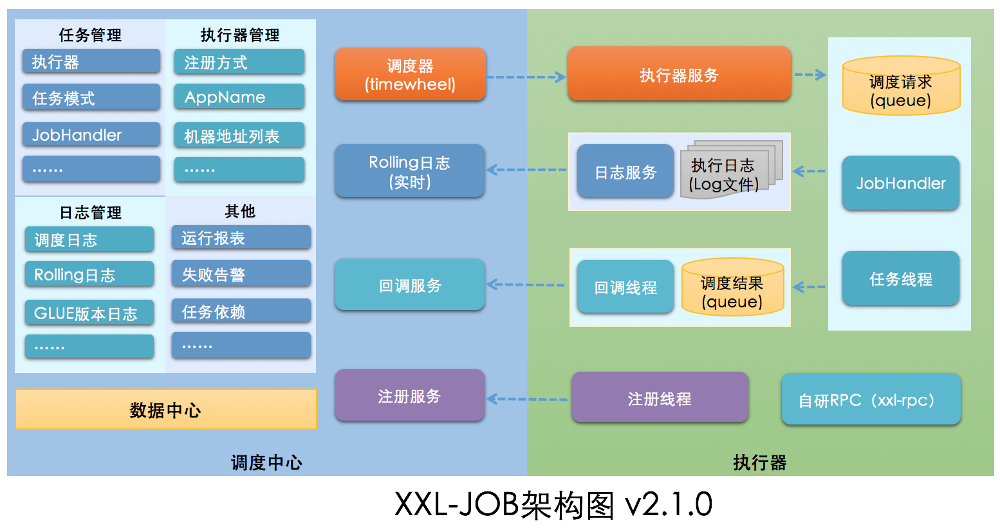
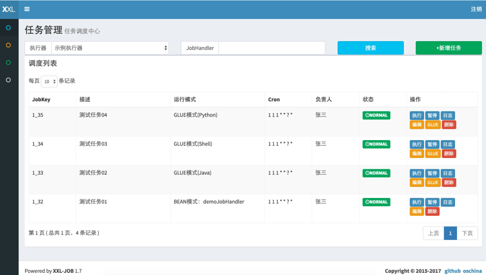

## Why Use Scheduled Tasks?

Here are some common use cases:

1. A system backs up its data at 1 a.m.
2. An e-commerce platform cancels an order if the user has not paid within 30 minutes.
3. A media aggregator fetches data from another website every 10 minutes.
4. A blogging platform schedules articles for publication.
5. An investment platform calculates each user's daily returns every evening and sends an update.
6. ……

These scenarios require an action to run at a specific future time, either on a schedule or after a delay.

- **Scheduled task**: Runs at a specified time, such as 8 a.m. every day or 3 p.m. every Monday. Common uses include backups, log cleanup, and report generation.
- **Delayed task**: Runs after a specified delay, such as 10 minutes or 3 hours. Common uses include asynchronous work such as order cancellation, notifications, and retracting a red envelope.

Although they serve different use cases, both schedule a task to run at a future time.

## Scheduling on a Single Machine

### Timer

`java.util.Timer` has been available since JDK 1.3 as an implementation of scheduled tasks.

`Timer` stores scheduled tasks in a `TaskQueue`, a priority queue implemented as a min-heap. The queue orders tasks by their next execution time, so the task at the top of the heap runs first.

`Timer` is simple to use. The following example creates a task that runs after one second.

```java
// Example:
TimerTask task = new TimerTask() {
    public void run() {
        System.out.println("Current time: " + new Date() + "\n" +
                "Thread name: " + Thread.currentThread().getName());
    }
};
System.out.println("Current time: " + new Date() + "\n" +
        "Thread name: " + Thread.currentThread().getName());
Timer timer = new Timer("Timer");
long delay = 1000L;
timer.schedule(task, delay);


// Output:
Current time: Fri May 28 15:18:47 CST 2021
Thread name: main
Current time: Fri May 28 15:18:48 CST 2021
Thread name: Timer
```

However, `Timer` has several limitations. Each instance uses a single background thread to run tasks sequentially, so a long-running task delays other tasks. If `TimerTask#run()` throws an uncaught runtime exception or error, the only execution thread terminates and no more tasks are scheduled. Saying that “`Timer` only catches `InterruptedException`” does not accurately describe this behavior.

The `Timer` class includes the following note:

```JAVA
 * This class does not offer real-time guarantees: it schedules
 * tasks using the <tt>Object.wait(long)</tt> method.
 *Java 5.0 introduced the {@code java.util.concurrent} package and
 * one of the concurrency utilities therein is the {@link
 * java.util.concurrent.ScheduledThreadPoolExecutor
 * ScheduledThreadPoolExecutor} which is a thread pool for repeatedly
 * executing tasks at a given rate or delay.  It is effectively a more
 * versatile replacement for the {@code Timer}/{@code TimerTask}
 * combination, as it allows multiple service threads, accepts various
 * time units, and doesn't require subclassing {@code TimerTask} (just
 * implement {@code Runnable}).  Configuring {@code
 * ScheduledThreadPoolExecutor} with one thread makes it equivalent to
 * {@code Timer}.
```

In short, `ScheduledThreadPoolExecutor` is a more capable replacement for `Timer` that can run scheduled tasks on multiple threads.

### ScheduledExecutorService

`ScheduledExecutorService` is an interface with several implementations. `ScheduledThreadPoolExecutor` is the most commonly used.



`ScheduledThreadPoolExecutor` is a thread pool that can run tasks concurrently. It uses `DelayedWorkQueue` internally as its task queue.

```java
// Example:
TimerTask repeatedTask = new TimerTask() {
    @SneakyThrows
    public void run() {
        System.out.println("Current time: " + new Date() + "\n" +
                "Thread name: " + Thread.currentThread().getName());
    }
};
System.out.println("Current time: " + new Date() + "\n" +
        "Thread name: " + Thread.currentThread().getName());
ScheduledExecutorService executor = Executors.newScheduledThreadPool(3);
long delay  = 1000L;
long period = 1000L;
executor.scheduleAtFixedRate(repeatedTask, delay, period, TimeUnit.MILLISECONDS);
Thread.sleep(delay + period * 5);
executor.shutdown();
// Output:
Current time: Fri May 28 15:40:46 CST 2021
Thread name: main
Current time: Fri May 28 15:40:47 CST 2021
Thread name: pool-1-thread-1
Current time: Fri May 28 15:40:48 CST 2021
Thread name: pool-1-thread-1
Current time: Fri May 28 15:40:49 CST 2021
Thread name: pool-1-thread-2
Current time: Fri May 28 15:40:50 CST 2021
Thread name: pool-1-thread-2
Current time: Fri May 28 15:40:51 CST 2021
Thread name: pool-1-thread-2
Current time: Fri May 28 15:40:52 CST 2021
Thread name: pool-1-thread-2
```

Neither `Timer` nor `ScheduledExecutorService` supports Cron expressions for specifying exact execution times.

### DelayQueue

`DelayQueue`, provided by the JUC package (`java.util.concurrent`), is a delayed queue that can be used for tasks such as canceling an order if it has not been paid within 15 minutes. It is a thread-safe implementation of `BlockingQueue` backed by an unbounded `PriorityQueue`. See [PriorityQueue source code analysis](https://javaguide.cn/java/collection/priorityqueue-source-code.html) for more details about `PriorityQueue`.



Both `DelayQueue` and `Timer/TimerTask` can serve as the basis for delayed scheduling. `DelayQueue` uses a priority queue to manage elements that implement `Delayed`; an element can only be retrieved after its delay expires. It does not create threads to run tasks, so an application usually needs a consumer loop and an executor. `Timer` provides its own execution thread. Both allow tasks to be added after initialization and support canceling or removing tasks, so it is incorrect to say that “`Timer` only accepts tasks when it is created.”

For more information about `DelayQueue`, see [`DelayQueue` source code analysis](https://javaguide.cn/java/collection/delayqueue-source-code.html).

### Spring Task

Spring's `@Scheduled` annotation makes it easy to define scheduled tasks.

```java
/**
 * cron: Use a Cron expression. Run at seconds 1 and 2 of every minute.
 */
@Scheduled(cron = "1-2 * * * * ? ")
public void reportCurrentTimeWithCronExpression() {
  log.info("Cron Expression: The time is now {}", dateFormat.format(new Date()));
}

```

I used Spring Task to schedule jobs in an enterprise SSM project I built at university.

Spring Task also supports **Cron expressions**, which define when and how often a scheduled job runs. A Cron expression can specify, for example, the time of day or day of the month when a task runs. If you are learning about scheduled tasks, Cron expressions are worth studying. Try this [online Cron expression generator](http://cron.qqe2.com/).

Spring's built-in scheduling is relatively simple and does not coordinate tasks across a cluster. For more details, see [Schedule Tasks in Spring Boot in Five Minutes](https://mp.weixin.qq.com/s?__biz=Mzg2OTA0Njk0OA==&mid=2247485563&idx=1&sn=7419341f04036a10b141b74624a3f8c9&chksm=cea247b0f9d5cea6440759e6d49b4e77d06f4c99470243a10c1463834e873ca90266413fbc92&token=2133161636&lang=zh_CN#rd).

Spring provides the scheduling abstraction through `TaskScheduler`, which can use different underlying implementations. The common `ThreadPoolTaskScheduler` delegates to `ScheduledExecutorService`; environments such as Jakarta EE can also use a container-managed scheduler. `@Scheduled` does not provide cluster coordination. If the application runs on multiple instances, each instance may trigger the task.

**Pros and cons:**

- **Pros:** Simple, lightweight, and supports Cron expressions.
- **Cons:** Limited functionality.

### Timing Wheel

Kafka, Dubbo, ZooKeeper, Netty, Caffeine, and Akka all have timing wheel implementations.

A timing wheel is a circular queue, usually backed by an array. Each slot can hold a list of scheduled tasks.

Each slot represents the wheel's basic time interval, or precision. If the wheel advances one slot per second, its precision is one second, so tasks due in 3 seconds and 3.9 seconds fall into the same slot.

The diagram below shows a timing wheel with 12 slots, which takes 12 seconds to complete one rotation. To schedule a task 3 seconds from now, place it in slot 3; to schedule one 9 seconds from now, place it in slot 9.



What if a task should run in 13 seconds? We can track the number of **remaining rotations**. The task is placed in slot 1 and records how many rotations remain. It runs after one full rotation plus one second. Implementations may differ in whether they count the current slot as a rotation, so the count depends on the specific implementation.

Another approach is a **hierarchical timing wheel**, similar to a watch. Kafka uses this design.

The example below illustrates how a hierarchical timing wheel works.



In the wheel above (milliseconds to seconds), level 1 has a precision of 1, level 2 a precision of 20, and level 3 a precision of 400. Suppose we add task A, due in 350 seconds, when the current time is 0. It is placed in slot 17 of level 2 because that level spans 20 × 20 = 400 seconds, and 350 / 20 = 17.

After level 1 completes 17 rotations, 340 seconds have passed and the level 2 pointer reaches slot 17. The task in that slot is then moved to level 1.

Task A is now due in 10 seconds, so it is moved to slot 10 of level 1.

Moving tasks between levels is called promotion or demotion in the timing wheel. A watch provides a useful analogy.

**Timing wheels are well suited to managing large numbers of timers. In typical implementations with a bounded number of levels and slots per level, locating a slot, inserting a task, and advancing the pointer are usually close to O(1). The actual work at each tick still depends on the number of due tasks, cascading migrations, and implementation details.**

## Distributed Scheduled Tasks

### Redis

Redis can be used to implement delayed tasks. Common approaches include:

1. Listening for Redis expiration events.
2. Using Redisson's built-in delayed queue.

For more details, see [High-Frequency Backend System Design and Scenario Interview Questions](https://javaguide.cn/zhuanlan/back-end-interview-high-frequency-system-design-and-scenario-questions.html). The topic is too extensive to repeat here.



### Message Queues

Most message queues, including RocketMQ and RabbitMQ, support scheduled or delayed messages. Both let the server deliver a message to a consumer at a specified time.

Before using scheduled messages in a message queue, check the limitations of the specific product and version. For example, the official RocketMQ 4.x implementation provides 18 fixed delay levels, up to 2 hours. RocketMQ 5.x instead sets the delivery time using a Unix timestamp in milliseconds, with a default maximum scheduling range of 24 hours. These version-specific mechanisms should not be conflated.

**Pros and cons:**

- **Pros:** Integrates with Spring, supports distributed deployments and clusters, and offers good performance.
- **Cons:** Limited flexibility and functionality; message delivery reliability must be ensured.

## Distributed Task Scheduling Frameworks

For advanced features such as task sharding and high availability in distributed environments, use a distributed task scheduling framework.

A distributed scheduled task usually involves these roles:

- **Task**: The business logic to run, such as publishing an article at a scheduled time.
- **Scheduler**: The scheduling center manages tasks and assigns them to workers.
- **Worker**: Receives and executes tasks assigned by the scheduler.

### Quartz

Quartz is a popular, open-source scheduling framework written entirely in Java. It is a long-standing reference in the Java scheduling ecosystem. Some other frameworks, such as Dangdang's `ElasticJob`, were originally developed on top of it.

Quartz integrates with Spring and supports dynamic task creation and clustering. However, its API can be cumbersome to use.

Quartz does not include a built-in UI console. You can use the open-source [quartzui](https://github.com/zhaopeiym/quartzui) project for this purpose.

Quartz also supports distributed scheduling through database-level locking. This approach has drawbacks, including significant database coupling and uneven load across nodes.

**Pros and cons:**

- **Pros:** Integrates with Spring and supports dynamic task creation and clustering.
- **Cons:** Distributed support is less convenient, it lacks visual task management, and it is harder to use than similar frameworks.

### ElasticJob

ElasticJob was originally open-sourced by Dangdang and historically had two subprojects: ElasticJob-Lite and ElasticJob-Cloud. That distinction and ElasticJob-Cloud's Mesos dependency belong to older versions and should not guide current selection. The current project describes ElasticJob as a lightweight, decentralized solution for distributed task sharding, with ZooKeeper and etcd as registry options.

`ElasticJob` supports task sharding and high availability in distributed environments, as well as visual task management.



The diagram below shows an older ElasticJob-Lite architecture using ZooKeeper as its registry. It illustrates decentralized scheduling; current versions also support etcd, so the diagram should not be treated as the only deployment option.



In this deployment, ElasticJob has no centralized scheduler and uses ZooKeeper to coordinate task shards across nodes. Current versions can also use etcd as the registry.

In ElasticJob, workers trigger scheduled tasks themselves. This is called a decentralized design: scheduling and execution happen on the workers.

The current official Spring Boot Starter registers jobs through Spring Beans and configuration files; it does not provide an `@ElasticJobConf` annotation. The example below uses ZooKeeper as the registry:

```java
@Component
public class TestJob implements SimpleJob {
    @Override
    public void execute(ShardingContext context) {
        System.out.printf("Job name: %s, total shards: %d, current shard parameter: %s%n",
                context.getJobName(),
                context.getShardingTotalCount(),
                context.getShardingParameter());
    }
}
```

```yaml
elasticjob:
  regCenter:
    serverLists: localhost:2181
    namespace: elasticjob-demo
  jobs:
    dayJob:
      elasticJobClass: com.example.job.TestJob
      cron: 0/10 * * * * ?
      shardingTotalCount: 2
      shardingItemParameters: 0=AAAA,1=BBBB
```

Configuration properties and supported registries can change between versions. When integrating, refer to the documentation for your version: [Spring Boot Starter](https://shardingsphere.apache.org/elasticjob/current/en/user-manual/usage/job-api/spring-boot-starter/) and [registry configuration](https://shardingsphere.apache.org/elasticjob/current/en/user-manual/configuration/registry-center/).

**Related links:**

- GitHub: <https://github.com/apache/shardingsphere-elasticjob>.
- Official website: <https://shardingsphere.apache.org/elasticjob/index_zh.html>.

**Pros and cons:**

- **Pros:** Integrates with Spring, supports distributed clusters, performs well, and provides visual task management.
- **Cons:** Requires a registry such as ZooKeeper or etcd, adding operational complexity and maintenance costs.

### XXL-JOB

`XXL-JOB` was open-sourced in 2015. It is a lightweight distributed task scheduling framework with visual task management, elastic scaling, retries and alerts on failure, task sharding, and other features.



According to the `XXL-JOB` website, the framework addresses several limitations of Quartz:

> Quartz is a leading open-source job scheduler and is often a first choice. However, in a cluster, managing its jobs through APIs avoids some issues but introduces others:
>
> - Issue 1: Managing jobs through API calls is inconvenient.
> - Issue 2: Business `QuartzJobBean` instances must be persisted in database tables, coupling the application to Quartz.
> - Issue 3: Scheduling logic and `QuartzJobBean` implementations live in the same project. As the number and complexity of scheduled jobs grow, business workloads can limit scheduler performance.
> - Issue 4: Quartz nodes compete for database locks, which can lead to uneven load. XXL-JOB assigns jobs collaboratively through executors to balance work across the cluster.
>
> XXL-JOB addresses these limitations of Quartz.

The architecture of `XXL-JOB` is shown below:



`XXL-JOB` consists of two main components: the **admin center** and **executors**. The admin center manages jobs, executors, and logs. Executors receive scheduling requests and run jobs. The admin center uses its own RPC mechanism to dispatch tasks.

Unlike ElasticJob's decentralized design, `XXL-JOB` uses a centralized design: a scheduling center dispatches tasks to multiple executors.

Like Quartz, `XXL-JOB` uses database locks when scheduling tasks and can encounter performance bottlenecks. For workloads that are not especially large, it is often sufficient for most organizations.

The current version recommends using `@XxlJob` on a no-argument `void` method in a Spring Bean. Use `XxlJobHelper` to access parameters, write logs, and report execution results. `@JobHandler` and methods that accept a `String` and return `ReturnT` belong to the older API.

```java
@Component
public class MyApiJobHandler {

    @XxlJob("myApiJobHandler")
    public void execute() {
        String param = XxlJobHelper.getJobParam();
        XxlJobHelper.log("Job parameter: {}", param);
        // Run the business logic. The default result is success; call XxlJobHelper.handleFail(...) on failure.
    }
}
```



**Related links:**

- GitHub: <https://github.com/xuxueli/xxl-job/>.
- Official website: <https://www.xuxueli.com/xxl-job/>.

**Pros and cons:**

- **Pros:** Easy to get started, integrates with Spring, supports distributed clusters, and provides visual task management.
- **Cons:** Dynamic task creation is not supported through the standard workflow. For a workaround, see [XXL-JOB issue 277](https://github.com/xuxueli/xxl-job/issues/277).

### PowerJob

PowerJob is a newer distributed task scheduling framework worth considering. Organizations that have adopted it include OPPO, JD.com, ZTO Express, and Cisco.

Its origins are interesting. The author interned at Alibaba, which used SchedulerX, an internal product also available as a paid Alibaba Cloud service. After the internship, the author left Alibaba and started PowerJob as an alternative in case SchedulerX no longer met their needs.

For more about PowerJob's origins, see the author's video [My Journey with a Task Scheduling Middleware](https://www.bilibili.com/video/BV1SK411A7F3/). The gist is: “Games no longer interested me, so I decided to build a new generation of distributed task scheduling and computing framework.”

SchedulerX is a commercial product, so it is not covered in detail here. The PowerJob project has also compared itself with Quartz, XXL-JOB, and SchedulerX. The table below is a feature comparison from the project maintainers, not an independent benchmark. Validate performance and capacity against the version, database, deployment size, and workload you plan to use.

| Feature                    | Quartz                                                     | XXL-JOB                                               | SchedulerX 2.0                                                      | PowerJob                                                                    |
| -------------------------- | ---------------------------------------------------------- | ----------------------------------------------------- | ------------------------------------------------------------------- | --------------------------------------------------------------------------- |
| Schedule types             | Cron                                                       | Cron                                                  | Cron, fixed rate, fixed delay, OpenAPI                              | **Cron, fixed rate, fixed delay, OpenAPI**                                  |
| Job types                  | Built-in Java                                              | Built-in Java, GLUE Java, Shell, Python scripts, etc. | Built-in Java, external Java (Fat JAR), Shell, Python scripts, etc. | **Built-in Java, external Java (container), Shell, Python scripts, etc.**   |
| Distributed computing      | None                                                       | Static sharding                                       | Dynamic MapReduce sharding                                          | **Dynamic MapReduce sharding**                                              |
| Online job management      | No                                                         | Yes                                                   | Yes                                                                 | **Yes**                                                                     |
| Web-based logs             | No                                                         | Yes                                                   | No                                                                  | **Yes**                                                                     |
| Scheduling and performance | Database locks; potential bottleneck                       | Database locks; potential bottleneck                  | Not specified                                                       | **Maintainers claim a lock-free design; benchmark actual capacity**         |
| Alerts and monitoring      | None                                                       | Email                                                 | SMS                                                                 | **Webhooks, email, DingTalk, and custom extensions**                        |
| System dependencies        | JDBC-compatible relational databases (MySQL, Oracle, etc.) | MySQL                                                 | Commercial service                                                  | **Relational databases supported by Spring Data JPA (MySQL, Oracle, etc.)** |
| DAG workflows              | No                                                         | No                                                    | Yes                                                                 | **Yes**                                                                     |

## Summary of Scheduling Options

Common single-machine scheduling options include `Timer`, `ScheduledExecutorService`, `DelayQueue`, Spring Task, and timing wheels. For ordinary Java periodic or delayed tasks, prefer `ScheduledExecutorService` or Spring Task. Timing wheels suit workloads with many timers that can trade precision for scheduling performance; they are not the default choice for every single-machine task.

Redis and message queues can trigger delayed work in distributed systems, but they usually do not provide complete workflow orchestration, sharding, failure compensation, or visual management. Reliable message queues commonly provide at-least-once delivery, so timeouts, retries, or failovers can result in duplicate delivery; consumers must therefore be idempotent. A periodic task requires the scheduler to keep generating trigger events and is unrelated to whether a single message can be “consumed multiple times.” Message queues remain useful for one-time delayed triggers, such as order cancellation, and for decoupling scheduling from execution.

Before putting any option into production, define the following behaviors:

- Whether tasks are idempotent and how to handle duplicate execution.
- Whether missed tasks should run later, be skipped, or be coalesced after downtime.
- Timeout, retry, backoff, maximum-attempt, dead-letter, and manual compensation policies.
- How to handle time zones, daylight saving time, clock rollback, and clock skew across a cluster.
- How to prevent unintended duplicate scheduling in a cluster and monitor and alert on latency, success rates, retries, and backlogs.

Quartz, ElasticJob, XXL-JOB, and PowerJob are frameworks built for distributed scheduling. They provide more complete features for distributed scheduled tasks and are well suited to periodic work. All but Quartz support visual task management.

XXL-JOB, released in 2015, is relatively easy to adopt and uses centralized scheduling. ElasticJob uses decentralized scheduling and coordinates task sharding through ZooKeeper or etcd. Their architectures and operational dependencies differ, so this alone does not prove that one framework “performs better.” Benchmark the specific versions against your task count, trigger frequency, shard count, recovery requirements, and database or registry load. Evaluate PowerJob and other frameworks using the same criteria rather than relying only on feature comparisons from their maintainers.

This article does not walk through a full implementation, but hands-on experience still matters. Before writing it, I built demos for these frameworks. I had used Quartz at university with Spring, and later tried it again with Spring Boot. It is hard to claim that a framework is difficult to use without having tried it.

<!-- @include: @article-footer.snippet.md -->
