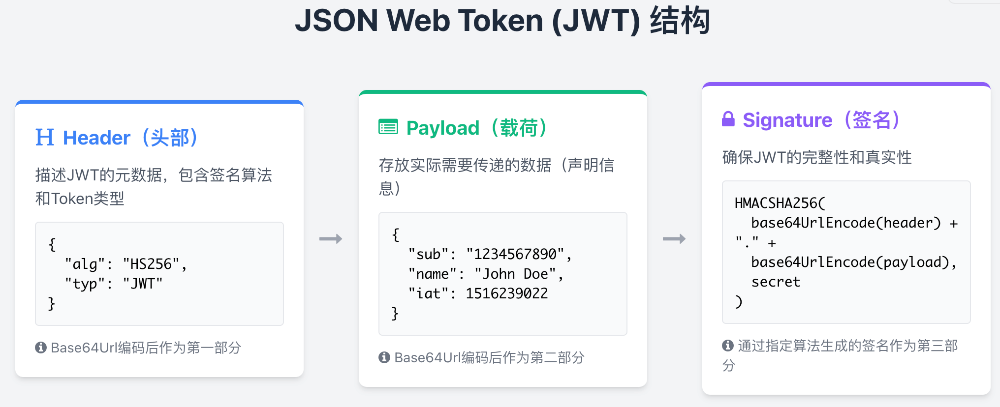

In campus interviews, most candidates I meet use JWT for authentication. They can usually answer basic questions about what JWT is and why it is used. But only a few can explain its problems and how to address them.

JWT is not a silver bullet. It has drawbacks and is often not the best choice. This article discusses its advantages, limitations, and common problems, and explains why many people no longer recommend using it everywhere.

For an introduction to JWT, see [JWT Fundamentals](https://javaguide.cn/system-design/security/jwt-intro.html).

## Advantages of JWT

Compared with Session-based authentication, JWT has four main advantages.

### Statelessness

A JWT contains the information needed for authentication, so the server does not need to store the token itself. This can improve availability and scalability while reducing server-side load.

But this statelessness also creates JWT's biggest drawback: **limited control**.

For example, if you want to revoke a JWT or change its permissions before it expires, the change will not take effect immediately. You may have to wait for the token to expire. Similarly, a JWT remains valid after a user logs out. You can address this by adding server-side logic, such as storing revoked JWTs and checking each token before processing a request. The later sections discuss possible solutions in more detail; this is just a brief introduction.

### Using the Authorization Header Can Reduce Traditional CSRF Risk

**Cross-Site Request Forgery (CSRF)** is a type of web attack. It is less well known than SQL injection and XSS, but it is still a risk that developers must consider. Even Gmail, a product from a leading technology company, had a CSRF vulnerability disclosed in 2007, causing significant losses to users.

**What is cross-site request forgery?** In simple terms, an attacker uses your identity to send requests that harm you, such as a fraudulent transfer.

For example, Xiaozhuang logs in to an online bank, then visits the bank's forum. A post contains a link that says “Smart investing: earn over 10,000% per year.” Curious, Xiaozhuang clicks it and finds that CNY 10,000 has disappeared from the account. What happened? The attacker hid a request in the link. The browser sent a transfer request to the bank using Xiaozhuang's identity—specifically, by including the bank's Cookie.

```html
<a href="http://www.mybank.com/Transfer?bankId=11&money=10000"
  >Smart investing: earn over 10,000% per year</a
>
```

Traditional CSRF exploits the fact that browsers automatically attach credentials to requests. The most common such credential is a `SessionID` stored in a Cookie. Even if an attacker cannot read the `SessionID`, they may trick the browser into sending a request to the target site with that Cookie.

Clicking a link is not required. In many cases, simply opening a page can trigger a CSRF attack.

```html

```

**Why is CSRF risk often said to be lower when using JWT?**

If a client explicitly sends a JWT as a Bearer token in the HTTP `Authorization` header, the browser does not attach it automatically to cross-site requests as it does a Cookie. This can reduce traditional CSRF risk. The protection comes from how the credential is transmitted, not from the JWT data format itself.

However, do not assume that you should store JWTs in `localStorage`. Any malicious script running on a same-origin page can read Web Storage, so one XSS vulnerability can directly expose an access token or refresh token. Browser applications should choose an approach based on their threat model. Options include Cookies with `HttpOnly`, `Secure`, and an appropriate `SameSite` attribute, or a Backend For Frontend (BFF) that keeps tokens on the server.

If you store authentication credentials in Cookies, also provide CSRF protection—for example, with a CSRF token, `Origin`/`Referer` validation, and `SameSite` Cookies. `SameSite` is usually a defense-in-depth measure; it should not replace CSRF tokens on its own in every deployment.

Do not rely on a generic “suspicious string filter” to prevent XSS. A more reliable approach is to encode data correctly for the context where it is output, such as HTML, attributes, JavaScript, CSS, or URLs. If users are allowed to submit HTML, use a mature HTML sanitization library and keep it updated. You can also use mechanisms such as CSP for defense in depth.

### Suitable for Mobile Applications

Session-based authentication requires storing session data on the server and typically uses a Cookie to hold the `SessionId`, so it may be less convenient for mobile applications.

JWT authentication does not have this particular requirement. It can be used as long as the client can store the JWT, and JWTs can be used across programming languages.

> Why might Session-based authentication be less suitable for mobile applications?
>
> 1. **State management:** Sessions rely on server-side state, while mobile apps often need to handle unstable or interrupted connections. Maintaining long-lived sessions can increase network overhead and complexity.
> 2. **Compatibility:** Mobile apps often target several platforms, such as iOS, Android, and the web. Session management and storage may differ across platforms and create compatibility problems.
> 3. **Security:** Mobile devices often operate on untrusted networks and face risks of data exposure and attack. Storing sensitive session information on the device can increase the potential impact.

### Friendly to Single Sign-On

With Session-based authentication, single sign-on requires storing user session information on a server and can involve common cross-domain Cookie issues. With JWT, the token is stored on the client, so these particular issues do not arise in the same way.

## Common JWT Authentication Problems and Solutions

### A JWT Remains Valid After Logout and Similar Events

Related scenarios include:

- Logging out.
- Changing a password.
- The server changing a user's permissions or roles.
- An account being suspended or deleted.
- The server forcibly logging out a user.
- A user being kicked offline.
- …

This is not a problem with Session-based authentication: the server can delete the relevant Session record. JWT authentication is harder to handle. As noted above, once a JWT has been issued, it remains valid until it expires unless the backend adds other logic.

How can you address this? After reviewing several sources, I have summarized four approaches:

**1. Store JWTs in a database**

Store valid JWTs in a database, preferably an in-memory database such as Redis. To invalidate a token, delete it from Redis. The drawback is that every request must first check whether its JWT exists in Redis, which defeats the stateless property of JWT.

**2. Use a denylist**

Similarly, maintain a denylist in an in-memory database such as Redis. To invalidate a JWT, add it to the **denylist**. Every request must then check whether the JWT is on the list.

The first two approaches either store all valid JWTs or add selected ones to a denylist.

Although both approaches sacrifice JWT's statelessness, real-world projects commonly use them.

**3. Change the signing secret**

Create a separate secret for each user. To invalidate one of their JWTs, change that user's secret. But this can have greater drawbacks than using an in-memory database:

- In a distributed service, every machine must receive the updated secret when a new JWT is issued. You need to store the secrets in a database or another external service, which makes the design less different from Session-based authentication.
- If a user is logged in from two browsers or also from a phone, logging out in one place would force them to log in again everywhere else. That may not be desirable.

**4. Use short-lived tokens and rotate them frequently**

This is a simple approach, but the user's login state is not remembered for long, so they may need to log in frequently.

It is relatively easy to address the case where JWTs remain valid after a password change. One approach I consider useful is to **sign the JWT using a hash of the user's password**. If the password changes, previously issued tokens will no longer verify.

### JWT Renewal

JWTs should generally have a reasonably short lifetime. What happens when one expires? How can you refresh it without making users log in repeatedly?

Here is a common Session-based approach: **suppose a Session lasts 30 minutes. If the user makes a request within those 30 minutes, extend the Session by another 30 minutes.**

How can JWT authentication handle renewal? After reviewing several sources, I have summarized four approaches:

**1. Use an approach similar to Session renewal (not recommended)**

This works in many scenarios. Suppose the server issues a JWT that is valid for 30 minutes. During verification, if it is about to expire, the server generates a new JWT and sends it to the client. On each request, the client checks whether the new JWT differs from the old one and updates its local copy if needed. The problem is that renewal occurs only when a request happens close to expiration, which is not ideal for the client.

**2. Return a new JWT with every request (not recommended)**

This approach is simple, but can be expensive, especially if the server stores and manages JWTs.

**3. Set the JWT to expire at midnight (not recommended)**

This is a compromise that lets most users stay logged in during the day. It is suitable only for systems with modest security requirements.

**4. Use short-lived access tokens and long-lived refresh tokens (recommended)**

One token is a short-lived access token, for example, one that expires in half an hour. The other is a refresh token with a longer lifetime, used only to obtain new access tokens. They do not both have to use the JWT format. A refresh token has powerful permissions and a long lifetime, making it a valuable target for attackers. Using it less often does not mean it is unlikely to leak.

After login, the client sends the access token with each request. When it expires, the client uses the protected refresh token to obtain a new access token. Browser applications should not store refresh tokens in `localStorage` by default. A BFF or protected Cookie can reduce the risk of direct access by scripts.

This approach has some drawbacks:

- The client must support the flow.
- Refresh grants must be revoked when the user logs out, changes a password, or another security event occurs.
- There may be a short period when the JWT is unavailable during renewal. The client can use a timer to request a new access token before the current one expires.
- For public clients, the authorization server should rotate refresh tokens and detect reuse of an old token, or use sender-constrained refresh tokens. Refresh tokens should also be bound to the client, authorization scope, and resource server, and have an idle expiration time.

### JWTs Can Be Large

A JWT has a complex structure—header, payload, and signature—and contains extra information. Base64Url encoding also increases its size, adding network overhead.

JWT components:



Example JWT:

```plain
eyJhbGciOiJIUzI1NiIsInR5cCI6IkpXVCJ9.
eyJzdWIiOiIxMjM0NTY3ODkwIiwibmFtZSI6IkpvaG4gRG9lIiwiaWF0IjoxNTE2MjM5MDIyfQ.
SflKxwRJSMeKKF2QT4fwpMeJf36POk6yJV_adQssw5c
```

Possible solutions:

- Minimize the information in the JWT payload, keeping only necessary user and permission data.
- Compress the JWT with an algorithm such as GZIP before transmission to reduce its size.
- In some cases, a traditional token may be more suitable. It is usually just a unique identifier; the associated information, such as user ID, expiration, and permissions, is stored on the server, often in Redis.

## Summary

One important advantage of JWT is statelessness. In practice, however, using JWT sensibly for authentication may still require storing information about tokens.

JWT is not a silver bullet and has many drawbacks. Choose JWT or Session-based authentication according to the project's needs. Do not blindly praise JWT or dismiss other authentication methods.

You can also use a regular token—a randomly generated ID with no embedded information—together with Redis for authentication.

## References

- RFC 9700 - Best Current Practice for OAuth 2.0 Security: <https://www.rfc-editor.org/rfc/rfc9700.html>
- OWASP Session Management Cheat Sheet: <https://cheatsheetseries.owasp.org/cheatsheets/Session_Management_Cheat_Sheet.html>
- OWASP Cross Site Scripting Prevention Cheat Sheet: <https://cheatsheetseries.owasp.org/cheatsheets/Cross_Site_Scripting_Prevention_Cheat_Sheet.html>
- [Detailed Analysis of JWT](https://learnku.com/articles/17883)
- [How to Log Out When Using JWT](https://medium.com/devgorilla/how-to-log-out-when-using-jwt-a8c7823e8a6)
- [CSRF Protection with JSON Web JWTs](https://medium.com/@agungsantoso/csrf-protection-with-json-web-JWTs-83e0f2fcbcc)
- [Invalidating JSON Web JWTs](https://stackoverflow.com/questions/21978658/invalidating-json-web-JWTs)

<!-- @include: @article-footer.snippet.md -->
