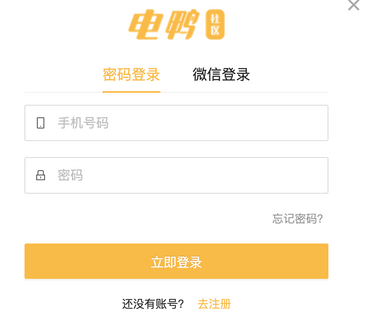
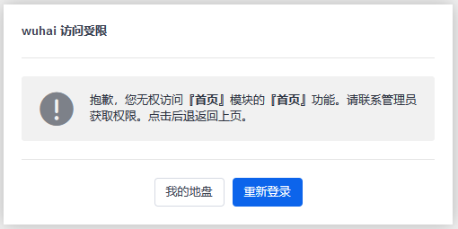
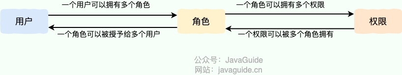
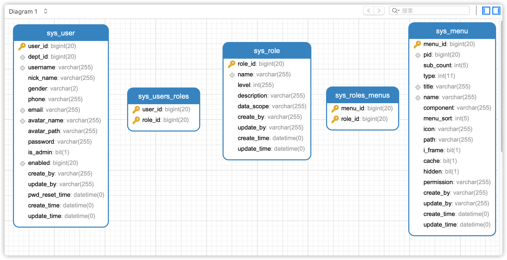
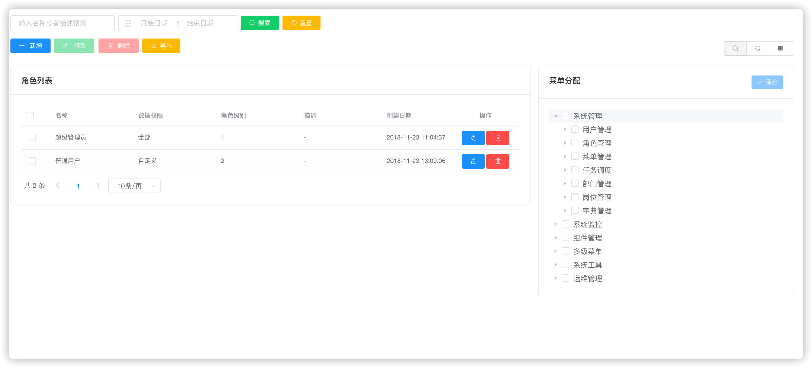
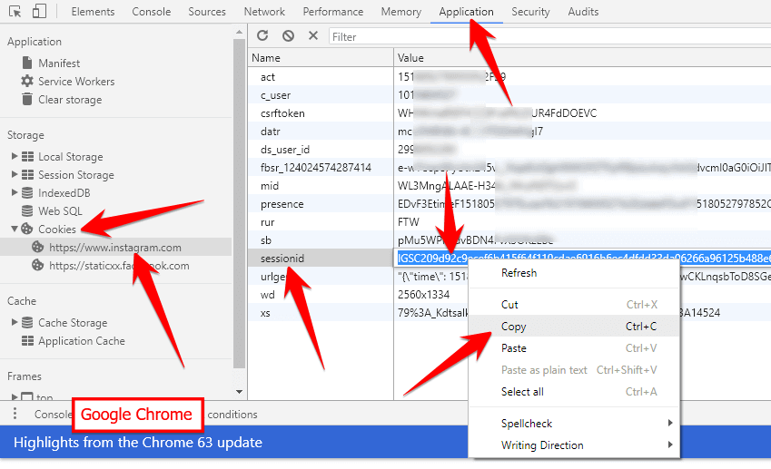
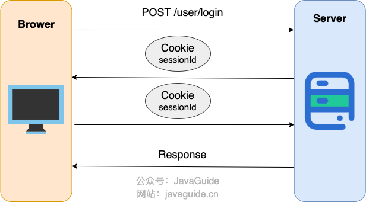
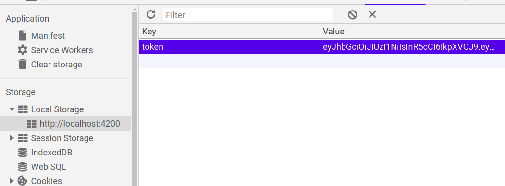
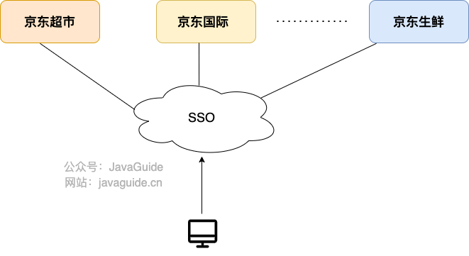
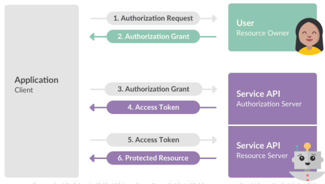

## What Is the Difference Between Authentication and Authorization?

This is a distinction many people confuse. The terms even sound similar, so start by learning how to pronounce them and what each one means.

In brief:

- **Authentication:** Who are you?
- **Authorization:** What are you allowed to do?

More formally:

- **Authentication** verifies a user's identity using credentials such as a username or user ID and password. It lets the system confirm that you are who you claim to be. It is also called identity or user verification.
- **Authorization** happens after authentication. It determines what the user can access and do. For example, only users with a specific role, such as an administrator, may access certain resources or perform operations such as deleting, adding, or updating system data.

Authentication:



Authorization:



Systems usually use both to protect their security.

## Are You Familiar with the RBAC Model?

The **RBAC model** is one of the most common access control models.

**What is RBAC?** Role-Based Access Control (RBAC) grants permissions through roles: permissions are assigned to roles, and users are assigned to roles.

In simple terms, a user can have several roles, and each role can have several permissions. This forms a **user–role–permission** model with many-to-many relationships between users and roles, and between roles and permissions.



In RBAC, permissions are associated with roles. Users receive the permissions of the roles to which they belong, which greatly simplifies permission management.

A common database design for this model uses five tables, two of which establish relationships between the other tables:



This model lets us create different roles and assign each role a different set of permissions, such as menu access.



Systems with strict access control requirements commonly use RBAC.

## What Is a Cookie? What Is It Used For?



`Cookie` and `Session` are both used to track a browser user's session, but they have different roles.

Wikipedia defines a `Cookie` as:

> Data stored on a user's local device by a website to identify the user (usually in encrypted form).

In short, **a `Cookie` is stored on the client and is commonly used to store user information**.

Common uses of `Cookie` include:

1. Storing information about a user who has logged in, so a site can prefill basic information on a later visit. A `Cookie` can also store preferences, themes, and other settings.
2. Storing a `SessionId` or `Token` and sending it with requests to the backend. The backend can then retrieve the corresponding `Session` or `Token` to identify the user's current state. This is useful because HTTP is stateless.
3. Recording and analyzing user behavior. For example, since HTTP is stateless, a server may use a `Cookie` to track how long a user stays on a page or which products they view.
4. …

## How Do You Use Cookies in a Project?

Here are examples from a Spring Boot project.

**1. Set a `Cookie` and return it to the client**

```java
@GetMapping("/change-username")
public String setCookie(HttpServletResponse response) {
    // Create a cookie
    Cookie cookie = new Cookie("username", "Jovan");
    // Set the cookie to expire in seven days
    cookie.setMaxAge(7 * 24 * 60 * 60); // expires in 7 days
    // Add it to the response
    response.addCookie(cookie);

    return "Username is changed!";
}
```

**2. Use Spring's `@CookieValue` annotation to get a specific cookie's value**

```java
@GetMapping("/")
public String readCookie(@CookieValue(value = "username", defaultValue = "Atta") String username) {
    return "Hey! My username is " + username;
}
```

**3. Read all cookie values**

```java
@GetMapping("/all-cookies")
public String readAllCookies(HttpServletRequest request) {

    Cookie[] cookies = request.getCookies();
    if (cookies != null) {
        return Arrays.stream(cookies)
                .map(c -> c.getName() + "=" + c.getValue()).collect(Collectors.joining(", "));
    }

    return "No cookies";
}
```

For more on using cookies in Spring Boot, see [How to Use Cookies in Spring Boot](https://attacomsian.com/blog/cookies-spring-boot).

## What Is the Difference Between a Cookie and a Session?

**A `Session` primarily lets the server keep track of a user's state.** A shopping cart is a typical example. Since HTTP is stateless, the server does not know which user is adding an item. After creating a `Session` for that user, it can identify and track them.

`Cookie` data is stored on the client (usually the browser), while `Session` data is stored on the server. A `Session` is generally more secure. Do not put sensitive information in a `Cookie`; if you need to store it, encrypt it and decrypt it on the server when required.

**How does authentication work with a `Session`?**

## How Does Session-Cookie Authentication Work?

Applications often use a `SessionID` to identify a user, and commonly store it in Redis. For example:

1. The user logs in successfully, and the server returns a `Cookie` containing a `SessionID`.
2. When the user sends a request to the backend, the browser includes the `SessionID`, allowing the backend to identify the session.

The process is shown in more detail below:



1. The user sends a username, password, and CAPTCHA to the server to log in.
2. After validating them, the server creates and stores a `Session` for the user. You can think of it as server-side storage for user state, such as shopping cart and login information. The server assigns the `Session` a unique `SessionID`.
3. The server sends the `SessionID` to the user's browser in the HTTP `Set-Cookie` response header.
4. The browser stores the `SessionID` in a `Cookie`. While the user remains logged in, the browser automatically includes this `Cookie` in requests within its scope.
5. The server reads the `SessionID` from the `Cookie` and looks up the corresponding `Session` to identify the user and retrieve their state.

Keep the following points in mind when using sessions:

- **Client cookie support:** Ensure that the browser has cookies enabled for features that depend on sessions.
- **Session expiration:** Set an appropriate expiration time to balance security and user experience.
- **Session ID security:** Set the `HttpOnly` flag on the `Cookie` containing the `SessionID` to prevent client-side scripts such as JavaScript from reading it. Set the `Secure` flag so the `SessionID` is sent only over HTTPS.

Spring Session provides a way to manage user sessions across multiple applications or instances. For more details, see:

- [Getting Started with Spring Session](https://codeboje.de/spring-Session-tutorial/)
- [Guide to Spring Session](https://www.baeldung.com/spring-Session)
- [Sticky Sessions with Spring Session and Redis](https://medium.com/@gvnix/sticky-Sessions-with-spring-Session-redis-bdc6f7438cc3)

## How Does Session-Cookie Authentication Work Across Multiple Servers?

Session-Cookie authentication works well in a single-server application. When the application scales horizontally across multiple servers, it faces a challenge.

Suppose identical servers A and B are running. When the user logs in, Nginx routes the request to server A through load balancing, and A stores the user's session. On the next request, Nginx may route the user to server B. Since B does not have that session, the user has to log in again.

**How can we prevent this?**

Here are a few possible approaches:

1. Route all requests from a user to the same server using a hash strategy. Each server stores sessions for some users. If a server goes down, all sessions stored on it are lost.
2. Synchronize session data across all servers. Whenever a session changes on one server, it is replicated to the others. This is costly, and the cost increases with the number of nodes.
3. Store session data in a shared data store, such as a cache, that every server can access. Avoid making this store a single point of failure; it should be highly available.
4. Use Spring Session to manage sessions across multiple servers. It integrates with backends such as Redis and MongoDB, storing session data in shared external storage so servers can access the same sessions.

## Can Sessions Work Without Cookies?

This is a classic interview question.

Sessions are commonly associated with a `SessionID` stored in a `Cookie`. If the client disables cookies and the application relies on this mechanism, sessions will not work as expected.

However, server-side sessions do not strictly require cookies. A non-browser client can send the session credential in an explicitly agreed-upon request header. Do not put a `SessionID` in a URL: even if encrypted, it remains a usable credential and may leak through browser history, access logs, monitoring systems, and the `Referer` header. URL rewriting should only be used for legacy compatibility when necessary, not as an authentication method for new systems.

## Why Does Cookie-Based Authentication Require More Attention to CSRF?

**CSRF (Cross-Site Request Forgery)** is an attack that uses your identity to send requests that harm you. For example:

Xiaozhuang logs in to an online bank and visits its forum. A post contains a link saying, “Smart investing, annual returns over 10,000%.” Curious, Xiaozhuang clicks it and finds that 10,000 yuan has disappeared from the account. The attacker hid a request in the link that uses Xiaozhuang's identity to make a bank transfer—in other words, the browser sent the request with the user's `Cookie`.

```html
<a href="http://www.mybank.com/Transfer?bankId=11&money=10000"
  >Smart investing, with annual returns over 10,000%</a
>
```

As noted above, `Session` authentication usually stores the `SessionId` in a `Cookie`. After login, the browser automatically includes the `Cookie` in requests within its scope, and the server uses the `SessionId` to identify the user. If an attacker steals the `SessionId`, that is session hijacking. CSRF usually does not require the attacker to read the `Cookie`; it exploits the browser's behavior of sending it automatically.

Because the browser sends the `SessionId` in the `Cookie`, an attacker can trick the user into clicking a malicious link and trigger an action as that user.

When a client explicitly sends a token as a Bearer token in the HTTP `Authorization` header, the browser does not automatically attach it to cross-site requests as it does a `Cookie`. This can reduce traditional CSRF risk. The protection comes from how the credential is sent, not from the token or JWT format itself.

Do not assume that tokens should therefore be stored in `localStorage` or `sessionStorage`. Malicious scripts running on the same origin can read Web Storage, so one XSS vulnerability may expose the token. Browser applications can use a Backend For Frontend (BFF), or cookies with `HttpOnly`, `Secure`, and an appropriate `SameSite` attribute. Cookie-based approaches should also use CSRF tokens, `Origin`/`Referer` validation, and other suitable protections.



Note that neither `Cookie` nor `Token` authentication prevents **Cross-Site Scripting (XSS)**. `HttpOnly` reduces the risk of scripts directly reading a cookie, but XSS can still let an attacker make requests as the user. Use layered defenses such as correct output encoding, HTML sanitization when needed, and CSP.

> Cross-Site Scripting is abbreviated as CSS, but that conflicts with Cascading Style Sheets (CSS). Some people therefore abbreviate it as XSS.

In an XSS attack, an attacker injects malicious code into another user's page. The script may then steal information such as a `Cookie`.

Recommended reading: [How to Prevent CSRF Attacks? — Meituan Technology](https://tech.meituan.com/2018/10/11/fe-security-csrf.html)

For security best practices, see:

- [OWASP Session Management Cheat Sheet](https://cheatsheetseries.owasp.org/cheatsheets/Session_Management_Cheat_Sheet.html)
- [OWASP Cross-Site Request Forgery Prevention Cheat Sheet](https://cheatsheetseries.owasp.org/cheatsheets/Cross-Site_Request_Forgery_Prevention_Cheat_Sheet.html)

## What Is a JWT? What Are Its Components?

[JWT Fundamentals](./jwt-intro.md)

## How Does JWT Authentication Work? How Can JWT Tampering Be Prevented?

[JWT Fundamentals](./jwt-intro.md)

## What Is SSO?

SSO (Single Sign-On) lets a user sign in to one application and then access other related applications. For example, after signing in to JD Finance, a user may also be signed in to other JD services such as JD Supermarket, JD Worldwide, and JD Fresh.



## What Are the Benefits of SSO?

- **For users:** Sign in once and access multiple services without remembering several usernames and passwords.
- **For system administrators:** Maintain one central account system.
- **For new application development:** Integrate with the central account system instead of building a separate login flow.

## How Do You Design an SSO System?

[SSO Fundamentals](./sso-intro.md)

## What Is OAuth 2.0?

OAuth is an industry-standard authorization protocol, primarily used to grant third-party applications limited access. OAuth 2.0 was a complete redesign of OAuth 1.0. OAuth 2.0 is faster and easier to implement; OAuth 1.0 has been deprecated. See [RFC 6749](https://tools.ietf.org/html/rfc6749) for details.

OAuth 2.0 is an authorization mechanism whose goal is to issue a time-limited token that lets a third-party application access specific resources.

Third-party login is a common OAuth 2.0 use case. OAuth 2.0 is also widely used for payments, such as WeChat Pay and Alipay, and for developer platforms such as the WeChat Open Platform and Alibaba Open Platform.

The diagram below illustrates [Slack OAuth 2.0 third-party login](https://api.slack.com/legacy/oauth):



**Recommended reading:**

- [OAuth 2.0 Explained Simply](http://www.ruanyifeng.com/blog/2019/04/oauth_design.html)
- [Understanding OAuth 2.0 in 10 Minutes](https://deepzz.com/post/what-is-oauth2-protocol.html)
- [The Four OAuth 2.0 Grant Types](http://www.ruanyifeng.com/blog/2019/04/oauth-grant-types.html)
- [GitHub OAuth Login Example](http://www.ruanyifeng.com/blog/2019/04/github-oauth.html)

## References

- [Do Not Replace Session Management with JWT: Understanding Tokens, JWT, OAuth, SAML, and SSO](https://zhuanlan.zhihu.com/p/38942172)
- [Introduction to JSON Web Tokens](https://jwt.io/introduction)
- [JSON Web Token Claims](https://auth0.com/docs/secure/tokens/json-web-tokens/json-web-token-claims)

<!-- @include: @article-footer.snippet.md -->
