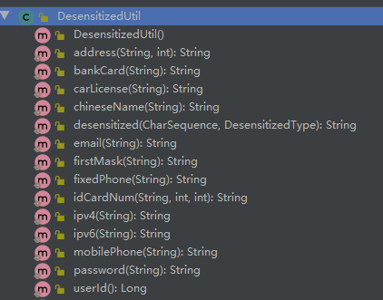
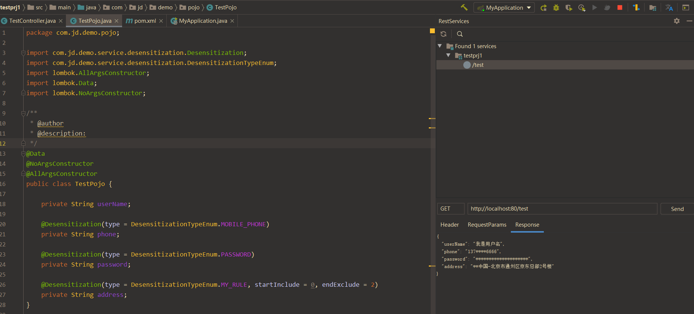

<!-- @include: @article-header.snippet.md -->

> Adapted from [Hutool: Mask Data in One Line - JD Cloud Developer](https://mp.weixin.qq.com/s/1qFWczesU50ndPPLtABHFg).

## What Is Data Masking?

### Definition

The Baidu Encyclopedia defines data masking as follows:

> Data masking transforms sensitive information according to masking rules to protect private data. This allows masked production datasets to be used safely in development, testing, other non-production environments, and outsourced environments. When customer or commercial data is involved, real data such as identity numbers, phone numbers, card numbers, and customer IDs must be transformed for testing without violating system rules. Data masking is a database security technique.

In short, data masking transforms sensitive information according to defined rules to protect private data.

Data masking uses different algorithms and techniques for different needs. For example, a masking algorithm can preserve the first few digits of an identity number and replace the rest with “X” or “\*”. Pseudonymization can replace a real name with a randomly generated alias.

### Common Masking Rules

Masking rules transform or modify sensitive data during processing or storage to protect it.

Common rules include:

- **Replacement (common):** Replace specific characters or sequences in sensitive data. For example, replace the middle digits of a credit card number with asterisks (\*) or another character.
- **Deletion:** Remove part of the sensitive data, such as three randomly selected digits from a phone number.
- **Shuffling:** Change the order of selected characters or fields, such as swapping randomly selected digits in an identity number.
- **Noise injection:** Add errors or noise to data, for example by inserting randomly generated characters.
- **Encryption or tokenization (common):** If the original value must be recoverable, use encryption with integrity protection. If not, choose truncation, tokenization, or HMAC with a separate key, depending on the use case. MD5 and SHA-256 are hash functions, not encryption algorithms. Unkeyed hashes of structured data such as bank card numbers can also be enumerated. See [Common Cryptographic Algorithms](https://javaguide.cn/system-design/security/encryption-algorithms.html).
- ……

## Common Data Masking Tools

### Hutool

Hutool is a Java utility library that wraps JDK functionality for files, streams, encryption and decryption, encoding, regular expressions, threads, and XML. It also provides these modules:

|        Module        | Description                                                                                                     |
| :------------------: | :-------------------------------------------------------------------------------------------------------------- |
|     `hutool-aop`     | Wraps JDK dynamic proxies and provides AOP support without an IoC container                                     |
| `hutool-bloomFilter` | Bloom filters using several hash algorithms                                                                     |
|    `hutool-cache`    | Simple cache implementations                                                                                    |
|    `hutool-core`     | Core utilities, including bean handling and date utilities                                                      |
|    `hutool-cron`     | Scheduled tasks with Crontab-like expressions                                                                   |
|   `hutool-crypto`    | Wrappers for symmetric, asymmetric, and digest algorithms                                                       |
|     `hutool-db`      | JDBC data access based on the ActiveRecord pattern                                                              |
|     `hutool-dfa`     | Multi-keyword search based on a DFA model                                                                       |
|    `hutool-extra`    | Wrappers for third-party tools such as template engines, email, Servlet, QR codes, emoji, FTP, and tokenization |
|    `hutool-http`     | HTTP client built on `HttpURLConnection`                                                                        |
|     `hutool-log`     | Logging facade that detects the available logging implementation                                                |
|   `hutool-script`    | Script execution, such as JavaScript                                                                            |
|   `hutool-setting`   | Enhanced support for Setting and Properties configuration files                                                 |
|   `hutool-system`    | Access to system properties such as JVM information                                                             |
|    `hutool-json`     | JSON support                                                                                                    |
|   `hutool-captcha`   | Image CAPTCHA generation                                                                                        |
|     `hutool-poi`     | Wrappers for Excel and Word support in POI                                                                      |
|   `hutool-socket`    | Java NIO and AIO socket wrappers                                                                                |
|     `hutool-jwt`     | JSON Web Token (JWT) implementation wrappers                                                                    |

Add individual modules as needed, or include them all with `hutool-all`. The data-masking utility used in this article is in the `hutool-core` module.

The current Hutool version supports masking these types of data, covering most common sensitive information:

1. User IDs.
2. Chinese names.
3. Identity numbers.
4. Landline numbers.
5. Mobile phone numbers.
6. Addresses.
7. Email addresses.
8. Passwords.
9. Mainland China license plates, including standard and new-energy vehicles.
10. Bank card numbers.

#### Mask Data in One Line

Hutool provides the masking methods shown below:



Hutool replaces sensitive characters with `*`. This is implemented by `StrUtil.hide`. To use a different masking character, copy and adapt the relevant Hutool source code.

The following test code demonstrates masking phone numbers, bank card numbers, identity numbers, and passwords.

```java
import cn.hutool.core.util.DesensitizedUtil;
import org.junit.Test;
import org.springframework.boot.test.context.Spring BootTest;

/**
 *
 * @description: Data masking with Hutool
 */
@Spring BootTest
public class HuToolDesensitizationTest {

    @Test
    public void testPhoneDesensitization(){
        String phone="13723231234";
        System.out.println(DesensitizedUtil.mobilePhone(phone)); // Output: 137****1234
    }
    @Test
    public void testBankCardDesensitization(){
        String bankCard="6217000130008255666";
        System.out.println(DesensitizedUtil.bankCard(bankCard)); // Output: 6217 **** **** *** 5666
    }

    @Test
    public void testIdCardNumDesensitization(){
        String idCardNum="411021199901102321";
        // Show only the first four and last two digits
        System.out.println(DesensitizedUtil.idCardNum(idCardNum,4,2)); // Output: 4110************21
    }
    @Test
    public void testPasswordDesensitization(){
        String password="www.jd.com_35711";
        System.out.println(DesensitizedUtil.password(password)); // Output: ****************
    }
}
```

This demonstrates data masking with Hutool's utility classes.

Note that a password is not an ordinary field that can be displayed or stored after masking. Hash passwords with a dedicated password-hashing algorithm as early as possible on the server; never store, return, or log them in plaintext. The `password()` method shown here only replaces every character with `*` and is not a substitute for password hashing.

#### Mask Data with Jackson Annotations

If many parts of the frontend need to display masked data, calling a utility method at each site creates duplication. An annotation can provide a cleaner approach.

In a Spring Boot web application, use Jackson's custom serialization support. The serializer masks values while converting them to JSON for the frontend.

**Step 1: Define an enum for masking strategies.**

```java
/**
 * @author
 * @description: Masking strategy enum
 */
public enum DesensitizationTypeEnum {
    // Custom rule
    MY_RULE,
    // User ID
    USER_ID,
    // Chinese name
    CHINESE_NAME,
    // Identity number
    ID_CARD,
    // Landline number
    FIXED_PHONE,
    // Mobile phone number
    MOBILE_PHONE,
    // Address
    ADDRESS,
    // Email address
    EMAIL,
    // Password
    PASSWORD,
    // Mainland China license plate, including standard and new-energy vehicles
    CAR_LICENSE,
    // Bank card number
    BANK_CARD
}
```

These are the supported masking types.

**Step 2: Define a `Desensitization` annotation.**

- `@Retention(RetentionPolicy.RUNTIME)`: Makes the annotation available at runtime.
- `@Target(ElementType.FIELD)`: Allows the annotation on fields.
- `@JacksonAnnotationsInside`: A meta-annotation that lets you combine other annotations.
- `@JsonSerialize`: Enables custom serialization. It can be applied to annotations, methods, fields, or classes; the serializer's overridden methods define the behavior.

```java
/**
 * @author
 */
@Target(ElementType.FIELD)
@Retention(RetentionPolicy.RUNTIME)
@JacksonAnnotationsInside
@JsonSerialize(using = DesensitizationSerialize.class)
public @interface Desensitization {
    /**
     * Data masking type. startInclude and endExclude apply to MY_RULE.
     */
    DesensitizationTypeEnum type() default DesensitizationTypeEnum.MY_RULE;

    /**
     * Inclusive start position for masking
     */
    int startInclude() default 0;

    /**
     * Exclusive end position for masking
     */
    int endExclude() default 0;
}
```

Note: The start and end positions apply only when the custom `MY_RULE` strategy is used.

**Step 3: Create a custom serializer.**

This is the key step. The custom serializer extends `JsonSerializer`, implements `ContextualSerializer`, and overrides two methods.

```java
/**
 * @author
 * @description: Custom serializer
 */
@AllArgsConstructor
@NoArgsConstructor
public class DesensitizationSerialize extends JsonSerializer<String> implements ContextualSerializer {
    private DesensitizationTypeEnum type;

    private Integer startInclude;

    private Integer endExclude;

    @Override
    public void serialize(String str, JsonGenerator jsonGenerator, SerializerProvider serializerProvider) throws IOException {
        switch (type) {
            // Mask according to a custom rule
            case MY_RULE:
                jsonGenerator.writeString(CharSequenceUtil.hide(str, startInclude, endExclude));
                break;
            // Mask the user ID
            case USER_ID:
                jsonGenerator.writeString(String.valueOf(DesensitizedUtil.userId()));
                break;
            // Mask a Chinese name
            case CHINESE_NAME:
                jsonGenerator.writeString(DesensitizedUtil.chineseName(String.valueOf(str)));
                break;
            // Mask an identity number
            case ID_CARD:
                jsonGenerator.writeString(DesensitizedUtil.idCardNum(String.valueOf(str), 1, 2));
                break;
            // Mask a landline number
            case FIXED_PHONE:
                jsonGenerator.writeString(DesensitizedUtil.fixedPhone(String.valueOf(str)));
                break;
            // Mask a mobile phone number
            case MOBILE_PHONE:
                jsonGenerator.writeString(DesensitizedUtil.mobilePhone(String.valueOf(str)));
                break;
            // Mask an address
            case ADDRESS:
                jsonGenerator.writeString(DesensitizedUtil.address(String.valueOf(str), 8));
                break;
            // Mask an email address
            case EMAIL:
                jsonGenerator.writeString(DesensitizedUtil.email(String.valueOf(str)));
                break;
            // Mask a password
            case PASSWORD:
                jsonGenerator.writeString(DesensitizedUtil.password(String.valueOf(str)));
                break;
            // Mask a mainland China license plate
            case CAR_LICENSE:
                jsonGenerator.writeString(DesensitizedUtil.carLicense(String.valueOf(str)));
                break;
            // Mask a bank card number
            case BANK_CARD:
                jsonGenerator.writeString(DesensitizedUtil.bankCard(String.valueOf(str)));
                break;
            default:
        }

    }

    @Override
    public JsonSerializer<?> createContextual(SerializerProvider serializerProvider, BeanProperty beanProperty) throws JsonMappingException {
        if (beanProperty != null) {
                // Check whether the field is a String
            if (Objects.equals(beanProperty.getType().getRawClass(), String.class)) {
                // Get the annotation
                Desensitization desensitization = beanProperty.getAnnotation(Desensitization.class);
                // Fall back to the context annotation if needed
                if (desensitization == null) {
                    desensitization = beanProperty.getContextAnnotation(Desensitization.class);
                }
                // Create the serializer if the annotation is present
                if (desensitization != null) {
                    // Pass the annotation's type, start position, and end position to the serializer.
                    return new DesensitizationSerialize(desensitization.type(), desensitization.startInclude(),
                            desensitization.endExclude());
                }
            }

            return serializerProvider.findValueSerializer(beanProperty.getType(), beanProperty);
        }
        return serializerProvider.findNullValueSerializer(null);
    }
}
```

These three steps implement annotation-based data masking. Now test it.

First, define a POJO and specify masking strategies for the relevant fields.

```java
/**
 *
 * @description: Test POJO
 */
@Getter
@Setter
@NoArgsConstructor
@AllArgsConstructor
public class TestPojo {

    private String userName;

    @Desensitization(type = DesensitizationTypeEnum.MOBILE_PHONE)
    private String phone;

    @Desensitization(type = DesensitizationTypeEnum.MY_RULE, startInclude = 0, endExclude = 2)
    private String address;
}
```

Next, add a test controller:

```java
@RestController
public class TestController {

    @RequestMapping("/test")
    public TestPojo testDesensitization(){
        TestPojo testPojo = new TestPojo();
        testPojo.setUserName("Example User");
        testPojo.setAddress("Building 2, JD Headquarters, Tongzhou, Beijing");
        testPojo.setPhone("13782946666");
        return testPojo;
    }

}
```



The output shows that data masking is working.

### Apache ShardingSphere

ShardingSphere is an open-source ecosystem of distributed database middleware solutions. It consists of three independent products: Sharding-JDBC, Sharding-Proxy, and Sharding-Sidecar (planned at the time of writing). They provide standardized data sharding, distributed transactions, and database governance.

Apache ShardingSphere includes a data-masking module with common masking features. It parses and intercepts user SQL, then rewrites it according to the configured rules to encrypt plaintext fields and decrypt encrypted fields. This makes encryption, decryption, storage, and queries transparent to the user.

Apache ShardingSphere automates and makes data masking transparent, so users do not need to handle its implementation details. It provides built-in and third-party masking strategies that can be enabled with configuration.

Documentation: <https://shardingsphere.apache.org/document/4.1.1/cn/features/orchestration/encrypt/>.

### FastJSON

In web development, FastJSON is a common alternative to Spring's default serialization tools for Spring REST APIs.

FastJSON supports data masking in two main ways:

- **Using `@JSONField`:** Create a custom serializer, then set the `serializeUsing` property on each field that needs masking.
- **Using a serialization filter:** Implement `ValueFilter`, override `process` to apply the masking, and use the filter when converting to JSON. See this [implementation example](https://juejin.cn/post/7067916686141161479).

### Mybatis-Mate

First, here is how MyBatis, MyBatis-Plus, and Mybatis-Mate relate to each other:

- MyBatis is a persistence framework that supports custom SQL, stored procedures, and advanced mappings.
- MyBatis-Plus extends MyBatis and can simplify persistence-layer development.
- Mybatis-Mate is an enterprise module for MyBatis-Plus that aims to make data handling more efficient. It requires a paid license.

Mybatis-Mate supports data masking and includes nine common rules for values such as phone numbers, email addresses, and bank card numbers.

```java
@FieldSensitive("testStrategy")
private String username;

@Configuration
public class SensitiveStrategyConfig {

    /**
     * Register the masking strategy
     */
    @Bean
    public ISensitiveStrategy sensitiveStrategy() {
        // Define a custom masking rule named testStrategy
        return new SensitiveStrategy().addStrategy("testStrategy", t -> t + "***test***");
    }
}

// Skip masking, for example, when editing a record
RequestDataTransfer.skipSensitive();
```

### MyBatis-Flex

Like MyBatis-Plus, MyBatis-Flex extends MyBatis. It also provides data masking and is free to use.

MyBatis-Flex provides a `@ColumnMask()` annotation and nine built-in masking rules:

```java
/**
 * Built-in data masking rules
 */
public class Masks {
    /**
     * Mask a mobile phone number
     */
    public static final String MOBILE = "mobile";
    /**
     * Mask a landline number
     */
    public static final String FIXED_PHONE = "fixed_phone";
    /**
     * Mask an identity number
     */
    public static final String ID_CARD_NUMBER = "id_card_number";
    /**
     * Mask a Chinese name
     */
    public static final String CHINESE_NAME = "chinese_name";
    /**
     * Mask an address
     */
    public static final String ADDRESS = "address";
    /**
     * Mask an email address
     */
    public static final String EMAIL = "email";
    /**
     * Mask a password
     */
    public static final String PASSWORD = "password";
    /**
     * Mask a license plate
     */
    public static final String CAR_LICENSE = "car_license";
    /**
     * Mask a bank card number
     */
    public static final String BANK_CARD_NUMBER = "bank_card_number";
    //...
}
```

Example:

```java
@Table("tb_account")
public class Account {

    @Id(keyType = KeyType.Auto)
    private Long id;

    @ColumnMask(Masks.CHINESE_NAME)
    private String userName;

    @ColumnMask(Masks.EMAIL)
    private String email;

}
```

If the built-in masking rules do not meet your needs, you can define custom rules.

1. Register a new masking rule with `MaskManager`:

```java
MaskManager.registerMaskProcessor("custom-rule"
        , data -> {
            return data;
        })
```

2. Apply the custom rule:

```java
@Table("tb_account")
public class Account {

    @Id(keyType = KeyType.Auto)
    private Long id;

    @ColumnMask("custom-rule")
    private String userName;
}
```

MyBatis-Flex also supports skipping masking, for example, when editing a user's data:

1. **`MaskManager#execWithoutMask` (recommended):** Uses the template method pattern to skip masking while the supplied logic runs, then automatically restores it.
2. **`MaskManager#skipMask`:** Skip masking.
3. **`MaskManager#restoreMask`:** Restore masking so later operations continue to use it.

`MaskManager#execWithoutMask` is implemented as follows:

```java
public static <T> T execWithoutMask(Supplier<T> supplier) {
    try {
        skipMask();
        return supplier.get();
    } finally {
        restoreMask();
    }
}
```

Use `MaskManager.skipMask()` and `restoreMask()` together. A `try { ... } finally { ... }` block is recommended.

## Summary

This article covered:

- **Data masking:** Transform sensitive information according to masking rules to protect private data.
- **Common rules:** Replacement, deletion, shuffling, noise injection, and encryption.
- **Common tools:** Hutool, Apache ShardingSphere, FastJSON, Mybatis-Mate, and MyBatis-Flex.

## References

- OWASP Cryptographic Storage Cheat Sheet：<https://cheatsheetseries.owasp.org/cheatsheets/Cryptographic_Storage_Cheat_Sheet.html>
- PCI SSC FAQ 1492 - PAN masking：<https://www.pcisecuritystandards.org/faqs/1492/>
- Hutool documentation: <https://hutool.cn/docs/#/>
- Custom data masking: <https://juejin.cn/post/7046567603971719204>
- Data masking with FastJSON: <https://juejin.cn/post/7067916686141161479>

<!-- @include: @article-footer.snippet.md -->
