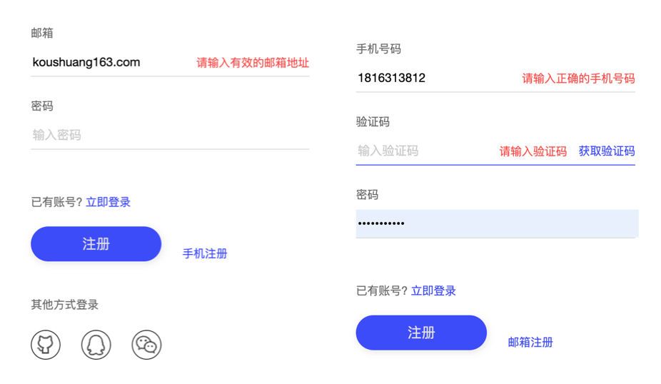
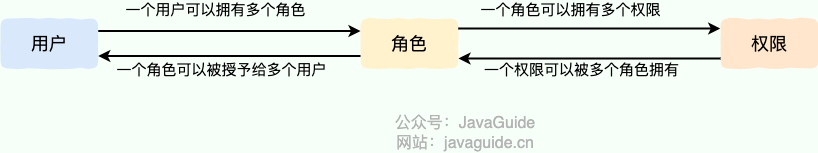

> **Related interview questions:**
>
> - If the frontend validates input, does the backend still need to validate it?
> - Why should the backend repeat frontend validation, or even perform stricter checks?
> - What data should the frontend and backend validate?

Web development—whether you build frontend pages or backend APIs—involves handling data. How do you make sure the data being sent is valid and safe? You need **data validation**. The frontend should validate data, but the backend **must validate it too**. Add the important safeguard of **authorization** as well; all three are essential.

Why? Frontend validation improves usability and catches obvious mistakes, but it is easy for someone with basic technical knowledge to bypass—for example, by sending a request directly with Postman. **Backend validation is the system's final and strongest line of defense for security and data accuracy.** It must ensure that incoming data has the right format and follows business rules, and, most importantly, that the person performing the operation has **permission** to do so.



## Frontend Validation

Frontend validation acts like a helpful receptionist. It tells users about input mistakes as they type, so they can fix them without waiting for the backend to reject a submitted form. Benefits include:

1. **Better user experience:** Users get immediate feedback and can fix errors easily, making the interaction smoother.
2. **Less load on the backend:** The frontend can block requests with obvious format errors or missing required fields, reducing invalid requests, server work, and network traffic. The backend still needs to validate the data; frontend checks simply reduce unnecessary requests.

What should the frontend validate?

- **Required fields:** Make sure required fields are not empty.
- **Format:** Check that an email looks like an email address (for example, `xxx@xx.com`) or that a phone number has the expected number of digits. Regular expressions can help.
- **Repeated input:** Confirm that two entries match, such as the password and password-confirmation fields during registration.
- **Range and length:** An age should not be negative, and a password might need to be between 6 and 20 characters.
- **Validity and business rules:** Check, for example, whether a username has already been registered or a product is in stock. These checks depend on the business and may require the backend.
- **File uploads:** Restrict file types (for example, to `.jpg` and `.png`) and file sizes.
- **Security:** Guard against attacks such as cross-site scripting (XSS). Handle user input so that submitted scripts do not execute on your page.
- …and other checks as needed by the business.

In short, frontend validation **guides users toward valid input** and **improves the interaction**.

## Backend Validation

Frontend validation is only the first line of defense. It improves usability but can be bypassed, so backend validation is what actually protects the system. Treat all data from the frontend as potentially untrusted and review it thoroughly. Backend checks should cover the frontend's basic validations—such as format, range, and length—and add stricter, deeper checks to protect security and data consistency. Important backend checks include:

1. **Completeness:** Required fields defined by the API contract must be present, such as `userId` and `orderId`. If a required field is missing, return an error immediately and reject the request.
2. **Validity and existence:** Verify that the submitted data is real and valid. Does `productId` exist in the database? Has `couponId` expired or already been used? This may require a database lookup or another service call.
3. **Consistency:** For operations involving multiple data objects, check that they follow the business rules. For example, before changing an order's status, verify that its current status permits the change; it should not jump directly from “unpaid” to “completed.” Consistency checks keep state transitions correct.
4. **Security:** Protect against attacks such as XSS and SQL injection. Validate and handle all external input carefully. Use parameterized queries to prevent SQL injection, and encode HTML output to prevent cross-site scripting.
5. …In general, the backend needs to repeat the checks that the frontend performs, for security.

In Java backend development, writing `if-else` statements for every basic validation is tedious. The Java ecosystem provides **Bean Validation**, a standard that lets you declare validation rules with **annotations** on JavaBean properties, such as DTO fields.

- **JSR 303 (1.0):** Established the foundation and introduced familiar annotations such as `@NotNull`, `@Size`, `@Min`, and `@Max`.
- **JSR 349 (1.1):** Added method parameter and return-value validation, groups, and other improvements.
- **JSR 380 (2.0):** Adopted Java 8 features, supported the new date and time API, and added useful annotations such as `@NotEmpty`, `@NotBlank`, and `@Email`.

In earlier Spring Boot versions (roughly before 2.3.x), `spring-boot-starter-web` included `hibernate-validator` by default.

In Spring Boot 2.3.x and later, validation dependencies were separated for greater flexibility. Add `spring-boot-starter-validation` yourself:

```xml
<dependency>
    <groupId>org.springframework.boot</groupId>
    <artifactId>spring-boot-starter-validation</artifactId>
</dependency>
```

The Bean Validation specification and implementations such as Hibernate Validator provide annotations for declaring validation rules. Here are some commonly used ones:

- `@NotNull`: The annotated element (of any type) must not be `null`.
- `@NotEmpty`: The annotated element, such as a `CharSequence`, `Collection`, `Map`, or array, must not be `null` or empty. For a string, `@NotEmpty` allows whitespace, such as `" "`.
- `@NotBlank`: The annotated `CharSequence` (such as a `String`) must not be `null`, and its length after trimming leading and trailing whitespace must be greater than zero.
- `@Null`: The annotated element must be `null`.
- `@AssertTrue` / `@AssertFalse`: The annotated `boolean` or `Boolean` must be `true` / `false`.
- `@Min(value)` / `@Max(value)`: The annotated numeric value (or its string representation) must be greater than or equal to / less than or equal to `value`. These support integral types such as `byte`, `short`, `int`, `long`, and `BigInteger`.
- `@DecimalMin(value)` / `@DecimalMax(value)`: Similar to `@Min` / `@Max`, but also support decimal values, including `BigDecimal`, `BigInteger`, `CharSequence`, and primitive or boxed numeric types. `value` must be a string representation of a number.
- `@Size(min=, max=)`: The size or length of the annotated element, such as a `CharSequence`, `Collection`, `Map`, or array, must be within the inclusive range from `min` to `max`.
- `@Digits(integer=, fraction=)`: The number of digits in the integer part must be no more than `integer`, and the number of fractional digits must be no more than `fraction`.
- `@Pattern(regexp=, flags=)`: The annotated `CharSequence` (such as a `String`) must match the regular expression in `regexp`. `flags` can specify matching options, such as case-insensitive matching.
- `@Email`: The annotated `CharSequence` (such as a `String`) must match an email format, using a relatively permissive built-in regular expression.
- `@Past` / `@Future`: The annotated date or time value, such as `java.util.Date`, `java.util.Calendar`, or a type from JSR 310's `java.time` package, must be in the past / future.
- `@PastOrPresent` / `@FutureOrPresent`: Similar to `@Past` / `@Future`, but allow the current time.
- …

When a controller method uses `@RequestBody` to bind a request body to an object, add `@Valid` to the parameter to trigger validation. If validation fails, Spring throws `MethodArgumentNotValidException`.

```java
@Data
@AllArgsConstructor
@NoArgsConstructor
public class Person {
    @NotNull(message = "classId must not be null")
    private String classId;

    @Size(max = 33)
    @NotNull(message = "name must not be null")
    private String name;

    @Pattern(regexp = "((^Man$|^Woman$|^UGM$))", message = "sex is not an allowed value")
    @NotNull(message = "sex must not be null")
    private String sex;

    @Email(message = "invalid email format")
    @NotNull(message = "email must not be null")
    private String email;
}


@RestController
@RequestMapping("/api")
public class PersonController {
    @PostMapping("/person")
    public ResponseEntity<Person> getPerson(@RequestBody @Valid Person person) {
        return ResponseEntity.ok().body(person);
    }
}
```

Validation for simple values bound directly to method parameters, such as `@PathVariable` and `@RequestParam`, works a little differently:

1. **Add `@Validated` to the controller class.** This Spring annotation (not part of the JSR standard) enables method-level parameter validation. **This step is required.**
2. **Put the validation annotations directly on method parameters.** Apply annotations such as `@Min`, `@Max`, `@Size`, and `@Pattern` to the relevant `@PathVariable` or `@RequestParam` parameters.

Do not forget to add `@Validated` to the class. It tells Spring to validate method parameters.

```java
@RestController
@RequestMapping("/api")
@Validated // Required step 1: add @Validated to the class
public class PersonController {

    @GetMapping("/person/{id}")
    public ResponseEntity<Integer> getPersonByID(
            @PathVariable("id")
            @Max(value = 5, message = "ID must not exceed 5") // Required step 2: put the constraint on the parameter
            Integer id
    ) {
        // If id > 5, Spring throws ConstraintViolationException before entering the method body.
        // The global exception handler must handle this exception as well.
        return ResponseEntity.ok().body(id);
    }

    @GetMapping("/person")
    public ResponseEntity<String> findPersonByName(
            @RequestParam("name")
            @NotBlank(message = "name must not be blank") // Also works with @RequestParam
            @Size(max = 10, message = "name must not exceed 10 characters")
            String name
    ) {
        return ResponseEntity.ok().body("Found person: " + name);
    }
}
```

Bean Validation mainly handles **data format and syntax checks**. That alone is not enough.

## Authorization

The data format is valid, but **is the currently logged-in user allowed to perform this operation?** That is what **authorization** checks. For example:

- Can an ordinary user modify someone else's order? (No.)
- Can a guest access an administrator endpoint? (No.)
- Can a guest manage another user's information? (No.)
- Can a VIP user use an exclusive coupon? (Yes.)
- …

Data validation and authorization do not have to follow exactly the same order in every endpoint. Usually, parse the request, enforce size limits, perform basic format checks, and identify the user early. Authorization at both the coarse-grained and object level must happen before returning query results or revealing whether a resource exists. If authorization depends on resource attributes, include the authorization conditions in the query where appropriate, or check them immediately after reading the resource. Never expose resource information to an unauthorized caller. Then perform business-consistency checks and any finer-grained authorization in the Service or data-access layer according to the transaction semantics.

Authorization asks **who** can perform **which action** on **which resource**. Regardless of how the workflow is layered, never return resource contents before authorization, and do not rely only on a single check in the Controller or frontend.

**Why is authorization important?**

- **A security foundation:** Prevents unauthorized access and operations and protects user data and the system.
- **Business isolation:** Ensures that different roles—such as administrators, ordinary users, and VIP users—can only access and operate on functions within their permissions.
- **Compliance:** Regulations in many industries impose strict requirements on data-access permissions.

Java backend applications commonly use mature security frameworks for authorization instead of implementing it from scratch, which is error-prone and difficult to maintain.

1. **Spring Security (industry standard; recommended):** Uses a filter chain to intercept requests and perform authentication (“Who are you?”) and authorization (“What can you do?”). Spring Security is powerful, has an active community, and integrates closely with the Spring ecosystem. Its configuration can be complex, however, and it has a steep learning curve.
2. **Apache Shiro:** Another popular security framework. It is lighter than Spring Security and has a more straightforward API. It also provides authentication, authorization, session management, encryption, and other features. It can be a good choice for projects unfamiliar with Spring or that find Spring Security too heavy.
3. **Sa-Token:** A lightweight Java authentication and authorization framework developed in China. It supports authentication, authorization, single sign-on, kicking users offline, and automatic renewal. It provides more ready-to-use features and is simpler to use than Spring Security or Shiro.
4. **Manual checks (not recommended for complex scenarios):** Retrieve the current user in the Service or Controller (for example, from `SecurityContextHolder` or a Session), then use `if-else` statements to check roles and permissions. This couples authorization to business logic, duplicates code, makes maintenance difficult, and increases the risk of missed checks. Use it only for very simple permission requirements.

**Common authorization models:**

- **RBAC (Role-Based Access Control):** Assign roles to users and permissions to roles. Users inherit the combined permissions of their roles. This is the most common model.
- **ABAC (Attribute-Based Access Control):** Make access decisions using user, resource, action, and environment attributes. It is more flexible but also more complex.

Most systems use RBAC or a simplified version. The diagram below illustrates the model:



For details on designing authorization systems, see [A Detailed Guide to Authorization System Design](https://javaguide.cn/system-design/security/design-of-authority-system.html).

## Summary

To build a secure, stable web application with a good user experience, implement all three checks—frontend data validation, backend data validation, and backend authorization—with each serving a different purpose:

- **Frontend data validation:** Improves user experience and reduces invalid requests. It is the first, user-friendly line of defense.
- **Backend data validation:** Ensures data has the correct format and follows business rules. It is the technical defense against invalid data entering the database. Bean Validation makes it easy to declare rules on JavaBean properties, such as DTO fields, using annotations.
- **Backend authorization:** Ensures that the right person performs the right action. It is the security defense against unauthorized operations. Frameworks such as Spring Security, Shiro, and Sa-Token can help implement it.

## References

- OWASP Authorization Cheat Sheet: <https://cheatsheetseries.owasp.org/cheatsheets/Authorization_Cheat_Sheet.html>
- [Why Validate Data on Both the Frontend and Backend?](https://juejin.cn/post/7306045519099658240)
- [A Detailed Guide to Authorization System Design](https://javaguide.cn/system-design/security/design-of-authority-system.html)
