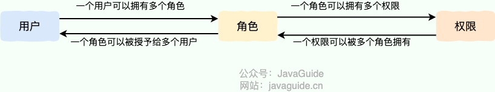
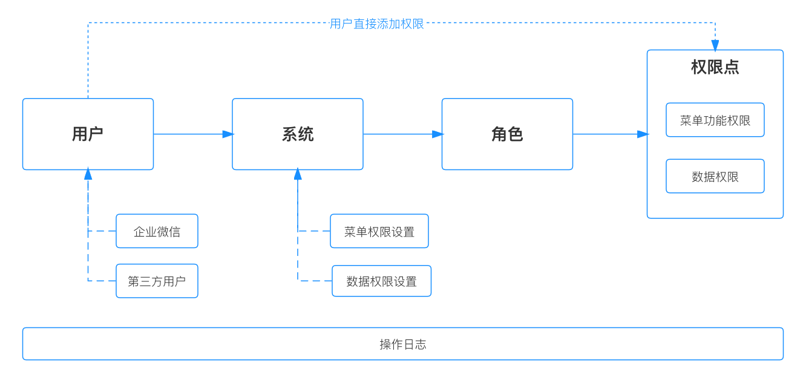
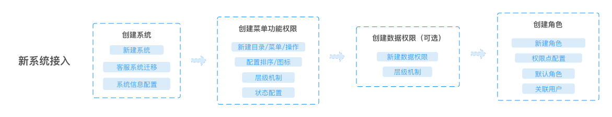
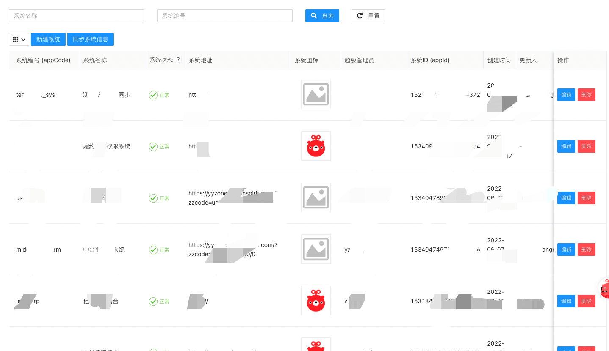
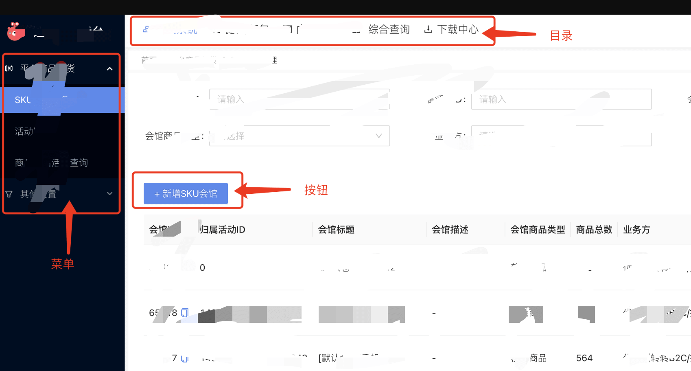
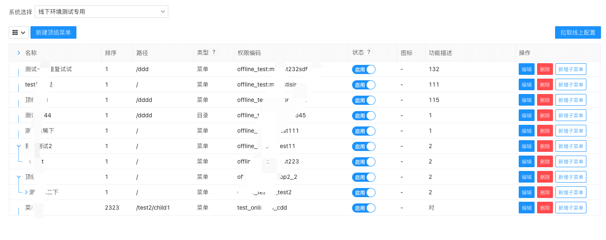
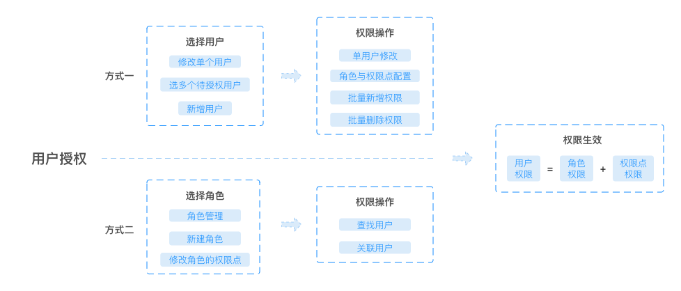
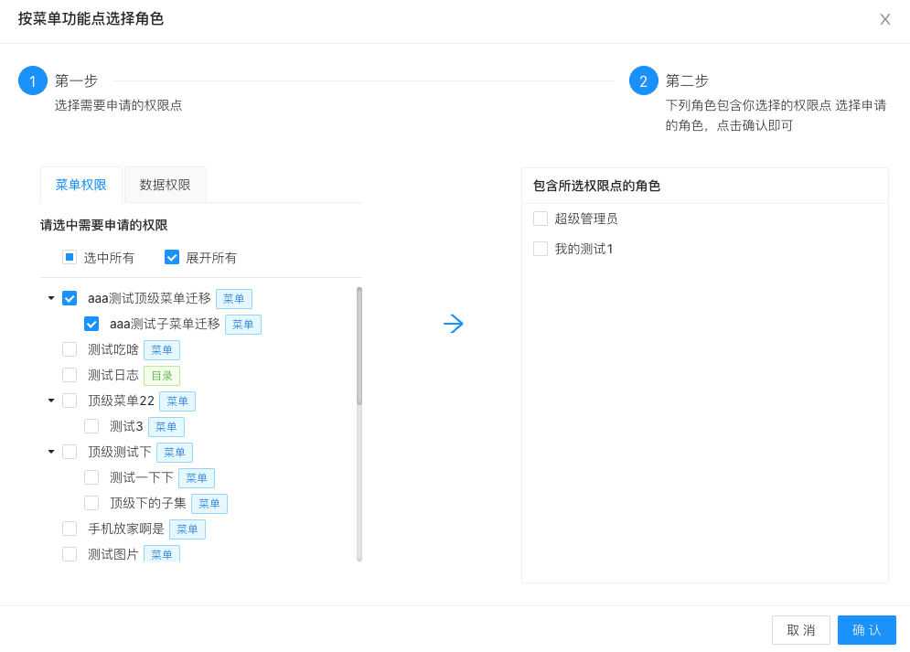

<!-- @include: @article-header.snippet.md -->

> Author: Zhuanzhuan Technology Team
>
> Original article: <https://mp.weixin.qq.com/s/ONMuELjdHYa0yQceTj01Iw>

## Problems with the Previous Access Control System

Zhuanzhuan did not have a unified access control system. Each business team built its own or reused another team's system. This lack of consistency caused several problems:

1. Teams repeatedly built similar solutions, increasing maintenance costs.
2. Each system handled only some use cases. The solutions were not general enough, leaving new projects without a reliable option.
3. There was no unified audit logging or approval process, making it difficult to trace authorization changes.

To address these problems, the company began building a unified access control system late last year. The goal was to provide all business teams with a flexible, easy-to-use, and secure system.

## Access Control Models in Common Use

Two access control models are widely used:

- **Role-Based Access Control (RBAC)**
- **Attribute-Based Access Control (ABAC)**

### RBAC

**Role-Based Access Control (RBAC)** grants permissions to users through their roles. Compared with assigning permissions directly to each user, this provides a more flexible, efficient, and scalable way to manage access.

A user can have multiple roles, and each role can have multiple permissions. This forms a **user–role–permission** model in which users and roles, and roles and permissions, have many-to-many relationships.

The diagram below illustrates the model:

With RBAC, users receive roles based on their responsibilities and needs. The `user -> role -> permission` relationship avoids managing every user's permissions individually. Users get the permissions associated with their assigned roles.

For example, a GitLab-style system might have `Admin`, `Maintainer`, and `Operator` roles, each with different permissions. Only `Admin` may be allowed to create and delete repositories. Assigning a user the `Admin` role gives them both permissions.

When multiple users need the same permissions, create a role with those permissions and assign it to each user. Later changes to the role's permissions then apply to all users assigned to that role.

### ABAC

**Attribute-Based Access Control (ABAC)** is more flexible than RBAC. It evaluates attributes to decide dynamically whether an action is allowed. ABAC is common in cloud systems such as AWS and Alibaba Cloud.

Consider these access control scenarios:

1. Grant a specific person permission to edit a particular book.
2. Allow a user to access a document when the user's department matches the document's department.
3. Allow a user to edit a document when they own it and its status is Draft.
4. Prevent members of Department A from accessing System B before 9 a.m.
5. Prevent users from accessing System A as administrators from locations outside Shanghai.
6. Allow a user to operate on orders created before June 7, 2022.

These scenarios are difficult to express with RBAC alone. RBAC describes what actions a user can perform, but does not by itself express the conditions under which an action is allowed or which data it applies to. ABAC evaluates attributes of the user, the requested data, and the environment to make that decision.

#### How ABAC Works

In ABAC, a policy decision is calculated dynamically from the subject, resource, action, and environment:

- **Subject**: The user making the request. Attributes can include user ID, personal resources, roles, department, and organizational membership.
- **Resource**: The asset the user wants to access, such as a file, record, server, or API.
- **Action**: What the user is trying to do with the resource, such as read, write, edit, copy, or delete.
- **Environment**: The context of the request, including time, location, device, communication protocol, and encryption strength.

The policy engine evaluates the defined rules against these attributes whenever an access request is made. If the request matches an allowing policy, it is permitted.

## Design of the New Access Control System

RBAC covers most of Zhuanzhuan's business needs, and is less expensive to build than an ABAC-based system. The new system therefore uses RBAC. Use cases it could not support were deferred so the system could be delivered quickly and adopted by business teams sooner.

A standard RBAC model requires every permission to flow through `user -> role -> permission`: a user's permissions come entirely from their roles. This can be inefficient because granting an individual permission requires creating a new role. The new system extends RBAC to allow permissions to be assigned either through roles or directly to users. A user's effective permissions are the union of permissions from their roles and their individually assigned permissions.

**Effective permissions = permissions granted by the user's roles + permissions assigned directly to the user.**

The new system is designed as follows:

- First, a unified sign-in and registration flow manages all company users, including external users. It is integrated with the company's organizational directory so each person has consistent information across systems. This also enables access management based on organizational structure.
- Second, the system supports access control for multiple business applications. Before managing permissions, an operator selects an application and configures its **menu permissions** and **data permissions**, creating the application's permission points. Menu and data permissions are explained below.
- Finally, the operator creates roles for the application and assigns permissions to them. For example, a store manager role might allow staff operations and access to the store's data. Once configured, assigning this role to a store manager grants those permissions.

After setup, user permissions can be managed in either of two ways:

1. Select a user, then assign any role or menu/data permission point.
2. Select a role, then associate users with it. This method assigns roles only; it cannot assign menu or data permissions directly.

The detailed designs for these workflows are described below.

### Access Control for the Access Control System

The access control system must also control access to itself: who can use it, and who can manage permissions for other applications? It defines three types of users:

1. **Super administrator**: Has all permissions in the access control system, including permission to manage connected applications.
2. **Application permission operator**: Has the super administrator role in at least one connected application. This user can act only within the applications they administer. This identity is granted automatically based on the user's roles; it is not assigned separately.
3. **Regular user**: Anyone who is not in the first two groups. Regular users can request that an application be connected and access the permission request page.

### Permission Types

The new system defines two broad permission types:

- **Menu and feature permissions**: Access to application navigation and menus, as well as permissions to use buttons and APIs.
- **Data permissions**: The scope of data a user may query. Applications may call this scope an organization or site; the new system manages it consistently as an organization.

### Default Roles

Each application has three default roles to cover basic access management needs:

- **Super administrator**: Has all permissions in the application, can change role and permission settings, and can grant access to other users.
- **System administrator**: Can grant access and change role and permission settings, but does not automatically receive application permissions.
- **Authorization administrator**: Can grant other users permissions, but cannot grant permissions beyond their own.

For example, authorization administrator A can grant permissions to user B, but only within the permissions A already has.

Separating **having a permission** from **being allowed to grant a permission** supports a wider range of access control scenarios.

## Core Modules of the New Access Control System

The following sections describe the system's core modules.

### Application, Menu, and Data Permission Management

Connecting a new application to the access control system involves these steps:

1. Create the application.
2. Configure menu and feature permissions.
3. Configure data permissions (optional).
4. Create roles for the application.

The first three steps are handled in the application management module:

Operators can create, read, update, and delete an application's basic information. A unique **application code** distinguishes applications and prefixes their menu and data permission codes, keeping those codes globally unique.

For example, if an application's code is `test_online`, its menu permission codes follow the format `test_online:m_xxx`.

The application management interface is shown below:

#### Menu Management

The new system divides menu items into three types: `directory`, `menu`, and `operation`.

- **Directory**: A top-level application directory, usually shown to the right of the application logo.
- **Menu**: The nested navigation menu, usually shown below the application logo on the left. This is the most common menu structure.
- **Operation**: A button, API, or other page element that represents an action.

The menu management interface is shown below:

Menu permissions can be used in either of two modes:

- **Dynamic menus**: The access control system manages menu creation and deletion. Adding a menu there also adds it to the application, so menu changes do not require an application release.
- **Static menus**: The application frontend manages menus, while the access control system controls access. It indicates whether the user has permission; the frontend decides whether to display each menu based on that permission data.

Hiding a directory, menu, or button in the frontend improves the user experience, but is not a security boundary. In either mode, the backend must deny access by default and check on every request that the current user is authorized to perform the requested action. For data access, it must also validate resource ownership, tenant, organization, and data scope. Do not rely only on menu permissions or trust user, organization, or resource IDs supplied by the client.

### Role and User Management

Role and user management can directly change user permissions. The overall design is shown below:

The design must account for bulk operations, whether associating users with roles or adding, removing, or resetting permissions for multiple users.

### Permission Requests

In addition to administrators granting access to other users, the system lets users request permissions for themselves. Alongside the usual request, review, and status workflows, the system helps users select the right permissions. Users can select a role directly or select menu/data permission points and find roles that grant them:

### Audit Logs

The system has two kinds of logs:

1. **Audit logs**: Key actions that users can search and review.
2. **Service logs**: Logs produced while the system runs. These contain more data than audit logs, but are harder to search and review. The access control system therefore needs a dedicated audit log feature.

User actions fall into three types: create, update, and delete. Modules such as user management, role management, and menu management can also be enumerated. An audit record can then be modeled as: who performed which action, on which target and module, and when.

Storing these records in a database makes them easier to review and filter.

## Summary and Further Reading

This article has covered the core design and modules of the new access control system. Many Zhuanzhuan business teams have since adopted it, making permission management easier than before. A flexible and complete access control system can help a company's business grow more efficiently.

Two follow-up articles cover the backend and frontend implementations:

- [Design and Implementation of Zhuanzhuan's Unified Access Control System: Backend](https://mp.weixin.qq.com/s/hFTDckfxhSnoM_McP18Vkg)
- [Design and Implementation of Zhuanzhuan's Unified Access Control System: Frontend](https://mp.weixin.qq.com/s/a_P4JAwxgunhfmJvpBnWYA)

## References

- OWASP Authorization Cheat Sheet: <https://cheatsheetseries.owasp.org/cheatsheets/Authorization_Cheat_Sheet.html>
- [Choosing an access control model](https://docs.authing.cn/v2/guides/access-control/choose-the-right-access-control-model.html)

<!-- @include: @article-footer.snippet.md -->
