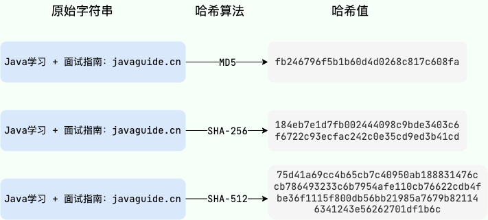
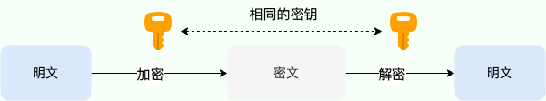
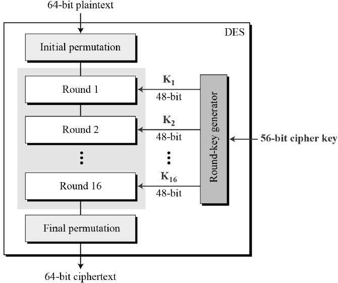
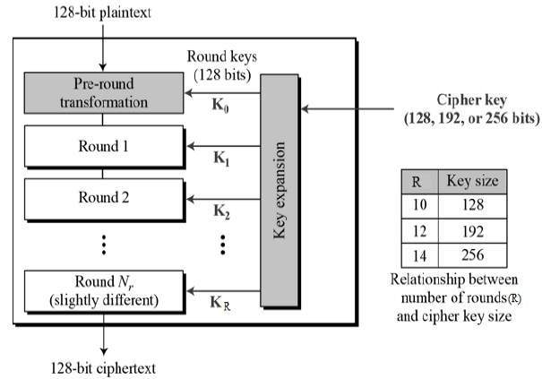
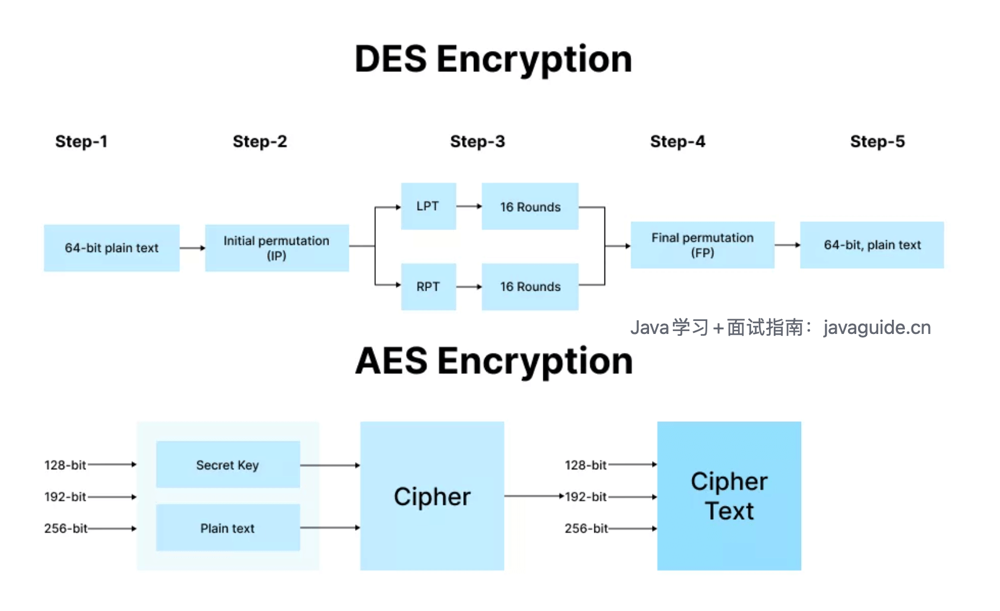
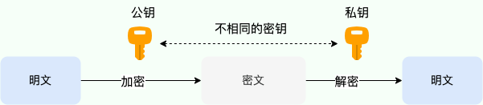
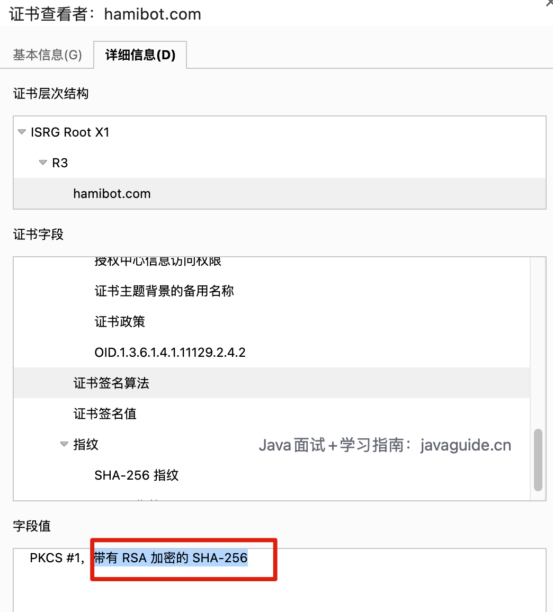

Cryptographic algorithms transform data using mathematical methods to protect it from unauthorized reading or modification. They fall into three categories: symmetric encryption, asymmetric encryption, and hash (or digest) algorithms.

Common use cases for cryptographic algorithms in software development include:

1. Passwords stored in a database should be salted and hashed with a password-hashing algorithm such as BCrypt.
2. Sensitive data stored in a database, such as bank card or identity numbers, should be protected with symmetric encryption such as AES.
3. Sensitive data sent over a network should be protected in transit with HTTPS, which may use asymmetric cryptography such as RSA.
4. ……

Strictly speaking, hash algorithms are not encryption algorithms, although they are used in some security applications, such as password storage. They are separate categories. An encryption algorithm transforms plaintext into ciphertext that can be recovered through some mechanism, usually a key. A hash algorithm is a one-way process: it maps input to a fixed-length, seemingly random hash value, from which the original input cannot be recovered.

## Hash Algorithms

Hash algorithms, also called hash functions or digest algorithms, map data of any length to a fixed-length identifier. This output is called a hash, hash value, or message digest; this article uses “hash value” for all of them.



Hashing is irreversible: you cannot recover the original value from its hash.

Hash values can be used to verify data integrity and consistency.

Two examples:

- When storing passwords, compare the hash of a submitted password with the stored hash to check whether the password is correct.
- When downloading a file, compare its hash with the value published by the official source to check whether it was modified or corrupted.

Hashing has two key properties:

- The original data cannot be recovered from its hash.
- Any change to the input causes a large change in the hash value.

Hash algorithms can be broadly divided into two categories:

1. **Cryptographic hash algorithms**: These provide stronger security and some protection for data integrity and tamper detection. They resist various attacks but may be slower, so they are used where security matters. Examples include SHA-2, SHA-3, SM3, RIPEMD-160, and BLAKE2.
2. **Non-cryptographic hash algorithms**: These are faster but less secure and more vulnerable to attacks such as brute force and collision attacks. They are suitable for applications that do not require cryptographic security. Examples include CRC32 and MurmurHash3.

There are also specialized hash algorithms, such as **slow hash algorithms**, which are designed to provide stronger protection for passwords.

Common hash algorithms include:

- MD (Message Digest): Includes MD2, MD4, and MD5. These algorithms are no longer recommended.
- SHA (Secure Hash Algorithm): SHA-1 is considered weak; SHA-2 and SHA-3 provide stronger security.
- Chinese commercial cryptography algorithms: SM2 is asymmetric, SM3 is a hash algorithm, and SM4 is symmetric. SM3 has security and performance comparable to SHA-256 and is commonly used in China.
- BCrypt: A password-hashing algorithm based on Blowfish, designed specifically for password storage. It is a computationally expensive hash algorithm.
- MAC (Message Authentication Code): HMAC is a hash-based MAC that can be used with a secure hash algorithm such as SHA-256.
- CRC (Cyclic Redundancy Check): CRC32 produces a 32-bit checksum and is commonly used to detect data corruption in files and other data.
- SipHash: Unlike an unkeyed cryptographic hash such as SHA-256, SipHash is a keyed PRF (Pseudo-Random Function). It requires a random key to provide collision-attack resistance. It balances speed and security and can defend against [hash-flooding DoS attacks](https://aumasson.jp/siphash/siphashdos_29c3_slides.pdf). Rust uses SipHash by default (currently SipHash-1-3). Redis switched its dictionary hash algorithm from MurmurHash2 to SipHash in version 4.0 (currently SipHash-1-2).
- MurmurHash: A classic, fast, non-cryptographic hash algorithm. MurmurHash3 can produce 32-bit or 128-bit hash values.
- ……

Hash algorithms generally do not require a key, but some specialized ones do. MACs and SipHash are keyed hash constructions: they use a secret key so that only someone who knows it can verify data integrity and origin.

### MD

The MD family includes MD2, MD4, and MD5. MD5 is the best known and produces a 128-bit (16-byte) hash. In relative security, MD5 is stronger than MD4, which is stronger than MD2. Other algorithms, such as RIPEMD and HAVAL, were derived from or improved on MD4 or MD5.

Even MD5, the strongest of these MD algorithms, is vulnerable. An attacker may use brute force or a rainbow table to find input with the same hash and compromise the data.

Salting can make attacks more difficult. A salt is a unique value combined with a password before hashing, so identical passwords do not produce identical stored hashes. This process is called salting.

Does salting make it secure? Not necessarily. It increases the cost of an attack but does not make an algorithm unbreakable. MD5 also has weak collision resistance: different inputs can produce the same MD5 value.

MD algorithms are therefore not recommended. Use a more secure algorithm, such as SHA-2 or BCrypt, as appropriate.

Java supports the MD family, including MD2 and MD5.

MD5 example (without a salt):

```java
String originalString = "JavaGuide: Technical Interview Guide";
// Create an MD5 digest
MessageDigest messageDigest = MessageDigest.getInstance("MD5");
messageDigest.update(originalString.getBytes(StandardCharsets.UTF_8));
// Compute the hash
byte[] result = messageDigest.digest();
// Convert the hash to a hexadecimal string
String hexString = new HexBinaryAdapter().marshal(result);
System.out.println("Original String: " + originalString);
System.out.println("MD5 Hash: " + hexString.toLowerCase());
```

Output:

```bash
Original String: JavaGuide: Technical Interview Guide
MD5 Hash: d4cfe8ac4cc1621f23b0943638885321
```

### SHA

The SHA (Secure Hash Algorithm) family maps data of any length to fixed-length hash values. The U.S. National Security Agency (NSA) designed the SHA family in 1993. The main versions are SHA-1, SHA-2, and SHA-3.

SHA-1 maps arbitrary-length data to a 160-bit hash. However, it has serious weaknesses and is vulnerable to collision and length-extension attacks, so it is no longer recommended. The SHA-2 family, including SHA-256, SHA-384, and SHA-512, and SHA-3 provide stronger security and longer hash values.

The SHA-2 family uses more complex operations and rounds, making it harder for an attacker to find collisions through precomputation or chance.

To select a more secure and advanced hash algorithm, the U.S. National Institute of Standards and Technology (NIST) solicited candidates for SHA-3 in 2007. NIST received 64 proposals and, after several evaluation rounds, selected Keccak in 2012 as the SHA-3 standard. SHA-3 is not directly related to SHA-2. Keccak uses a different design called the sponge construction, so traditional attack methods do not directly apply. It resists known attack classes, including collision, length-extension, and differential attacks.

Because SHA-2 has no major known security vulnerabilities and is efficient in software, it remains the more common choice.

SHA-2 is stronger than MD5 mainly for two reasons:

- Longer hashes: SHA-256 produces a 256-bit hash, compared with MD5's 128-bit hash, making brute-force and rainbow-table attacks more difficult.
- Stronger collision resistance: SHA uses more complex operations and rounds, making collisions harder to find. No pair of different inputs with the same SHA-256 hash is currently known.

SHA-2 is not an absolute guarantee of security. For password storage, use a dedicated password-hashing function rather than relying on salting a fast hash such as SHA-2.

Java supports the SHA family, including SHA-1, SHA-256, SHA-384, and SHA-512.

SHA-256 example (without a salt):

```java
String originalString = "JavaGuide: Technical Interview Guide";
// Create a SHA-256 digest
MessageDigest messageDigest = MessageDigest.getInstance("SHA-256");
messageDigest.update(originalString.getBytes(StandardCharsets.UTF_8));
// Compute the hash
byte[] result = messageDigest.digest();
// Convert the hash to a hexadecimal string
String hexString = new HexBinaryAdapter().marshal(result);
System.out.println("Original String: " + originalString);
System.out.println("SHA-256 Hash: " + hexString.toLowerCase());
```

Output:

```bash
Original String: JavaGuide: Technical Interview Guide
SHA-256 Hash: 156145f81d2666752066e91c0dd61483e2af46d6365840ae6bbb31a2da7348a9
```

### Bcrypt

BCrypt is a password-hashing algorithm based on the Blowfish cipher and designed specifically for password storage.

BCrypt uses a salt and a cost factor to make precomputed attacks less effective and brute-force attacks more expensive. The salt is generated randomly and combined with the password, so identical passwords produce different hashes. The cost factor controls the number of iterations and the computation required to hash a password.

The cost factor can be adjusted to meet different security requirements.

Spring Security supports several password encoders. `BCryptPasswordEncoder` is one recommended option; it uses BCrypt to hash passwords before storage.

```java
@Bean
public PasswordEncoder passwordEncoder(){
    return new BCryptPasswordEncoder();
}
```

## Symmetric Encryption

Symmetric encryption uses the same key to encrypt and decrypt data. It is also called secret-key or shared-key encryption.



Common symmetric ciphers include DES, 3DES, and AES.

### DES and 3DES

DES (Data Encryption Standard) encrypts 64-bit blocks using a 64-bit key, of which 56 bits are effective key material and 8 bits are used for parity.

Although DES processes only 64 bits at a time, arbitrary-length plaintext can be encrypted by dividing it into 64-bit blocks. If the plaintext length is not a multiple of 64 bits, padding is required. Common options include PKCS5Padding, PKCS7Padding, and NoPadding.

DES splits each 64-bit plaintext block in half, applies multiple rounds of transformations to each half, and combines them into a 64-bit ciphertext block. The transformations include permutation, XOR, selection, and shifting. Each of the 16 rounds uses a subkey derived from the same 56-bit master key. A final inverse permutation produces the ciphertext.



DES is a classic symmetric cipher, but its 56-bit effective key is too short and can be brute-forced in a short time.

Several variants and replacements were proposed to improve on DES, including 3DES (Triple DES).

3DES was used during the transition from DES to AES. It applies DES three times to each data block, using two or three 56-bit keys.

For compatibility with DES, 3DES uses encrypt-decrypt-encrypt rather than encrypt-encrypt-encrypt. When all three keys are the same, the first two operations cancel each other, leaving one DES operation. 3DES is more secure than DES but is relatively slow.

### AES

AES (Advanced Encryption Standard) is a modern symmetric-key cipher. It supports 128-, 192-, and 256-bit keys; longer keys provide a larger security margin.

AES is a block cipher with a fixed block size of 128 bits (16 bytes). It can be used with different modes of operation, including ECB, CBC, OFB, CFB, CTR, XTS, OCB, and GCM. The modes have different parameters and processing steps, but all use the AES cipher.

Like DES, some AES modes require padding when plaintext is not a multiple of 128 bits. GCM is an authenticated-encryption (AEAD) mode that can process plaintext of any length, so Java applications commonly use `AES/GCM/NoPadding`. GCM provides confidentiality and verifies ciphertext integrity, but an IV (nonce) must never be reused with the same key.

AES is faster and more secure than 3DES.



Comparison of DES and AES (image from [RSA vs. AES Encryption: Key Differences Explained](https://cheapsslweb.com/blog/rsa-vs-aes-encryption)):



Java example using AES-GCM. It encodes a randomly generated IV with the ciphertext. In production, generate and store AES keys with a KMS, HSM, or KeyStore; do not hard-code keys in source code:

```java
private static final String AES_TRANSFORMATION = "AES/GCM/NoPadding";
private static final int GCM_IV_LENGTH = 12;
private static final int GCM_TAG_LENGTH = 128;
private static final SecureRandom SECURE_RANDOM = new SecureRandom();

/**
 * Encrypt
 */
public static String encrypt(String data, SecretKey secretKey) throws GeneralSecurityException {
    byte[] iv = new byte[GCM_IV_LENGTH];
    SECURE_RANDOM.nextBytes(iv);

    Cipher cipher = Cipher.getInstance(AES_TRANSFORMATION);
    cipher.init(Cipher.ENCRYPT_MODE, secretKey, new GCMParameterSpec(GCM_TAG_LENGTH, iv));
    byte[] encryptedBytes = cipher.doFinal(data.getBytes(StandardCharsets.UTF_8));

    // The IV is not secret, but decryption requires the same IV, so store it with the ciphertext.
    ByteBuffer byteBuffer = ByteBuffer.allocate(iv.length + encryptedBytes.length);
    byteBuffer.put(iv);
    byteBuffer.put(encryptedBytes);
    return Base64.getEncoder().encodeToString(byteBuffer.array());
}

/**
 * Decrypt
 */
public static String decrypt(String encryptedData, SecretKey secretKey) throws GeneralSecurityException {
    byte[] input = Base64.getDecoder().decode(encryptedData);
    int tagLengthInBytes = GCM_TAG_LENGTH / Byte.SIZE;
    if (input.length < GCM_IV_LENGTH + tagLengthInBytes) {
        throw new IllegalArgumentException("Invalid encrypted data");
    }

    ByteBuffer byteBuffer = ByteBuffer.wrap(input);
    byte[] iv = new byte[GCM_IV_LENGTH];
    byteBuffer.get(iv);
    byte[] encryptedBytes = new byte[byteBuffer.remaining()];
    byteBuffer.get(encryptedBytes);

    Cipher cipher = Cipher.getInstance(AES_TRANSFORMATION);
    cipher.init(Cipher.DECRYPT_MODE, secretKey, new GCMParameterSpec(GCM_TAG_LENGTH, iv));
    byte[] decryptedBytes = cipher.doFinal(encryptedBytes);
    return new String(decryptedBytes, StandardCharsets.UTF_8);
}

public static void main(String[] args) throws Exception {
    // Demonstration only. In production, retrieve the key from a KMS, HSM, or KeyStore.
    KeyGenerator keyGenerator = KeyGenerator.getInstance("AES");
    keyGenerator.init(256);
    SecretKey secretKey = keyGenerator.generateKey();

    String originalString = "JavaGuide: Technical Interview Guide";
    String encryptedData = encrypt(originalString, secretKey);
    String decryptedData = decrypt(encryptedData, secretKey);
    System.out.println("Original String: " + originalString);
    System.out.println("AES Encrypted Data : " + encryptedData);
    System.out.println("AES Decrypted Data : " + decryptedData);
}
```

Output:

```bash
Original String: JavaGuide: Technical Interview Guide
AES Encrypted Data: <Base64 string differs on each run>
AES Decrypted Data : JavaGuide: Technical Interview Guide
```

## Asymmetric Encryption

Asymmetric encryption uses different keys for encryption and decryption. It is also called public-key cryptography. The key pair consists of a public key, which can be shared, and a private key, which must be kept secret.

Data encrypted with a public key can be decrypted only with the corresponding private key. Digital signatures are a separate operation: the sender creates a signature with the private key, and the recipient verifies it with the public key. Do not simplify signatures to “encrypt with the private key and decrypt with the public key”; use the appropriate encryption and signature APIs.



Common public-key algorithms include RSA and elliptic-curve algorithms. Their capabilities differ: RSA can be used for encryption and signatures; DSA is used for signatures only; ECC is a family that includes schemes for signatures and key agreement.

### RSA

RSA (Rivest–Shamir–Adleman) is an asymmetric algorithm whose security is based on the difficulty of factoring large integers. Key generation selects two large primes and uses their product as part of the public key. Finding large primes is relatively easy, while factoring their product is extremely difficult. For more details, see [Do You Really Understand the RSA Encryption Algorithm?](https://www.cnblogs.com/xiaofuge/p/16954187.html).

RSA security depends on the difficulty of factoring large numbers. 512-bit and 768-bit RSA keys have been factored, so use a key size of at least 2048 bits.

RSA is widely supported and can be used for encryption and digital signatures, but it is slow and unsuitable for encrypting large amounts of data directly.

RSA is a widely used asymmetric algorithm and has been used in protocols such as SSL/TLS and SSH.



RSA is slow and can encrypt only limited amounts of data directly. Applications commonly use hybrid encryption: generate a random symmetric key, encrypt application data with AES-GCM, and encrypt the symmetric key with RSA-OAEP. The following example shows RSA-OAEP encrypting a short value:

```java
private static final String RSA_ALGORITHM = "RSA";
private static final String RSA_TRANSFORMATION = "RSA/ECB/OAEPPadding";
private static final OAEPParameterSpec OAEP_SHA_256 = new OAEPParameterSpec(
        "SHA-256",
        "MGF1",
        MGF1ParameterSpec.SHA256,
        PSource.PSpecified.DEFAULT
);

/**
 * Generate an RSA key pair
 */
public static KeyPair generateKeyPair() throws NoSuchAlgorithmException {
    KeyPairGenerator keyPairGenerator = KeyPairGenerator.getInstance(RSA_ALGORITHM);
    // Use a 2048-bit key
    keyPairGenerator.initialize(2048);
    return keyPairGenerator.generateKeyPair();
}

/**
 * Encrypt data with the public key
 */
public static String encrypt(String data, PublicKey publicKey) throws Exception {
    Cipher cipher = Cipher.getInstance(RSA_TRANSFORMATION);
    cipher.init(Cipher.ENCRYPT_MODE, publicKey, OAEP_SHA_256);
    byte[] encryptedData = cipher.doFinal(data.getBytes(StandardCharsets.UTF_8));
    return Base64.getEncoder().encodeToString(encryptedData);
}

/**
 * Decrypt data with the private key
 */
public static String decrypt(String encryptedData, PrivateKey privateKey) throws Exception {
    byte[] decodedData = Base64.getDecoder().decode(encryptedData);
    Cipher cipher = Cipher.getInstance(RSA_TRANSFORMATION);
    cipher.init(Cipher.DECRYPT_MODE, privateKey, OAEP_SHA_256);
    byte[] decryptedData = cipher.doFinal(decodedData);
    return new String(decryptedData, StandardCharsets.UTF_8);
}

public static void main(String[] args) throws Exception {
    KeyPair keyPair = generateKeyPair();
    PublicKey publicKey = keyPair.getPublic();
    PrivateKey privateKey = keyPair.getPrivate();
    String originalString = "JavaGuide: Technical Interview Guide";
    String encryptedData = encrypt(originalString, publicKey);
    String decryptedData = decrypt(encryptedData, privateKey);
    System.out.println("Original String: " + originalString);
    System.out.println("RSA Encrypted Data : " + encryptedData);
    System.out.println("RSA Decrypted Data : " + decryptedData);
}
```

Output:

```bash
Original String: JavaGuide: Technical Interview Guide
RSA Encrypted Data: <Base64 string differs on each run>
RSA Decrypted Data : JavaGuide: Technical Interview Guide
```

### DSA

DSA (Digital Signature Algorithm) is a digital signature algorithm whose security is based on the discrete logarithm problem. It can generate and verify signatures, but cannot encrypt data. A signature is not “encrypting a digest with the private key and decrypting it with the public key”: the sender creates a signature with the private key and signature algorithm, and the recipient checks it with the public key and verification algorithm.

DSA is mainly retained for legacy compatibility. NIST FIPS 186-5 no longer approves DSA for generating new signatures; it allows verification only for legacy signatures created before the standard took effect. New systems should choose RSA-PSS, ECDSA, or EdDSA based on protocol and compatibility requirements, using the `Signature` API from a well-established cryptographic library.

## Summary

This article covered three categories of cryptographic algorithms: hash algorithms, symmetric encryption, and asymmetric encryption.

- Hash algorithms produce fixed-length identifiers that can help verify data integrity and consistency. Examples include MD, SHA, and MAC algorithms.
- Symmetric encryption uses the same key to encrypt and decrypt data. Examples include DES, 3DES, and AES.
- Public-key cryptography uses a public/private key pair for encryption, digital signatures, or key agreement, depending on the algorithm. RSA supports encryption and signatures; DSA supports signatures only.

## References

- NIST SP 800-38D - Recommendation for Block Cipher Modes of Operation: GCM and GMAC：<https://csrc.nist.gov/pubs/sp/800/38/d/final>
- NIST FIPS 186-5 - Digital Signature Standard：<https://csrc.nist.gov/pubs/fips/186-5/final>
- Java `Cipher` API：<https://docs.oracle.com/en/java/javase/11/docs/api/java.base/javax/crypto/Cipher.html>
- Understanding Perfect Hashing - Tencent Technology: <https://mp.weixin.qq.com/s/M8Wcj8sZ7UF1CMr887Puog>
- Practical Cryptography for Developers (Part 2): Hash Functions: <https://thiscute.world/posts/practical-cryptography-basics-2-hash/>
- A Security Tour: The DSA Algorithm: <https://zhuanlan.zhihu.com/p/347025157>
- Introduction to AES-GCM Encryption: <https://juejin.cn/post/6844904122676690951>
- Java AES 256 GCM Encryption and Decryption Example | JCE Unlimited Strength：<https://www.javainterviewpoint.com/java-aes-256-gcm-encryption-and-decryption/>

<!-- @include: @article-footer.snippet.md -->
