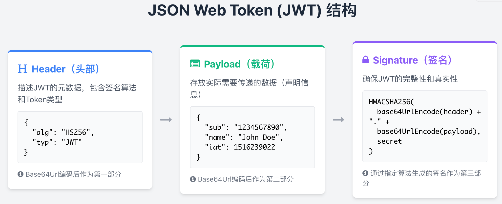
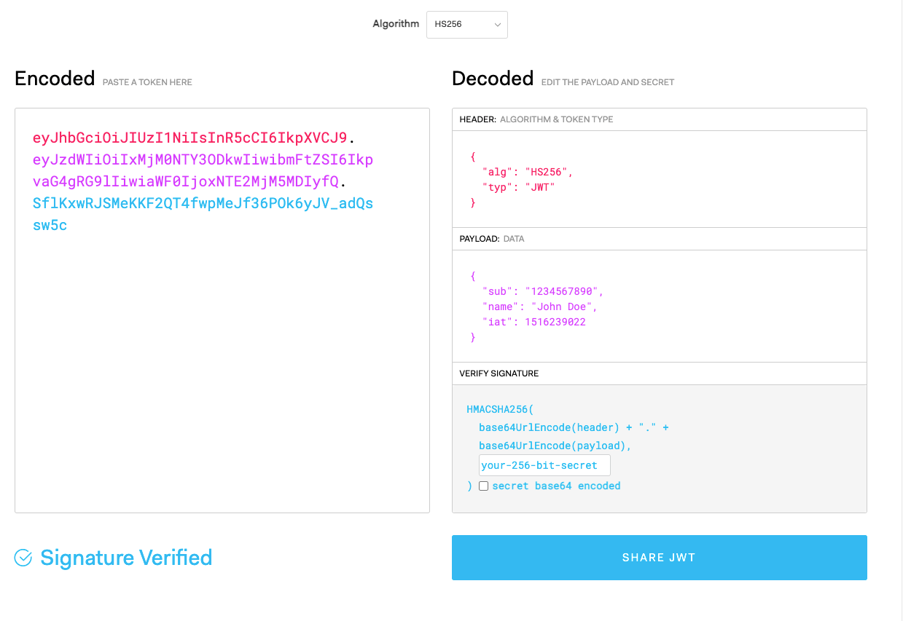
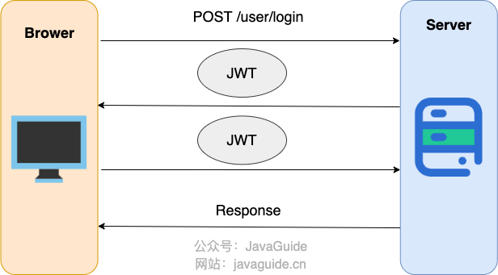

<!-- @include: @article-header.snippet.md -->

## What Is a JWT?

JSON Web Token (JWT) is a compact, URL-safe format for representing claims defined by [RFC 7519](https://datatracker.ietf.org/doc/html/rfc7519). After a successful login, a server can place claims such as a user identifier, permissions, and expiration time in a JWT. The client sends it with subsequent requests, and the server checks the signature and relevant claims before deciding whether to grant access.

A JWT can carry the claims needed for authentication, so the server does not necessarily need to store session state as it would in a traditional Session-based design. However, revoking tokens, changing permissions, and actively logging users out may still require server-side state. Do not assume a system is completely stateless just because it uses JWTs.

The JWT header and payload are only Base64Url-encoded. Anyone who obtains the token can decode them, so never put sensitive information such as passwords or national ID numbers in the payload. A signature detects tampering; it does not encrypt the content.

If a client explicitly sends a JWT as a Bearer token in the `Authorization` header, the browser does not attach it automatically as it does a Cookie. This can reduce traditional CSRF risk. But that depends on how the credential is transmitted and stored, not on the JWT format itself. If you put a JWT in a Cookie, you still need CSRF protection.

See [JWT: Advantages and Disadvantages](./advantages-and-disadvantages-of-jwt.md) for more on the benefits and limitations of JWT authentication.

Here is the definition of JWT from [RFC 7519](https://datatracker.ietf.org/doc/html/rfc7519):

> JSON Web Token (JWT) is a compact, URL-safe means of representing claims to be transferred between two parties. The claims in a JWT are encoded as a JSON object that is used as the payload of a JSON Web Signature (JWS) structure or as the plaintext of a JSON Web Encryption (JWE) structure, enabling the claims to be digitally signed or integrity protected with a Message Authentication Code (MAC) and/or encrypted. ——[JSON Web Token (JWT)](https://datatracker.ietf.org/doc/html/rfc7519)

## What Are the Parts of a JWT?



A JWT usually consists of three Base64Url-encoded parts separated by `.`:

- **Header:** Metadata about the JWT, including the token type and signature algorithm. After Base64Url encoding, it becomes the first part of the JWT.
- **Payload:** Claims to be transmitted, such as `sub` (subject) and `jti` (JWT ID). After Base64Url encoding, it becomes the second part.
- **Signature:** Computed from the encoded header, payload, signature algorithm, and signing key. HS256 uses a shared secret; asymmetric algorithms such as RS256 and ES256 use a private key to sign and a public key to verify.

A JWT typically looks like this: `xxxxx.yyyyy.zzzzz`.

For example:

```plain
eyJhbGciOiJIUzI1NiIsInR5cCI6IkpXVCJ9.
eyJzdWIiOiIxMjM0NTY3ODkwIiwibmFtZSI6IkpvaG4gRG9lIiwiaWF0IjoxNTE2MjM5MDIyfQ.
SflKxwRJSMeKKF2QT4fwpMeJf36POk6yJV_adQssw5c
```

You can decode this example JWT at [jwt.io](https://jwt.io/) and view its header, payload, and signature. Real production tokens may contain user identifiers and permission information; do not copy them into third-party online tools.

The header and payload are JSON data. The signature is computed from the encoded header and payload and the signing key.



### What Is the Difference Between Parsing and Verifying a JWT?

Parsing a JWT only Base64Url-decodes the header and payload; it does not require a key. Anyone with the token can parse it, so parsing does not prove that the token is trustworthy.

Verification checks the signature using the configured algorithm and key. It should also validate claims such as `exp`, `nbf`, `iss`, and `aud`. The server should trust the identity and permission data only after the signature and all required claims pass validation.

### Header

The header usually contains two fields:

- `typ` (Type): The token type, which is JWT.
- `alg` (Algorithm): The signature algorithm, such as HS256.

For example:

```json
{
  "alg": "HS256",
  "typ": "JWT"
}
```

The JSON header is Base64Url-encoded to produce the first part of the JWT.

### Payload

The payload is also JSON and contains claims.

There are three types of claims:

- **Registered Claims:** Predefined claims. They are recommended but not required.
- **Public Claims:** Claims that JWT issuers can define themselves. To avoid conflicts, they should be registered in the [IANA JSON Web Token Registry](https://www.iana.org/assignments/jwt/jwt.xhtml).
- **Private Claims:** Claims defined by a JWT issuer for a particular project; these are common in real applications.

Some commonly used registered claims include:

- `iss` (issuer): The JWT issuer.
- `iat` (issued at time): When the JWT was issued.
- `sub` (subject): The subject of the JWT.
- `aud` (audience): The intended recipient of the JWT.
- `exp` (expiration time): When the JWT expires.
- `nbf` (not before): The time before which the JWT must not be accepted.
- `jti` (JWT ID): A unique identifier for the JWT.

For example:

```json
{
  "uid": "ff1212f5-d8d1-4496-bf41-d2dda73de19a",
  "sub": "1234567890",
  "name": "John Doe",
  "exp": 15323232,
  "iat": 1516239022,
  "scope": ["admin", "user"]
}
```

The payload is not encrypted by default. **Never put private information in the payload!**

The JSON payload is Base64Url-encoded to produce the second part of the JWT.

### Signature

The signature is calculated from the first two parts. Its purpose is to prevent the JWT—especially its payload—from being tampered with.

Generating the signature requires:

- The header and payload.
- A signing key stored on the server. With an asymmetric algorithm, the private signing key must remain secret.
- A signature algorithm.

The signature is calculated as follows:

```plain
HMACSHA256(
  base64UrlEncode(header) + "." +
  base64UrlEncode(payload),
  secret)
```

After calculating the signature, concatenate the header, payload, and signature, separated by periods (`.`). The resulting string is the JWT.

## How Does JWT Authentication Work?

In an application using JWT authentication, the server creates a JWT from the payload, header, and signing key, then sends it to the client. The client must store the token securely based on the application type and threat model, and include it in later requests.



A simplified flow is:

1. The user sends a username, password, and verification code to the server to log in.
2. If the username, password, and verification code are valid, the server returns a signed token: the JWT.
3. The client stores the token securely. A browser application can keep it on the server through a BFF, or use a protected Cookie where appropriate.
4. The client includes the JWT in the header of each subsequent request to the backend.
5. The server verifies the JWT and retrieves the relevant user information from it.

Two recommendations:

1. Do not store JWTs in `localStorage` or `sessionStorage` by default. Any malicious script running on a same-origin page can read Web Storage, so one XSS vulnerability could expose the token. If you use a Cookie, set `HttpOnly`, `Secure`, and an appropriate `SameSite` attribute, and provide CSRF protection.
2. A common way to send a JWT when not using Cookies is in the HTTP `Authorization` header: `Authorization: Bearer Token`.

**[spring-security-jwt-guide](https://github.com/Snailclimb/spring-security-jwt-guide)** is a simple example of using JWT for authentication.

## How Can You Prevent JWT Tampering?

With correct signature verification, an attacker who obtains or intercepts a JWT cannot modify its header or payload and create a valid signature without the signing key. However, a signature does not provide confidentiality and cannot prevent an attacker from replaying a stolen, still-valid JWT.

Why? When the server receives a JWT, it parses the header, payload, and signature. It then computes a new signature from the header, payload, and key and compares it with the signature in the JWT. If they match, the header and payload have not been modified.

But if the server's key is also exposed, an attacker can modify the header and payload and generate a valid signature again.

Protect signing keys carefully, and establish key rotation and revocation procedures.

## How Can You Improve JWT Security?

1. Use a mature library. Do not implement JWT signing, encryption, or verification yourself.
2. Fix the set of algorithms allowed by the server. Do not trust the JWT header's `alg` value to select the verification algorithm. HMAC keys should have sufficient randomness and length.
3. Validate every claim relevant to the application, including `iss`, `aud`, `exp`, and `nbf`. Set an explicit maximum clock skew.
4. Use explicit `typ` values and mutually exclusive validation rules for JWTs with different purposes, such as ID Tokens and Access Tokens, to prevent one token type from being substituted for another.
5. Never put private information in an unencrypted payload, and do not trust claims until the token has been verified.
6. Choose a secure storage method for the client type. Limit token lifetime, permissions, and audience. For high-risk cases, consider revocation, replay detection, or sender-constrained tokens.
7. Protect and rotate signing keys. For more complete security requirements, see [RFC 8725: JSON Web Token Best Current Practices](https://www.rfc-editor.org/rfc/rfc8725.html).

<!-- @include: @article-footer.snippet.md -->
