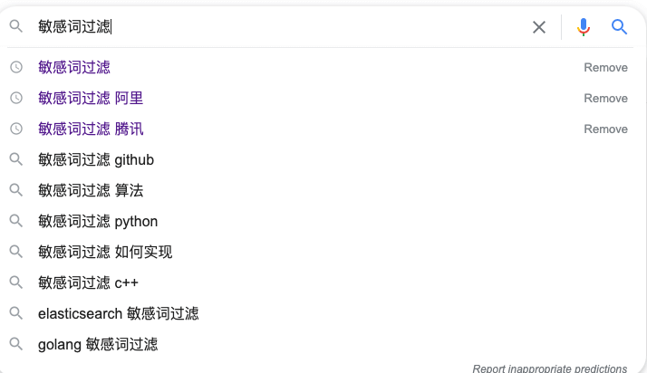
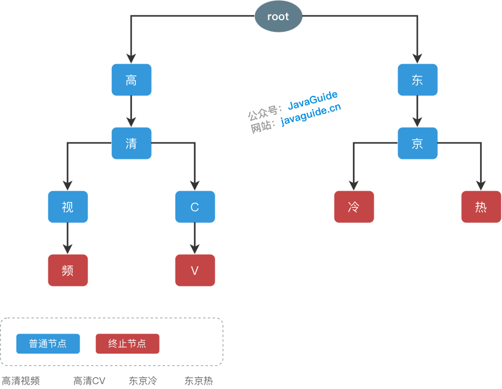
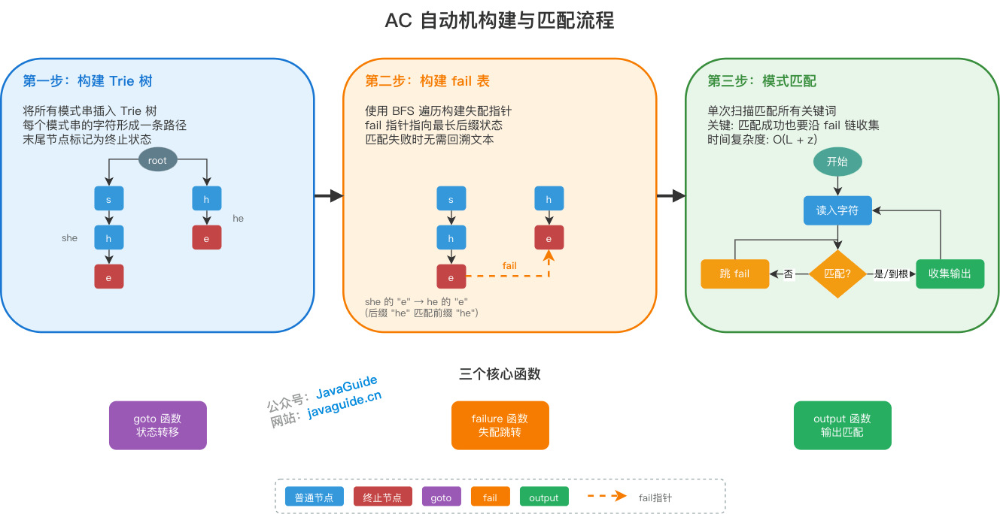
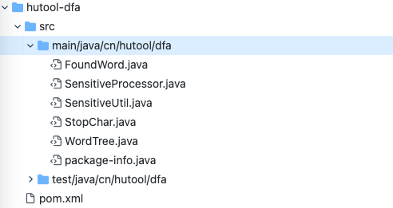
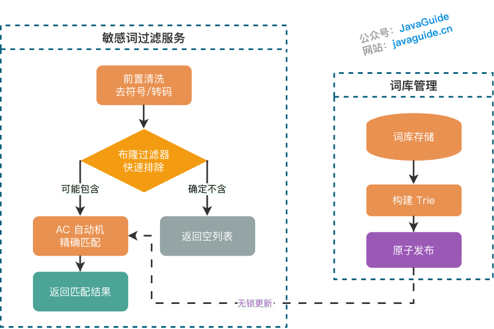

Sensitive word filtering is a core part of content safety. Social media, e-commerce platforms, online games, and AI applications need to filter user input and generated content in real time to prevent the spread of prohibited material such as pornography, violence, and hate speech.

Technically, sensitive word filtering is a **multi-pattern string matching problem**: finding multiple keywords in a piece of text at the same time.

This article is nearly 20,000 words long. It starts with how the algorithms evolved and also covers production practices such as handling obfuscated words, high-concurrency optimization, and dictionary management.

**Key takeaways:**

| Algorithm                   | Use case                            | Characteristics                                 |
| --------------------------- | ----------------------------------- | ----------------------------------------------- |
| **Trie**                    | Small dictionaries (< 10,000 words) | Simple to implement and understand              |
| **Aho–Corasick automaton**  | High-throughput workloads           | Matches all words in one scan; best performance |
| **Double-Array Trie (DAT)** | Large dictionaries (> 10,000 words) | Low memory use, high construction cost          |

## How the Algorithms Evolved

The following sections introduce sensitive word filtering algorithms in order of increasing complexity, explaining the motivation and effect of each optimization.

### Brute-Force Matching (BF)

**Brute-force matching** is the most straightforward approach: scan every position in the text and try to match each sensitive word.

Assume the sensitive word dictionary contains `n` words with an average length of `m`, and the text to scan has length `L`:

```java
public List<String> bruteForceMatch(String text, List<String> words) {
    List<String> result = new ArrayList<>();
    for (String word : words) {              // O(n): iterate over every sensitive word
        if (text.contains(word)) {           // O(L × m): naive substring matching
            result.add(word);
        }
    }
    return result;
}
```

**Time complexity**: O(n × L × m)

| Scenario | Words  | Text length | Average word length | Operations  |
| -------- | ------ | ----------- | ------------------- | ----------- |
| Small    | 100    | 1,000       | 5                   | 500,000     |
| Medium   | 1,000  | 5,000       | 5                   | 25 million  |
| Large    | 10,000 | 10,000      | 5                   | 500 million |

**Limitations:**

1. **Repeated scans**: The full text is scanned for each sensitive word, so many characters are compared repeatedly.
2. **No state reuse**: Words are processed independently, so prior match information cannot be reused.
3. **Poor scalability**: Performance degrades linearly as the dictionary grows.

With tens of thousands of words, brute-force matching can take seconds, which is too slow for production services.

### Trie: Reuse Prefixes to Reduce Comparisons

**Trie** (pronounced /ˈtraɪ/), also called a prefix tree, improves on brute-force matching by **trading space for time**. It uses **shared prefixes** to reduce storage and lookup costs.

Keyword suggestions in a browser's search box can be implemented with a Trie:



#### Basic Properties

A Trie has three basic properties:

1. **The root node contains no character**; every other node contains exactly one character.
2. **The path from the root to a node** forms the string represented by that node.
3. **Each node's children have distinct characters.**

#### Structure Example

Assume the sensitive word dictionary contains the following words:

- 高清视频
- 高清 CV
- 东京冷
- 东京热

The resulting Trie is shown below (red nodes mark the end of a word):



To search for `东京热`, process its characters (`东`, `京`, `热`) in order, matching from the root down.

#### Comparison with Brute-Force Matching

Assume the dictionary is `["she", "he", "his", "hers"]` and search for those words in `"ushers"`:

| Algorithm   | Matching process                                    | Character comparisons |
| ----------- | --------------------------------------------------- | --------------------- |
| Brute force | Scan the text separately for each of the four words | About 24¹             |
| Trie        | Start at each position and follow the tree          | About 10              |

> ¹ This is a simplified estimate (number of words × text length). The actual worst-case count depends on word lengths and positions, and can be higher.

The advantage of a Trie is that **all sensitive words share one tree**, so a traversal can try to match them all.

#### Complexity Analysis

| Metric           | HashMap implementation | Array implementation |
| ---------------- | ---------------------- | -------------------- |
| Preprocessing    | O(n × m)               | O(n × m × σ)         |
| Lookup time      | O(L × m)               | O(L × m)             |
| Space complexity | O(n × m)               | O(n × m × σ)         |

> σ is the character-set size (about 20,000 for Chinese characters and only 128 for ASCII). The code examples use a `HashMap`, which suits large character sets such as Chinese. Arrays suit smaller character sets, such as English only.

#### Trie Code Example

```java
public class SimpleTrie {
    private static class Node {
        Map<Character, Node> children = new HashMap<>();
        boolean isEnd;
    }

    private final Node root = new Node();

    // Add a sensitive word
    public void addWord(String word) {
        Node node = root;
        for (char c : word.toCharArray()) {
            node = node.children.computeIfAbsent(c, k -> new Node());
        }
        node.isEnd = true;
    }

    // Check whether the text contains a sensitive word
    public boolean contains(String text) {
        for (int i = 0; i < text.length(); i++) {
            Node node = root;
            for (int j = i; j < text.length(); j++) {
                node = node.children.get(text.charAt(j));
                if (node == null) break;
                if (node.isEnd) return true;
            }
        }
        return false;
    }

    // Find all sensitive words in the text
    public List<String> matchAll(String text) {
        List<String> result = new ArrayList<>();
        for (int i = 0; i < text.length(); i++) {
            Node node = root;
            for (int j = i; j < text.length(); j++) {
                node = node.children.get(text.charAt(j));
                if (node == null) break;
                if (node.isEnd) {
                    result.add(text.substring(i, j + 1));
                }
            }
        }
        return result;
    }
}
```

#### Limitations of a Trie

Although a Trie is much faster than brute-force matching, it still has a **backtracking problem**:

Search for `["she", "he", "his"]` in the text `"ushers"`:

1. Starting at position 1, match `"s" → "h" → "e"` and find `"she"`.
2. After the match, **return to position 2** and match `"h" → "e"` again to find `"he"`.

In the worst case, restarting at the next position after a failed match degrades to O(L × m), such as when matching `"aaaaab"` against `"aaaaaaaa"`.

Can we avoid **backtracking entirely**? This leads to the Aho–Corasick automaton.

**Note:** `PatriciaTrie` in [Apache Commons Collections](https://mvnrepository.com/artifact/org.apache.commons/commons-collections4) is a compressed binary Trie based on **bit operations** (PATRICIA = Practical Algorithm To Retrieve Information Coded In Alphanumeric). It differs from the **character-based Trie** described here and is not directly suitable for filtering Chinese sensitive words.

### Aho–Corasick: Match All Words in One Scan

The **Aho–Corasick automaton (AC automaton)** is a multi-pattern matching algorithm built on a Trie. Alfred V. Aho and Margaret J. Corasick at Bell Labs introduced it in 1975.

Its core idea is related to KMP: **use information from previous matches to resume at a suitable position after a mismatch, avoiding backtracking**. KMP handles one pattern; Aho–Corasick handles multiple patterns.

#### Core Components

The Aho–Corasick automaton uses three core functions:

| Function    | Purpose                                                                                      |
| ----------- | -------------------------------------------------------------------------------------------- |
| **goto**    | State transition: the state reached after reading a character from the current state         |
| **failure** | Mismatch transition: jump to the state for the longest matching suffix to avoid backtracking |
| **output**  | Match output: records the set of matches associated with each state                          |

#### Construction Steps

The automaton is built in three steps:



**Step 1: Build the Trie**

Insert all patterns into a Trie to form the automaton's base structure. Mark the final node of each pattern as a terminal state.

**Step 2: Build failure links (the core step)**

Failure links are central to the Aho–Corasick automaton. They specify **which state to try next when the current character cannot be matched, instead of restarting from the root**.

Construction uses breadth-first search (BFS) to visit nodes level by level. For the current node `temp`:

1. Find the failure link of `temp`'s parent.
2. Look among that failure state's children for a node with the same character as `temp`.
3. If one exists, set `temp.fail` to that child.
4. Otherwise, continue following failure links until a match is found or the root is reached.

**A failure link** points to the state corresponding to the **longest suffix** of the string represented by the current state.

::: tip Relation to KMP
A failure link generalizes the KMP `next` array to a Trie. For example, the suffix `"he"` of `"she"` matches the prefix of `"he"`, so the failure link from the final `'e'` in `"she"` points to the `'e'` in `"he"`.
:::

**Step 3: Match Patterns**

Scan from the beginning of the text with pointer `p` initially at the root:

1. **State transition**: If the current character is a child of `p`, move `p` to that child. Otherwise, follow failure links until a match is found or the root is reached.
2. **Collect matches**: Add the matches for the current state. An implementation can follow the failure chain here or merge failure outputs into each state during construction; the code below uses the latter approach.

Why include matches from failure states? A suffix of a long word may also be a shorter word. For example, when `"she"` matches, its failure state also matches `"he"`. The code merges those outputs during construction, so they are available from the current state without traversing the failure chain for every character.

#### Aho–Corasick Code Example

```java
public class AhoCorasickAutomaton {
    private static class Node {
        Map<Character, Node> children = new HashMap<>();
        Node fail;                    // Failure link
        List<String> outputs = new ArrayList<>(); // Matches for this state
    }

    private final Node root = new Node();

    // Step 1: Build the Trie
    public void addWord(String word) {
        Node node = root;
        for (char c : word.toCharArray()) {
            node = node.children.computeIfAbsent(c, k -> new Node());
        }
        node.outputs.add(word); // Record the match at the terminal node
    }

    // Step 2: Build failure links (BFS)
    public void buildFailPointer() {
        Queue<Node> queue = new LinkedList<>();
        root.fail = root;

        // Direct children of the root point back to the root
        for (Node child : root.children.values()) {
            child.fail = root;
            queue.offer(child);
        }

        while (!queue.isEmpty()) {
            Node current = queue.poll();
            for (Map.Entry<Character, Node> entry : current.children.entrySet()) {
                char c = entry.getKey();
                Node child = entry.getValue();

                // Follow the parent's failure chain to find a transition for character c
                Node fail = current.fail;
                while (fail != root && !fail.children.containsKey(c)) {
                    fail = fail.fail;
                }
                child.fail = fail.children.getOrDefault(c, root);
                // Avoid a self-loop: point to the root if fail points to this node
                if (child.fail == child) {
                    child.fail = root;
                }
                // Merge the failure state's outputs
                child.outputs.addAll(child.fail.outputs);
                queue.offer(child);
            }
        }
    }

    // Step 3: Match patterns in a single scan
    public List<String> match(String text) {
        List<String> result = new ArrayList<>();
        Node state = root;

        for (int i = 0; i < text.length(); i++) {
            char c = text.charAt(i);
            // Follow failure links to find a state that can handle character c
            while (state != root && !state.children.containsKey(c)) {
                state = state.fail;
            }
            state = state.children.getOrDefault(c, root);
            // Collect all matches for the current state, including merged failure outputs
            result.addAll(state.outputs);
        }
        return result;
    }
}
```

Example:

```java
AhoCorasickAutomaton ac = new AhoCorasickAutomaton();
ac.addWord("she");
ac.addWord("he");
ac.addWord("her");
ac.addWord("hers");
ac.buildFailPointer(); // Build failure links after inserting all words

List<String> matches = ac.match("ushers");
// Output: [she, he, her, hers]
```

#### Performance Comparison

| Algorithm    | Preprocessing | Matching time | Characteristics                                                 |
| ------------ | ------------- | ------------- | --------------------------------------------------------------- |
| Brute force  | O(1)          | O(L × n × m)  | Scans the text separately for each word                         |
| Trie         | O(n × m)      | O(L × m)      | May backtrack                                                   |
| Aho–Corasick | O(n × m)¹     | O(L + z)      | One scan; z is the total number of matches, including overlaps² |

> 1. With a `HashMap` for child nodes, preprocessing is O(n × m). With an array, it is O(n × m × σ), because the character set of size σ must be allocated in advance.
> 2. In an extreme case with many nested words (such as "a", "ab", "abc", ..., "abc...z"), z may be much larger than L, so runtime is dominated by z. Sensitive word dictionaries rarely have this degree of nesting in practice.

The Aho–Corasick automaton provides **linear-time matching** with respect to text length and the number of matches, rather than the number of sensitive words.

Combining Aho–Corasick with DAT through [AhoCorasickDoubleArrayTrie](https://github.com/hankcs/AhoCorasickDoubleArrayTrie) can improve matching efficiency while reducing memory use.

### Double-Array Trie (DAT): Reduce Memory Use

Standard Tries can use substantial memory because each node needs a map. Production systems often use an optimized variant, the **Double-Array Trie (DAT)**.

DAT was introduced by Aoe Jun-ichi and others in their 1989 paper [An Efficient Implementation of Trie Structures](https://www.co-ding.com/assets/pdf/dat.pdf). It compresses a Trie using two integer arrays, `base[]` and `check[]`:

| Property                  | Standard Trie (array implementation) | Double-Array Trie                        |
| ------------------------- | ------------------------------------ | ---------------------------------------- |
| Space complexity          | O(n × m × σ)                         | O(n × m)                                 |
| Memory use                | Higher                               | Often 20–30% of the array implementation |
| Implementation complexity | Simple                               | More complex; must handle collisions     |

**Note:** DAT's compression efficiency depends heavily on the proportion of shared prefixes in the dictionary. Compression is limited in extreme cases with no shared prefixes.

Reference implementation: <https://github.com/komiya-atsushi/darts-java>

### DFA: An Engineering-Oriented Implementation

**DFA (Deterministic Finite Automaton)** is a concept from automata theory. A Trie traversal from the root is itself a DFA run: each node is a state, and each edge is a character transition. However, ordinary Trie matching restarts the DFA at each position in the text. Aho–Corasick uses failure links to complete the state transitions, enabling a true **single-pass, multi-pattern DFA**.

[Hutool 5.8.x](https://hutool.cn/docs/#/dfa/%E6%A6%82%E8%BF%B0) provides a DFA-based sensitive word filtering implementation built on a Trie:



```java
WordTree wordTree = new WordTree();
wordTree.addWord("大");
wordTree.addWord("大憨憨");
wordTree.addWord("憨憨");

String text = "那人真是个大憨憨！";

// Get the first matching keyword
String matchStr = wordTree.match(text);
System.out.println(matchStr); // Output: 大

// matchAll(text, limit, isDensityMatch, isGreedy)
// - limit: Maximum number of matches; -1 means unlimited
// - isDensityMatch: Whether to find overlapping matches inside an already matched word
// - isGreedy: Whether to use greedy matching (true for the longest keyword, false for the shortest)
List<String> matchStrList = wordTree.matchAll(text, -1, false, false);
System.out.println(matchStrList); // Output: [大, 憨憨]

List<String> matchStrList2 = wordTree.matchAll(text, -1, false, true);
System.out.println(matchStrList2); // Output: [大, 大憨憨]
```

**Output explanation:**

- `matchAll(text, -1, false, false)`: non-greedy, non-density matching

  - Starting at position 0, `"大"` matches (the shortest match).
  - After skipping the matched character, `"憨憨"` matches starting at position 2.
  - Result: `[大, 憨憨]`

- `matchAll(text, -1, false, true)`: greedy, non-density matching
  - Starting at position 0, `"大憨憨"` matches (the longest match).
  - `"大"` also matches as a prefix.
  - Result: `[大, 大憨憨]`

## Handle Obfuscated Words

In practice, users may try to evade sensitive word filters in several ways:

| Obfuscation                        | Example               | Mitigation                                    |
| ---------------------------------- | --------------------- | --------------------------------------------- |
| Homophones                         | “赌博” → “读博”       | Maintain a homophone dictionary               |
| Inserted symbols                   | "fuck" → "f\*u\*c\*k" | Strip special characters during preprocessing |
| Traditional and Simplified Chinese | “台灣” → “台湾”       | Convert to Simplified Chinese before matching |
| Full-width characters              | "abc" → "ａｂｃ"      | Convert full-width characters to half-width   |

**Preprocessing** is a common way to handle obfuscated words: normalize a copy of the text before matching. The code below covers basic cases such as compatibility-equivalent characters, letter case, Unicode code points, and format-control characters. It is only an example; production systems should extend the rules based on supported languages, false-positive tolerance, and observed evasion attempts.

```java
import java.text.Normalizer;
import java.util.Locale;

public String preprocess(String text) {
    // NFKC normalizes compatibility-equivalent characters, including full-width and half-width forms.
    // Normalize only a copy used for detection; preserve the user's original text.
    String normalized = Normalizer.normalize(text, Normalizer.Form.NFKC)
            .toLowerCase(Locale.ROOT);
    StringBuilder sb = new StringBuilder();
    normalized.codePoints()
            // Remove format-control characters such as zero-width joiners to prevent evasion with invisible characters.
            .filter(codePoint -> Character.getType(codePoint) != Character.FORMAT)
            .filter(this::isChineseOrAlphanumeric)
            .forEach(sb::appendCodePoint);
    return toSimplifiedChinese(sb.toString()); // Convert Traditional Chinese to Simplified Chinese
}

private boolean isChineseOrAlphanumeric(int codePoint) {
    return Character.isLetterOrDigit(codePoint)
            || Character.UnicodeScript.of(codePoint) == Character.UnicodeScript.HAN;
}
```

Mature libraries such as [ToolGood.Words](https://github.com/toolgood/ToolGood.Words) include Traditional/Simplified Chinese conversion and full-width/half-width conversion.

::: warning Caution

- **Position mapping**: `preprocess` removes special characters, so positions in the normalized text no longer map directly to positions in the original. If the application must return exact match locations for highlighting or partial replacement, maintain a map from normalized positions to original positions.
- **Normalization boundaries**: NFKC removes some distinctions between compatibility characters that may be meaningful to the application. Use it only on a detection copy and keep the original for display and auditing. Removing characters may also join previously separated text into a new word; evaluate the false-positive rate using real data.
- **Unicode confusables**: Unicode confusables can help detect similar-looking characters across scripts, but they should not be used as a general-purpose normalization step. For high-risk matches, consider context-aware models or human review; character substitution alone is not enough to make the final decision.
  :::

## High-Concurrency Optimizations

### Atomic Hot Swap: Update the Dictionary at Runtime

In production, sensitive word dictionaries need frequent updates without interrupting active matching requests. Use `AtomicReference` for an atomic hot swap: build a new Trie in the background, then atomically replace the old instance so reader threads are not blocked.

```java
public class SensitiveWordFilter {
    private final AtomicReference<SimpleTrie> trieRef;

    public SensitiveWordFilter(List<String> initialWords) {
        this.trieRef = new AtomicReference<>(buildTrie(initialWords));
    }

    // Get the current Trie when matching
    public List<String> match(String text) {
        SimpleTrie trie = trieRef.get();
        return trie != null ? trie.matchAll(text) : Collections.emptyList();
    }

    // Update the dictionary: build a new Trie, then publish it atomically
    public void refreshWords(List<String> newWords) {
        SimpleTrie newTrie = buildTrie(newWords);
        trieRef.set(newTrie);  // Atomic publication; immediately visible to reader threads
    }

    private SimpleTrie buildTrie(List<String> words) {
        SimpleTrie trie = new SimpleTrie();
        for (String word : words) {
            trie.addWord(word);
        }
        return trie;
    }
}
```

**Key points:**

- Use `AtomicReference` to make the swap atomic.
- Threads may still be using the old Trie; let the garbage collector reclaim it when it is no longer referenced.
- Build the new Trie asynchronously in the background to avoid blocking service responses.

### Parallel Processing: Split Very Long Texts

Very long texts, such as articles and comments, can be split into chunks and processed in parallel.

**Note:** Chunks must overlap; otherwise, sensitive words that span chunk boundaries will be missed.

```java
// Use a dedicated thread pool instead of occupying ForkJoinPool.commonPool()
private final ExecutorService filterExecutor =
    new ThreadPoolExecutor(
        4, 8, 60L, TimeUnit.SECONDS,
        LinkedBlockingQueue<>(1000),
        new ThreadPoolExecutor.CallerRunsPolicy() // Run in the caller when the queue is full to apply backpressure
    );

public List<String> parallelMatch(String text, int chunkSize, int maxWordLength) {
    // Overlap = longest sensitive word length - 1, preventing misses across chunk boundaries
    int overlap = maxWordLength - 1;
    List<CompletableFuture<List<String>>> futures = new ArrayList<>();

    for (int i = 0; i < text.length(); i += chunkSize) {
        int start = i;
        int end = Math.min(i + chunkSize + overlap, text.length());
        String chunk = text.substring(start, end);

        // Explicitly pass the custom thread pool
        futures.add(CompletableFuture.supplyAsync(() ->
            trieRef.get().matchAll(chunk), filterExecutor
        ));
    }

    return futures.stream()
        .flatMap(f -> f.join().stream())
        .distinct()
        .collect(Collectors.toList());
}
```

**Why Is an Overlap Needed?**

Suppose the sensitive word `"赌博网站"` has length 4 and the chunk size is 100. If it starts at position 99, it will be split across two chunks:

- chunk 1: `...text ends at position 99赌`
- chunk 2: `博网站 continues...`

Neither chunk can match the complete word `"赌博网站"`, causing a false negative. An overlap ensures that each sensitive word appears in full in at least one chunk.

### Fast Pre-Filtering with a Bloom Filter

Use a **Bloom filter** for an initial check to quickly rule out text that contains no sensitive words.

**When it helps**: This approach is useful only when most texts contain no sensitive words and the Bloom filter's false-positive rate is very low. `quickCheck` itself is O(L × maxWordLen), the same order as Trie matching. If texts frequently match the Bloom filter falsely, it adds overhead instead.

**Note:** A Bloom filter tests whether an individual element belongs to a set. Check substrings of the text, not the entire text as one element.

```java
public List<String> matchWithBloomFilter(String text, int maxWordLength) {
    // Quick check: scan all possible substrings
    if (!quickCheck(text, maxWordLength)) {
        return Collections.emptyList();  // Definitely contains no sensitive word
    }
    // A sensitive word may be present; run exact matching
    return trieRef.get().matchAll(text);
}

private boolean quickCheck(String text, int maxWordLen) {
    BloomFilter<String> filter = getBloomFilter();  // Bloom filter containing all sensitive words
    for (int i = 0; i < text.length(); i++) {
        for (int len = 1; len <= maxWordLen && i + len <= text.length(); len++) {
            if (filter.mightContain(text.substring(i, i + len))) {
                return true;  // Possible match; run exact matching
            }
        }
    }
    return false;  // Definitely no match
}
```

**Use case**: When sensitive words are rare, a Bloom filter can quickly rule out many texts that contain none and reduce the number of Trie matches. However, scanning with the Bloom filter also has a cost (O(L × maxWordLen)), so evaluate it against the characteristics of your data.

## Open-Source Projects

| Project                                                                            | Languages            | Minimum JDK | Characteristics                                                                                                                                                           | Use case                               |
| ---------------------------------------------------------------------------------- | -------------------- | ----------- | ------------------------------------------------------------------------------------------------------------------------------------------------------------------------- | -------------------------------------- |
| [ToolGood.Words](https://github.com/toolgood/ToolGood.Words)                       | C#/Java/Python/Go/JS | Java 8+     | Multiple languages; includes Traditional/Simplified Chinese, full-width/half-width, and pinyin conversion. The C# version filters over 300 million characters per second. | Multilingual projects                  |
| [Hutool DFA](https://hutool.cn/docs/#/dfa/%E6%A6%82%E8%BF%B0)                      | Java                 | Java 8+     | Lightweight API built on a Trie                                                                                                                                           | Small to medium dictionaries           |
| [AhoCorasickDoubleArrayTrie](https://github.com/hankcs/AhoCorasickDoubleArrayTrie) | Java                 | Java 7+     | High-performance Aho–Corasick and Double-Array Trie                                                                                                                       | Large dictionaries and high throughput |

## Production Recommendations

### Dictionary Management

- **Update regularly**: Maintain the dictionary over time and support hot loading to avoid restarting the service.
- **Use sensitivity levels**: Classify words as high, medium, or low sensitivity based on the use case, with different actions such as blocking, human review, or logging.
- **Maintain an allowlist**: Prevent false positives. For example, a sensitive word `"XXX"` may incorrectly match the normal word `"XXY"` as a substring, or `"公安"` may match `"办公安排"`. Possible mitigations include excluding allowlisted phrases, requiring a minimum match length or whole-word matches, and checking the surrounding context.
- **Log matches**: Record match results to improve the dictionary and analyze false positives.

### Error Handling

- **Dictionary load failure**: If building the new Trie fails (for example, because of an out-of-memory error or corrupted file), keep the old Trie, log the error, and send an alert.
- **Empty dictionary**: Log a warning when the dictionary is empty instead of silently allowing all text through.
- **Matching timeout**: Consider a timeout circuit breaker for very long texts and large dictionaries. For high-risk content, reject, isolate, or send timed-out requests for human review; do not automatically allow them. Use fail-open only for explicitly low-risk scenarios with business approval, and limit input size, record metrics, and alert promptly.

### Monitoring Metrics

| Metric                 | Suggested threshold  | Description                                                       |
| ---------------------- | -------------------- | ----------------------------------------------------------------- |
| Matching latency (p99) | < 10 ms              | Time per filtering request                                        |
| False-positive rate    | < 1%                 | Normal content incorrectly identified as sensitive                |
| False-negative rate    | Monitor continuously | Sensitive content not detected                                    |
| Dictionary hit rate    | Analyze as needed    | Frequency of matches for each word, used to refine the dictionary |

### Architecture Recommendation



## References

### Research Papers

- Unicode Standard Annex #15 - Unicode Normalization Forms：<https://www.unicode.org/reports/tr15/>
- Unicode Technical Standard #39 - Unicode Security Mechanisms：<https://www.unicode.org/reports/tr39/>
- Aho, A.V. and Corasick, M.J. (1975). "[Efficient string matching: An aid to bibliographic search](https://dl.acm.org/doi/10.1145/360825.360855)." _Communications of the ACM_, 18(6), 333–340. (The original Aho–Corasick paper.)
- Aoe, J., Morimoto, K., and Sato, T. (1989). "[An Efficient Implementation of Trie Structures](https://www.co-ding.com/assets/pdf/dat.pdf)." _Software: Practice and Experience_.

### Related Patents

- [Automatic sensitive word filtering and management system](https://patents.google.com/patent/CN101964000B)
- [Sensitive word filtering method and system for online games](https://patents.google.com/patent/CN103714160A/zh)

<!-- @include: @article-footer.snippet.md -->
