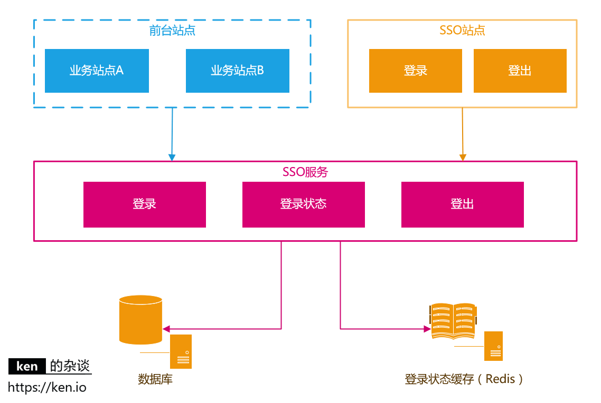
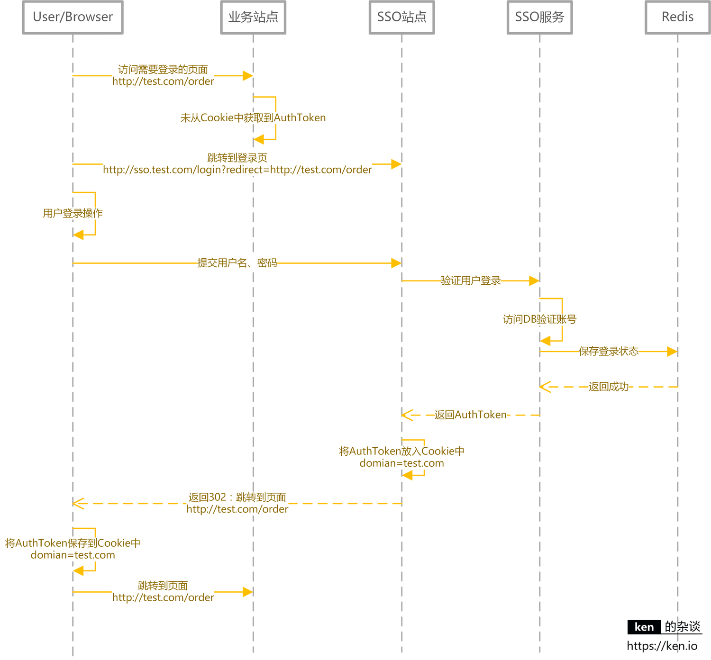
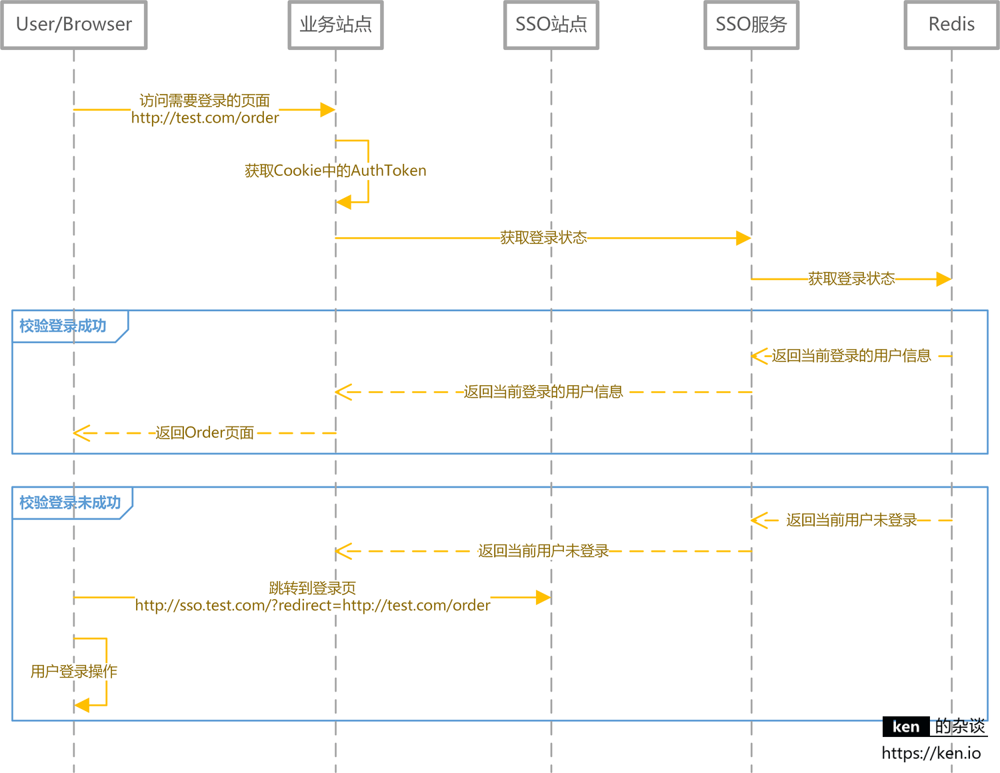
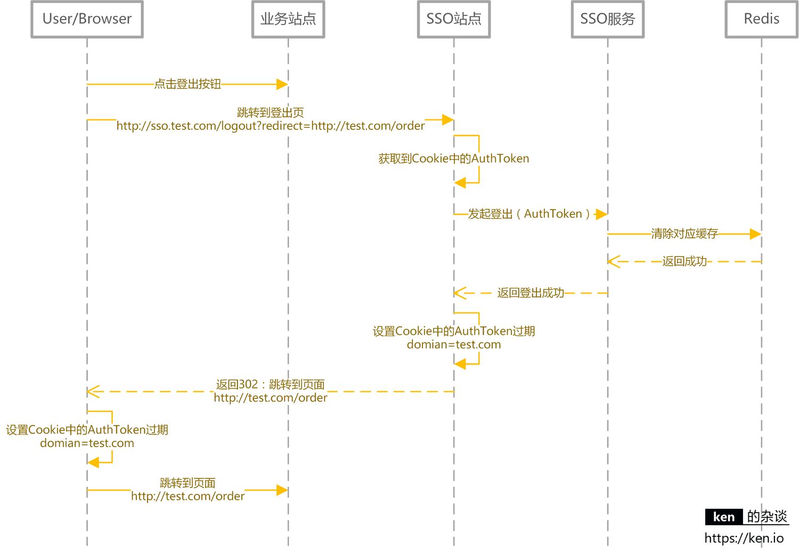
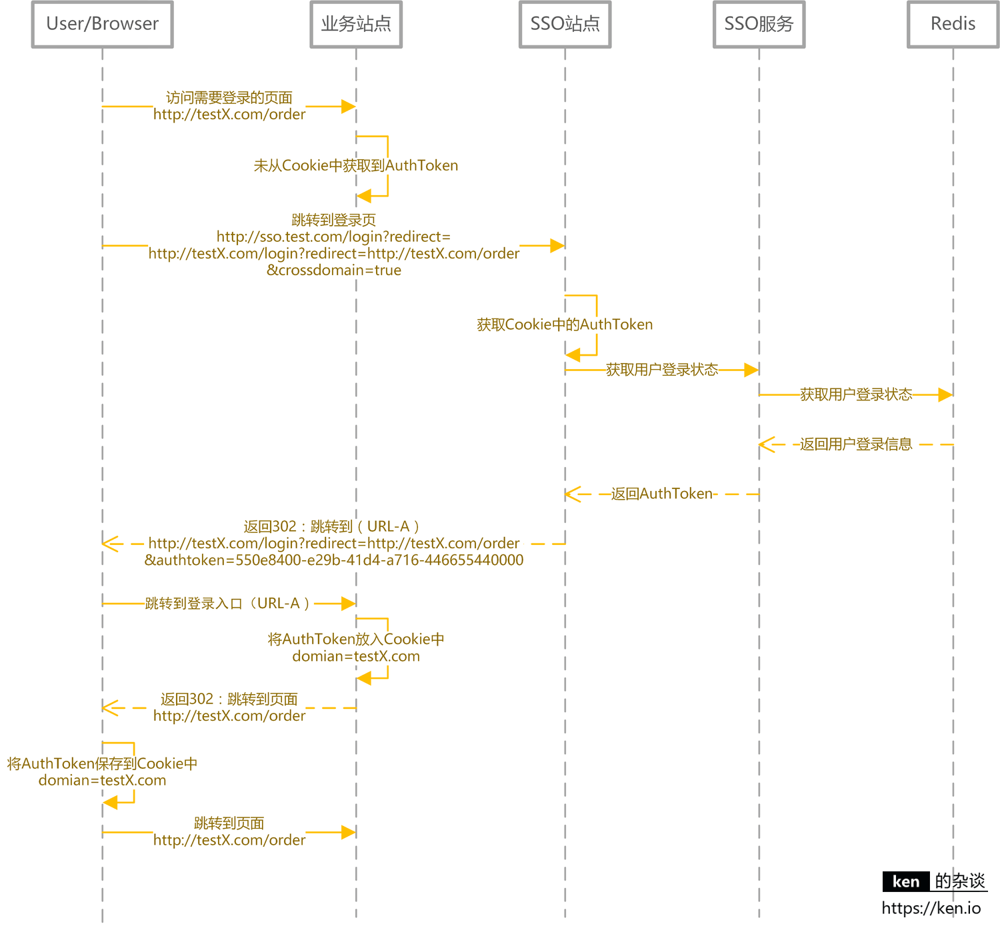
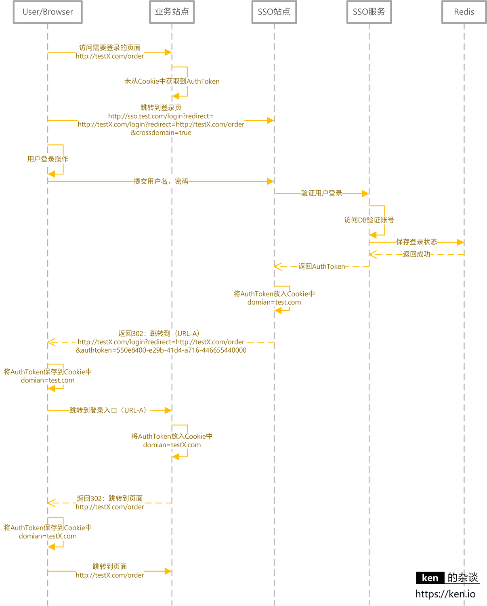
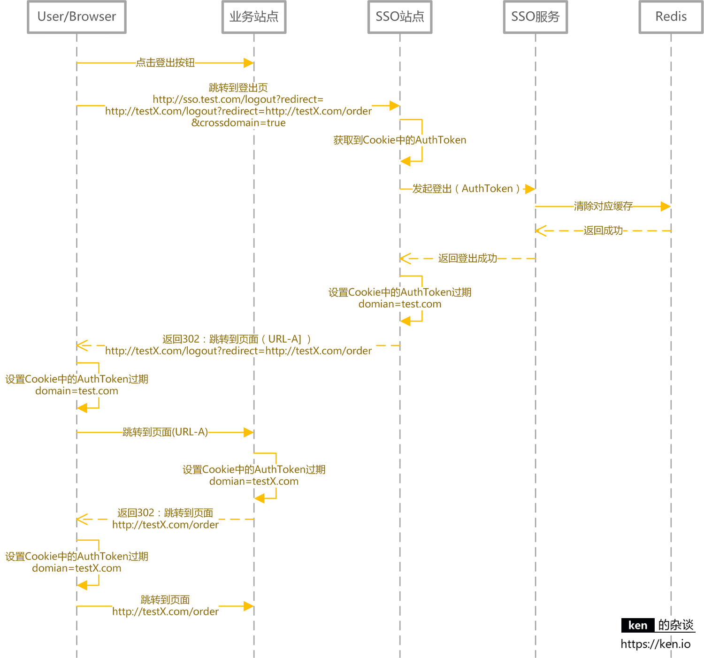

> Reproduced with permission from <https://ken.io/note/sso-design-implement>. Author: ken.io.

## Introduction to SSO

### What Is SSO?

SSO stands for Single Sign-On. It lets users sign in once and access multiple mutually trusted applications.

For example, after signing in to the [NetEase Account Center](https://reg.163.com/), you are also signed in to these sites:

- NetEase Live: [https://v.163.com](https://v.163.com/)
- NetEase Blog: [https://blog.163.com](https://blog.163.com/)
- NetEase Huahai: [https://love.163.com](https://love.163.com/)
- NetEase Kaola: [https://www.kaola.com](https://www.kaola.com/)
- NetEase Lofter: [http://www.lofter.com](http://www.lofter.com/)

### What Are the Benefits of SSO?

1. **For users:** Sign in once and use multiple applications without keeping track of separate usernames and passwords.
2. **For administrators:** Maintain a single centralized account system.
3. **For new application development:** Integrate with the central account system instead of building authentication from scratch.

## SSO Design and Implementation

This article discusses how to design and implement an SSO system.

The core features are:

- Single sign-on
- Single sign-out
- Cross-domain single sign-on
- Cross-domain single sign-out

### Core Applications and Dependencies

| Application, module, or object | Description                                         |
| ------------------------------ | --------------------------------------------------- |
| Client application             | Application that requires authentication            |
| SSO login site                 | Provides the login page                             |
| SSO logout site                | Provides the logout entry point                     |
| SSO login service              | Provides the login service                          |
| SSO session service            | Validates sessions and retrieves user information   |
| SSO logout service             | Logs users out                                      |
| Database                       | Stores user account information                     |
| Cache                          | Stores user session information, typically in Redis |

### Store and Validate User Sessions

Common web frameworks implement sessions by generating a session ID stored in a browser cookie, with session data stored in server memory. This approach is also described in [ken.io's explanation of how sessions work](https://ken.io/note/session-principle-skill).

After a successful login, the SSO site creates its own session. Store the browser's session identifier in a cookie with `Secure`, `HttpOnly`, and an appropriate `SameSite` attribute. Keep the cookie scoped to the current host; don't broaden it to the parent domain just to share a session. A mobile app should use the system browser for a standard authorization flow and store necessary credentials in secure storage such as Keychain or Keystore. This article focuses on web-based SSO.

When a user visits a page that requires authentication, the client submits the `AuthToken` to the SSO service to validate the session or retrieve user information.

Redis is a suitable store for session information. A Redis cluster can provide high availability and horizontal scaling, and can support load balancing and scaling for the SSO service.

| Object       | Description                                                                                                                                                                                                                                                           |
| ------------ | --------------------------------------------------------------------------------------------------------------------------------------------------------------------------------------------------------------------------------------------------------------------- |
| `AuthToken`  | A high-entropy, unpredictable identifier generated with a cryptographically secure random number generator. Set expiration, rotation, and revocation mechanisms. Do not use a predictable UUID version or encrypt a username and timestamp to create a session token. |
| Session data | Usually includes a cached user ID and username.                                                                                                                                                                                                                       |

### User Login and Session Validation

**Login sequence diagram**

The diagram above shows sharing an `AuthToken` across subdomains with a parent-domain cookie. For a new system, don't set the authentication cookie's `Domain` to `.test.com`: this sends the same credential to every matching subdomain, and a vulnerable, abandoned, or compromised subdomain can expand the attack surface.

A safer approach is for the SSO site and each business site to maintain separate host-only sessions. When a business site needs authentication, redirect to the SSO site. It checks its own cookie, then returns the result using a short-lived, one-time authorization code. The business site's backend exchanges the code for user information and creates a local session.

**Retrieve user information and validate the session**

### User Sign-Out

SSO sign-out involves more than deleting a cookie:

1. The SSO server revokes the central session and associated refresh grants.
2. The SSO site clears its session cookie.
3. Depending on the protocol and business risk, notify business sites through front-channel or back-channel logout to clear local sessions. Account for notification failures and offline sites.

**Sign-out sequence diagram**

### Cross-Domain Sign-In and Sign-Out

Cross-domain SSO should not try to work around cross-domain cookie restrictions. Use standard browser redirects and backend token exchange so each site can establish its own session. A common choice is the OpenID Connect Authorization Code Flow.

The main ideas are:

- After login, the SSO service returns a short-lived, one-time authorization code only to a registered, exactly matched redirect URI. The business site's backend exchanges the code for the authentication result and creates its own session. Don't copy the same long-lived bearer token across multiple domains.
- Validate `state` in authorization requests. With OpenID Connect, also validate the issuer, audience, and signature, and check the `nonce` when used. Public clients using the Authorization Code Flow should also use PKCE.
- Use protocol-defined front-channel or back-channel notifications for cross-site sign-out. If a notification fails, let business sites converge through session expiration, token revocation, and revalidation.

**Cross-domain sign-in (already signed in to the primary domain)**

**Cross-domain sign-in (not signed in to the primary domain)**

**Cross-domain sign-out**

The sequence diagrams above come from the original article and illustrate login redirects and notifications. Details such as passing `AuthToken` directly or sharing a parent-domain cookie should not be treated as implementation guidance for a new system. Follow the current security specifications for the OpenID Connect/OAuth protocol you choose.

## Notes

- **About the design:** This design illustrates an implementation approach. For app sign-in, adding a custom “app signature” is not a sufficient security measure. Use the system browser for the OpenID Connect/OAuth Authorization Code Flow with PKCE. Do not treat an app as a trusted environment capable of keeping a client secret permanently confidential.
- **About the sequence diagrams:** They show the main scenarios, not every possible case. Messages that do not affect the overall flow have been omitted for clarity.

## References

- [OpenID Connect Core 1.0](https://openid.net/specs/openid-connect-core-1_0-18.html)
- [RFC 9700：Best Current Practice for OAuth 2.0 Security](https://www.rfc-editor.org/rfc/rfc9700.html)

<!-- @include: @article-footer.snippet.md -->
