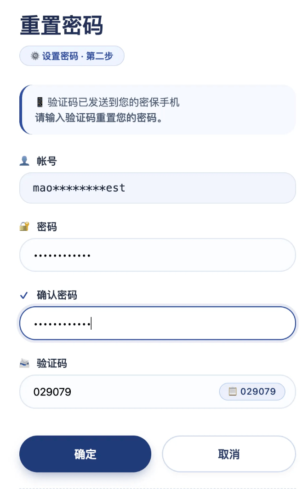
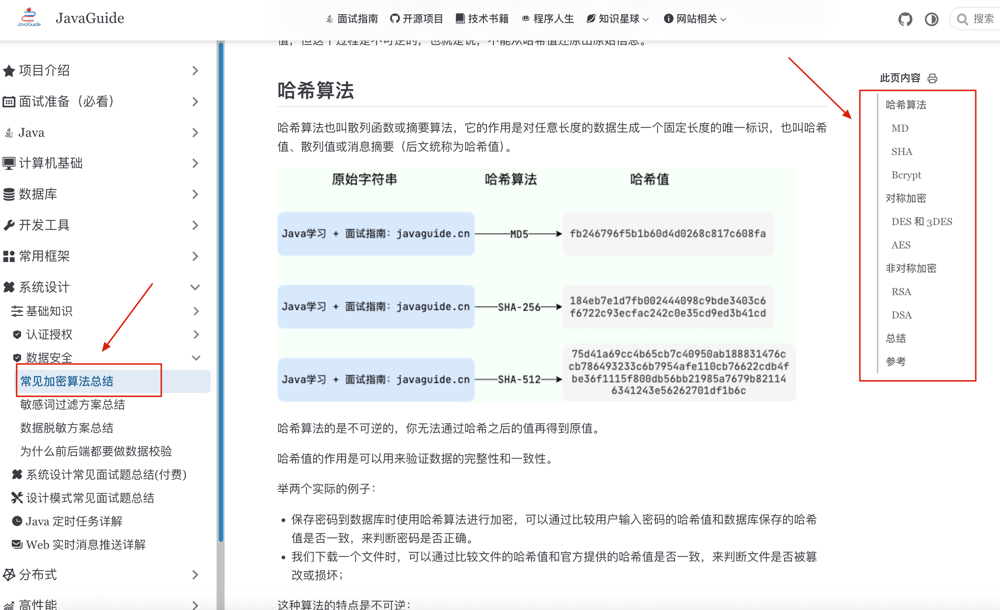
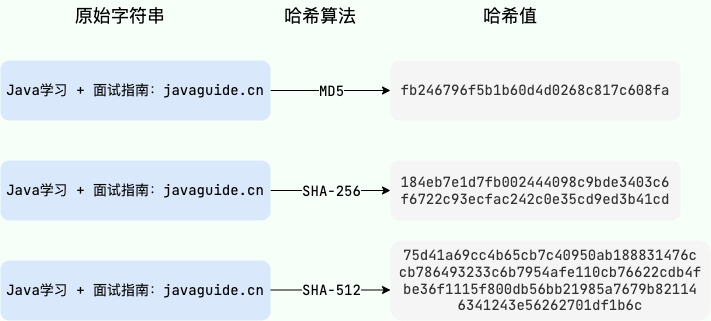

This is an interesting question that many companies ask in interviews. The answer is simple, but have you ever wondered about it when resetting a password?



The answer is simple: **the server does not know your original password either**. The developer who stored it in plaintext has probably already been fired 🤣.

If the server knew your original password, that would be a serious security risk.

Let's take a closer look.

This article does not cover encryption algorithms in depth. For more, see [Common Encryption Algorithms](https://javaguide.cn/system-design/security/encryption-algorithms.html).



## Why Doesn't the Server Know Your Password?

Anyone who has worked in software development should know that a server must **never store passwords in plaintext** in a database.

Plaintext storage is too risky:

1. Database data may be stolen.
2. Insiders with database access could misuse it.
3. An attacker who breaks in could immediately obtain every user's password.

Passwords must therefore be transformed before storage, using a **hashing algorithm**.

## What Is a Hashing Algorithm?

Hashing algorithms, also called hash functions or digest algorithms, produce a fixed-length identifier from input data of any length. This output is called a hash, hash value, or message digest; this article uses “hash.”



Hashing algorithms have two key properties:

1. **One-way behavior:** You cannot recover the original input from its hash. This is the key property.
2. **Determinism:** The same input always produces the same output.

Here is an analogy: **a stored password is like a potato cut into thin strips; you cannot turn the strips back into a whole potato. To check a password, the website cuts the password you enter into strips in the same way and compares the two piles.**

These properties make hashing suitable for password storage: the server stores only the hash and checks a login attempt by verifying it against the stored hash.

### Types of Hashing Algorithms

Hashing algorithms can be divided into two broad categories:

1. **Cryptographic hash functions:** These provide stronger integrity protection and tamper detection and can resist some attacks. They are generally slower and are used where security matters, such as SHA-2, SHA-3, SM3, RIPEMD-160, and BLAKE2.
2. **Non-cryptographic hash functions:** These are faster but less secure and more vulnerable to attacks such as brute force and collision attacks. They suit applications without security requirements, such as CRC32 and MurmurHash3.

There are also specialized hash functions, including **slow hashing algorithms** designed for stronger password security.

### Why Is MD5 Not Recommended?

MD5 was once commonly used to hash passwords, but it is **no longer recommended**:

1. **Weak collision resistance:** Different inputs can produce the same MD5 hash.
2. **Short hash:** Its 128-bit output is vulnerable to precomputed attacks such as rainbow tables.
3. **Too fast:** This makes large-scale password guessing easier.

For details, see [Stop Claiming That You “Encrypt Passwords with MD5” on Your Resume](https://mp.weixin.qq.com/s?__biz=Mzg2OTA0Njk0OA==&mid=2247542780&idx=1&sn=fb2fe3fb53fe596cc5b22e30766e0098&scene=21#wechat_redirect).

### Why Add a Salt?

Simply hashing passwords still leaves them vulnerable to **rainbow-table attacks**. A rainbow table is a precomputed lookup table of hashes that attackers can use to crack passwords quickly.

A salt is a random value generated separately for each password. The password-hashing algorithm uses both the salt and password to compute the hash. The salt does not need to be secret, but it must be random and unique per user.

**Salting helps by:**

1. Increasing the complexity and uniqueness of each password hash.
2. Defeating rainbow-table attacks because each user has a different salt.
3. Producing different hashes even when two users choose the same password.

## Recommended Password Storage

Use an algorithm designed for password storage with an adjustable computational cost. Do not use fast hashes such as MD5, SHA-256, or SHA-3 directly. Even when salted, fast hashes let an attacker who obtains the database try many candidate passwords quickly.

For new systems, prefer **Argon2id**. If it is unavailable, consider scrypt for your environment. For legacy compatibility, use Bcrypt with appropriate settings. Where FIPS compliance is required, use PBKDF2. Periodically evaluate and update parameters based on server performance.

### Bcrypt Example

**Bcrypt** is a slow hashing algorithm designed for password storage. It includes a salt mechanism and a `cost` parameter:

- **Salt:** A randomly generated string combined with the password to make each hash unique.
- **Cost:** Controls the number of iterations, increasing the time and resources required to calculate the hash.

The random salt in Bcrypt prevents precomputed and rainbow-table attacks. The cost parameter makes offline guessing more expensive, but cannot make a weak password uncrackable. Also note that most Bcrypt implementations process only the first 72 bytes of a password. Do not silently truncate longer passwords without telling users.

Spring Security provides `BCryptPasswordEncoder`. The example below shows how to set the cost explicitly; for new systems, still evaluate Argon2id first:

```java
@Bean
public PasswordEncoder passwordEncoder(){
    // Determine the cost through performance testing and adjust it as hardware improves.
    return new BCryptPasswordEncoder(12);
}
```

## Login Verification Flow

When you enter a password to log in, verification works as follows:

1. The server looks up the user's encoded password hash by username. The encoding usually includes the algorithm identifier, parameters, and random salt.
2. The server calls the password-hashing library's verification method, such as Spring Security's `PasswordEncoder#matches`. Do not combine the salt yourself or compare strings directly.
3. The library reads the salt and parameters from the encoded hash, processes the submitted password the same way, and compares the result securely.
4. If verification succeeds, the password is correct; otherwise, it is incorrect. After a successful login, the server can also rehash the password with updated parameters if the stored parameters are outdated.

## How Can a Site Tell Whether a New Password Matches the Old One?

You may have noticed that some websites warn you not to reuse your current password when resetting it. How can the site tell whether the new password matches the old one?

It uses the same process as password verification:

1. The user enters a new password.
2. The server calls the password-hashing library to verify it against the stored hash, for example, `passwordEncoder.matches(newPassword, oldPasswordHash)`.
3. If verification succeeds, the new password matches the old one, so the change is rejected.
4. Otherwise, the server generates a new random salt and hash for the new password. Do not reuse the old hash or use a fixed salt.

The site still does not know your old password; it only checks whether the two piles of “potato strips” match.

## Secure Password Transmission

So far, we have discussed how the server stores passwords. What about password security during transmission?

Here is a common interview question: **If an employee knows the encryption method, could they intercept network traffic privately or after leaving the company, reproduce the encryption, and obtain passwords?**

The answer is: **storage and transmission are handled separately**.

A complete password-security design must protect both stored passwords and passwords in transit.

### Use HTTPS

HTTPS is the foundation of secure transmission. HTTP runs over TCP and sends data in plaintext; the client and server cannot verify each other's identity. HTTPS is HTTP over SSL/TLS, which encrypts data in transit.

For a detailed comparison, see [HTTP vs. HTTPS (Application Layer)](https://javaguide.cn/cs-basics/network/http-vs-https.html).

For a typical web application, correctly configured HTTPS is the baseline for protecting passwords in transit. Servers should prefer TLS 1.3 and support TLS 1.2 when compatibility requires it. Enforce HTTPS across the site, enable HSTS, validate certificates correctly, and disable outdated protocols and weak cipher suites.

Adding custom RSA encryption in the browser usually does not prevent password theft by a malicious client, compromised frontend script, or compromised server-side decryption point. It can instead add risks involving key distribution, padding choices, and ciphertext replay. Do not treat “client-side RSA + HTTPS” as a universal requirement for every system.

Systems with specific compliance requirements or threat models may add application-layer protection on top of TLS. Use a mature, reviewed protocol that includes a random challenge, freshness checks, and replay protection; a simple public-key encryption step is not enough.

In addition to encrypting transmission, limit login attempts, never log passwords, use multi-factor authentication, and defend against credential stuffing.

## What Else Should a Password Reset Flow Consider?

This article focuses on why the server cannot retrieve the original password. A practical password-reset flow should also meet these security requirements:

- Return the same message whether or not the account exists, and keep response times similar where possible to prevent account enumeration.
- Generate reset tokens with a cryptographically secure random-number generator. They should have sufficient entropy, be single-use, and expire quickly.
- Rate-limit reset requests and token verification. Use a trusted domain and HTTPS for reset links, and prevent tokens from leaking through the `Referer` header.
- Notify users after a successful password change. Depending on the risk, invalidate existing sessions or at least let users sign out of their other sessions with one action.

## Summary

Returning to the original question: why can you reset a forgotten password but not retrieve it?

Because the server stores a hash of the password, and **hashing is one-way**: the original password cannot be recovered from the hash. This is a basic principle of password security.

If a website can tell you your original password, it means the server stores it in **plaintext or a reversible form** instead of storing only a password hash. This is a serious security flaw. Change the password immediately and check whether you reused it elsewhere.

**More importantly:** if you use the same password on every site, a leak from one poorly secured website can put all your accounts at risk. **Never reuse the same password across websites!**

## References

- OWASP Password Storage Cheat Sheet：<https://cheatsheetseries.owasp.org/cheatsheets/Password_Storage_Cheat_Sheet.html>
- OWASP Forgot Password Cheat Sheet：<https://cheatsheetseries.owasp.org/cheatsheets/Forgot_Password_Cheat_Sheet.html>
- OWASP Transport Layer Security Cheat Sheet：<https://cheatsheetseries.owasp.org/cheatsheets/Transport_Layer_Security_Cheat_Sheet.html>
