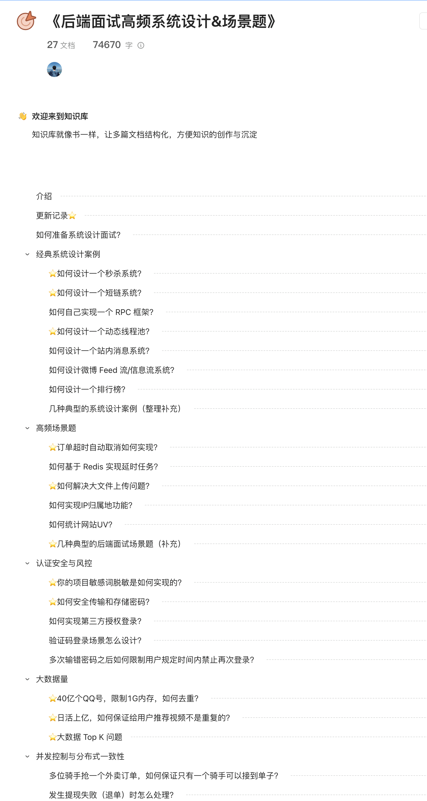

**System design** interview questions are exclusive to my [Knowledge Planet](https://javaguide.cn/about-the-author/zhishixingqiu-two-years.html) community (follow the link for details and instructions on joining) and are included in [_High-Frequency System Design and Scenario Questions for Backend Interviews_](https://javaguide.cn/zhuanlan/back-end-interview-high-frequency-system-design-and-scenario-questions.html).

**This series** covers common system design examples such as URL shorteners and flash-sale systems, as well as popular scenario questions such as deduplicating large datasets and third-party authorization.

As technical interviews in China become more competitive, more companies ask system design and scenario questions to assess candidates more broadly, for both new-graduate and experienced-hire roles. Interviews made up entirely of scenario questions are still uncommon, though; interviewers usually include one or two such questions.

That is why I put together this series. It covers common system design examples such as URL shorteners and flash-sale systems, and popular scenario questions such as deduplicating large datasets and third-party authorization.

Even if you are not preparing for an interview, I recommend reading the series. It can help you improve your system design thinking and ability to solve practical problems. Many of its examples can also be applied to your own projects, including lottery system design, third-party authorization, and implementing delayed tasks with Redis.

The series was originally part of [_Java Interview Handbook_](https://javaguide.cn/zhuanlan/java-mian-shi-zhi-bei.html), but was moved to its own page as it grew.

<!-- @include: @planet.snippet.md -->
