> Original article: <https://juejin.cn/post/7122014462181113887>. JavaGuide has revised and expanded it.

I have a friend who runs a small website and wants to add Web push notifications for inbox messages. The feature is the familiar red notification badge shown below.

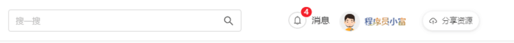

He hasn't decided how to implement it, so I have outlined a few options and provided simple examples.

## What Is Message Push?

Push notifications have many use cases. For example, when someone follows my public account, I receive a notification that encourages me to open the app.

Message push is the proactive delivery of messages to a user's current web page or mobile app, often initiated by website operators through a messaging tool.

Message push is generally divided into Web push and mobile push.

Example of a mobile push notification:

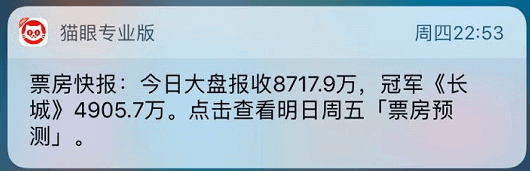

Example of a Web push notification:

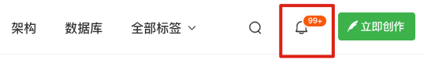

Before looking at implementations, let's clarify the requirement. When an event occurs, such as a user sharing a resource or the server sending a notification, the red badge on the web page should increment immediately.

The server usually stores notifications in one or more tables, recording messages associated with different user events. The client can either query (pull) the user's unread-message count or receive it from the server (push).

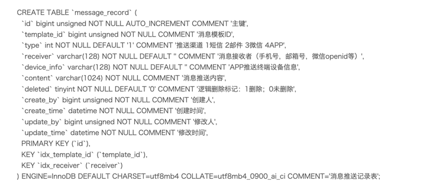

Message delivery uses either push or pull. Let's look at the common approaches.

## Common Message Push Approaches

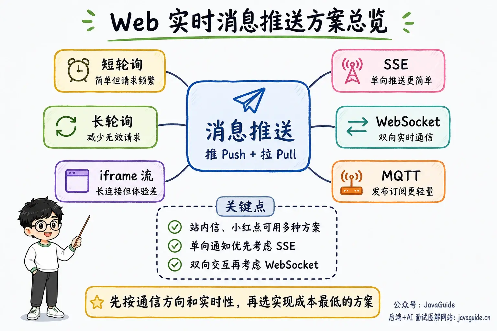

### Short Polling

**Polling** is one of the simplest ways to implement message delivery. Here, we divide it into short polling and long polling.

With short polling, the browser sends an HTTP request to the server at a fixed interval. The server returns the current unread-message data, and the browser renders it.

A simple JavaScript timer can request the unread-message count once per second and display the response.

```typescript
setInterval(() => {
  // Call the API
  messageCount().then((res) => {
    if (res.code === 200) {
      this.messageCount = res.data;
    }
  });
}, 1000);
```

Short polling is easy to implement, but its drawback is clear: because notifications do not change frequently, the client keeps making requests even when there are no new messages. This can put significant load on the server and waste bandwidth and server resources.

### Long Polling

Long polling improves on short polling. It reduces wasted server resources while keeping notifications reasonably fresh. It is widely used in middleware, including the Nacos and Apollo configuration centers and the Kafka and RocketMQ message brokers.

I explained how Nacos long polling works in [Is the Nacos configuration center's interaction model push or pull?](https://mp.weixin.qq.com/s/94ftESkDoZI9gAGflLiGwg).

Long polling is still a form of polling. If the server has no new data, it holds the request until the data changes or a timeout occurs. After the response, the client immediately starts another long poll.

This example uses `DeferredResult`, Spring's wrapper around the asynchronous request mechanism introduced in Servlet 3.0. It lets the application return a result later.

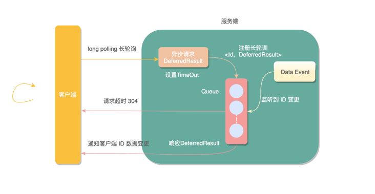

`DeferredResult` lets the container release the Servlet thread handling the request. Later, an application thread, message callback, or other event source can call `setResult()` to resume response processing. `DeferredResult` does not start a worker thread; the application determines which thread runs the business logic.

The following example uses long polling to push messages.

Multiple long-poll requests may watch the same ID, so this example uses Guava's `Multimap`, which allows one key to map to multiple values. When a key changes, all corresponding long-poll requests receive a response. After receiving the new version, the frontend queries the unread-message count and updates the page.

```java
@Controller
@RequestMapping("/polling")
public class PollingController {

    // Long-polling requests watching each ID
    // Thread-safe collection
    private static final Multimap<String, DeferredResult<String>> watchRequests =
            Multimaps.synchronizedMultimap(HashMultimap.create());
    // In-memory version for the example; production systems should use a durable business-data version
    private static final Map<String, Long> versions = new HashMap<>();

    /**
     * Register a watch
     */
    @GetMapping(path = "watch/{id}")
    @ResponseBody
    public DeferredResult<String> watch(@PathVariable String id,
                                        @RequestParam(defaultValue = "0") long version) {
        // Set the timeout
        DeferredResult<String> deferredResult = new DeferredResult<>(TIME_OUT, "timeout");
        // Remove the key when the async request completes to prevent a memory leak
        deferredResult.onCompletion(() -> {
            watchRequests.remove(id, deferredResult);
        });
        // Compare the version and register the watch atomically so a publish cannot be missed
        synchronized (watchRequests) {
            long currentVersion = versions.getOrDefault(id, 0L);
            if (currentVersion != version) {
                deferredResult.setResult(Long.toString(currentVersion));
            } else {
                watchRequests.put(id, deferredResult);
            }
        }
        return deferredResult;
    }

    /**
     * Update the data
     */
    @PostMapping(path = "publish/{id}")
    @ResponseBody
    public String publish(@PathVariable String id) {
        // Update the version, then remove and copy the watcher snapshot in the same synchronized block
        Collection<DeferredResult<String>> deferredResults;
        long currentVersion;
        synchronized (watchRequests) {
            currentVersion = versions.merge(id, 1L, Long::sum);
            deferredResults = new ArrayList<>(watchRequests.removeAll(id));
        }
        for (DeferredResult<String> deferredResult : deferredResults) {
            deferredResult.setResult(Long.toString(currentVersion));
        }
        return "success";
    }
}
```

Here, `DeferredResult` returns the agreed timeout value, `"timeout"`. The client then immediately starts another long poll with the same version. When it receives a new version, it fetches the latest business data and uses that version in its next watch request. Version comparison, watch registration, and version increments during publishing happen in the same critical section. Even if an update occurs while requests are being handed off, the next watch detects the change. The example's in-memory versions are lost when the process restarts. Production systems should use a durable identifier, such as a database version or message offset, and define a cleanup policy.

Do not use HTTP 304 as a generic request-timeout status. It is reserved for conditional requests to indicate that the cached representation is unchanged, and its response must not contain a body. A production system could instead agree on a bodyless response such as 204; the key is to use consistent timeout semantics on the client and server.

To test this, the page starts a long-poll request with a known version, `/polling/watch/10086?version=0`, and waits for a change. Then update the data with `/polling/publish/10086`; the long poll returns the new version. The client fetches the latest data and starts the next request with that version. This cycle repeats.

Long polling performs much better than short polling, but it still generates many requests. That is one of its limitations.

### iframe Streaming

iframe streaming inserts a hidden `<iframe>` into the page. Its `src` requests the message-count API, creating a long-lived connection over which the server continuously sends data to the iframe.

The server usually sends HTML or embedded JavaScript to update the page in real time.

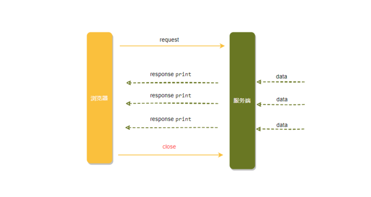

This approach is simple to implement; the frontend only needs an `<iframe>` element.

```html
<iframe src="/iframe/message" style="display:none"></iframe>
```

The server must keep the response open, write new data when available, and flush the buffer promptly. Do not use an unbounded `while (true)` loop without waiting, interruption handling, or error handling in a Servlet request thread. It can waste CPU, occupy a container thread indefinitely, and fail to stop cleanly when the client disconnects. If you must maintain a legacy iframe stream, use the container's asynchronous I/O and an event-driven write model. New systems usually use SSE or WebSocket instead.

iframe streaming has high server overhead. Browsers such as IE and Chrome also remain in the loading state, with the icon spinning continuously.

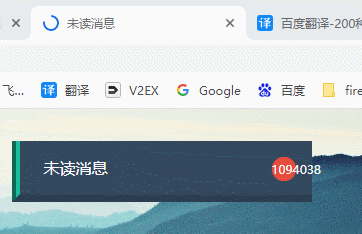

iframe streaming is inconvenient and strongly discouraged.

### SSE (Recommended)

In addition to the familiar `WebSocket`, servers can push messages to clients using Server-Sent Events (SSE). SSE provides one-way message delivery from a server to a client (the browser).

Streaming chat is a typical use case for SSE. The server can continuously write generated content to the event stream, so users can see results before the full response is ready.

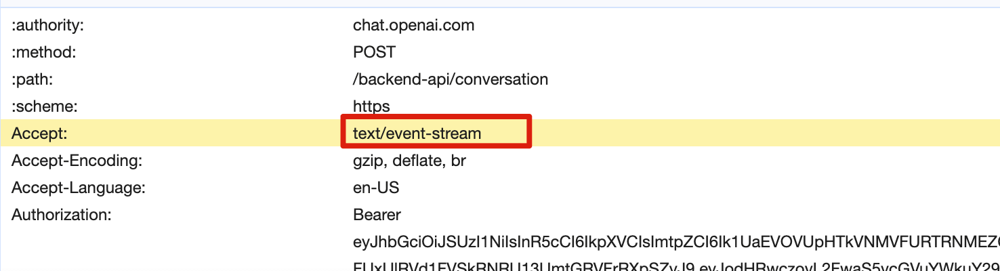

SSE is based on HTTP. The server does not open a connection without a request; the client initiates the request, and the server keeps the HTTP response open while continuously writing events.

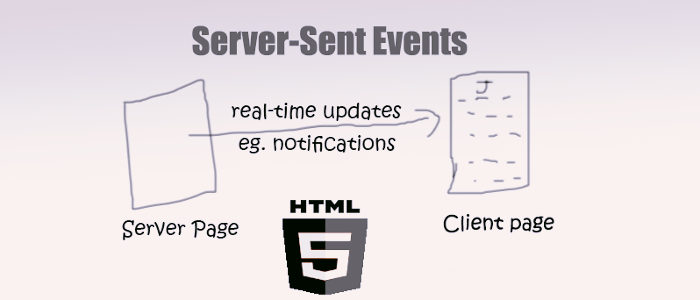

SSE opens a one-way channel between the server and client. Instead of a single response payload, the server returns a `text/event-stream` stream and sends updates to the client as they become available.

The idea is similar to online video playback, where a stream is continuously sent to the browser. You can also think of it as a long-running download.

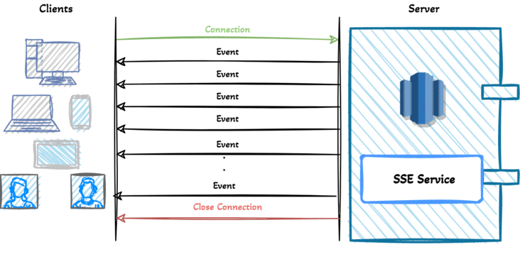

SSE and WebSocket both enable communication between a server and browser and allow the server to push messages to the client, but they differ in several ways:

- SSE uses HTTP and `text/event-stream`, so it is usually easy to integrate with existing Web services. WebSocket requires server or container support for protocol upgrades and frames; it does not require a separate server.
- SSE is one-way: the server sends data to the client. WebSocket is full-duplex, so both sides can send data at the same time.
- SSE is simple to implement and has low development overhead. WebSocket typically has a higher implementation cost.
- SSE supports automatic reconnection by default; with WebSocket, you implement reconnection yourself.
- SSE sends text only; binary data must be encoded. WebSocket supports binary data natively.

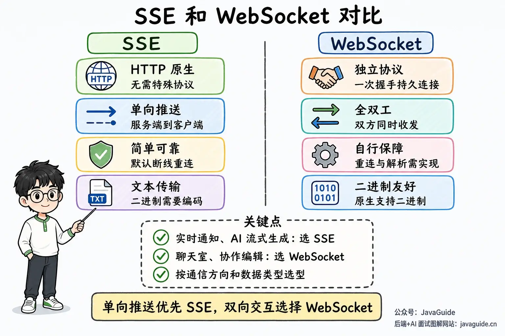

**How should you choose between SSE and WebSocket?**

> No technology is inherently better; choose the one that fits the use case.

SSE is less widely known, partly because WebSocket offers a richer protocol for bidirectional, full-duplex communication. A two-way channel is useful for games, instant messaging, and other use cases that need near-real-time updates in both directions.

In other cases, the client does not need to send data and only needs updates from the server. For inbox notifications, unread-message counts, status changes, stock prices, and monitoring metrics, SSE is often simpler and less costly to implement. SSE also provides features such as automatic reconnection, event IDs, and named events.

The frontend makes one HTTP request with a unique ID, opens the event stream, and listens for server-sent events.

```javascript
<script>
    let source = null;
    let userId = 7777
    if (window.EventSource) {
        // Open the connection
        source = new EventSource('http://localhost:7777/sse/sub/'+userId);
        setMessageInnerHTML("Connected user: " + userId);
        /**
         * The open event fires once the connection is established.
         * Alternatively: source.onopen = function (event) {}
         */
        source.addEventListener('open', function (e) {
            setMessageInnerHTML("Connected...");
        }, false);
        /**
         * Handle data received from the server.
         * Alternatively: source.onmessage = function (event) {}
         */
        source.addEventListener('message', function (e) {
            setMessageInnerHTML(e.data);
        });
    } else {
        setMessageInnerHTML("Your browser does not support SSE");
    }
</script>
```

The server implementation is simpler: create an `SseEmitter` and store it in `sseEmitterMap` for management.

```java
private static Map<String, SseEmitter> sseEmitterMap = new ConcurrentHashMap<>();

/**
 * Create a connection
 */
public static SseEmitter connect(String userId) {
    try {
        // 0 means no application-level timeout; it does not mean "30 seconds by default"
        SseEmitter sseEmitter = new SseEmitter(0L);
        // Register callbacks
        sseEmitter.onCompletion(completionCallBack(userId));
        sseEmitter.onError(errorCallBack(userId));
        sseEmitter.onTimeout(timeoutCallBack(userId));
        sseEmitterMap.put(userId, sseEmitter);
        count.getAndIncrement();
        return sseEmitter;
    } catch (Exception e) {
        log.info("Failed to create an SSE connection for user: {}", userId);
    }
    return null;
}

/**
 * Send a message to a specific user
 */
public static void sendMessage(String userId, String message) {

    if (sseEmitterMap.containsKey(userId)) {
        try {
            sseEmitterMap.get(userId).send(message);
        } catch (IOException e) {
            log.error("Failed to send a push message to user [{}]: {}", userId, e.getMessage());
            removeUser(userId);
        }
    }
}
```

The `Map<String, SseEmitter>` example above keeps only one connection per user; a new connection replaces the old one. To support multiple tabs or devices, store a set of `SseEmitter` instances per user and remove each connection in its completion, timeout, and error callbacks. A `0L` timeout does not prevent proxies, gateways, or containers from closing the connection. Production systems need heartbeat, timeout, and client reconnection policies.

**Note:** SSE is not supported by Internet Explorer, but is supported by other major browsers.

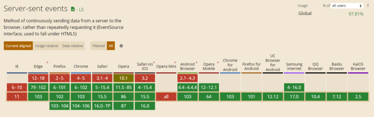

### WebSocket

WebSocket is a familiar way to implement message push, and we have already compared it with SSE above.

WebSocket is a protocol for full-duplex communication over a TCP connection. After a handshake, the browser and server establish a persistent connection and can send data in both directions.

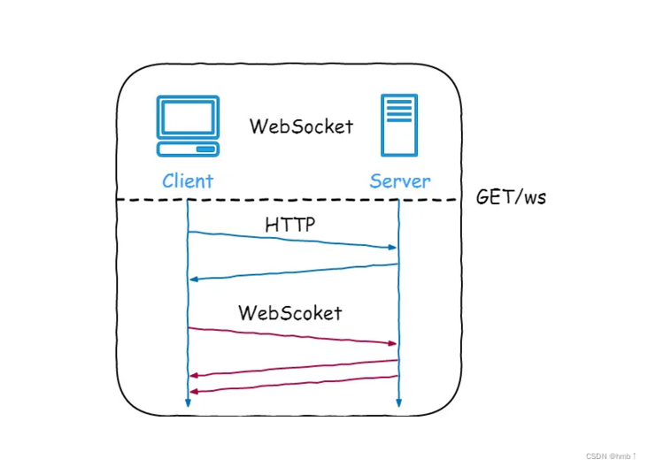

The WebSocket handshake and communication work as follows:

1. The client sends an HTTP request with headers such as `Upgrade: websocket` and `Sec-WebSocket-Key` to request a protocol upgrade.
2. If the server supports WebSocket, it responds with HTTP status 101 and headers such as `Connection: Upgrade` and `Sec-WebSocket-Accept: xxx` to confirm the upgrade.
3. The client and server can then exchange data over the WebSocket connection. Data is sent in frames rather than HTTP request-response messages. A message may be split into multiple frames, which the receiver reassembles.
4. Either side can send a close frame to end the connection. The other side replies with a close frame, and both sides close the TCP connection.

After establishing a WebSocket connection, a heartbeat mechanism can help keep it active and detect failures.

To use WebSocket with Spring Boot, first add the WebSocket dependency. This has more setup overhead than SSE.

```xml
<!-- Add the WebSocket dependency -->
<dependency>
    <groupId>org.springframework.boot</groupId>
    <artifactId>spring-boot-starter-websocket</artifactId>
</dependency>
```

The server uses `@ServerEndpoint` to declare a WebSocket endpoint. A client can connect to `ws://localhost:7777/websocket/10086`. The `userId` in the path is only for demonstrating routing. In production, authenticate the user during the handshake and bind the connection to the authenticated principal; do not trust a `userId` supplied by the client.

```java
@Component
@Slf4j
@ServerEndpoint("/websocket/{userId}")
public class WebSocketServer {
    // Session used to send data to this client
    private Session session;
    private String userId;
    private static final CopyOnWriteArraySet<WebSocketServer> webSockets = new CopyOnWriteArraySet<>();
    // Active sessions
    private static final Map<String, Session> sessionPool = new ConcurrentHashMap<>();
    /**
     * Called when a connection is established
     */
    @OnOpen
    public void onOpen(Session session, @PathParam(value = "userId") String userId) {
        try {
            this.session = session;
            this.userId = userId;
            webSockets.add(this);
            sessionPool.put(userId, session);
            log.info("WebSocket connected; total connections: " + webSockets.size());
        } catch (Exception e) {
            log.error("WebSocket connection initialization failed, userId={}", userId, e);
        }
    }
    /**
     * Clean up the session when the connection closes
     */
    @OnClose
    public void onClose() {
        webSockets.remove(this);
        if (userId != null && session != null) {
            sessionPool.remove(userId, session);
        }
    }
    @OnError
    public void onError(Throwable error) {
        log.error("WebSocket connection error, userId={}", userId, error);
    }
    /**
     * Called when a message arrives from the client
     */
    @OnMessage
    public void onMessage(String message) {
        log.info("WebSocket message received: " + message);
    }
    /**
     * Send a message to one user
     */
    public static boolean sendOneMessage(String userId, String message) {
        Session session = sessionPool.get(userId);
        if (session != null && session.isOpen()) {
            try {
                log.info("Sending a direct WebSocket message: " + message);
                session.getAsyncRemote().sendText(message);
                return true;
            } catch (Exception e) {
                log.error("Failed to send WebSocket message, userId={}", userId, e);
            }
        }
        return false;
    }
}
```

The example's `sessionPool` also keeps only one connection per `userId`. To support multiple tabs or devices, store a set of sessions per user and handle sending, heartbeats, backpressure, and cleanup for each connection.

To trigger a server push through an HTTP endpoint, add a controller whose parameters match the frontend request:

```java
@RestController
@RequestMapping("/socket")
public class SocketController {

    @PostMapping("/publish")
    public ResponseEntity<Void> publish(@RequestParam String userId,
                                        @RequestParam String message) {
        return WebSocketServer.sendOneMessage(userId, message)
                ? ResponseEntity.accepted().build()
                : ResponseEntity.notFound().build();
    }
}
```

This controller only demonstrates the request contract. In production, authenticate and authorize requests to the publishing endpoint. Do not let callers send messages to other users by supplying an arbitrary `userId`; also limit message size and request rate.

In a Spring Boot application with an embedded Servlet container, you usually also need to register `ServerEndpointExporter` to discover endpoints annotated with `@ServerEndpoint`.

```java
@Configuration
public class WebSocketConfiguration {

    /**
     * Register WebSocket endpoints annotated with @ServerEndpoint
     */
    @Bean
    public ServerEndpointExporter serverEndpointExporter() {
        return new ServerEndpointExporter();
    }
}
```

The frontend opens a WebSocket connection, monitors its state, and receives data from or sends data to the server.

```javascript
<script>
    var ws = new WebSocket('ws://localhost:7777/websocket/10086');
    // Check the connection state
    console.log('WebSocket state: ' + ws.readyState);
    // Listen for a successful connection
    ws.onopen = function () {
        console.log('WebSocket state: ' + ws.readyState);
        // Send data once connected
        ws.send('test1');
    }
    // Handle and display messages from the server
    ws.onmessage = function (data) {
        console.log('Message received from server:');
        console.log(data);
        // Close the WebSocket connection when communication is complete
        ws.close();
    }
    // Listen for the connection closing
    ws.onclose = function () {
        // Check the WebSocket state
        console.log('WebSocket state: ' + ws.readyState);
    }
    // Handle errors
    ws.onerror = function (error) {
        console.log(error);
    }
    function sendMessage() {
        var content = $("#message").val();
        $.ajax({
            url: '/socket/publish',
            type: 'POST',
            data: { "userId": "10086", "message": content },
            success: function (data) {
                console.log(data)
            }
        })
    }
</script>
```

The page establishes a WebSocket connection on initialization and can then communicate in both directions.

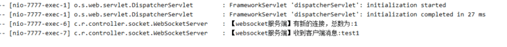

### MQTT

**What Is MQTT?**

MQTT is a lightweight messaging protocol based on the publish/subscribe model. Clients receive messages by subscribing to topics, and the protocol is widely used in IoT systems. The current OASIS specification uses the name “MQTT” without expanding it to “Message Queue Telemetry Transport.”

The protocol decouples publishers from subscribers, providing messaging for remotely connected devices over unreliable networks. Its use is similar to that of a traditional message queue.

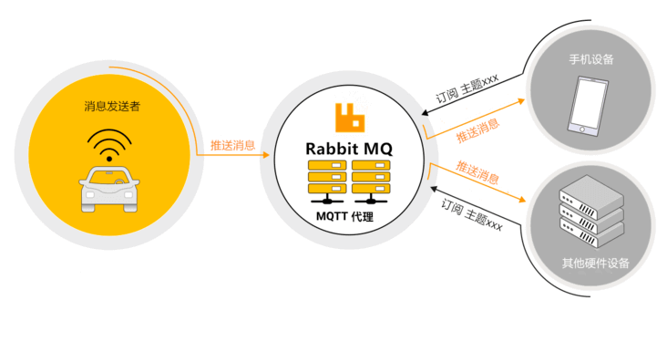

MQTT is an application-layer protocol that requires an ordered, lossless, bidirectional byte stream. TCP is the most common transport, usually with TLS in production. It can also run over transports such as WebSocket that provide these byte-stream semantics. It is therefore inaccurate to say that MQTT works directly over any TCP/IP network without a suitable transport.

**Why Use MQTT?**

Why is MQTT so popular in the Internet of Things (IoT), compared with other protocols such as HTTP?

- The classic short-lived HTTP request-response pattern requires devices to poll periodically or maintain a long-lived connection to receive server updates. MQTT provides an asynchronous publish/subscribe model over persistent connections. HTTP should not be broadly described as a “synchronous protocol”: HTTP/2, HTTP/3, SSE, and WebSocket upgrades do not behave like classic short polling.
- HTTP requests are initiated by the client, but that does not mean a server can never stream a response or that a device cannot receive commands. MQTT standardizes persistent connections, topic routing, subscriptions, QoS, and session state.
- To send commands to multiple devices, an MQTT broker can distribute messages by topic to all subscribers. HTTP can support similar use cases, but the application often needs to manage connections, device groups, and retry semantics itself.

For a detailed introduction and practical examples, see these two articles:

- MQTT introduction: [I didn't expect building a smart home with Spring Boot and RabbitMQ to be this easy](https://mp.weixin.qq.com/s/udFE6k9pPetIWsa6KeErrA)
- Implementing message push with MQTT: [Real-time unread-message push with the frontend and RabbitMQ](https://mp.weixin.qq.com/s/U-fUGr9i1MVa4PoVyiDFCg)

## Summary

> The following section was added by JavaGuide.

| Approach         | Description                                                                                     | Advantages                                        | Disadvantages                                                                                 |
| ---------------- | ----------------------------------------------------------------------------------------------- | ------------------------------------------------- | --------------------------------------------------------------------------------------------- |
| Short polling    | The client periodically requests data, and the server responds even when nothing has changed.   | Simple to understand and implement                | Poor freshness; many unnecessary requests and frequent connections waste resources            |
| Long polling     | The server holds each client request until data changes or the request times out.               | Fewer unnecessary requests                        | Suspended requests consume resources                                                          |
| iframe streaming | A long-lived connection lets the server continuously send data to an iframe.                    | Simple to understand and implement                | Long-lived connections add overhead; the browser may display a loading indicator continuously |
| SSE              | One-way message delivery from the server to the client (browser).                               | Simple to implement with useful built-in features | No bidirectional communication                                                                |
| WebSocket        | After an HTTP handshake, client and server communicate over a full-duplex WebSocket connection. | High performance with low overhead                | More complex to implement                                                                     |
| MQTT             | A lightweight publish/subscribe protocol that delivers messages through topic subscriptions.    | Mature and lightweight                            | More complex to implement                                                                     |

<!-- @include: @article-footer.snippet.md -->
