## Introduction to Docker

Before getting started, here is a brief review of Docker. For a fuller introduction, see [Docker Fundamentals](./docker-intro.md).

### What Is Docker?

Docker can be understood in several ways:

- Docker is a widely used containerization platform written in Go.
- Docker packages applications and their runtime dependencies into images, reducing inconsistencies between development, testing, and deployment environments.
- Users can create containers and run applications in them. Containers can be versioned, copied, shared, and modified like code.
- Docker **isolates processes using operating-system-level virtualization.** Because isolated processes are separated from the host and from one another, they are called containers.

Official website: <https://www.docker.com/>.

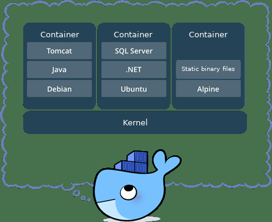

### Why Use Docker?

Docker lets developers package applications and dependencies into lightweight, portable containers that can run on popular Linux systems.

Containers use a sandboxing mechanism to isolate one another, much like mobile apps, while adding little performance overhead.

Projects commonly depend on services such as MySQL, Redis, and Kafka. Installing and configuring them manually varies across operating systems and can lead to “it works on my machine” problems.

Docker helps address this by running services such as MySQL and Redis in containers, separating applications from their environments. Benefits include:

1. Consistent runtime environments that are easier to move.
2. Process isolation, so containers do not interfere with one another and system resources are used more efficiently.
3. The ability to create multiple consistent containers from an image.

The open-source book [Docker — From Beginner to Practitioner](https://yeasy.gitbook.io/docker_practice/introduction/why) also explains why Docker is useful.

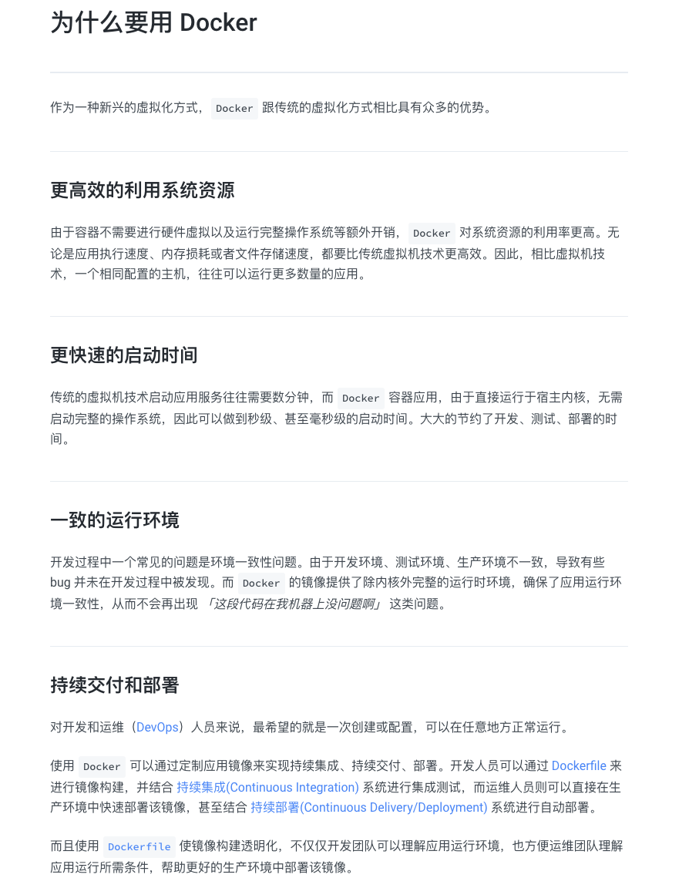

## Installing Docker

### Windows

On Windows, Docker Desktop is the recommended option. Visit the Docker website to download the installer:

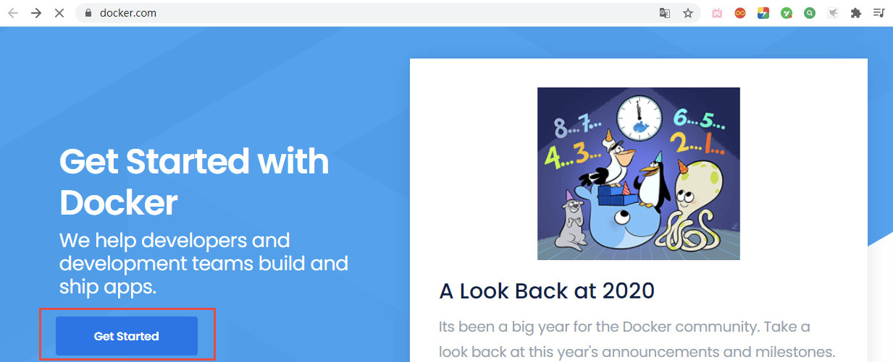

Then click `Get Started`:

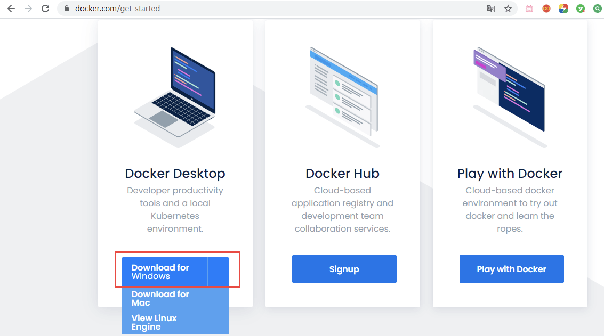

Click `Download for Windows` to download the installer.

Docker Desktop for Windows currently recommends the WSL 2 backend. Before installing, make sure your system meets Docker Desktop's requirements and WSL 2 is enabled. Some setups can use the Hyper-V backend. To enable it, open Control Panel and select Programs:

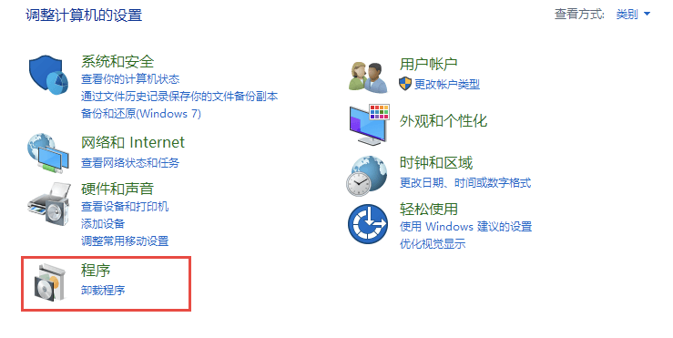

Click `Turn Windows features on or off`:

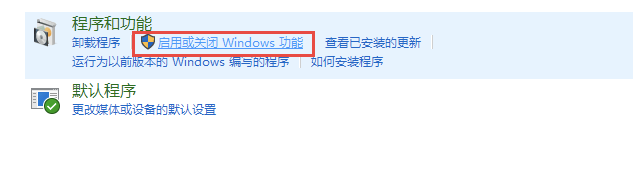

Select `Hyper-V` and click OK:

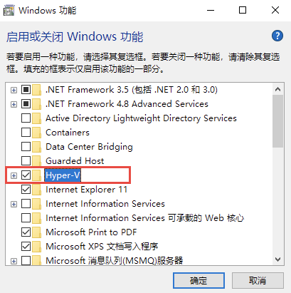

Restart the computer after applying the changes.

After enabling `Hyper-V`, run the Docker Desktop installer and click `OK` when prompted:

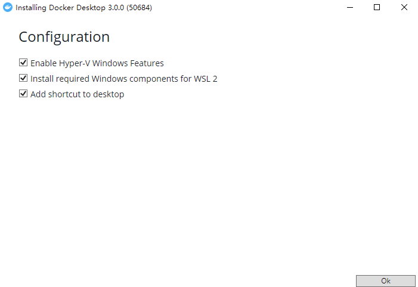

Restart the computer after installation. If you see the following prompt:

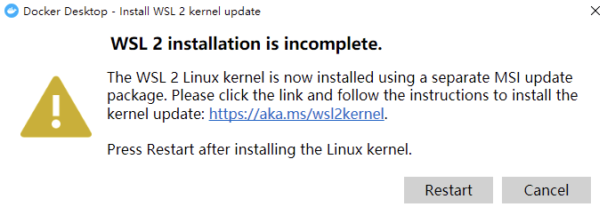

If the installer offers WSL 2, it is generally the preferred backend for running Linux containers on Windows. Choose Hyper-V instead if your environment requires it.

Docker Desktop is a graphical application, so its interface is not covered here.

### macOS

Install it with Homebrew:

```shell
brew install --cask docker
```

### Linux

On Linux, installation commands vary slightly by distribution. For production, follow the official Docker documentation. The official convenience script shown here is a quick option for test or development environments.

Docker provides a convenience script for test and development environments. It prepares the system and installs the stable Docker release.

```shell
curl -fsSL get.docker.com -o get-docker.sh
```

```shell
sh get-docker.sh --mirror Aliyun
```

After installation, start the service:

```shell
systemctl start docker
```

Enable the service at startup:

```shell
systemctl enable docker
```

## Docker Concepts

Before using Docker, understand these core concepts:

### Images

An image is a read-only template used to create Docker containers. One image can create multiple containers.

### Containers

A container is a running instance created from an image. Docker uses containers to run one or more applications in isolation. A container can be started, stopped, and removed. Think of it as a lightweight Linux environment with an application running inside. Its filesystem consists of image layers plus a top writable layer.

### Repositories

A repository stores images. A registry hosts repositories; each repository can contain multiple images and tags. Repositories can be public or private. Docker Hub is the most widely used public registry and hosts many images available for download.

### Summary

In simple terms, an image packages software, a container is a running instance of an image, and a repository stores images.

Repositories can be remote or local. Like Maven's local dependency cache, Docker's local image store avoids downloading an image from a remote registry every time it is needed.

## Trying Docker

Let's try Docker by downloading a MySQL image.

Like GitHub, Docker provides Docker Hub to find images and their usage instructions. Visit [Docker Hub](https://hub.docker.com/):

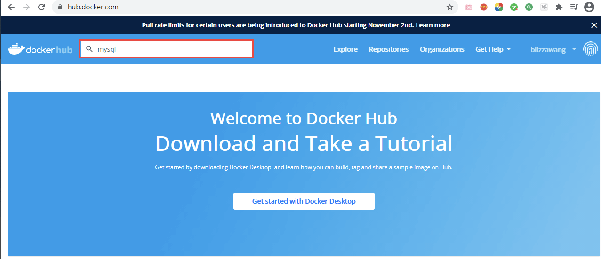

Enter `mysql` in the search box at the upper left and press Enter:

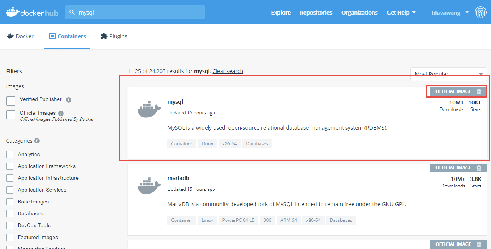

There are many MySQL images. The `OFFICIAL IMAGE` badge identifies an official image, so select the first MySQL result:

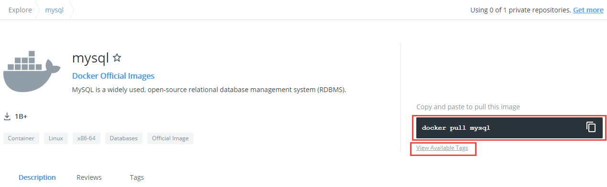

The page shows `docker pull mysql` as the pull command. It downloads the version associated with the default tag. In real projects, specify a version tag to keep the environment predictable.

To download a specific version, click `View Available Tags`:

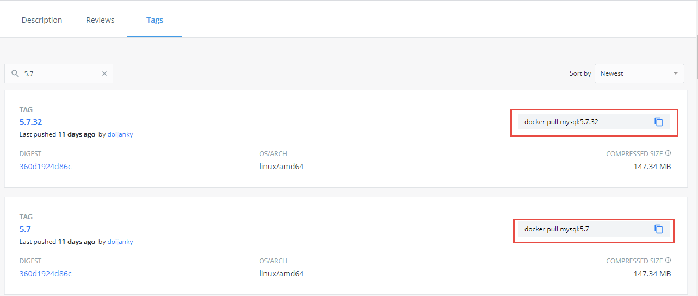

This page lists image versions and their pull commands. To download MySQL 8.4, run:

```shell
docker pull mysql:8.4
```

In some network environments, pulling from Docker Hub may be slow or fail. Avoid copying third-party mirror addresses from the web; their availability, synchronization policies, and supported use can change.

For example, Alibaba Cloud Container Registry (ACR) limits its image accelerator, since July 2, 2024, to Alibaba Cloud users on products that support public network access, and only for a subset of container images. Its current documentation also says that it no longer synchronizes the latest images and that access from non-Alibaba Cloud machines returns HTTP 403. See the [ACR announcement about changes to the image accelerator](https://help.aliyun.com/zh/acr/product-overview/product-change-acr-mirror-accelerator-function-adjustment-announcement) and the [official image acceleration documentation](https://help.aliyun.com/zh/acr/user-guide/accelerate-the-pulls-of-docker-official-images) for current details.

If you use Alibaba Cloud ECS, configure the accelerator with the address provided in the Alibaba Cloud console and follow its documentation. Do not copy this configuration to non-Alibaba Cloud environments. In production, reduce reliance on public registries by syncing required images to a private registry and pinning image versions or digests.

## Docker Image Commands

Images are used frequently in Docker, so let's start with the image commands.

Use `docker images` to list the images currently available in Docker.

```shell
[root@izrcf5u3j3q8xaz ~]# docker images
REPOSITORY    TAG       IMAGE ID       CREATED         SIZE
mysql         8.4       f07dfa83b528   11 days ago     448MB
tomcat        latest    feba8d001e3f   2 weeks ago     649MB
nginx         latest    ae2feff98a0c   2 weeks ago     133MB
hello-world   latest    bf756fb1ae65   12 months ago   13.3kB
```

`REPOSITORY` is the image name, `TAG` is its version tag, `IMAGE ID` is its unique ID, `CREATED` is when the image was created (not when it was downloaded), and `SIZE` is the image size.

To list images with a specific name:

```shell
docker images mysql
```

This lists all MySQL images available in Docker:

```shell
[root@izrcf5u3j3q8xaz ~]# docker images mysql
REPOSITORY   TAG       IMAGE ID       CREATED         SIZE
mysql        8.4       0ebb5600241d   11 days ago     589MB
mysql        8.0       f07dfa83b528   11 days ago     596MB
```

The `-q` option displays only image IDs:

```shell
[root@izrcf5u3j3q8xaz ~]# docker images -q
0ebb5600241d
f07dfa83b528
feba8d001e3f
d404d78aa797
```

To pull an image, run:

```shell
docker pull mysql:8.4
```

`docker pull` is followed by the image name and tag. If you omit the tag, as in `docker pull mysql`, Docker pulls the version associated with the default tag.

You can search for images before pulling one:

```shell
docker search mysql
```

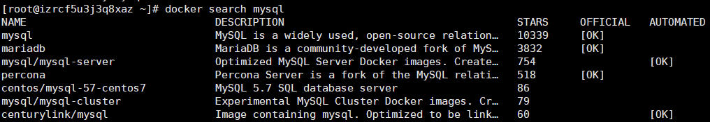

However, `docker search` searches repositories but does not list all tags for an image. To see available MySQL versions, use the Tags page on Docker Hub.

```shell
docker pull mysql:8.4
```

If a tag does not exist, `docker pull` returns an error such as `manifest unknown`:

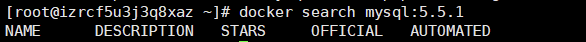

Remove an image with:

```shell
docker image rm mysql:8.4
```

If you omit the tag, Docker uses the default tag.

You can also remove an image by its ID:

```shell
docker image rm bf756fb1ae65
```

This command returns an error:

```shell
[root@izrcf5u3j3q8xaz ~]# docker image rm bf756fb1ae65
Error response from daemon: conflict: unable to delete bf756fb1ae65 (must be forced) - image is being used by stopped container d5b6c177c151
```

The `hello-world` image is still referenced by a stopped container, so Docker cannot remove it normally. To force removal:

```shell
docker image rm -f bf756fb1ae65
```

This removes the image even if a container references it. Use it with care.

Docker also provides the shorthand `docker rmi <image>:<tag>` for removing images.

You can combine `rmi` and `-q` to remove multiple images. For example, remove all MySQL images with:

```shell
docker rmi -f $(docker images mysql -q)
```

`docker images mysql -q` lists only the IDs of MySQL images and passes them to `docker rmi -f`, which removes them all.

## Docker Container Commands

Now that you know the image commands, here are the container commands. Containers are created from images.

To run a container from an image:

```shell
docker run tomcat:8.0-jre8
```

You need the image locally first, so pull it:

```shell
docker pull tomcat:8.0-jre8
```

After pulling it, run the container and list running containers with `docker ps`.

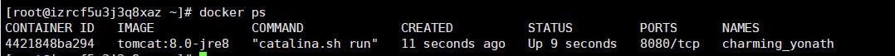

`CONTAINER_ID` is the container ID, `IMAGE` is the image name, `COMMAND` is the command running in the container, `CREATED` is its creation time, `STATUS` is its state, `PORTS` lists the service ports, and `NAMES` is the container name.

Tomcat cannot be accessed externally when started this way because the container is isolated. To access it through port 8080, map a host port to the container port:

```shell
docker run -p 8080:8080 tomcat:8.0-jre8
```

In `8080:8080`, the first port is on the host and the second is in the container. External requests to the host's port 8080 are forwarded to port 8080 in the container.

Tomcat is now accessible externally:

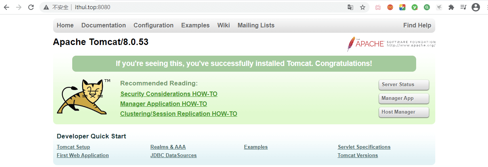

For example, with this port mapping:

```shell
docker run -p 8088:8080 tomcat:8.0-jre8
```

In this case, access Tomcat through port 8088. Containers are independent, so multiple Tomcat containers do not conflict as long as their host ports differ.

Run a container in the background so it does not occupy the terminal:

```shell
docker run -d -p 8080:8080 tomcat:8.0-jre8
```

Docker assigns a name by default, but you can set one yourself:

```shell
docker run -d -p 8080:8080 --name tomcat01 tomcat:8.0-jre8
```

The container is now named `tomcat01`. Container names must be unique.

The `docker ps` command also accepts options such as `-a`:

```shell
docker ps -a
```

This lists both running and stopped containers.

The `-q` option lists only the IDs of running containers:

```shell
[root@izrcf5u3j3q8xaz ~]# docker ps -q
f3aac8ee94a3
074bf575249b
1d557472a708
4421848ba294
```

Combine it with `-a` to list the IDs of all containers, running or stopped:

```shell
[root@izrcf5u3j3q8xaz ~]# docker ps -aq
f3aac8ee94a3
7f7b0e80c841
074bf575249b
a1e830bddc4c
1d557472a708
4421848ba294
b0440c0a219a
c2f5d78c5d1a
5831d1bab2a6
d5b6c177c151
```

The following commands start, restart, stop, or kill a container. Each accepts either a container ID or name.

```shell
docker start c2f5d78c5d1a
```

Start a stopped container by its ID or name.

```shell
docker restart c2f5d78c5d1a
```

Restart the specified container.

```shell
docker stop c2f5d78c5d1a
```

Stop the specified container.

```shell
docker kill c2f5d78c5d1a
```

Immediately kill the specified container.

---

Stopping a container does not remove it. Remove it with:

```shell
docker rm d5b6c177c151
```

You do not need to enter the full container ID; a unique prefix is enough.

To force-remove a running container, add `-f`:

```shell
docker rm -f d5b6c177c151
```

To remove all containers, combine the commands:

```shell
docker rm -f $(docker ps -qa)
```

`docker ps -qa` lists all container IDs, and `docker rm -f` removes them.

---

When a container runs in the background, view its logs with:

```shell
docker logs 289cc00dc5ed
```

To stream logs in real time, use `-f`:

```shell
docker logs -f 289cc00dc5ed
```

Use `-t` to include timestamps, often together with `-f`:

```shell
docker logs -ft 289cc00dc5ed
```

---

To see which processes are running in a container:

```shell
docker top 289cc00dc5ed
```

To interact with a container, run:

```shell
docker exec -it 289cc00dc5ed bash
```

This opens a shell inside the container. Commands run there affect the container. To return to the CentOS host, run `exit`.

To deploy a project to the Tomcat container, copy a file into it:

```shell
docker cp ./test.html 289cc00dc5ed:/usr/local/tomcat/webapps
```

`docker cp` copies files from CentOS to a container. Here, `./test.html` is the host path, `289cc00dc5ed` is the container ID, and `/usr/local/tomcat/webapps` is the destination path in the container.

```shell
[root@izrcf5u3j3q8xaz ~]# docker exec -it 289cc00dc5ed bash
root@289cc00dc5ed:/usr/local/tomcat# cd webapps
root@289cc00dc5ed:/usr/local/tomcat/webapps# ls
test.html
root@289cc00dc5ed:/usr/local/tomcat/webapps#
```

To copy a file from the container to CentOS, reverse the source and destination:

```shell
docker cp 289cc00dc5ed:/usr/local/tomcat/webapps/test.html ./
```

To deploy a project this way, upload it to CentOS, copy it into the container, and start the container.

---

To inspect container details such as listening ports and IP addresses, use:

```shell
docker inspect 923c969b0d91
```

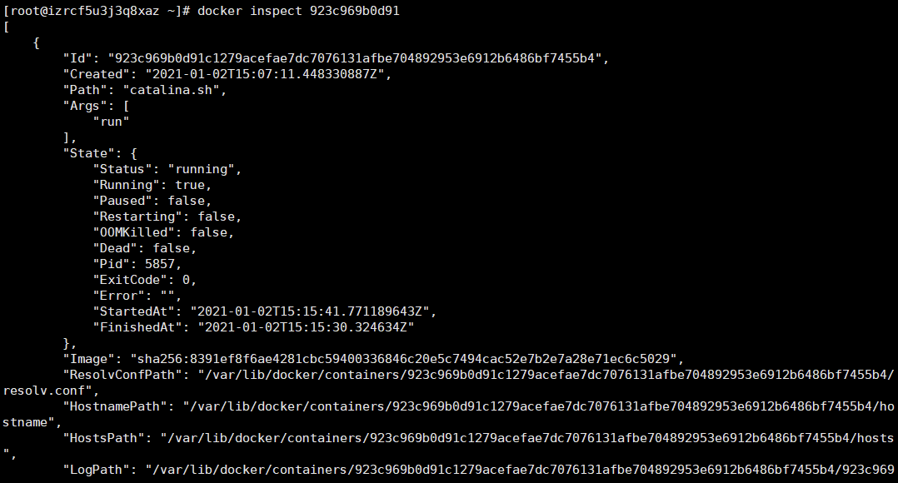

## Docker Volumes

Volumes let you share files between the host and a container. Changes made on the host are reflected in the container without copying files again.

To bind the host's `/opt/apps` directory to the container's `webapps` directory:

```shell
docker run -d -p 8080:8080 --name tomcat01 -v /opt/apps:/usr/local/tomcat/webapps tomcat:8.0-jre8
```

Tomcat is now inaccessible:

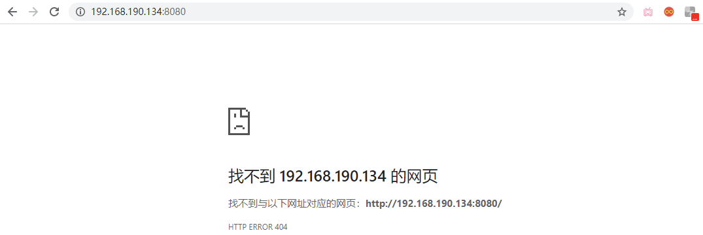

This shows the mount is working: Docker synchronizes the container's `webapps` directory with `/opt/apps`. Since `/opt/apps` is empty, the mounted directory is empty too, so Tomcat cannot serve the application.

Add a file to `/opt/apps` and it will appear in `webapps` as well:

```shell
[root@centos-7 opt]# cd apps/
[root@centos-7 apps]# vim test.html
[root@centos-7 apps]# ls
test.html
[root@centos-7 apps]# cat test.html
<h1>This is a test html!</h1>
```

After creating `test.html` in `/opt/apps`, check whether it appears in the container's `webapps` directory:

```shell
[root@centos-7 apps]# docker exec -it tomcat01 bash
root@115155c08687:/usr/local/tomcat# cd webapps/
root@115155c08687:/usr/local/tomcat/webapps# ls
test.html
```

The file is available in the container. Next, create a simple web application:

```java
public class HelloServlet extends HttpServlet {

    @Override
    protected void doGet(HttpServletRequest req, HttpServletResponse resp) throws ServletException, IOException {
        resp.getWriter().println("Hello World!");
    }

    @Override
    protected void doPost(HttpServletRequest req, HttpServletResponse resp) throws ServletException, IOException {
        doGet(req,resp);
    }
}
```

This simple servlet can be packaged and uploaded to `/opt/apps`; the file will then be available in the container:

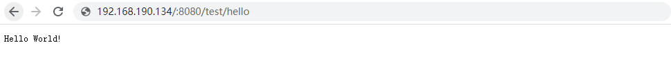

This is called a **bind mount** because you specify the host directory. Docker also supports **named volumes**, which are commonly used for managed data storage.

```shell
docker run -d -p 8080:8080 --name tomcat01 -v aa:/usr/local/tomcat/webapps tomcat:8.0-jre8
```

Here, `aa` is a volume name, not a host directory. Docker creates the volume and copies existing content from the container's `webapps` directory into it. By default, Docker-managed volumes are stored under `/var/lib/docker/volumes`:

```shell
[root@centos-7 volumes]# pwd
/var/lib/docker/volumes
[root@centos-7 volumes]# cd aa/
[root@centos-7 aa]# ls
_data
[root@centos-7 aa]# cd _data/
[root@centos-7 _data]# ls
docs  examples  host-manager  manager  ROOT
```

Changes to the volume affect the container. In real projects, avoid editing files directly under `/var/lib/docker/volumes`; manage data through the container, application, or an explicitly chosen bind mount.

---

Here are a few more commands for containers and images:

```shell
docker commit -m "description" -a "image author" tomcat01 my_tomcat:1.0
```

This command creates an image from a container. List the images to see it:

```shell
[root@centos-7 _data]# docker images
REPOSITORY          TAG                 IMAGE ID            CREATED             SIZE
my_tomcat           1.0                 79ab047fade5        2 seconds ago       463MB
tomcat              8                   a041be4a5ba5        2 weeks ago         533MB
mysql               8.4                 db2b37ec6181        2 months ago        589MB
```

To save an image to an archive:

```shell
docker save my_tomcat:1.0 -o my-tomcat-1.0.tar
```

```shell
[root@centos-7 ~]# docker save my_tomcat:1.0 -o my-tomcat-1.0.tar
[root@centos-7 ~]# ls
anaconda-ks.cfg  initial-setup-ks.cfg  Public  Videos  Documents  Music
get-docker.sh    my-tomcat-1.0.tar     Templates  Pictures  Downloads  Desktop
```

To load a `.tar` image archive into Docker:

```shell
docker load -i my-tomcat-1.0.tar
```

```shell
root@centos-7 ~]# docker load -i my-tomcat-1.0.tar
b28ef0b6fef8: Loading layer [==================================================>]  105.5MB/105.5MB
0b703c74a09c: Loading layer [==================================================>]  23.99MB/23.99MB
......
Loaded image: my_tomcat:1.0
[root@centos-7 ~]# docker images
REPOSITORY          TAG                 IMAGE ID            CREATED             SIZE
my_tomcat           1.0                 79ab047fade5        7 minutes ago       463MB
```

## Common Troubleshooting Commands

Once you start using Docker, troubleshooting commands become especially useful. Get familiar with these:

```shell
# Show container settings, networks, mounts, and environment variables
docker inspect tomcat01

# Show the most recent container logs
docker logs --tail=100 tomcat01

# Follow container logs
docker logs -f tomcat01

# Show container resource usage
docker stats

# Show Docker disk usage
docker system df
```

Be careful when cleaning up resources, especially with commands that use `-f`. `docker system prune` removes unused containers, networks, images, and build cache. Adding `--volumes` also removes unused volumes, which may contain database or local test data.

<!-- @include: @article-footer.snippet.md -->
