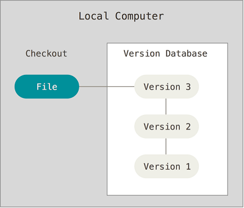
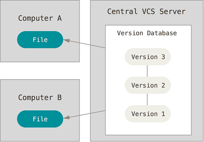
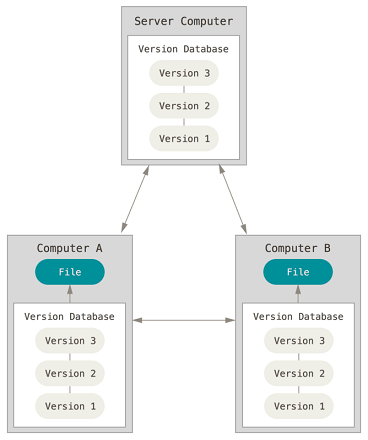
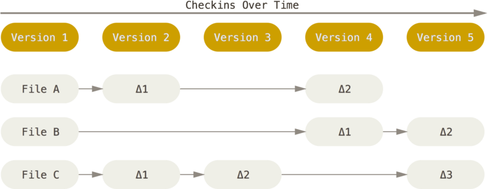
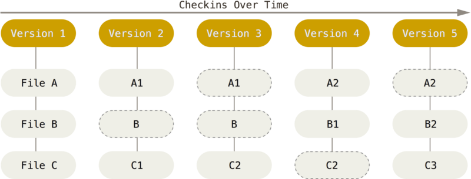
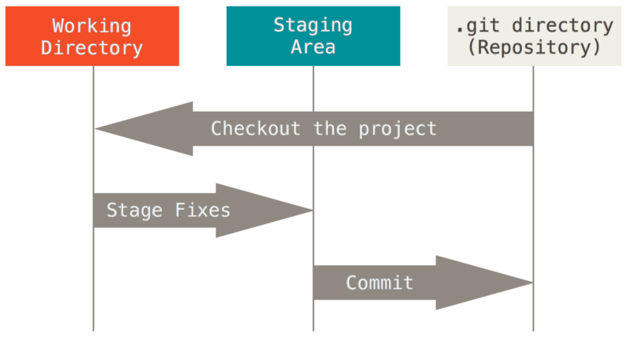

## Version Control

### What Is Version Control?

Version control records changes to one or more files so you can review specific versions later. You can use it for any kind of file, not just source code.

### Why Use Version Control?

You can restore a file—or an entire project—to an earlier state, compare changes, see who last changed a line, investigate the cause of an unexpected issue, or find out when a bug was reported.

### Local Version-Control Systems

Many people save different versions by copying the whole project directory and renaming each copy with a date or other label. This is simple, but easy to get wrong: you can confuse working directories, edit the wrong file, or overwrite something unexpectedly.

To address this, people developed local version-control systems that record file changes in a simple database.



### Centralized Version-Control Systems

The next challenge was enabling developers on different computers to collaborate. Centralized version-control systems (CVCS) addressed this by keeping all file revisions on one central server. Collaborators connect to that server to retrieve the latest files or submit changes.



This solved the collaboration problem, but centralized systems still have some drawbacks:

- **Single point of failure:** If the central server goes down, others cannot use it. If its database disk fails and there is no backup, you may lose all the data. Local version-control systems have a similar risk: if the full project history exists in only one place, it can all be lost.
- **Network required:** Work is affected by the network connection and available bandwidth.

### Distributed Version-Control Systems

Distributed version-control systems (DVCS) addressed these limitations. Git is a typical DVCS.

Instead of retrieving only the latest file snapshot, each client gets a complete copy of the repository. If a collaboration server fails, any local clone can be used to restore it. Each clone is effectively a full backup of the repository.



Distributed systems can work offline because everyone has a complete repository on their own computer. After changing files, you can send your changes to others. In practice, teams rarely push changes directly to each other. Instead, they use a server as a convenient place to exchange changes. The server is not essential; it just makes sharing easier.

Not needing a network connection is only one advantage. As we'll see, Git also has powerful branch-management features.

## Getting to Know Git

### A Brief History of Git

The Linux kernel team used the distributed version-control system BitKeeper to manage its source code. Later, the commercial company behind BitKeeper ended its relationship with the open-source Linux community and revoked its free-use license. Drawing on their experience with BitKeeper, the Linux community—especially Linus Torvalds—created Git and made many improvements to version control.

### How Git Differs from Other Version-Control Systems

Git handles and stores information differently from other version-control systems, even though many commands look similar. Understanding this difference can help prevent confusion.

The main difference is **how Git stores data**.

**Git records snapshots directly instead of comparing differences.** The distinction will become clearer below.

Most version-control systems, including CVS, Subversion, Perforce, and Bazaar, store information as a list of file changes. They treat it as a set of base files plus the changes made to each file over time.

The diagram below shows the basic idea: whenever you commit a file, the system records its changes as increments, or deltas (Δ).



**How do we get the latest version of a file?**

Simply add the original file and all of its changes together.

**What's the problem with this approach?**

If there are many changes, reconstructing the latest file can take time and computing resources.

Git stores data differently. It treats it more like a series of snapshots of a small filesystem. Whenever you commit an update or save a project state, Git takes a snapshot of the files at that point and stores an index to it. For efficiency, if a file hasn't changed, Git doesn't store it again; it keeps a link to the previously stored file. Git treats data more like a **stream of snapshots**.



### The Three States in Git

A file in Git can be in one of three states:

1. **Committed:** The data is safely stored in the local database.
2. **Modified:** The file has changed but hasn't been saved to the database.
3. **Staged:** The current version of a modified file is marked to be included in the next commit's snapshot.

This leads to three areas in a Git project: the **Git directory** (`.git`), the **working directory**, and the **staging area**.



**A basic Git workflow looks like this:**

1. Modify files in the working directory.
2. Stage files, adding their snapshots to the staging area.
3. Commit the changes, permanently storing the staged snapshots in the Git directory.

## Get Started with Git

### Get a Git Repository

There are two ways to get a Git repository:

1. Initialize a repository in an existing directory by navigating to the project and running `git init`. This creates a `.git` subdirectory.
2. Clone an existing repository from a server with `git clone [url]`. To choose a local directory name, use `git clone [url] directoryname`.

### Record Changes in the Repository

1. **Check file status:** `git status`
2. **Stage changes:** `git add filename` stages a specific file; `git add .` stages all changes in the current directory; `git add *.txt` uses a wildcard to stage `.txt` files.
3. **Ignore files:** Add patterns to a `.gitignore` file.
4. **Commit changes:** `git commit -m "Commit message"`. Before committing, run `git status` to make sure everything you intend to commit is staged.
5. **Skip staging:** `git commit -a -m "Commit message"` automatically stages and commits changes to tracked files, skipping the `git add` step.
6. **Remove a file:** `git rm filename` removes it from the staging area; then commit the change.
7. **Rename a file:** `git mv README.md README` is equivalent to running `mv README.md README`, `git rm README.md`, and `git add README`.

### Write a Good Git Commit Message

A good commit message can look like this:

```plain
Summary: Describe the commit in one line.

The body can provide more detail, context, or an explanation of the problem this commit fixes.

The body can contain several paragraphs. Keep lines short and add line breaks so the output of "git log" is easy to read.
```

Keep the summary clear and concise. This makes it easier for Git log tools and other people to review the history.

### Push Changes to a Remote Repository

- If you haven't cloned an existing repository and want to connect your local repository to a server, add a remote with `git remote add origin <server>`. For example, to connect to a repository created on GitHub, run `git remote add origin https://github.com/Snailclimb/test.git`.
- Push changes to the remote repository with `git push origin main`. Replace `main` with the branch you want to push. Many older projects still use `master` as their default branch, so check the repository.

Your changes will then be available on the remote server.

### Rename or Remove a Remote Repository

- Rename `test` to `test1`: `git remote rename test test1`
- Remove the `test1` remote: `git remote rm test1`

### View Commit History

After making several commits or cloning a project, you may want to review its history. The simplest and most effective command is `git log`. It lists commits in chronological order, with the latest first.

**Add options to filter the output:**

To show commits by a particular author:

```shell
git log --author=bob
```

### Undo Changes

Sometimes you commit and then realize that you forgot to add a few files or made a mistake in the commit message. Try recommitting with the `--amend` option:

```shell
git commit --amend
```

To unstage a file:

```shell
git restore --staged filename
```

Older Git versions also commonly use:

```shell
git reset filename
```

To discard changes to a file:

```shell
git restore filename
```

Older Git versions also commonly use:

```shell
git checkout -- filename
```

To discard all local changes and commits, fetch the latest history from the server and point your local main branch at it:

```shell
git fetch origin
git reset --hard origin/main
```

**Warning:** `git reset --hard` discards uncommitted local changes. Make sure there is nothing you need to keep before running it. If the older project uses `master` as its default branch, use `git reset --hard origin/master` instead.

### Branches

Branches isolate different development tasks. Develop a feature or fix on another branch, then merge it back into the main branch when it is ready. Many repositories now use `main` as the default branch; older ones often use `master`.

Create a branch named `test`:

```shell
git branch test
```

Switch to `test`:

```shell
git switch test
```

When you switch branches, Git updates the working directory to match the latest commit on that branch, adding, removing, or modifying files as needed.

Older Git versions also commonly use `git checkout test`.


Create and switch to a branch in one command:

```shell
git switch -c feature_x
```

Older Git versions also commonly use `git checkout -b feature_x`.

Switch to the main branch:

```shell
git switch main
```

Merge `test` into the current branch (this may produce conflicts):

```shell
git merge test
```

Delete the branch you created:

```shell
git branch -d feature_x
```

Push the branch to the remote repository so others can access it:

```shell
git push origin feature_x
```

## Recommended Learning Resources

**Interactive learning tool:**

As suggested in [issue 729](https://github.com/Snailclimb/JavaGuide/issues/729), try [Learn Git Branching](https://oschina.gitee.io/learn-git-branching/). It demonstrates basic Git operations and clearly explains what each command does and how it changes the repository.

**Recommended reading:**

- [A Visual Git Tutorial (15,000 Chinese characters, 40 diagrams)](https://www.cnblogs.com/anding/p/16987769.html): A thorough article with detailed illustrations.
- [Git: The Simple Guide](https://rogerdudler.github.io/git-guide/index.zh.html): A clear overview of common Git operations.
- [Visualizing Git](https://marklodato.github.io/visual-git-guide/index-zh-cn.html): Diagrams of common Git commands. If you understand the basics, it can help you build a deeper understanding.
- [Git Tutorial for Beginners](https://backlog.com/git-tutorial/cn/intro/intro1_1.html): An approachable introduction.
- [Pro Git](https://git-scm.com/book/zh/v2): A high-quality book originally written in English and translated into many languages.

<!-- @include: @article-footer.snippet.md -->
