GitHub is more than a code-hosting platform. Developers also use it to showcase projects, browse source code, collaborate on open source, automate builds, and maintain a professional profile. Here are some practical tips.

## Generate a GitHub Resume and Year in Review

Use [resume.github.io](https://resume.github.io/) to generate an online resume from your GitHub profile.

Whether you include a GitHub link on your resume depends on the quality of your account. Complete projects, ongoing maintenance, clear READMEs, and a tidy commit history can strengthen your application. If the account only has empty repositories or throwaway exercises, there's no need to include it. Here is an example of the result:

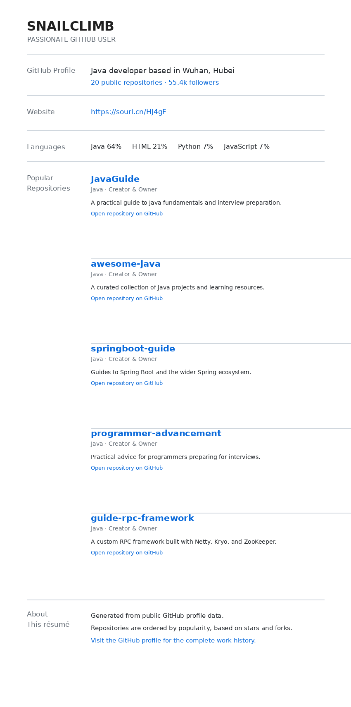

Use <https://www.githubtrends.io/wrapped> to generate a yearly review of your GitHub activity, including project contributions, most-used languages, and detailed contribution data.

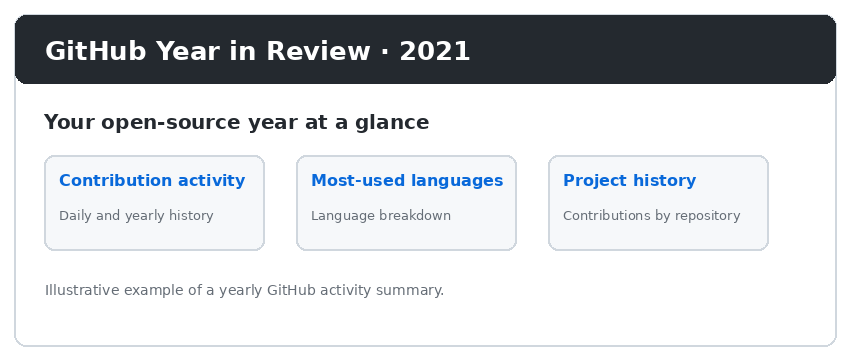

## Personalize Your GitHub Profile

GitHub lets you customize the content displayed on your profile. Here is an example:

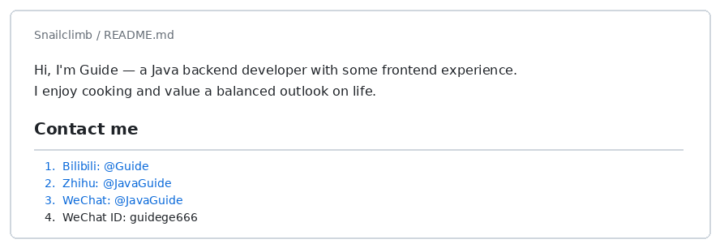

To do this, create a repository with the same name as your GitHub account and customize its `README.md`.

Your profile will display the contents of that `README.md`. (If you don't know Markdown, take five minutes to learn it!)

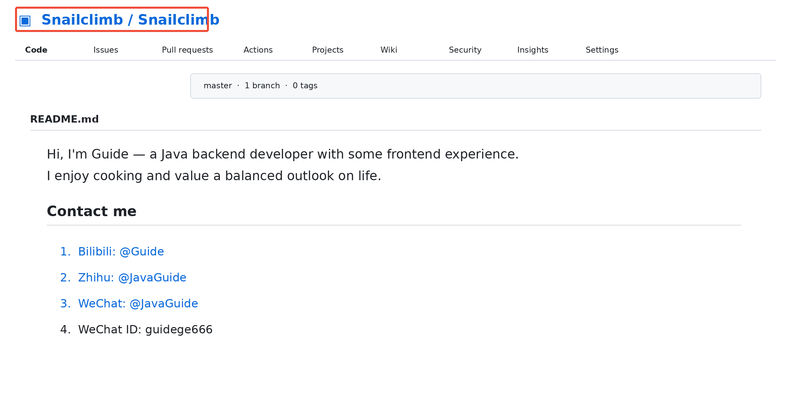

You can do a lot with this. For example, the open-source project [github-readme-stats](https://hellogithub.com/periodical/statistics/click/?target=https://github.com/anuraghazra/github-readme-stats) can dynamically generate GitHub statistics for your README. Here is an example:

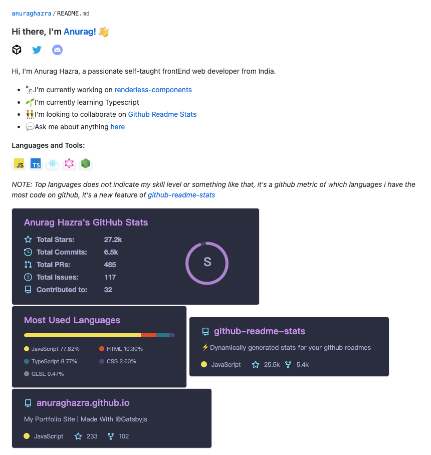

I won't go into more detail here. Explore the options if you're interested.

## Customize Project Badges

The badges you see on GitHub projects are generated with [Shields.io](https://shields.io/). Here are the badges for JavaGuide:

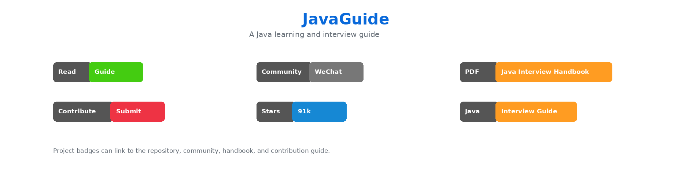

Shields.io can create static badges and badges that display your project's current status.

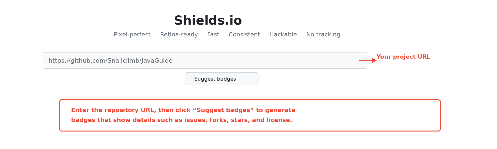

Here are some badges describing project status:

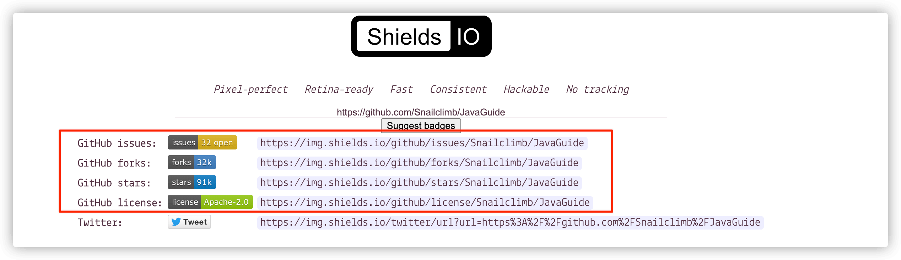

## Add a Contribution Graph to Your Project

Use Repobeats to add a summary of project contributions, like this:

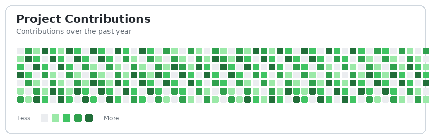

Visit <https://repobeats.axiom.co/>.

## GitHub Emoji


Find emoji for GitHub in the [WebFX emoji cheat sheet](https://www.webfx.com/tools/emoji-cheat-sheet/).

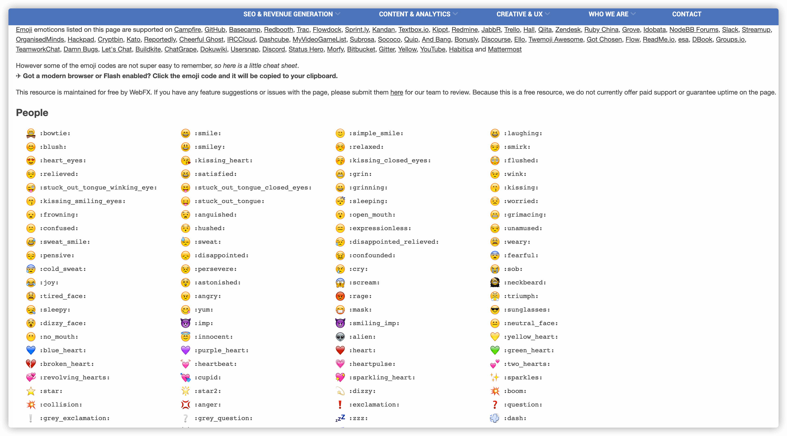

## Browse GitHub Source Code Efficiently

GitHub Codespaces provides an online development environment similar to VS Code. It is useful for briefly reading or debugging code, or contributing to an open-source project. For large projects or projects that need local services, clone the repository and use an IDE you know.

Here are a few common ways to browse GitHub source code.

### Octotree Browser Extension

This is an old favorite of mine. Octotree displays a project in a tree in the browser sidebar, making it easier to browse source code as you would in an IDE.

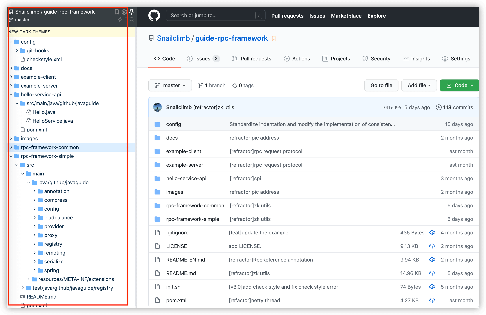

### Sourcegraph

If you don't want to clone a project locally, tools such as Sourcegraph can help search and browse code. Sourcegraph supports cross-repository code search and navigation to references, which is useful when reading large projects.

After installing its browser extension, a small icon appears on the project page, as shown below. Click it to browse the source online.

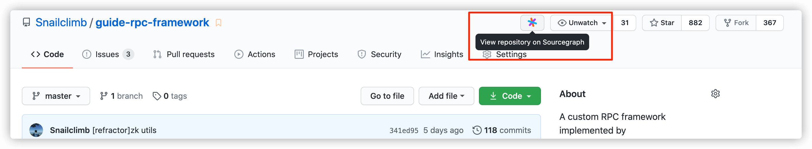

Sourcegraph's code view looks something like this. It also displays code in a tree and lets you navigate between classes.

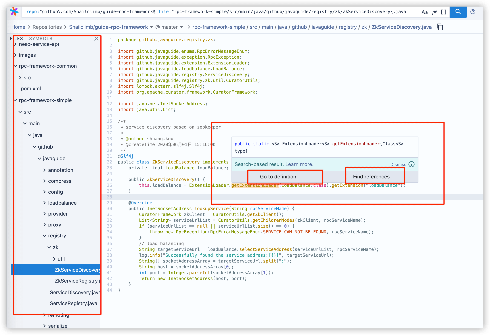

### Clone the Project Locally

Clone the project, then browse it with your preferred IDE. This is the best way to understand a project in depth.

```bash
git clone https://github.com/Snailclimb/JavaGuide.git
```

## Extend GitHub in Your Browser

**Enhanced GitHub** is a browser extension that displays repository and file sizes and lets you download individual files quickly.

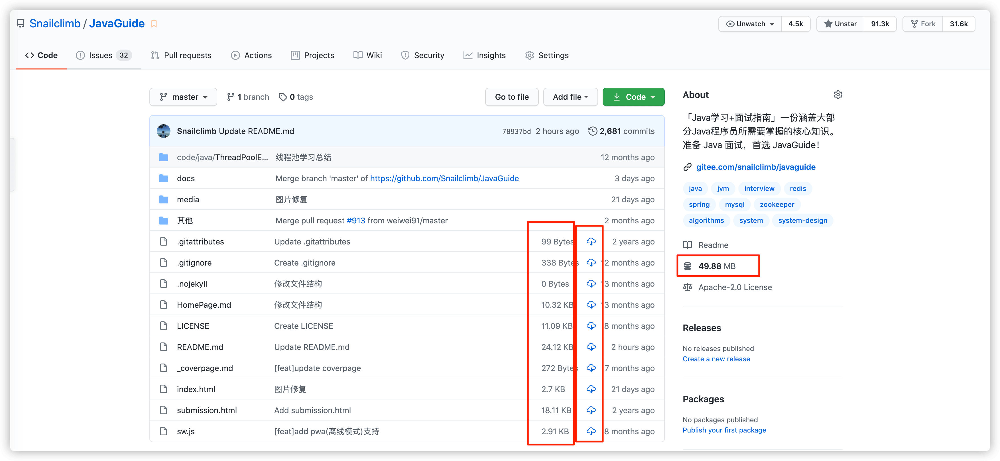

## Generate a Table of Contents for Markdown

Use a VS Code extension such as **Markdown Preview Enhanced** to generate a table of contents for Markdown files.

The generated table of contents lets readers jump to a section by clicking a link, making the article easier to navigate.

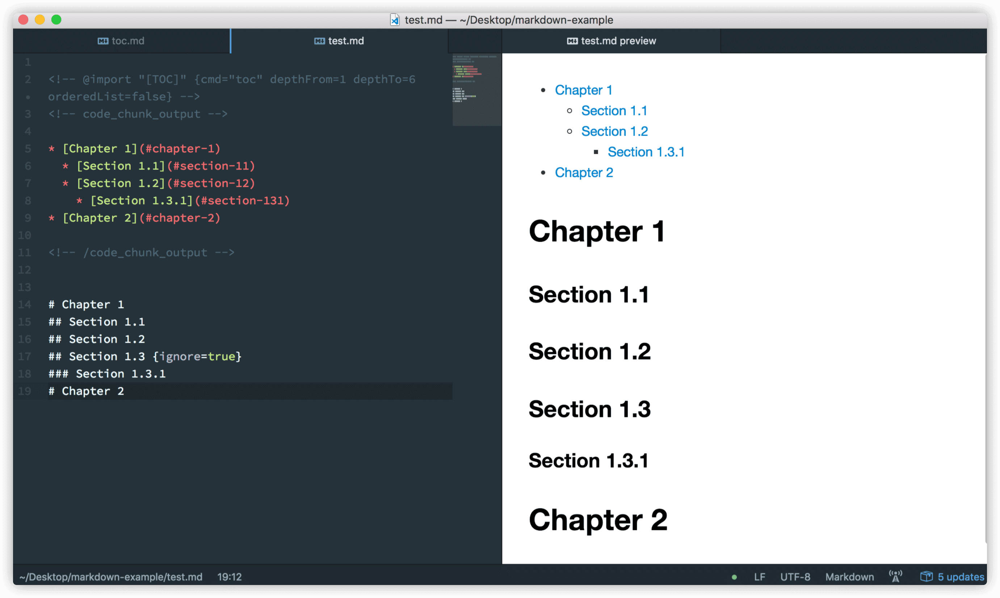

GitHub now generates a table of contents for Markdown files automatically; expand it with the table-of-contents button on the page.

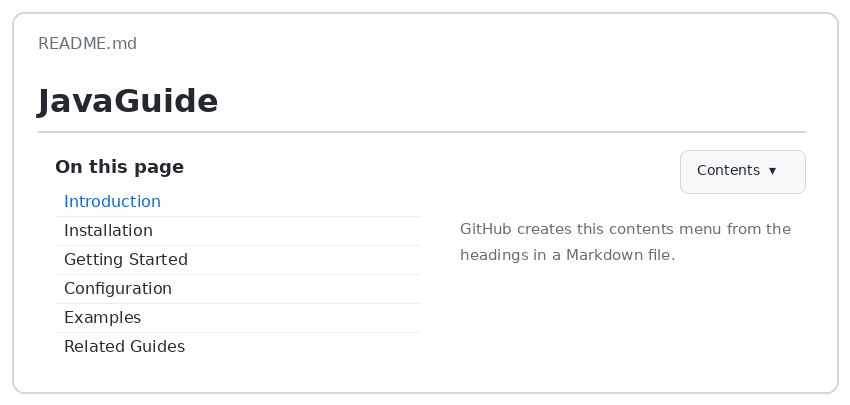

## Make Good Use of GitHub Explore

GitHub Explore is a powerful, convenient way to discover projects, topics, and technology trends.

It can:

1. Recommend projects based on your interests.
2. Group projects by category or topic through GitHub Topics. For example, [Data Visualization](https://github.com/topics/data-visualization) collects data-visualization projects, and [Awesome Lists](https://github.com/topics/awesome) collects repositories in the Awesome series.
3. Show popular open-source projects through GitHub Trending. Filter by programming language and time period.
4. Collect related repositories in GitHub Collections. For example, [Teaching Materials for Computational Social Science](https://github.com/collections/teaching-computational-social-science) collects open-source resources for computer science courses, while [Learn to Code](https://github.com/collections/learn-to-code) collects repositories that can help you learn programming.
5. And more...

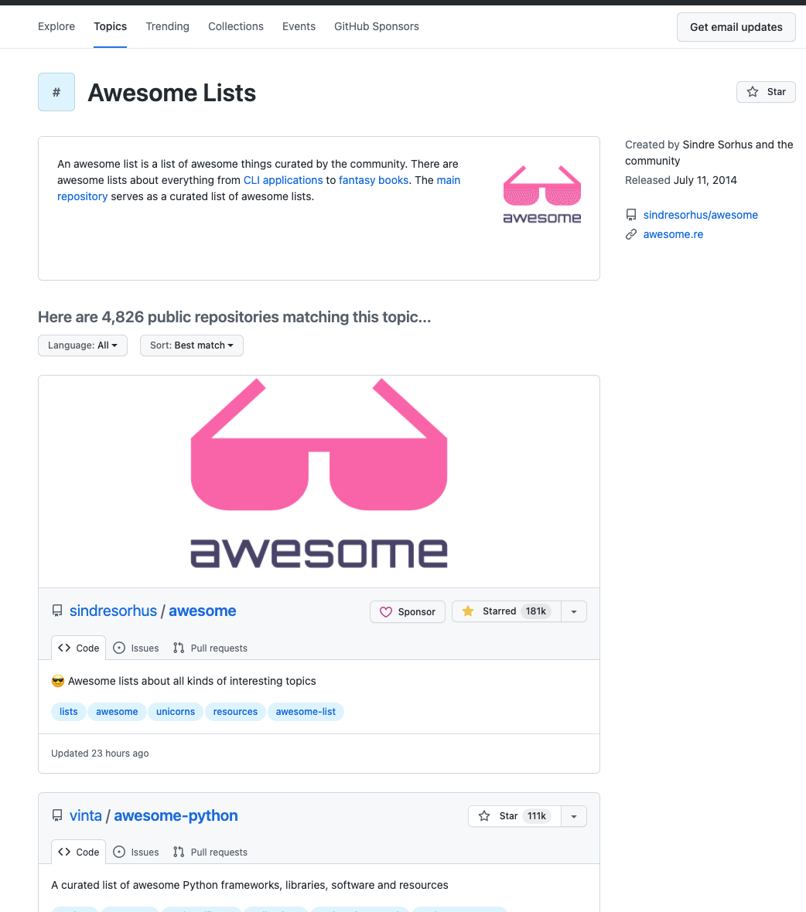

## GitHub Actions Is Powerful

You can think of GitHub Actions as GitHub's built-in automation platform. Use it to build, test, deploy, scan dependencies, and run scheduled tasks directly on GitHub.

For a detailed introduction, see Ruan Yifeng's [Getting Started with GitHub Actions](https://www.ruanyifeng.com/blog/2019/09/getting-started-with-github-actions.html).

GitHub Actions has an official marketplace with Actions contributed by others that you can reuse.

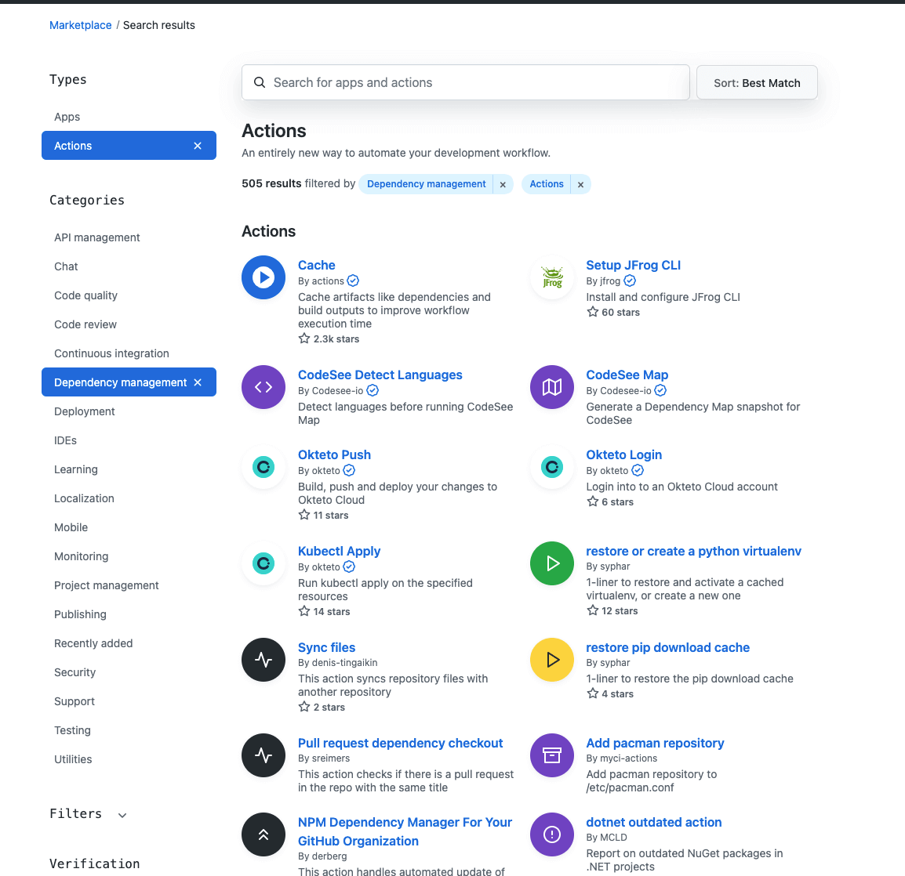

## Afterword

You don't need to memorize every GitHub tip at once. Start with profiles, project badges, code browsing, Explore and Trending, and GitHub Actions; that covers most everyday needs.

This article doesn't cover GitHub's search syntax. In practice, keyword search, language filters, sorting by star count, and filtering by update time are often more useful than memorizing complex syntax.

<!-- @include: @article-footer.snippet.md -->
