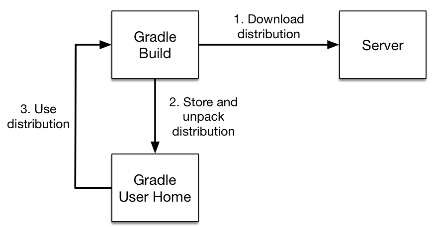
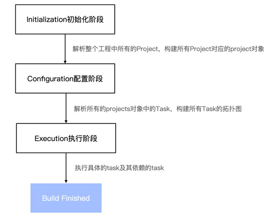
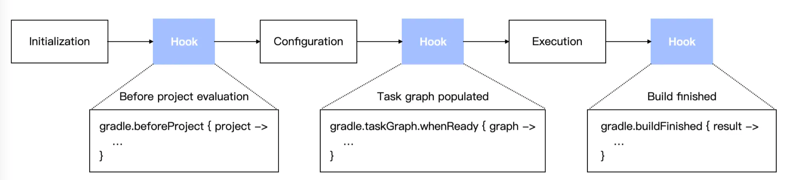

> This section is based on the Gradle documentation and focuses on key concepts rather than hands-on usage.

Gradle is optional material; decide whether to study it based on your needs. Maven is still more common in Java backend projects in China, but Gradle is also widely used for Android, some Spring Boot projects, and projects with highly customized build processes.

## Introduction to Gradle

The official Gradle documentation describes Gradle as follows:

> Gradle is an open-source [build automation](https://en.wikipedia.org/wiki/Build_automation) tool flexible enough to build almost any type of software. Gradle makes few assumptions about what you're trying to build or how to build it. This makes Gradle particularly flexible.

In simple terms, Gradle is an automated build tool that runs on the JVM. It helps compile, test, package, and publish projects.

Gradle has three main purposes for developers:

1. **Build projects:** Provide a standard, cross-platform way to automate project builds.
2. **Manage dependencies:** Make it easy to manage project dependencies (JARs) and avoid version conflicts.
3. **Standardize project structure:** Provide a standard, consistent project layout.

Gradle build scripts can use the Groovy DSL or Kotlin DSL. Kotlin DSL is common in new projects and generally provides better type hints and IDE support.

## Introduction to Groovy

Gradle runs on the JVM, and its build scripts can be written in Groovy or Kotlin. Many older Gradle examples use Groovy DSL, so some Groovy knowledge helps when reading legacy projects.

Groovy is a dynamic scripting language for the JVM based on Java. Its syntax is similar to Java, and it can use Java libraries. Groovy supports object-oriented programming and scripting. Its design draws on Java, Python, Ruby, and Smalltalk, including features such as dynamic typing, closures, and metaprogramming.

You can learn Groovy much as you would Java, so the learning curve is relatively gentle. Even if you forget Groovy syntax, you can often continue using Java syntax.

Groovy, Kotlin, Java, and Scala are all JVM languages. They compile to Java bytecode and run on the JVM.

## Gradle's Advantages

Gradle is a newer build system with benefits such as speed and flexibility. It is widely used in Java development. Android uses it as its official build system, and Java projects such as Spring Boot have also adopted it.

- **Flexibility:** Gradle supports scripts written with Groovy and suits projects with complex build processes.
- **Fine-grained tasks:** Gradle breaks builds into individual tasks. Its task source code is open source, so you can modify tasks to change the build process.
- **Extensibility:** Gradle supports reusable plugins, much like libraries.

## Introduction to Gradle Wrapper

The official Gradle documentation describes Gradle Wrapper as follows:

> The recommended way to execute any Gradle build is with the help of the Gradle Wrapper (in short just “Wrapper”). The Wrapper is a script that invokes a declared version of Gradle, downloading it beforehand if necessary. As a result, developers can get up and running with a Gradle project quickly without having to follow manual installation processes saving your company time and money.

Gradle Wrapper runs builds using a declared Gradle version, downloading it first if needed. This lets developers get started without manually installing Gradle.

The diagram below shows the [Gradle Wrapper workflow](https://docs.gradle.org/current/userguide/gradle_wrapper.html):



The process has three main steps:

1. If the specified version has not been downloaded, download its distribution archive from Gradle's server.
2. Extract the archive and run the wrapper script.
3. Later builds reuse the extracted Gradle version.

Gradle Wrapper provides these benefits:

1. It standardizes the Gradle version for reliable, consistent builds.
2. You can build a Gradle project without installing Gradle on your computer.
3. Updating Gradle for different users or environments, such as an IDE or CI server, is as simple as changing the Wrapper configuration.

### Generate Gradle Wrapper

To generate Gradle Wrapper for the first time, you need Gradle installed locally. Gradle includes a `Wrapper` task; run `gradle wrapper` from the project root.

You can pass options to control the generated Wrapper:

- `--gradle-version`: Set the Gradle version.
- `--gradle-distribution-url`: Set the distribution URL, usually like `https://services.gradle.org/distributions/gradle-${gradleVersion}-bin.zip`.
- `--gradle-distribution-sha256-sum`: Set the archive's SHA-256 checksum to reduce the risk of a tampered download.

The command generates these files in the project root:

```plain
├── gradle
│   └── wrapper
│       ├── gradle-wrapper.jar
│       └── gradle-wrapper.properties
├── gradlew
└── gradlew.bat
```

- `gradle-wrapper.jar`: Contains the logic needed to run Gradle.
- `gradle-wrapper.properties`: Defines the Gradle version and runtime behavior.
- `gradlew`: Runs Gradle commands on Linux and macOS.
- `gradlew.bat`: Runs Gradle commands on Windows.

The `gradle-wrapper.properties` file looks like this:

```properties
distributionBase=GRADLE_USER_HOME
distributionPath=wrapper/dists
distributionUrl=https\://services.gradle.org/distributions/gradle-6.0.1-bin.zip
zipStoreBase=GRADLE_USER_HOME
zipStorePath=wrapper/dists
```

- `distributionBase`: Parent directory where the extracted Gradle distribution is stored.
- `distributionPath`: A subdirectory of `distributionBase`; together they specify where the extracted distribution is stored.
- `distributionUrl`: Download URL for the specified Gradle version.
- `zipStoreBase`: Parent directory where the downloaded archive is stored.
- `zipStorePath`: A subdirectory of `zipStoreBase`; together they specify where the archive is stored.

### Update Gradle Wrapper

There are two ways to update Gradle Wrapper:

1. Change `distributionUrl` directly, then run a Gradle command.
2. Run `./gradlew wrapper --gradle-version [version]`.

The following command upgrades Gradle to 9.5.1:

```shell
./gradlew wrapper --gradle-version 9.5.1
```

The `distributionUrl` property in `gradle-wrapper.properties` changes too:

```properties
distributionUrl=https\://services.gradle.org/distributions/gradle-9.5.1-bin.zip
```

Once Wrapper is set up, use `./gradlew build` for routine builds instead of `gradle build` from a local installation. This ensures the team and CI use the same Gradle version.

### Customize Gradle Wrapper

Gradle includes a `Wrapper` task that generates the Wrapper properties file. You can customize it through that task. For example, to use Gradle 9.5.1:

```groovy
tasks.wrapper {
    gradleVersion = '9.5.1'
}
```

You can also set the distribution archive URL, the local path for the extracted distribution, and other options:

```groovy
tasks.wrapper {
    gradleVersion = '9.5.1'
    distributionUrl = '../../gradle-9.5.1-bin.zip'
    distributionPath = 'wrapper/dists'
}
```

`distributionUrl` can point to a local project path or a network URL.

## Gradle Tasks

A Gradle task is a single unit of work in a build. A build runs a series of tasks, such as compiling Java source code and creating a JAR file.

Here is one way to declare a task:

```groovy
// Declare a task named helloTask
task helloTask {
    doLast {
        println "Hello"
    }
}
```

You can add Actions to a task. Here, `doLast` adds an Action to the end of the task's Action queue.

```groovy
// Add an Action to the beginning of the queue
Task doFirst(Action<? super Task> action);
Task doFirst(Closure action);

// Add an Action to the end of the queue
Task doLast(Action<? super Task> action);
Task doLast(Closure action);

// Remove all Actions
Task deleteAllActions();
```

A task can have multiple Actions, which run in order. An Action represents a function or method; a task is an execution graph made up of Actions.

Use `dependsOn` to declare one or more task dependencies:

```groovy
task first {
    doLast {
        println "+++++first+++++"
    }
}
task second {
    doLast {
        println "+++++second+++++"
    }
}

// Declare multiple task dependencies
task print(dependsOn: [second, first]) {
    doLast {
        logger.quiet "Declare multiple task dependencies"
    }
}

// Declare one task dependency
task third(dependsOn: print) {
    doLast {
        println '+++++third+++++'
    }
}
```

A task's dependencies run before the task itself.

You can set default tasks that run when no task is specified:

```groovy
defaultTasks 'clean', 'run'

task clean {
    doLast {
        println 'Default Cleaning!'
    }
}

task run {
    doLast {
        println 'Default Running!'
    }
}
```

Gradle also includes tasks such as `copy` and `delete`:

```groovy
task deleteFile(type: Delete) {
    delete "C:\\Users\\guide\\Desktop\\test"
}
```

## Gradle Plugins

Gradle provides core build mechanisms, while plugins provide build logic that runs on top of them. A plugin is similar to a `.gradle` file and can be thought of as a reusable collection of tasks.

Gradle plugins mainly fall into two categories:

- **Script plugins:** Ordinary script files that can be applied from other build scripts.
- **Binary or object plugins:** Defined in a separate plugin module and applied by other modules using a Plugin ID. This form is easier to publish and reuse; most Gradle plugins you'll encounter are binary plugins.

Although plugins and `.gradle` files can offer similar functionality, plugins package build logic in a separate module and provide a better overall experience.

- **Reuse logic:** Share logic across similar projects and reduce duplicated maintenance. `.gradle` files can also be reused, but plugins provide better encapsulation.
- **Publish components:** Publish plugins to a Maven repository for other projects to use by Plugin ID. A `.gradle` file can also be stored remotely and referenced by other projects.
- **Configure builds:** Plugins can declare extensions to expose configurable properties. A `.gradle` file can do this too, but it is more cumbersome.

## Gradle Build Lifecycle

A Gradle build has three phases: **initialization, configuration, and execution**.



You can add custom hooks between initialization and configuration, after configuration, and after execution.



### Initialization

Gradle supports single-project and multi-project builds. During initialization, it determines which projects are part of the build and creates a [Project instance](https://docs.gradle.org/current/dsl/org.gradle.api.Project.html) for each. In essence, Gradle runs `settings.gradle` to discover the projects.

### Configuration

During configuration, Gradle evaluates each project's `build.gradle`, selects tasks to run, determines their relationships and order, and initializes task configuration.

Each `build.gradle` file corresponds to a Project object. Configuration evaluates its statements and closures, as well as task configuration blocks.

At the end of configuration, Gradle creates a **directed acyclic graph** based on task dependencies.

### Execution

During execution, Gradle runs the tasks selected and configured during the configuration phase.

## References

- [Gradle documentation](https://docs.gradle.org/current/userguide/userguide.html)
- [Gradle tutorial](https://www.imooc.com/wiki/gradlebase)
- [A concise introduction to Groovy](https://cloud.tencent.com/developer/article/1358357)
- [Gradle build lifecycle explained](https://juejin.cn/post/7067719629874921508)
- [Build a custom Gradle plugin, step by step](https://www.cnblogs.com/pengxurui/p/16281537.html)
- [Gradle guide to plugins, tasks, and the build process](https://juejin.cn/post/6889090530593112077)

<!-- @include: @article-footer.snippet.md -->
