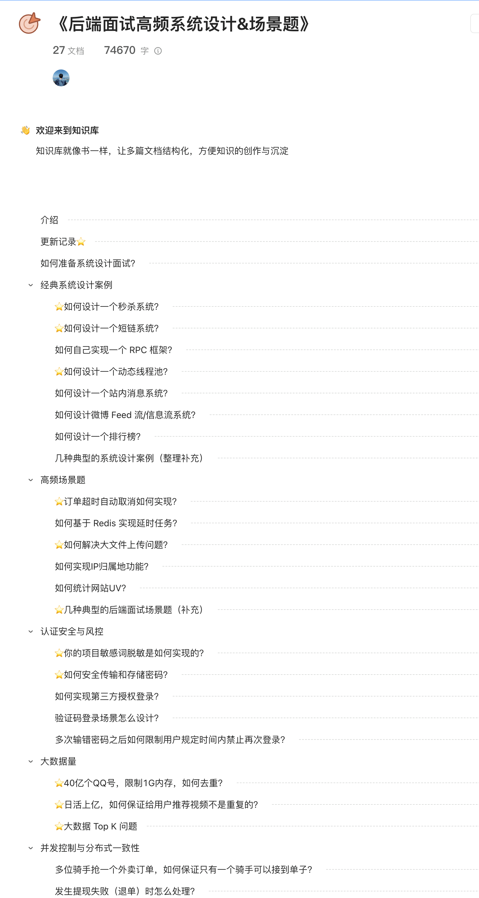

## About This Guide

**High-Frequency Backend System Design and Scenario Questions** is a private guide in my [Knowledge Planet](../about-the-author/zhishixingqiu-two-years.md). It brings together system-design cases and scenario questions that commonly appear in backend interviews.

### Why Use This Guide?

Technical interviews in China have become more competitive. More companies, including Alibaba, Meituan, ByteDance, and Tencent, ask **system-design** and **scenario-based** questions to assess candidates' overall skills in both new-graduate and experienced-hire interviews.

> Many candidates memorize common interview questions but struggle with open-ended prompts such as “How would you design a flash-sale system?”

System-design and scenario questions typically:

- ✅ Have no single correct answer; they focus on reasoning and architectural judgment.
- ✅ Test how well you apply high concurrency, high availability, and distributed-systems concepts together.
- ✅ Assess practical problem-solving and engineering experience.
- ⚠️ Usually make up only one or two questions in a standard interview.

This guide was created to help candidates prepare for these questions.

### What Does the Guide Cover?

**1. Strengthen interview answers**

Good answers to system-design questions can make a strong impression. Preparing for these questions can help you stand out.

**2. Develop system-design skills**

Even outside interview preparation, the guide can help you build a framework for system design and solve practical problems.

**3. Apply the ideas in projects**

Many examples can be applied to your own projects, including:

- Third-party authorization and login, such as WeChat or QQ login.
- Implementing delayed tasks with Redis.
- Designing and implementing dynamic thread pools.
- Different implementations of distributed locks.

## Contents

### 📐 System-Design Cases

| Topic                                                | Main concepts                                                                                    |
| ---------------------------------------------------- | ------------------------------------------------------------------------------------------------ |
| ⭐ **How would you design a dynamic thread pool?**   | Dynamic thread-pool configuration, monitoring and alerts, rejection policies, graceful shutdown. |
| **How would you design an in-app messaging system?** | Message delivery, unread counts, WebSocket, message queues.                                      |
| **How would you design a social-media feed?**        | Push and pull models, timelines, recommendations, read/write fan-out, caching.                   |
| **How would you design a leaderboard?**              | Redis Sorted Sets, real-time updates, pagination, sorting large data sets.                       |
| **Additional system-design examples**                | Combined examples involving likes, coupons, and red packets.                                     |

### 🎯 Common Scenario Questions

| Topic                                                               | Main concepts                                                                                 |
| ------------------------------------------------------------------- | --------------------------------------------------------------------------------------------- |
| ⭐ **How would you automatically cancel an order after a timeout?** | Delayed queues, scheduled jobs, state machines, idempotency.                                  |
| **How can Redis implement delayed tasks?**                          | Expiration notifications versus Redisson `DelayedQueue`, timeliness, and reliability.         |
| ⭐ **How would you support large file uploads?**                    | Multipart uploads, resumable transfers, instant uploads, concurrent uploads, file validation. |
| **How would you determine an IP address's geographic location?**    | IP databases, offline databases versus online APIs, performance tuning.                       |
| **How would you count unique visitors (UVs) to a website?**         | PV, UV, VV, and IP; HyperLogLog; deduplication.                                               |
| ⭐ **Additional backend interview scenarios**                       | Rate limiting, idempotency, cache penetration, and related cases.                             |

### 🔐 Authentication, Security, and Risk Controls

| Topic                                                            | Main concepts                                                                |
| ---------------------------------------------------------------- | ---------------------------------------------------------------------------- |
| ⭐ **How would you mask sensitive words in a project?**          | Masking strategies, regular expressions, performance, dynamic configuration. |
| ⭐ **How should passwords be transmitted and stored securely?**  | Salted hashes, BCrypt, HTTPS, replay-attack prevention.                      |
| **How would you implement third-party authorization and login?** | OAuth 2.0, authorization-code flow, tokens, JWT.                             |
| **How should verification-code login be designed?**              | Code generation, storage and validation, abuse prevention, expiration.       |
| **How should repeated failed password attempts be limited?**     | Rate limiting, Redis counters, sliding windows, distributed rate limiting.   |

### 📊 Large-Scale Data Scenarios

| Topic                                                                                                | Main concepts                                                  |
| ---------------------------------------------------------------------------------------------------- | -------------------------------------------------------------- |
| ⭐ **How would you deduplicate 4 billion QQ numbers with 1 GB of memory?**                           | Bitmaps, Bloom filters, partitioning, external sorting.        |
| ⭐ **How can a video recommendation system with hundreds of millions of daily users avoid repeats?** | Bloom filters, Redis Sets, deduplication, memory optimization. |
| ⭐ **How would you find the Top K items in a large data set?**                                       | Heapsort, quickselect, divide and conquer, MapReduce.          |

### 🔄 Concurrency and Distributed Consistency

| Topic                                                                  | Main concepts                                                              |
| ---------------------------------------------------------------------- | -------------------------------------------------------------------------- |
| **How can multiple couriers claim the same order without duplicates?** | Distributed locks, optimistic locking, Redis `SETNX`, concurrency control. |
| **How should a failed withdrawal or refund be handled?**               | Compensation, idempotency, state rollback, reconciliation.                 |

## Preview

## Who Is This For?

- 🎓 **New-graduate candidates** preparing for system-design interviews at large companies.
- 👨‍💻 **Experienced candidates** strengthening architecture skills for their next role.
- 🔧 **Junior and mid-level engineers** learning system-design principles and practical problem solving.
- 📚 **Technology enthusiasts** learning how common systems are designed.

<!-- @include: @planet2.snippet.md -->
