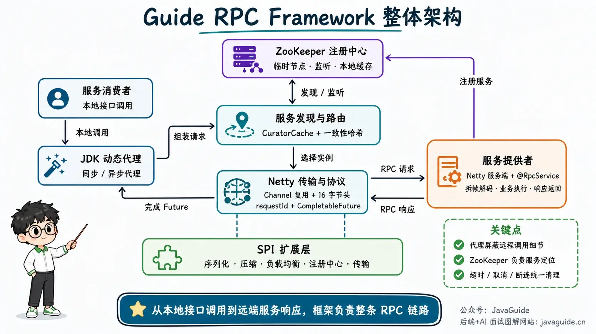

Follow-up questions about an RPC project quickly get into implementation details:

- TCP provides a byte stream. How do you handle message boundaries, including partial and combined reads?
- When one persistent connection carries multiple requests, how do responses find the matching callers?
- How does a client learn when service instances come and go?
- After a request times out, how do you clean up its `CompletableFuture` and in-flight request map? Should a reused Channel be closed?
- Why should adding a serializer not mean adding another branch to a `switch` statement?

Knowing only that “RPC makes remote calls look like local calls” is not enough to answer these questions. **Build an RPC Framework from Scratch** uses a runnable Java project to connect dynamic proxies, networking, a custom protocol, serialization, a registry, load balancing, asynchronous calls, and error handling.

If you are new to RPC concepts and call flows, first read JavaGuide's free article, [Remote Procedure Call (RPC)](../distributed-system/rpc/rpc-intro.md).

## Project Overview

[guide-rpc-framework](https://github.com/Snailclimb/guide-rpc-framework) is a lightweight RPC framework for learning and engineering practice. It retains an earlier Socket implementation and adds a Netty implementation, so you can compare how BIO and NIO handle connections, threads, and requests.

**Project repositories:**

- GitHub: <https://github.com/Snailclimb/guide-rpc-framework>
- Gitee: <https://gitee.com/SnailClimb/guide-rpc-framework>

The code is fully open source. The companion tutorial is a private JavaGuide Knowledge Planet guide with 15 chapters, plus advice on presenting the project on a resume and common interview questions.

## What Happens During an RPC Call?



For a service interface injected with `@RpcReference`, a call follows these steps:

```text
Local interface call
    ↓
JDK dynamic proxy builds RpcRequest
    ↓
ZooKeeper service discovery
    ↓
Consistent hashing selects a service instance
    ↓
Create or reuse a Netty Channel
    ↓
Encode, serialize, and compress the protocol message
    ↓
Server frames and decodes the request, then invokes the target method
    ↓
Match the response to its CompletableFuture by requestId
```

The tutorial goes beyond “the client sends a request and the server returns a result.” It explains how protocol fields are laid out, why long-running methods should not run on I/O threads, and how a single timeout budget can cover queuing through response handling.

## Implemented Capabilities

| Module                         | Current implementation                                                                                                                    |
| ------------------------------ | ----------------------------------------------------------------------------------------------------------------------------------------- |
| Networking                     | Socket and Netty transports; Netty supports Channel reuse and heartbeat checks.                                                           |
| Protocol                       | A fixed 16-byte header containing a magic number, version, total length, message type, codec ID, and request ID.                          |
| Message boundaries             | Length-based framing, with an 8 MiB maximum for both frames and decompressed message bodies.                                              |
| Serialization and compression  | Hessian, Kryo, Protostuff, and Gzip; Hessian is the default serializer.                                                                   |
| Service registry and discovery | ZooKeeper ephemeral nodes and CuratorCache, with local address caching and session recovery.                                              |
| Load balancing                 | Consistent hashing by default, with 160 virtual nodes per physical node.                                                                  |
| Request-response correlation   | Concurrent requests use `requestId -> CompletableFuture`; timeouts, cancellation, disconnects, and shutdown cleanup are handled.          |
| Invocation styles              | Synchronous proxies and asynchronous counterparts returning `CompletableFuture`.                                                          |
| Extension mechanism            | Named custom SPI for serializers, compression, load balancing, registries, service discovery, and transports.                             |
| Spring integration             | `@RpcScan`, `@RpcService`, and `@RpcReference` support scanning, service publishing, and proxy injection.                                 |
| Error handling                 | Stable status codes from 0 to 16 distinguish invalid arguments, timeouts, resource exhaustion, unavailable services, and internal errors. |
| Automated tests                | 82 tests covering configuration, SPI, encoding and decoding, proxies, transport, service handling, and ZooKeeper session recovery.        |

This remains a learning and engineering-practice project. Automatic retries, circuit breaking, rate limiting, TLS, caller authentication, remote cancellation, a monitoring center, and a bounded server-side task queue are not implemented. The tutorial calls out these limitations instead of attributing production framework features to this code.

## How the Tutorial Is Structured

It starts with a minimal call flow using Sockets and JDK dynamic proxies, then introduces Netty, a custom protocol, pluggable serialization, and ZooKeeper. Each change is tied to the problem it solves.

The source-code analysis follows the actual call path: request creation, service discovery, message encoding and decoding, server-side method execution, and Future completion. You can map each step in the articles to the corresponding code.

Later chapters on SPI, load balancing, and testing cover extensions and failure cases, including duplicate `requestId` values, late responses, request timeouts, early connection closure, invalid protocol frames, and expired ZooKeeper sessions.

The project README maintains the required environment, startup order, and first RPC call in its “Quick Start” section, avoiding a duplicate setup article.

## Tutorial Chapters

### RPC Fundamentals and Framework Design

1. **01 What Is RPC? How Does It Work?** Explains the difference between local and remote calls, RPC components, and the basic call flow.
2. **02 Common RPC Frameworks** Compares options such as Dubbo, gRPC, Thrift, and Motan and discusses framework selection.
3. **03 How to Build an RPC Framework** Defines the responsibilities of the proxy, transport, serializer, registry, and load balancer.
4. **04 Serialization and Protocol Selection** Compares JDK serialization, Hessian, Kryo, and Protostuff, and explains how this project integrates them.

### Networking, Dynamic Proxies, and ZooKeeper

1. **05 Socket Networking in Practice** Runs a remote call with minimal components and explains the thread and connection model of blocking I/O.
2. **06 Netty Networking in Practice** Covers EventLoop, Channel, Pipeline, Handler, and length-field-based framing.
3. **07 Static Proxies, JDK Dynamic Proxies, and CGLIB** Explains how proxies hide request construction and network transport details.
4. **08 ZooKeeper Commands and Curator** Covers the node model, ephemeral nodes, listeners, and basic Curator usage.

### RPC Framework Source-Code Analysis

1. **09 Transport Module** Follow client sends, protocol encoding and decoding, Channel reuse, heartbeats, and server handlers.
2. **10 Registry Module** Examine service identifiers, publishing, address caching, node listeners, and session recovery.
3. **11 Other Modules** Covers proxies, service providers, the local service container, Spring annotation integration, and error handling.

### Asynchronous Calls, Extensibility, and Reliability

1. **12 Use `CompletableFuture` to Handle Server Responses** Correlates concurrent requests and responses and covers timeouts, cancellation, and cleanup.
2. **13 How Does the RPC Framework's SPI Work?** Replaces a hard-coded factory with named SPI and analyzes extension discovery, validation, and three-level caching.
3. **14 Random Load Balancing and Consistent Hashing** Explains where each algorithm fits and examines the project's current consistent-hashing implementation.
4. **15 How to Test an RPC Framework** Uses JUnit, Netty `EmbeddedChannel`, and Curator `TestingServer` to test concurrency, timeouts, disconnects, invalid frames, and session recovery.

## Resume Guidance and Interview Preparation

Running the project is only the first step. Interviewers may ask about its default serializer, header size, thread model, timeout range, and missing service-governance features.

The companion guide, **Resume Guidance and Common Interview Questions**, includes:

- Nine suggested ways to describe the project on a backend resume, plus six shorter versions for a one-page resume.
- Verifiable figures such as the 16-byte header, 8 MiB message limit, 160 virtual nodes, and 82 tests.
- A one-minute project introduction and 18 common follow-up questions.
- Clarifications about easy-to-misstate capabilities: Hessian is the default; random load balancing is not integrated with the current SPI configuration; there is no Spring Boot Starter or complete retry and circuit-breaking mechanism.

Do not invent performance figures. Without a load-test report, do not claim “100,000 QPS.” Without a Spring Boot Starter, do not describe the Spring annotation integration as one.

## Questions to Answer After Studying

- How does RPC differ from HTTP calls, and why does this project use a custom binary protocol?
- What does each field in the 16-byte header store? How does the length field handle partial and combined reads?
- Why limit both the compressed frame size and the decompressed message-body size?
- When concurrent requests reuse one Channel, how does a response find its `CompletableFuture`?
- When does the request timeout begin, and why should it include queuing and service discovery?
- How does the custom SPI compare with JDK `ServiceLoader` and Dubbo SPI?
- What do ZooKeeper ephemeral nodes, CuratorCache, and session recovery each solve?
- Why does consistent hashing use virtual nodes, and which requests are remapped when service instances change?
- Why move business execution off Netty I/O threads? Can methods on one Channel run in parallel?
- What is still missing before this framework is production-ready, and what should be added first?

If you can only recite answers, revisit the relevant chapters and trace them through the code.

## Who Should Read This?

- Developers who know Java fundamentals, collections, reflection, and multithreading and want to apply them in a complete project.
- Developers who have used Netty or ZooKeeper but are unsure of their roles in an RPC call path.
- Candidates preparing for Java backend interviews who want a project that supports deeper discussion of protocols, networking, and distributed coordination.
- Developers who use Dubbo or Feign and want to understand how proxies, protocols, service discovery, and response correlation work.
- Developers preparing to read frameworks such as Dubbo or Netty who want to first study a smaller project.

RPC beginners are welcome, but you should know Java syntax, Maven, and basic client-server concepts. The tutorial does not spend many pages repeating those prerequisites.

## Suggested Study Plan

1. Follow the project README to set up JDK 25, Maven 3.9, and ZooKeeper 3.9.5, then run the client and server.
2. Read the first eight chapters and implement the minimal Socket, proxy, Netty, and ZooKeeper examples yourself.
3. Read the current source code alongside chapters 9–14, and modify at least one extension point, such as adding a serializer or load-balancing strategy.
4. Run `mvn verify` and add a test for a timeout, disconnect, or invalid frame. Confirm that you can explain resource cleanup after failure.
5. Prepare your resume and interview answers. Do not claim capabilities you have not verified yourself.

## FAQ

### Do I have to pay for the project code?

No. The GitHub and Gitee repositories are fully open source and free. There is no Pro edition.

### Where can I read the companion tutorial?

The tutorial is a private JavaGuide Knowledge Planet guide, available online through Yuque. It is not sold separately.

### Is the tutorial a video course or written guide?

It consists mainly of written explanations, source-code analysis, and diagrams. You can move between the article and code and search for protocol fields, classes, and test scenarios later.

### Can I put this project on my resume as-is?

You can, but first run it, understand the main call path, and make at least one change of your own. Interviewers may ask about the protocol, Netty's thread model, ZooKeeper nodes, consistent hashing, or `CompletableFuture`; copying a project description will not prepare you for those questions.

## Get Started

If you only want to read the source code, visit the open-source repository. To study the implementation along the call path and prepare resume and interview material, join the [JavaGuide Knowledge Planet](../about-the-author/zhishixingqiu-two-years.md) for the complete tutorial.

The Knowledge Planet also includes one-on-one Q&A, resume reviews, Java interview resources, system-design and scenario questions, and source-code guides that complement this RPC project.

<!-- @include: @planet2.snippet.md -->
