Backend developers often face the same problem when choosing a project for their resume: it is mostly CRUD. The technology stack may look broad, but interviewers have little to explore, and the project may not show your understanding of **LLM applications, RAG knowledge bases, or production Agents**.

This guide introduces a hands-on **LLM and Agent project** for Java backend developers: an AI interview platform built with **Spring Boot 4.1, Java 25, and Spring AI 2.0**. It brings together resume analysis, text and voice mock interviews, RAG knowledge-base Q&A, knowledge-base interviews, multiple model providers, asynchronous jobs, and distributed rate limiting.

If you want a project to present on your resume and discuss in interviews while learning Spring AI, RAG, and Agent engineering, this offers more to explore than a CRUD application built mainly around business tables.

## Project Overview

This AI interview platform is built with Spring Boot 4.1, Java 25, and Spring AI 2.0. Its main features are:

1. **AI resume analysis**: Upload a resume for multi-dimensional scoring and improvement suggestions.
2. **Text and voice mock interviews**: Generate personalized questions from an interview Skill or resume; support real-time text Q&A, voice conversations, and answer evaluation.
3. **RAG knowledge-base Q&A**: Upload technical documents to build a private knowledge base for retrieval-augmented answers.
4. **Knowledge-base interviews**: Generate and manage question banks from knowledge-base documents, then run focused mock interviews.
5. **Interview scheduling**: Parse interview invitations and manage them in a calendar.
6. **Multiple model providers**: Configure OpenAI-compatible providers and switch the default chat or embedding model at runtime.

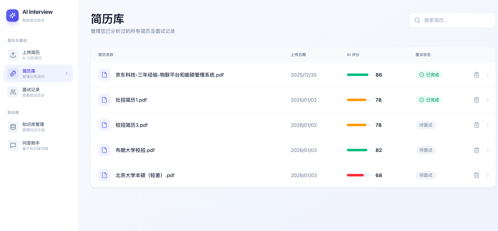

**Project repositories:**

- Github：<https://github.com/Snailclimb/interview-guide>
- Gitee：<https://gitee.com/SnailClimb/interview-guide>

The complete project is free and open source; there is no paid or Pro edition.

## How to Present the Project on Your Resume

**How can you present the Spring AI interview platform and RAG knowledge base on your resume?** The guide offers versions for five role directions:

1. **Backend roles**: Three versions emphasize architecture and distributed systems, AI applications and reactive programming, or engineering and infrastructure.
2. **Testing and test-development roles**: Two versions emphasize unit testing and TDD, or functional and failure-scenario coverage, highlighting quality assurance for AI applications.

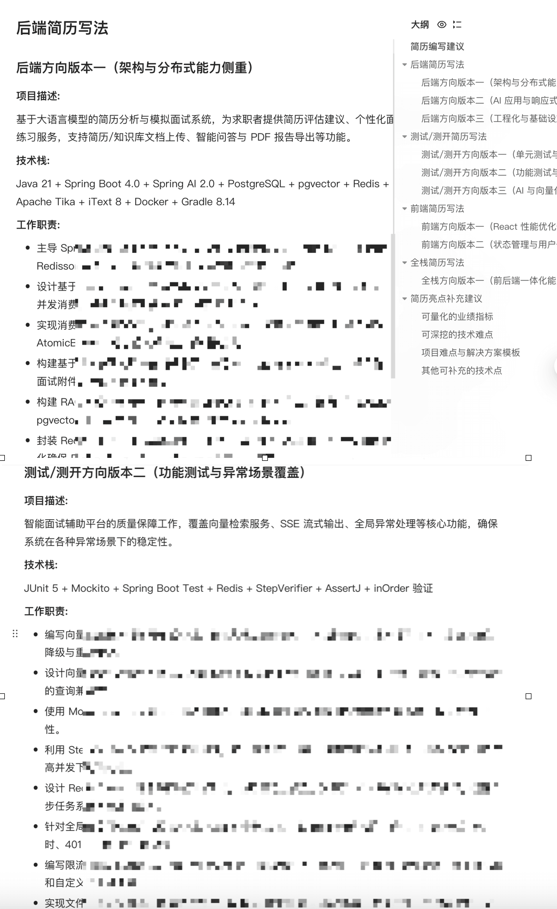

Each resume bullet reflects the project's actual implementation. The guide also explains how to address gaps—for example, how to add authentication and authorization with Spring Security or Sa-Token, which the project does not currently implement.

It also covers topics interviewers may explore, such as Redis Streams versus traditional message queues and distributed rate limiting, with templates for describing project challenges and solutions.

## Tutorial Overview

The companion tutorial includes dozens of hand-drawn technical diagrams to explain the project.

For example, the RAG interview guide took a week to draft. It has since grown to **50,000 Chinese characters** and **35 common RAG interview questions**, and has gone through three rounds of proofreading. It will continue to be revised.

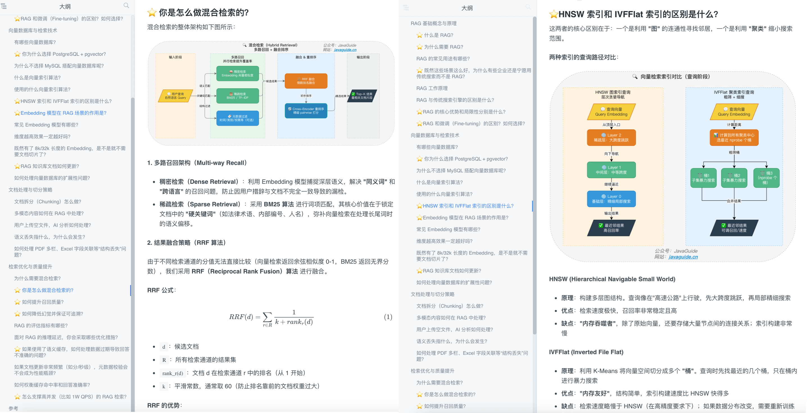

This article explains the implementation approach for the RAG knowledge base.

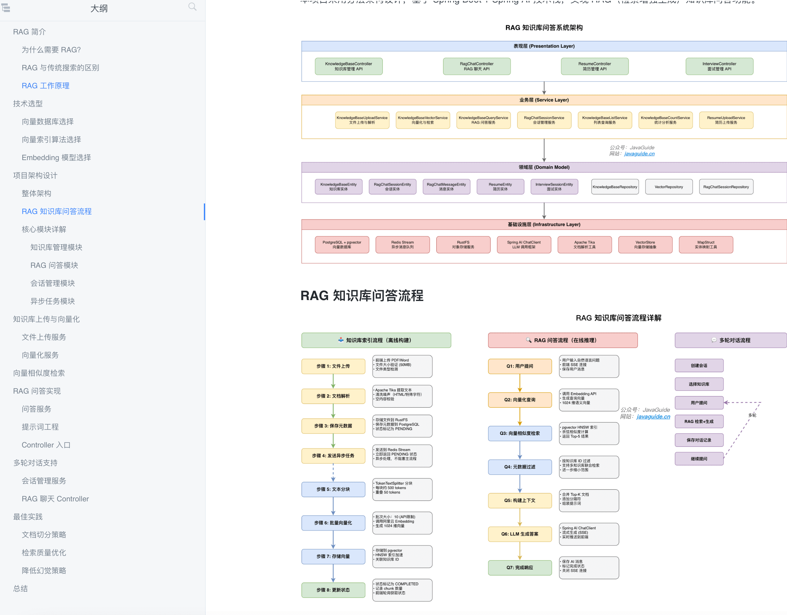

The tutorial explains not only how to write the code, but also why it is designed this way and how to handle production challenges.

## Companion Tutorial Contents

The project covers many topics and introduces them from the fundamentals upward. Its step-by-step tutorial builds a backend architecture from scratch with **LLM integration, RAG, vector storage, distributed rate limiting, and asynchronous processing**.

Whether you want to learn practical **Spring AI** or need a substantial project for your resume, the guide covers infrastructure setup, feature implementation, and interview preparation.

The companion tutorial is paid; instructions for joining appear below. The fee helps cover the time spent creating and maintaining it.

**The complete tutorial contains more than 200,000 Chinese characters:**

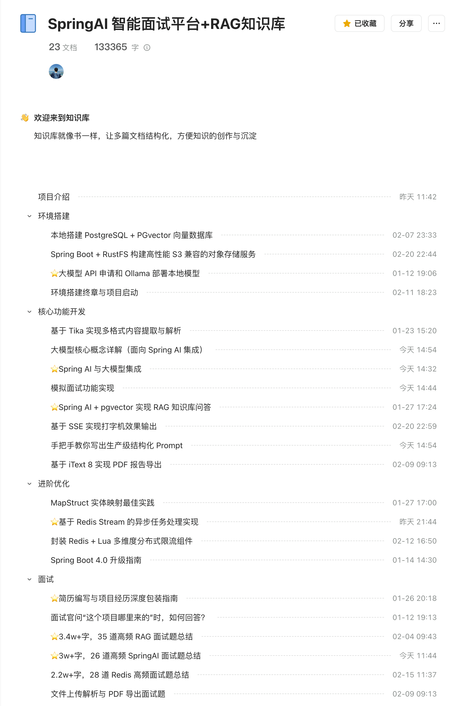

### Project Overview and Setup

- Set up PostgreSQL and pgvector locally.
- Build an S3-compatible object-storage service with Spring Boot and RustFS.
- ⭐ Obtain an LLM API key and deploy a local model with Ollama.
- Complete the environment setup and launch the project, including one-command deployment with Docker Compose.

### Core Features

- Parse uploaded resumes with Tika and a two-stage cleaning process.
- ⭐ Integrate Spring AI with LLMs.
- ⭐ Implement multi-LLM routing and the `LlmProviderRegistry` design.
- ⭐ Build RAG knowledge-base Q&A with Spring AI and pgvector.
- Stream responses with a typewriter effect using SSE.
- Write structured prompts for production use.
- Implement AI mock interviews.
- Export PDF reports with iText 8.

### Advanced Engineering

- MapStruct entity-mapping practices.
- Centralized exception handling and business error codes.
- Virtual threads in practice.
- ⭐ Asynchronous task processing with Redis Streams.
- Using Redis Streams as a message queue.
- Redis Stream reliability: conditional claiming, execution generations, and recovery of stuck tasks.
- Build a multi-dimensional distributed rate limiter with Redis and Lua.
- Evolve rate-limit configuration from dimension arrays to independent `@Repeatable` limits.
- Load-test distributed rate limiting with `wrk`.
- ⭐ Offline RAG evaluation and production observability.
- Bounded fallbacks for long contexts and batch evaluation.
- Upgrade to Spring Boot 4.x: lessons from Jackson 3, Spring AI 2.0, and Boot 4.1.

### Interview Preparation

- ⭐ Resume writing and presenting project experience.
- How to answer “Where did this project come from?”
- ⭐ Spring AI interview questions.
- ⭐ RAG knowledge-base interview questions.
- Prompt engineering interview questions.
- Redis interview questions.
- Interview questions on file parsing and PDF export.
- A focused guide to backend project highlights.

### Further Improvements

- ⭐ Skill-driven question generation and Skill architecture.
- Knowledge-base interviews: generate question banks and focused interviews from documents.
- Prompt-injection defenses.
- Multi-turn RAG context and retrieval for short queries.
- Spring AI structured output and Advisor-chain improvements.

## Join the Program

**This is a private hands-on project for the [JavaGuide Knowledge Planet](https://javaguide.cn/about-the-author/zhishixingqiu-two-years.html). The tutorial is available online through Yuque and is not offered separately.**

It is offered through the Knowledge Planet so that learners can get **in-depth technical Q&A** and **job-search support**.

The tutorial was expected to be completed in **one to two months**. It consists of written articles rather than videos, and is designed to guide readers through running the project from scratch, even with limited prior experience.

More **Java projects based on real business scenarios** are planned for the Knowledge Planet. The next planned project is an **enterprise customer-service system** covering additional AI capabilities.

The Knowledge Planet also offers **one-on-one Q&A, resume reviews, backend interview materials (including common system-design and scenario questions), and study check-ins**. See the [JavaGuide Knowledge Planet](https://javaguide.cn/about-the-author/zhishixingqiu-two-years.html) for details.

The Knowledge Planet has been maintained for **six years** and continues to be updated. The listed price is **CNY 0.40 per day**.

The current promotion includes a **CNY 30** coupon. The source also notes that prices may increase and existing members can renew at half price by scanning the code:

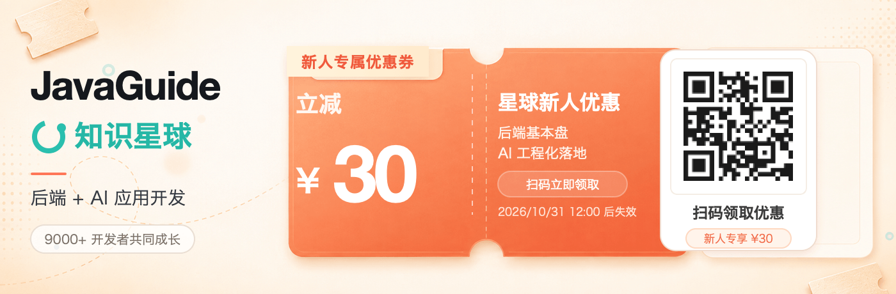

The goal is to keep creating useful content. Thank you for your support.

## System Architecture

**Note:** The architecture diagram was created in draw.io and exported as SVG. It may not display correctly in dark mode.

The system uses a frontend-backend architecture with three layers: presentation, backend services, and data storage.

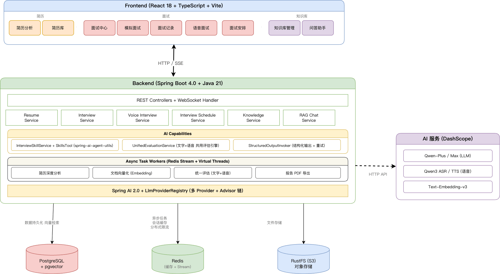

**Backend layer:**

- REST Controllers: A unified API entry point for HTTP requests.
- Business services:
  - Resume Service: Resume upload, parsing, and AI analysis.
  - Interview Service: Interview sessions, question generation, and answer evaluation.
  - Knowledge Service: Knowledge-base uploads, text chunking, and embeddings.
  - RAG Chat Service: Retrieval-augmented, streaming Q&A.
  - Question Bank Service: Generate question banks from a knowledge base for focused interviews.
  - LLM Provider Service: Manage model providers and voice-service configuration.
- Asynchronous processing: Redis Stream consumers handle long-running AI tasks such as resume analysis, embedding generation, question-bank creation, and interview evaluation.
- AI integration: Spring AI provides a unified LLM API with OpenAI-compatible providers such as DashScope, Kimi, DeepSeek, GLM, and LM Studio. The default chat and embedding models can be changed at runtime.

**Data storage layer:**

- PostgreSQL + pgvector：
  - Relational data: Resumes, interview records, and knowledge-base metadata.
  - Vector search: Store document embeddings for similarity search.
- Redis：

  - Session cache: Interview-session state.
  - Message queue: Redis Streams for asynchronous jobs.

- RustFS/MinIO (S3): Original files such as resume PDFs and knowledge-base documents.

**Asynchronous processing flow:**

Resume analysis, knowledge-base embedding, and interview-report generation use Redis Streams. The flow for resume analysis and embedding is:

```
Upload request → Save file → Publish message to Stream → Return immediately
                              ↓
                      Consumer processes message
                              ↓
                    Run analysis/embedding task
                              ↓
                      Update database status
                              ↓
                   Frontend polls for the latest status
```

Status transitions: `PENDING` → `PROCESSING` → `COMPLETED` / `FAILED`

**Knowledge-base Q&A flow:**

```
Knowledge-base question → Embed query → pgvector similarity search → Retrieve relevant documents
                                                      ↓
                                Build prompt → LLM generates answer → Stream over SSE
```

## Technology Stack

### Backend

| Technology            | Version    | Description                                                      |
| --------------------- | ---------- | ---------------------------------------------------------------- |
| Spring Boot           | 4.1.0      | Application framework                                            |
| Java                  | 25         | Language, including virtual threads                              |
| Spring AI             | 2.0.0      | AI integration and OpenAI-compatible models                      |
| PostgreSQL + pgvector | 14+        | Relational database and vector storage; Compose defaults to PG16 |
| Redis + Redisson      | 6+ / 4.0.0 | Cache and Stream-based messaging                                 |
| Apache Tika           | 2.9.2      | Document parsing                                                 |
| iText 8               | 8.0.5      | PDF export                                                       |
| MapStruct             | 1.6.3      | Object mapping                                                   |
| SpringDoc OpenAPI     | 3.0.2      | API documentation                                                |
| DashScope SDK         | 2.22.7     | Speech recognition and synthesis (Qwen3 ASR/TTS)                 |
| AWS S3 SDK            | 2.29.51    | S3-compatible storage (MinIO/RustFS)                             |
| spring-ai-agent-utils | 0.10.0     | Skill loading and Advisor extensions                             |
| WebSocket             | -          | Real-time, bidirectional voice interviews                        |
| Gradle                | 9.6.1      | Build tool                                                       |

Common technology-selection questions:

1. Why PostgreSQL and pgvector? Their vector-storage features are sufficient for this project, and using one database keeps the architecture small.
2. Why Redis?
   - Redis replaces `ConcurrentHashMap` for interview-session caching.
   - Redis Streams handle asynchronous resume analysis and knowledge-base embedding, while decoupling those tasks so they could be implemented in other languages. A mature queue such as [Kafka](https://javaguide.cn/high-performance/message-queue/kafka-questions-01.html) would add another component.
3. Why Gradle? I prefer it and have written about it in [Gradle Core Concepts](https://javaguide.cn/tools/gradle/gradle-core-concepts.html).

### Frontend

| Technology         | Version | Description               |
| ------------------ | ------- | ------------------------- |
| React              | 18.3    | UI framework              |
| TypeScript         | 5.6     | Language                  |
| Vite               | 5.4     | Build tool                |
| Tailwind CSS       | 4.1     | CSS framework             |
| React Router       | 7.11    | Routing                   |
| Framer Motion      | 12.23   | Animations                |
| Recharts           | 3.6     | Charts                    |
| Lucide React       | 0.468   | Icons                     |
| React Big Calendar | 1.19    | Interview calendar        |
| React Markdown     | 9.0     | Markdown rendering        |
| React Virtuoso     | 4.18    | Virtualized RAG chat list |
| pnpm               | 10.26   | Package manager           |

## Technology-Selection FAQ

This section gives a brief overview. More detailed articles on these technology choices will follow.

### Why Spring AI?

Spring AI is Spring's framework for integrating AI, with a unified abstraction for LLM calls. Reasons for choosing it include:

1. **Unified abstraction**: One codebase supports providers such as OpenAI, Alibaba Cloud DashScope, and Ollama; switch models through configuration.
2. **Spring integration**: Works with Spring Boot, including auto-configuration, dependency injection, and declarative calls.
3. **Vector-store support**: Integrates with vector databases such as pgvector, Milvus, and Pinecone, simplifying RAG development.
4. **Structured output**: `BeanOutputConverter` maps LLM output to Java objects without manual JSON parsing.

```java
// Example: structured output with Spring AI.
var converter = new BeanOutputConverter<>(ResumeAnalysisDTO.class);
String result = chatClient.prompt()
    .system(systemPrompt)
    .user(userPrompt + converter.getFormat())
    .call()
    .content();
return converter.convert(result);  // Returns a Java object.
```

### Why PostgreSQL and pgvector?

The project stores both structured data, such as resumes and interview records, and vector data, such as document embeddings. Here is a comparison of the options:

| Option                | Advantages                                         | Disadvantages                                                      |
| --------------------- | -------------------------------------------------- | ------------------------------------------------------------------ |
| PostgreSQL + pgvector | One database and simpler operations.               | Vector search may be slower than with a dedicated vector database. |
| PostgreSQL + Milvus   | Better vector-search performance.                  | Adds a component and operational complexity.                       |
| PostgreSQL + Pinecone | Managed service with no infrastructure to operate. | Higher cost and data stored by a third party.                      |

**Why choose pgvector?**

- **Simple architecture**: No extra component, reducing deployment and operational complexity.
- **Sufficient performance**: HNSW indexes support millisecond-scale retrieval, which is sufficient for tens of thousands of documents.
- **Transactional consistency**: Vector and business data share a database and can use the same transactions.
- **SQL filtering**: Add `WHERE` conditions, for example to search only one knowledge-base category.

```sql
-- Example: similarity search with pgvector.
SELECT content, 1 - (embedding <=> \$1) as similarity
FROM vector_store
WHERE metadata->>'category' = 'Java'
ORDER BY embedding <=> \$1
LIMIT 5;
```

**Why not use MySQL with a separate vector database?**

PostgreSQL's main advantage is its extensibility. Developers can add powerful extensions without modifying the database engine, making it a versatile data platform.

- **AI vector search?** The recommended **pgvector** extension has a mature ecosystem and can serve many workloads that might otherwise use a dedicated vector database.
- **Full-text search?** Built-in features cover basic needs; extensions such as **pg_bm25** are also available.
- **Time-series data?** Use the **TimescaleDB** extension.
- **Geospatial data?** Use the widely adopted **PostGIS** extension.

This all-in-one approach can reduce a project's reliance on external middleware such as Elasticsearch and Milvus. An extended PostgreSQL deployment may satisfy several needs while simplifying the stack and lowering development and operational costs.

For a detailed comparison, see [MySQL vs. PostgreSQL: Which Should You Choose?](https://mp.weixin.qq.com/s/APWD-PzTcTqGUuibAw7GGw).

### Why Redis?

The project uses Redis in two main areas:

1. Redis replaces `ConcurrentHashMap` for session caching.
2. Redis Streams handle asynchronous resume analysis and knowledge-base embedding. This also decouples the work so it could be implemented in another language.

**Why Redis Streams instead of a more established message queue such as Kafka or RabbitMQ?**

AI tasks such as resume analysis and knowledge-base embedding take 10–60 seconds, so they should not run synchronously. A message queue provides asynchronous processing and decoupling.

| Dimension                  | Redis Streams                                      | RabbitMQ                                               | Kafka                                                 | In-memory queue                                                   |
| :------------------------- | :------------------------------------------------- | :----------------------------------------------------- | :---------------------------------------------------- | :---------------------------------------------------------------- |
| **Throughput**             | High (around 100,000 QPS)                          | Medium (around 10,000 QPS)                             | Very high (millions with horizontal scaling)          | Very high (tens of millions/sec, CPU and memory limited)          |
| **Latency**                | Very low (sub-millisecond)                         | Low (milliseconds)                                     | Medium (milliseconds to tens of milliseconds)         | Very low (nanoseconds/microseconds)                               |
| **Persistence**            | Yes (RDB/AOF)                                      | Yes (Mnesia/disk)                                      | Strong (native segmented logs)                        | None (lost when the process exits)                                |
| **Backlog capacity**       | Moderate (memory-limited)                          | Medium (disk-backed, with noticeable performance loss) | Very high (terabytes on disk)                         | Low (heap-limited)                                                |
| **Consumption model**      | Pub/sub and consumer groups                        | Flexible routing and exchange types                    | Pub/sub and consumer groups                           | Point-to-point or multiple consumers, depending on implementation |
| **Replay**                 | By ID or time range                                | No                                                     | Yes, by offset or timestamp                           | No                                                                |
| **Ordering**               | Ordered within one Stream                          | Ordered within one queue                               | Ordered within one partition                          | Ordered within one queue                                          |
| **Reliability**            | Medium (asynchronous replication may lose data)    | High (publisher confirms/transactions)                 | Very high (replicas, ISR, and acknowledgments)        | Low (no persistence or acknowledgment)                            |
| **Operational complexity** | Low                                                | Medium                                                 | High (simplified by KRaft)                            | Very low                                                          |
| **Use cases**              | Lightweight streams and existing Redis deployments | Complex routing and enterprise integration             | Big-data streams, event sourcing, and log aggregation | In-process decoupling and extreme performance                     |

Reasons for choosing Redis Streams:

- **Reuse existing infrastructure**: Redis already provides session caching, so no new middleware is needed.
- **Required features**: Consumer groups, acknowledgments (ACKs), and persistence are supported.
- **Simple operations**: Redis Streams are sufficient for a small or medium-sized project.

### Why Gradle?

Spring Boot itself uses Gradle. Maven is more common in China, so Gradle is also a useful alternative to learn.

I also prefer Gradle. See [Gradle Core Concepts](https://javaguide.cn/tools/gradle/gradle-core-concepts.html).

### Why MapStruct?

The project needs many Entity-to-DTO conversions. MapStruct generates mapping code at compile time:

| Option         | Performance                  | Type safety          | Complexity             |
| -------------- | ---------------------------- | -------------------- | ---------------------- |
| MapStruct      | No reflection; fastest.      | Compile-time checks. | Define an interface.   |
| BeanUtils      | Reflection; slow.            | Runtime errors.      | One line of code.      |
| ModelMapper    | Reflection; relatively slow. | Runtime errors.      | Complex configuration. |
| Manual mapping | Fastest.                     | Compile-time checks. | Repetitive code.       |

### Why Apache Tika?

The system parses documents in formats such as PDF, Word, and TXT. Apache Tika is an Apache document-parsing library that provides:

- **Broad format support**: Hundreds of formats, including PDF, DOCX, DOC, TXT, HTML, and Markdown.
- **Automatic detection**: Detects formats from file contents rather than relying on file extensions.
- **Text extraction**: A unified API extracts plain text across formats.

```java
// Example: parsing with Tika.
Tika tika = new Tika();
String content = tika.parseToString(inputStream);  // Detects the format and extracts text.
```

### Why SSE Instead of WebSocket?

Knowledge-base Q&A streams responses so text can appear progressively, as in ChatGPT. Two options are:

| Option    | Advantages                        | Disadvantages                                          |
| --------- | --------------------------------- | ------------------------------------------------------ |
| SSE       | Simple, HTTP-based, one-way push. | Server-to-client only.                                 |
| WebSocket | Bidirectional and feature-rich.   | More complex protocol and connection-state management. |

Reasons for choosing SSE:

- **Fits the use case**: LLM responses flow from server to client; bidirectional communication is unnecessary.
- **Simple implementation**: HTTP-based, with reconnection and cross-origin support.
- **Spring support**: Return a `Flux<ServerSentEvent<String>>`.

> The project uses SSE for streaming knowledge-base answers and resume analysis. Voice interviews use WebSocket for bidirectional real-time audio. Choose the protocol for the use case; it is not an either-or decision.

### Why React, TypeScript, and Tailwind CSS?

| Technology   | Reason                                                                            |
| ------------ | --------------------------------------------------------------------------------- |
| React        | Mature ecosystem, component-based development, and extensive community resources. |
| TypeScript   | Type safety and IDE assistance reduce runtime errors.                             |
| Vite         | Fast development-server startup and a responsive HMR workflow.                    |
| Tailwind CSS | Utility classes enable rapid styling without a separate CSS file.                 |

## Features

### Resume Management

- **Multiple formats**: Supports PDF, DOCX, DOC, TXT, and other resume formats.
- **Batch uploads**: Upload multiple resumes at once, reuse the knowledge-base upload flow, and track processing status.
- **Asynchronous processing**: Redis Streams handle resume analysis and show progress (pending, processing, completed, or failed).
- **Reliability**: Retries failed analyses up to three times and detects duplicates using content hashes.
- **Reprocessing**: Run analysis again on an uploaded resume without uploading it again.
- **Report export**: Export AI analysis as a structured PDF resume report.

### Mock Interviews

- **Skill-driven questions**: More than ten interview tracks, including Java backend, company-specific tracks for Alibaba, ByteDance, and Tencent, frontend, Python, algorithms, system design, test development, and AI Agents. Each `SKILL.md` defines topics, difficulty, and reference knowledge bases. `spring-ai-agent-utils` loads Skills through Progressive Disclosure.
- **Two parallel question streams**: When a resume is available, 60% of questions explore its projects using a separate prompt, while 40% cover track fundamentals through a Skill. Virtual threads generate both sets in parallel; separate prompts avoid conflicts.
- **Custom job-description parsing**: Paste a job description (JD); the LLM identifies interview categories and matches them to a shared question bank. No preset track is required.
- **Deduplicate past questions**: Exclude questions already asked in a session.
- **Time allocation by interview stage**: Adjusting the total duration redistributes time among the introduction, technical questions, project discussion, and candidate questions.
- **Follow-up questions**: Configure multiple follow-ups (one by default) to simulate multi-turn interviews.
- **Unified evaluation**: Text and voice interviews use the same engine: batch evaluation, structured output, a second-pass summary, and fallbacks.
- **Report export**: Generate and export detailed PDF interview reports asynchronously.
- **Interview hub**: A central page links to text and voice interviews and supports continuing or restarting an interview.

### Interview Scheduling

- **Invitation parsing**: Rules and AI parse Lark, Tencent Meeting, and Zoom invitations to extract the company, role, time, and meeting link.
- **Calendar**: Day, week, and month views, drag-and-drop changes, and a list view.
- **Status management**: Scheduled expiration and manual pending, completed, or canceled states.
- **Reminders**: Configurable alerts help prevent missed interviews.

### Voice Interviews

Real-time voice interviews use WebSocket and the Qwen3 voice model, with one API key for ASR, TTS, and the LLM:

- **Streaming conversation**: Concurrent sentence-level TTS generates and plays audio as it is produced, with a 200 ms first-chunk latency.
- **Server-side VAD**: Automatically detects utterance boundaries and provides live captions, including interim results.
- **Echo protection and manual submission**: Helps prevent the AI's voice from being captured as user input.
- **Multi-turn context and pause/resume**: Sessions pause automatically after a timeout.
- **Micrometer metrics**: Track TTS and ASR latency, session duration, and other measurements.

> **Known issues:** End-to-end latency is high because audio passes through the server; echo can leak when headphones are not used; TTS has limited voice options; and audio can break up on weak networks. Planned areas to explore include WebRTC, client-side VAD and noise reduction, and end-to-end voice models.

### Knowledge-Base Management

- **Document processing**: Batch upload PDF, DOCX, Markdown, and other formats; automatically chunk documents and generate embeddings asynchronously.
- **RAG retrieval**: Integrates pgvector and improves answer relevance with query rewriting, similarity thresholds, and Top K settings.
- **Streaming responses**: Uses Server-Sent Events (SSE) for typewriter-style output.
- **Knowledge-base chat**: Session management, pinned conversations, multiple knowledge bases, Markdown rendering, and virtualized lists.
- **Knowledge-base operations**: Categories, downloads, re-embedding, search, and usage statistics.

### Knowledge-Base Question Banks and Interviews

- **Generate questions from knowledge bases**: Create main questions, reference answers, key points, rubrics, and follow-ups from embedded documents, then organize them by track and difficulty.
- **Asynchronous generation and quality notices**: Redis Streams run question-generation tasks. If generation is incomplete, keep a draft and show actual versus requested follow-up counts instead of silently dropping questions.
- **Question-bank management**: Search, filter, paginate, add, edit, and delete questions; manage draft, enabled, and archived states individually or in bulk.
- **Validate interview capacity**: Before an interview, calculate available questions by track, difficulty, main-question count, and follow-ups per question. Follow-up counts are a hard constraint; disable options with insufficient capacity and revalidate on the backend.
- **Focused knowledge-base interviews**: Select enabled questions and follow-ups, record answers, and asynchronously produce an overall score, per-question feedback, strengths, and improvement suggestions with the shared evaluation engine.
- **Evaluation and history**: Show evaluation progress after submission and open the interview details when complete. Filter by track, time, and completion status; view performance trends and export PDF reports.

### Model Providers and System Settings

- **Provider management**: Includes OpenAI-compatible configurations for DashScope, LM Studio, Kimi, DeepSeek, GLM, and others.
- **Default model switching**: Change the default chat or embedding model in settings without editing source configuration.
- **Voice-service configuration**: Manage ASR/TTS settings and test service connectivity.
- **Secure configuration storage**: Runtime settings are written to `~/.interview-guide/` by default; API keys can be encrypted.

## Screenshots

### Resumes and Interviews

Interview hub:

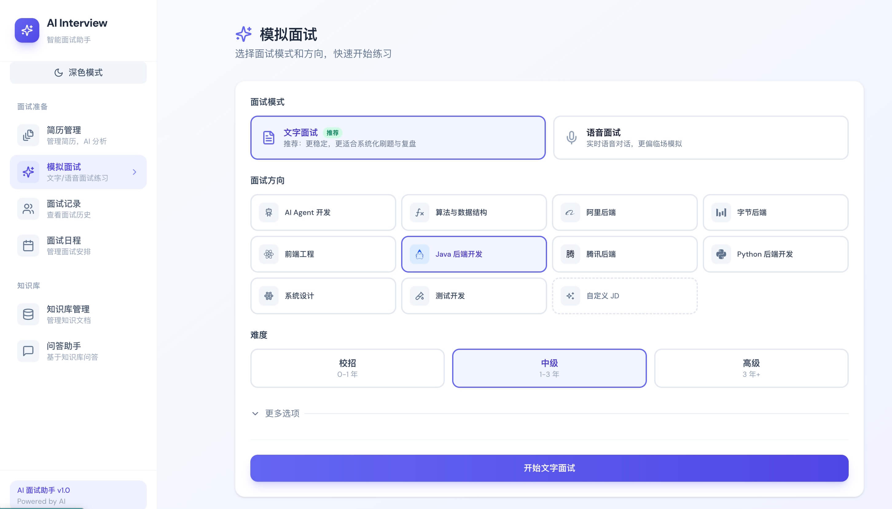

Skill-generated questions and JD parsing:

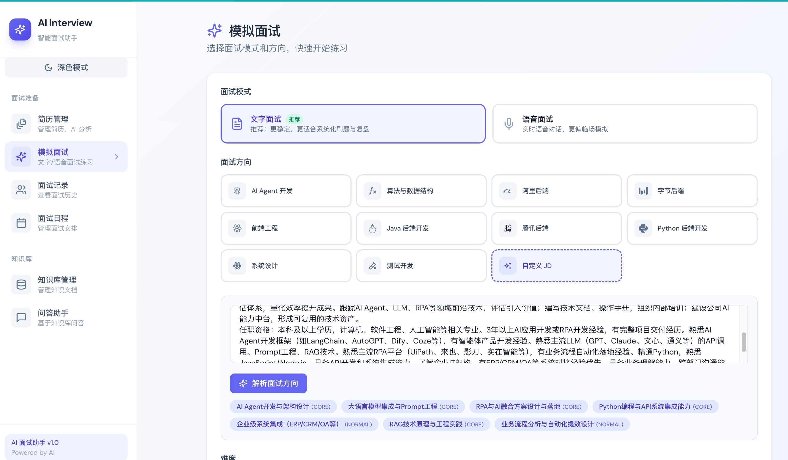

Resume library:


Resume upload and analysis:

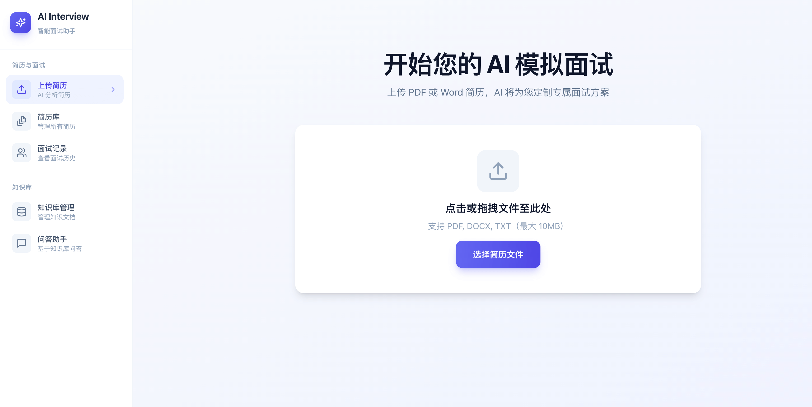

Resume analysis details:

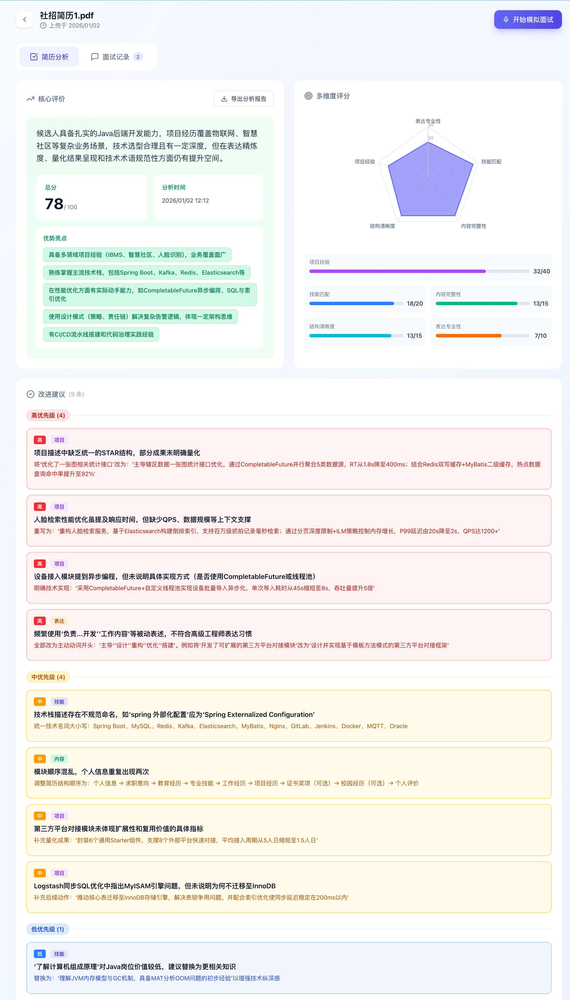

Interview history:

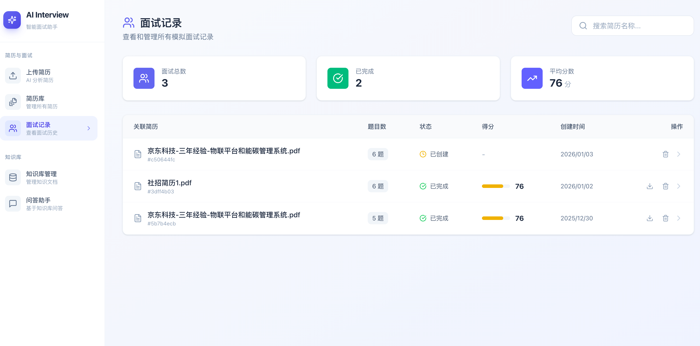

Interview details:

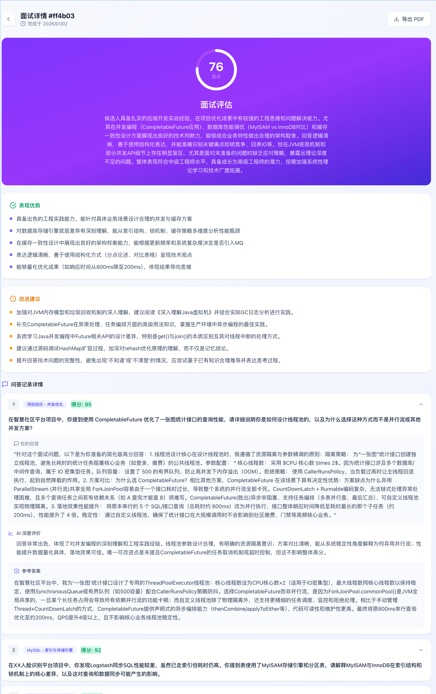

Mock interview:

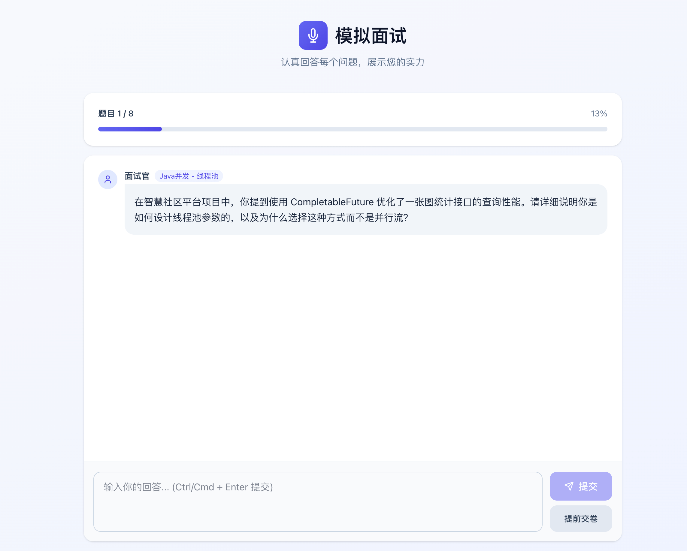

Interview schedule:

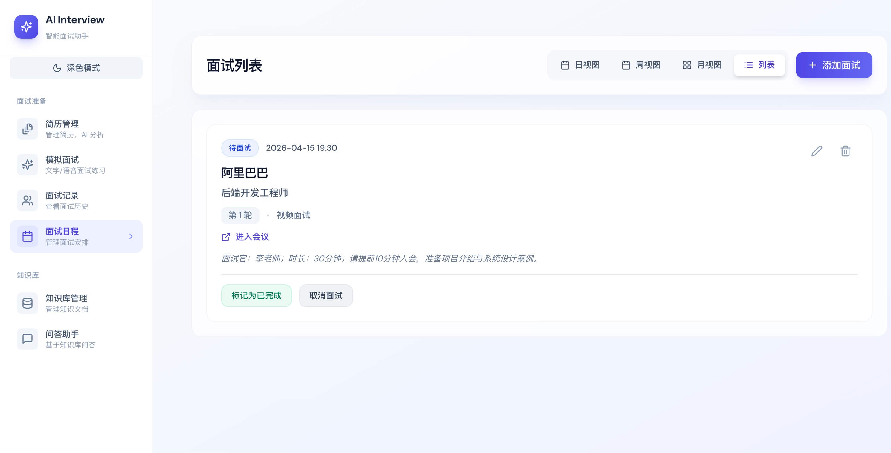

Model switching and voice-service settings:

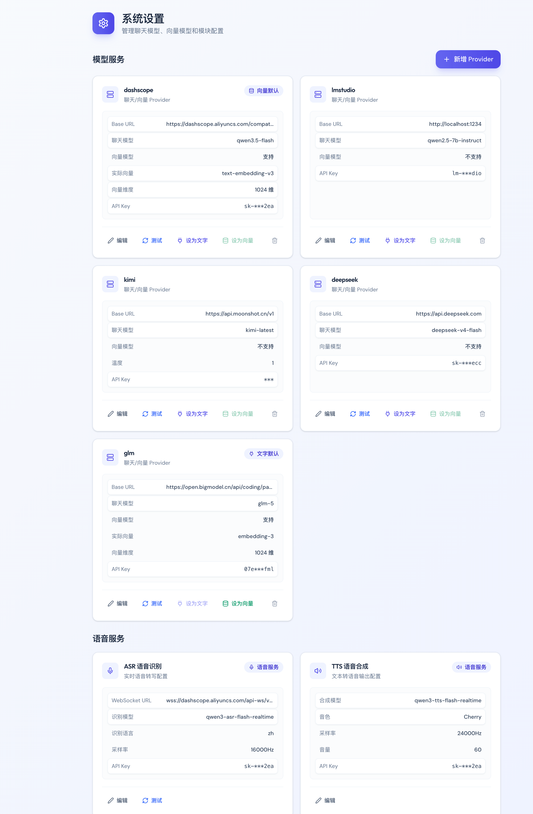

### Knowledge Base

Knowledge-base management:

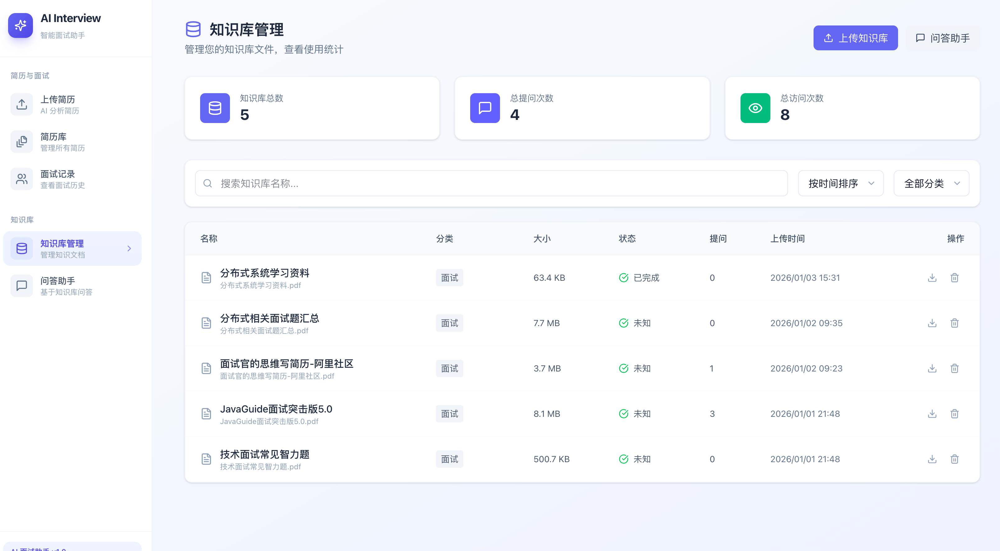

Q&A assistant:

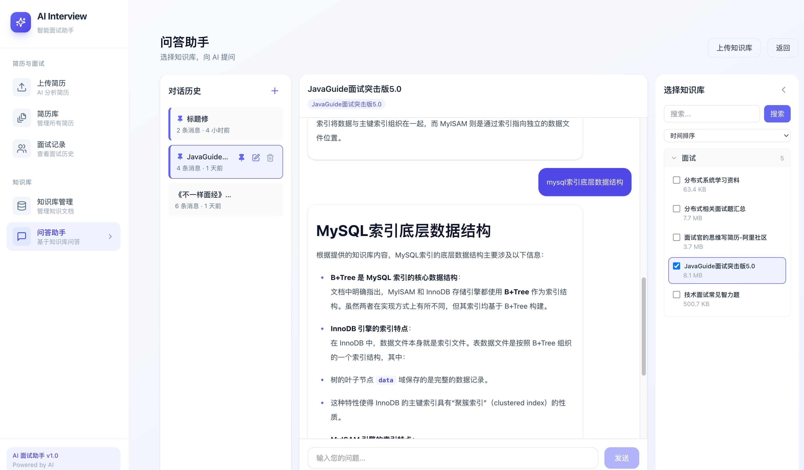

## What You Will Learn

The project uses Java 25 and Spring Boot 4.1 and is presented as the first full-stack project to integrate Spring AI 2.0 in depth. It includes the code and a detailed architecture tutorial.

The project is taught from fundamentals upward. Its step-by-step tutorial is designed to help readers with limited programming experience build an AI application from scratch.

### Core Patterns in AI Application Development

The project can help backend developers transition to AI application development:

- **Spring AI 2.0 in practice**: Learn Spring's AI abstractions and connect models such as Qwen and OpenAI through a unified declarative interface.

- **Prompt engineering**: Build structured system and user prompts instead of concatenating strings. Use `BeanOutputConverter` to map LLM output to Java objects and avoid manual JSON parsing.

- **Query rewriting**: Use an LLM to add context and improve retrieval terms. Learn a cascading strategy that tries the original query, a rewritten query, and then falls back to the original.

- **Dynamic retrieval tuning**: Adjust `topK` and similarity thresholds based on query length and semantic density, with different strategies for short, medium, and long queries.

- **End-to-end RAG**: Follow document parsing, chunking, embedding, vector storage, similarity search, and context-grounded generation. Learn relevance checks that prevent weak matches from triggering long “insufficient information” answers.

- **Reliable structured output and retries**: Use a shared `StructuredOutputInvoker` pattern, retries, error feedback, and strict JSON instructions to improve parsing success.

- **Multiple providers and runtime switching**: Manage OpenAI-compatible providers such as DashScope, Kimi, DeepSeek, GLM, and LM Studio through `LlmProviderRegistry`. Switch default chat and embedding models without code changes or application restarts.

- **RAG evaluation and observability**: Evaluate a fixed dataset and evidence anchors offline using metrics such as recall and MRR. Expose `app_rag_*` metrics through Micrometer so retrieval quality can be monitored and regression-tested.

- **Prompt-injection defenses**: Treat uploaded resumes and documents as untrusted input. Use input cleaning (`PromptSanitizer`) and data-boundary instructions to prevent malicious content from overriding the system prompt.

### Modern Java Backend Architecture

The project demonstrates these engineering practices:

- **Java 25 and Spring Boot 4.1**: Use features such as virtual threads and records, and adapt to Spring Boot 4.x's modular design.

- **Modular monolith**: Organize code into clear layers such as Modules, Infrastructure, and Common. This supports separation of concerns without the operational overhead of microservices.

- **Centralized errors and business error codes**: Combine a global exception handler, `BusinessException(ErrorCode)`, and `Result<T>` to define a clear error contract between frontend and backend instead of scattering `throw new RuntimeException()` calls.

- **Object-mapping performance**: Generate mapping code at compile time with MapStruct and safely handle complex Entity-to-DTO conversions.

### Data Storage and Middleware Choices

The project selects middleware based on its use cases rather than adding components without a need:

- **PostgreSQL and pgvector**: Store relational business data and high-dimensional vectors together. Tune HNSW indexes for collections of tens of thousands of documents.

- **Distributed rate limiting with Redis and Lua**: Build a rate limiter whose Lua scripts make each decision atomic. Apply limits by user, IP, or globally to protect AI API quotas from abuse.

- **Asynchronous jobs with Redis Streams**: Learn why the project uses Redis Streams instead of Kafka for 10–60 second tasks such as resume analysis. Explore decoupling and load leveling, plus reliability measures such as conditional claiming, execution generations (fencing), heartbeats, and recovery of stuck jobs.

- **Document processing and cleaning**: Use Apache Tika and `TextCleaningService` to parse documents, normalize blank lines, and remove noise such as image links and invalid control characters. Content-hash checks detect duplicate uploads and reduce storage and token use.

### Advanced AI Design Patterns

- **Skill architecture and Agent Skills**: Decouple interview-track configuration from code with `SKILL.md` and `skill.meta.yml`. Study the Discovery → Semantic Matching → Execution Progressive Disclosure flow in `spring-ai-agent-utils`, and compare one-time preloading for text interviews with on-demand, multi-turn ReAct loading for voice interviews.

- **Parallel question generation**: Avoid prompt conflicts between resume-based and track-based questions by using two isolated templates and parallel AI calls. Generate 60% resume questions and 40% track questions, then merge their indexes and apply fallback strategies.

- **Multi-turn follow-ups**: Use layered prompts to create a tree of main questions and follow-ups, with configurable follow-up counts, question-type weights, and history-based deduplication.

- **Streaming-output handling**: Use an SSE “detection window” to preserve fast first-token responses while detecting uninformative output and replacing it with a consistent template.

- **Consistent no-result behavior**: Design a predictable RAG response when retrieval finds no useful evidence, using relevance checks, output normalization, and stream truncation.

- **Knowledge-base question generation**: Generate main questions, reference answers, rubrics, and follow-ups from embedded documents. Redis Streams run generation asynchronously; capacity checks enforce follow-up counts, and a shared evaluator completes the flow from documents to question banks, focused interviews, and reports.

### Standardized Delivery and Deployment

- **Gradle build system**: Manage dependencies in larger projects with Gradle 9 and Version Catalogs.

- **Database versioning**: Use Flyway for schema creation and incremental changes, with Hibernate `ddl-auto` set to `validate`. Treat migration scripts as code.

- **Containerized deployment**: Use Docker Compose to start the database extensions, cache, object storage, and other services, and learn infrastructure configuration practices for cloud-native environments.

### Frontend Engineering and Interaction

Backend developers can also use the project to broaden their frontend experience:

- **SSE rendering**: Learn how to stream answers token by token and why SSE can be a better fit than WebSocket for one-way delivery.

- **Responsive UI and animation**: Build the interface with Tailwind CSS and add interactions with Framer Motion.

- **AI data visualization**: Use Recharts to present resume scores and comparisons across dimensions in radar charts.

## Join the Program

Many AI projects stop at calling an API. This project addresses **engineering problems**, including:

- How do you handle slow LLM responses? (**Asynchronous processing + Redis Streams**)
- How do you get structured output from an LLM? (**Structured prompts + MapStruct**)
- How do you make an LLM answer from private documents? (**RAG + pgvector**)

**This is a private hands-on project for the [JavaGuide Knowledge Planet](https://javaguide.cn/about-the-author/zhishixingqiu-two-years.html). The tutorial is available online through Yuque and is not offered separately.**

It is offered through the Knowledge Planet so that learners can get **in-depth technical Q&A** and **job-search support**.

More **Java projects based on real business scenarios** are planned. The next planned project is an **enterprise customer-service system** covering additional AI capabilities.

The Knowledge Planet also offers **one-on-one Q&A, resume reviews, backend interview materials (including common system-design and scenario questions), and study check-ins**. See the [JavaGuide Knowledge Planet](https://javaguide.cn/about-the-author/zhishixingqiu-two-years.html) for details.

The Knowledge Planet has been maintained for **six years** and continues to be updated. The listed price is **CNY 0.40 per day**.

The current promotion says the membership costs about as much as two books while providing services comparable to training programs costing over CNY 10,000. A **CNY 30** coupon is also available; the source notes that prices may increase and existing members can renew at half price by scanning the code:


The goal is to keep creating useful content. Thank you for your support.
