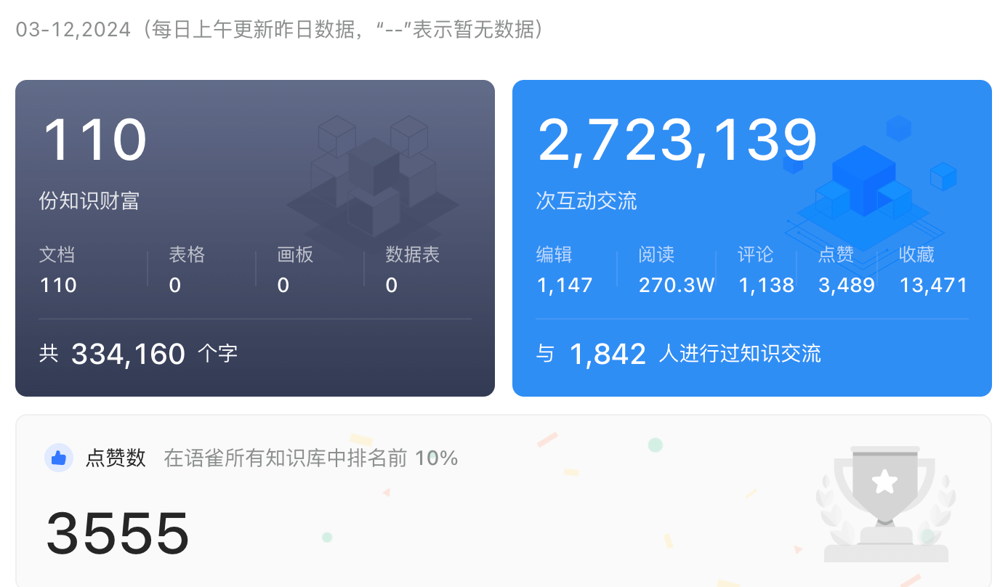
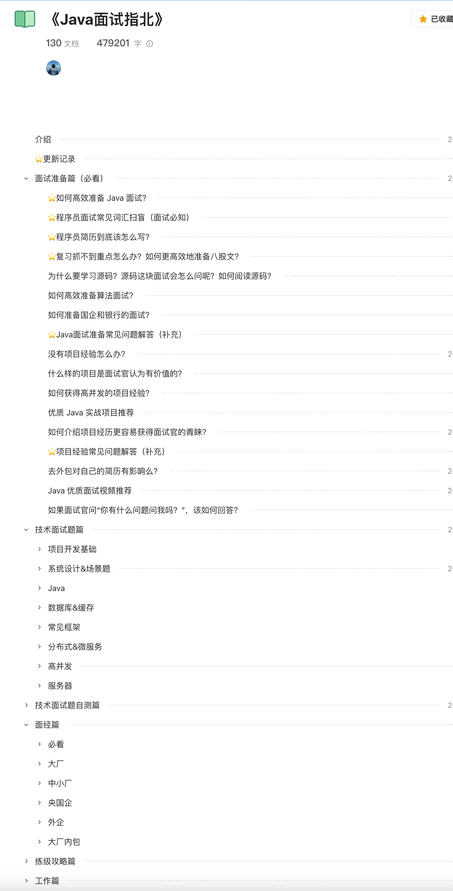
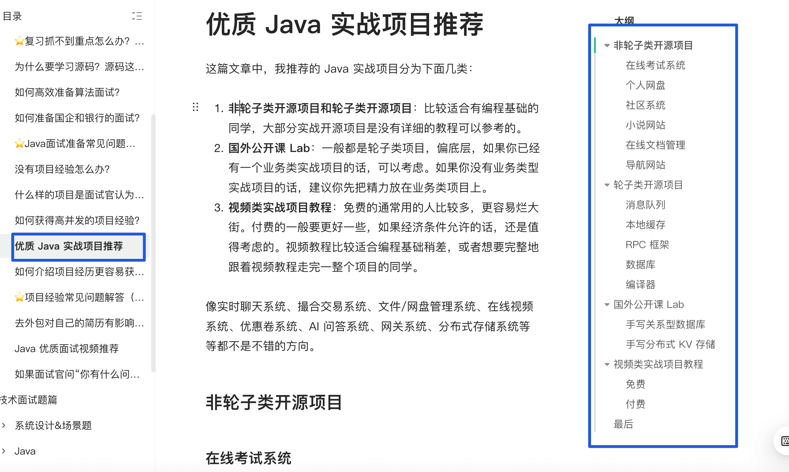
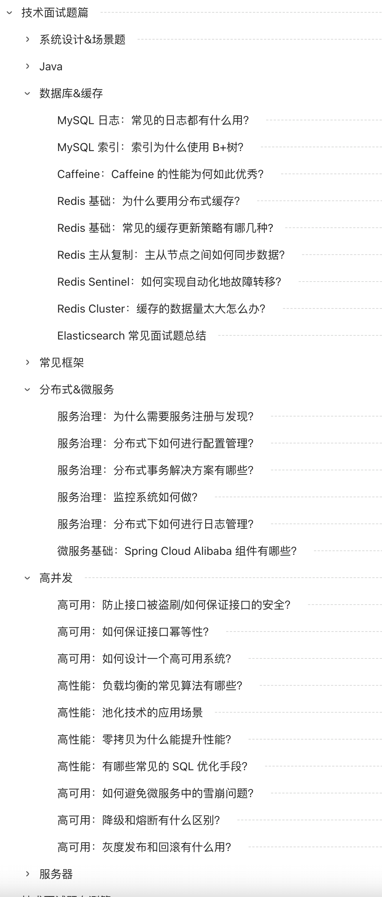
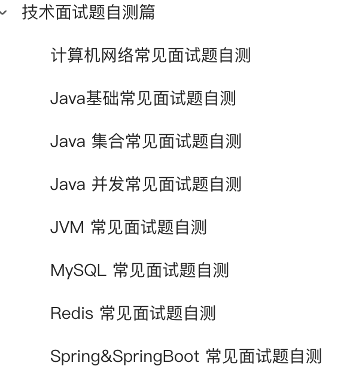
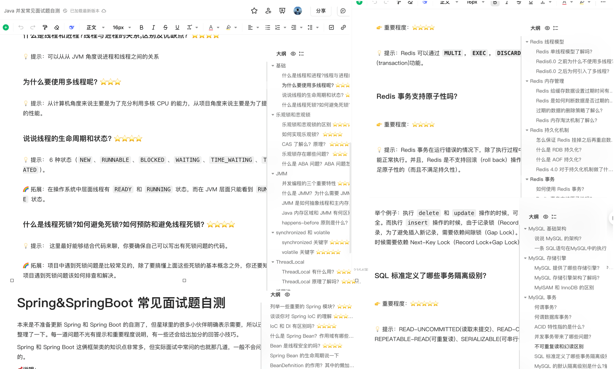
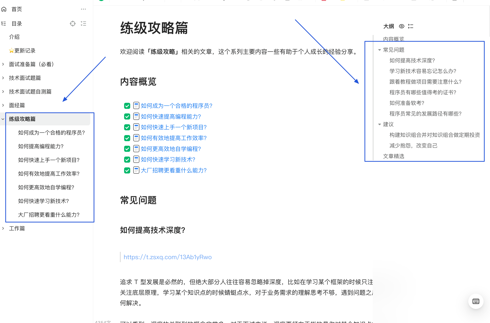
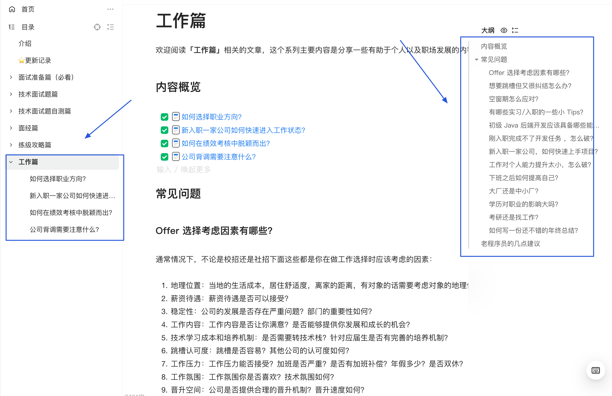

**Four years of work have gone into this Java interview guide.**

The Java Interview Guide is a resource for backend interviews. Its content has been revised repeatedly to help Java and backend candidates prepare for interviews.

**By the numbers:** The guide has received more than **4,771,000 reads**, **5,118 likes**, and **1,657 comments**. The comments are also a place to ask questions; I try to reply to nearly every one.

📅 **Growth over time:** The image below shows the guide's metrics in 2024. They have continued to grow since then, reflecting readers' interest.

## About the Guide

**The Java Interview Guide** is a private handbook in my [Knowledge Planet](../about-the-author/zhishixingqiu-two-years.md). It complements the [open-source edition of JavaGuide](https://javaguide.cn/). It adds, among other things:

- More than 17 articles on interview preparation and detailed answers to more than 50 common questions, to help you prepare efficiently.
- Broader interview coverage, including system design, scenario questions, common frameworks, distributed systems, microservices, and high concurrency.
- A curated selection of interview reports, with references to further reading.
- Technical interview self-tests to help identify gaps in your knowledge.
- Career-growth advice and lessons from experience.

The guide is revised each year to reflect interview trends. A single Knowledge Planet membership provides ongoing access, including future updates.

Here are some comments from Knowledge Planet members:

## What's Included

### Interview Preparation

The **interview preparation section** includes more than 17 articles and answers to more than 50 common questions. Topics include project experience, resumes, source-code study, algorithm preparation, and interview resources.

The **⭐ Java Interview Preparation FAQ (Supplement)** and **⭐ Project Experience FAQ (Supplement)** are useful starting points; both cover a lot of practical information.

For readers with limited project experience, I have also collected smaller but useful projects. They include video guides and open-source repositories, from complete business applications to technical libraries and frameworks.

### Technical Interview Questions

The **technical interview section** complements the open-source JavaGuide. In addition to Java and common frameworks, it covers advanced topics such as system design, distributed systems, and high concurrency.

### Interview Reports

As the saying goes, “Learn from others' successes and failures.” Reviewing other candidates' interview experiences can help you avoid common mistakes.

The **interview reports section** features detailed Java backend interviews for new-graduate and experienced-hire candidates, at large and small companies, state-owned enterprises, and multinational companies. It also includes interviews for in-house contractor roles at large companies.

**Why use these interview reports?**

Online interview reports can be plentiful and inconsistent. This collection focuses on selecting useful reports and explaining what readers can learn from them. Each report aims to:

- **Reflect real interviews:** Prioritize experiences that show actual interview scenarios, areas of focus, and interviewer reasoning.
- **Provide further study:** Where possible, link to in-depth references or provide sample answers for common and challenging questions, so readers can understand the reasoning behind them.

The [Knowledge Planet](https://javaguide.cn/about-the-author/zhishixingqiu-two-years.html) also has a section dedicated to interview reports and questions, which is updated over time.

### Technical Interview Self-Tests

The **technical interview self-test** series helps readers check their understanding. It covers many core Java backend topics and continues to be updated.

Each question includes **hints and an approach**. The ⭐ markers show priority: more stars mean a question is more likely to come up and deserves more preparation.

Self-testing is an effective way to find gaps and reinforce what you have learned.

### Career Growth

The **career growth section** shares advice and experience that can support professional development.

Readers have said they found the articles useful. Applying what you learn matters most.

### Work

The **work section** covers professional development and common workplace challenges.

<!-- @include: @planet2.snippet.md -->
