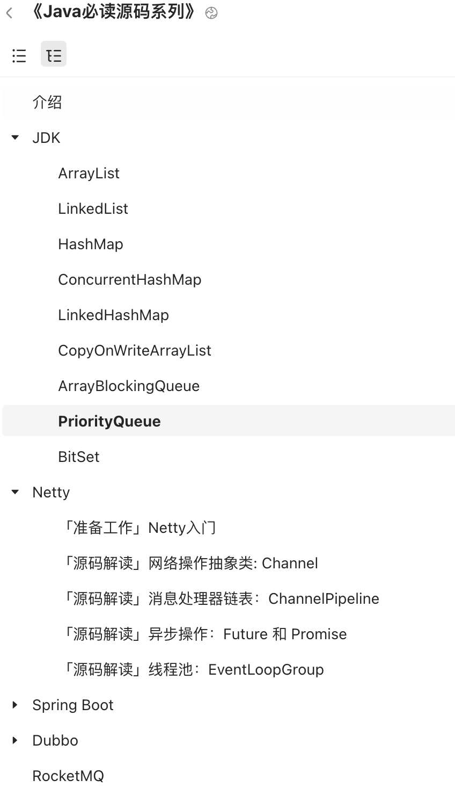
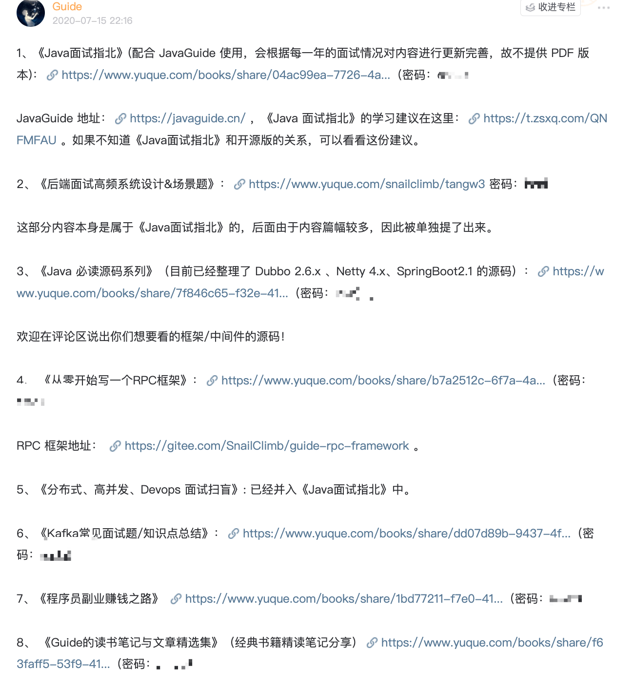

## Introduction

**The Java Source Code Reading Series** is an exclusive booklet in my [Knowledge Planet](../about-the-author/zhishixingqiu-two-years.md) community. It currently covers the source code of frameworks and middleware such as Dubbo 2.6.x, Netty 4.x, and Spring Boot 2.1. More worthwhile source code will be added over time.

The material is clearly structured and detailed, making it suitable for anyone who wants to study framework and middleware internals.

## Contents

<!-- @include: @planet2.snippet.md -->

## More Series

In addition to the Java Source Code Reading Series, my Knowledge Planet community has several other series, including [_Java Interview Handbook_](https://mp.weixin.qq.com/s?__biz=Mzg2OTA0Njk0OA==&mid=2247536358&idx=2&sn=a6098093107d596d3c426c9e71e871b8&chksm=cea1012df9d6883b95aab61fd815a238c703b2d4b36d78901553097a4939504e3e6d73f2b14b&token=710779655&lang=zh_CN#rd), [_High-Frequency System Design and Scenario Questions for Backend Interviews_](https://mp.weixin.qq.com/s?__biz=Mzg2OTA0Njk0OA==&mid=2247536451&idx=1&sn=5eae2525ac3d79591dd86c6051522c0b&chksm=cea10088f9d6899e0aee4146de162a6de6ece71ba4c80c23f04d12b1fd48c087a31bc7d413f4&token=710779655&lang=zh_CN#rd), and [_Build an RPC Framework from Scratch_](./handwritten-rpc-framework.md). All are available to members at no extra cost.

